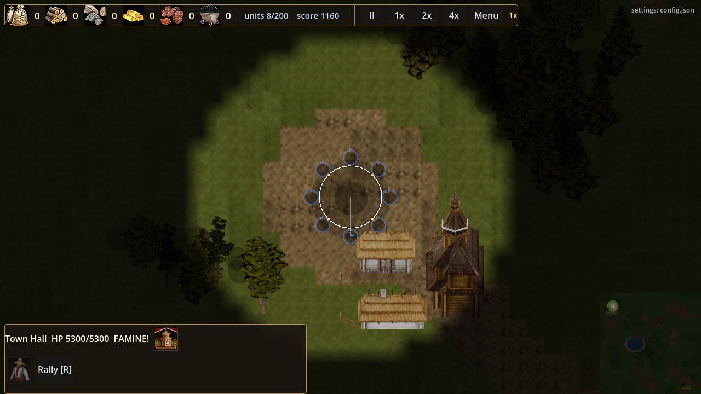
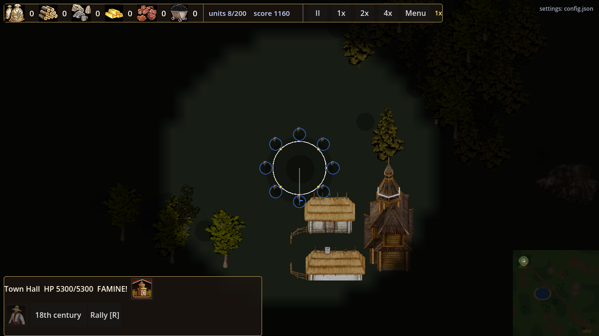

<div align="center">

# ⚔️ Cossacks 3 — Godot Singleplayer Port

**The legendary 17th–18th century RTS, rebuilt as a playable singleplayer skirmish in Godot 4 — with the original's own models, numbers and rules.**

*Mass armies · animated sprites baked from the original 3D meshes · 20 nations · formations, morale and volley fire*



</div>

---

## What this is

A faithful, playable port of **Cossacks 3 (GSC Game World)** singleplayer into **Godot 4.7**:
build your town, feed your peasants, raise line infantry, form them into
squares — then break the enemy line with cannon fire. The computer opponent
expands, masses troops, forms squads and attacks in waves.

Everything visual and numeric comes from the installed game itself
(`C:\Games\Cossacks 3`, yours — never redistributed): meshes, textures,
sounds, damage formulas, gathering rates, upkeep, formation sizes.

| | |
|---|---|
| 🎞️ **Animated original units** | 54 sprite sheets (8 directions × walk / idle / attack / death), skinned on CPU from the donor `.oss` skeletons, rendered with Blender CPU Cycles |
| 🏰 **20 nations, real architecture** | 215 nation building sheets — Ukrainian wooden towns, Russian red-brick, Ottoman domes — plus construction stages and rubble |
| 📏 **Donor-accurate sim** | Damage formula, 1.664/s mine income, /625 upkeep, famine, capture, market drift — 182 documented values in `app/mechanics.json` |
| 🎖️ **Line warfare** | 15–400-man formations with officers + drummers, +2/+3 bonuses (+9/+9 on hold), morale, routs, priests, 17c flee vs 18c bayonets |
| 🤖 **Computer opponent** | Expands, techs, forms squads, combined-arms waves; officer-led batteries |
| 🧪 **Never hangs, always tested** | 28-step sim self-test, 17-step UI user-journey test, AI-vs-AI CLI matches, frame-sequence capture → MP4 |



## Quick start

You need: **Godot 4.7**, **Blender 5.2** (CPU Cycles only — no GPU needed),
**Python 3.14 + Pillow**, the game installed at `C:\Games\Cossacks 3`, and
**ffmpeg** for videos.

```bat
cd app
godot --path .                                   :: play (skirmish by default)
godot --headless --path . -- --self-test report.json     :: 28-step sim test
godot --headless --path . -- --ui-test uitest.json       :: 17-step UI journey test
godot --headless --path . -- --cli cli.json --cli-seconds 60   :: fast AI vs AI
godot --path . -- --seq shots/j1 --seq-seconds 120 --seq-step 2 --speed 8 --config shots/boost.json --journey   :: record a match
python tools\seq_to_mp4.py --dir shots/j1 --fps 10        :: assemble journey.mp4
```

> The window stays behind other windows and exits by itself in every test
> mode. Headless runs use a CPU map render — they work on machines with no
> GPU at all. See **[COMMANDS.md](docs/COMMANDS.md)** for the full manual.

## Controls

| Input | Action |
|---|---|
| Left mouse (drag) | Select / box-select |
| Right mouse | Move · gather · attack · enter construction · repair (peasants on damaged own building) |
| A / S / C / G / Q | Attack-move / stand ground / stop standing / guard / patrol |
| D / E / V | Hold fire / feuer frei / engage · Space pauses |
| F · Shift+F | Form squad (F on its officer replenishes) · disband |
| J / K / L | Line / column / square · officer panel: 15–400 formation sizes |
| Delete | Delete own selection (deny capture) |
| Build menu | `C H B S L E O I M R T N W` (`2` = Barracks 18c, `3` = Diplomatic Center) |
| Economy | Mills research food, mines upgrade II→VII (up to 95 workers), market barter, academy 18th century at the Town Hall |

## Project map

```
app/
  scripts/      game sim (game.gd), mapgen (mapgen.gd), rendering (world.gd),
                HUD, input, AI, menu, selftest.gd (28 sim steps),
                uitest.gd (17 UI steps)
  assets/models/anim/   baked sheets: 54 units + 215 nation buildings (+stages/rubble)
  assets/models/{obj,tex}/ converted donor meshes (tools/convert_models.py)
  tools/        bake_sprites.py (Blender/Workbench baker), compute_ortho.py,
                sheet_metrics.py, scan_map.py, copy/convert/extract,
                seq_to_mp4.py (video assembly), video_build.py / record_session.py
  shots/        screenshots, sequences, test configs (boost.json)
  mechanics.json / MECHANICS.md   every gameplay number + its source
  config.json / selftest.json / uitest.json / cli.json   settings + reports
docs/
  COMMANDS.md             full manual: flags, tools, when/why, troubleshooting
  UNIT_BAKING_FIX.md      unit sprite baking: donor .oss format, the bugs + fixes,
                          frame-by-frame peasant verification (2026-11-20)
  guides/
    GUIDE1.md             round-1 execution plan (superseded by GUIDE2)
    GUIDE2.md             round-2 guide S1-S10, all completed
    GUIDE3.md             round-3 G1-G16: fidelity, UI, sprites, AI, weak-GPU perf — done
    GUIDE4.md             round-4 L1-L8: landscape, clusters, height, stumps, anims,
                          building ghost — implemented; verification pass in progress
reference/videos.md  17 gameplay videos + wiki mechanics research
inbox/backup/  safety copies of every edited script
```

## Docs — where to go next

- 🎮 **Playing & testing everything** → [COMMANDS.md](docs/COMMANDS.md) — every
  Godot flag, every Python tool (incl. `video_build.py` / `record_session.py` fidelity
  capture), when to use which, troubleshooting, acceptance gates
- 🔨 **How it was built, step by step** → [GUIDE3.md](docs/guides/GUIDE3.md)
  (round 3, G1–G16: fidelity, UI logic, sprite correctness, AI, speed on weak GPUs —
  all done) and [GUIDE4.md](docs/guides/GUIDE4.md) (round 4, L1–L8: landscape,
  resource clusters, height, stumps, correct anim cycles, transparent building ghost
  — implemented; verification pass in progress). Earlier rounds: [GUIDE2.md](docs/guides/GUIDE2.md) (S1–S10),
  [GUIDE1.md](docs/guides/GUIDE1.md) (round 1)
- 🎞️ **How unit sprites are baked** → [UNIT_BAKING_FIX.md](docs/UNIT_BAKING_FIX.md) —
  the definitive 2026-11-20 fix: donor `.oss`/`.aaf` format, the 5 documented bugs
  (transposed rotations, de-travel pin, per-action camera, clipped diagonal views,
  missing attach props) and the frame-by-frame peasant check rolled out to all 54
  unit keys; dedicated work/gather clips now play instead of the combat attack
- 📏 **Every number + its source** → [app/MECHANICS.md](app/MECHANICS.md),
  [app/mechanics.json](app/mechanics.json)
- 🎬 **What "correct" looks like** → [reference/videos.md](reference/videos.md)
  (17 YouTube gameplay videos + wiki rules), `app/shots/` captures
- ⚖️ **License / credits** → [app/CREDITS.md](app/CREDITS.md) — donor files
  used; **for private use by the game owner only, never redistribute**

---

<div align="center">

*Built with Godot 4 · Blender Cycles · Pillow · ffmpeg — no GPU required.*

</div>
