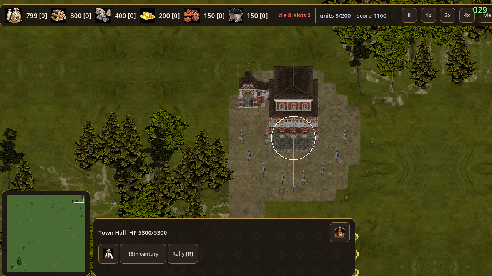

<div align="center">

# ⚔️ Cossacks 3 — Godot Singleplayer Port

**The legendary 17th–18th century RTS, rebuilt as a playable singleplayer skirmish in Godot 4 — with the original's own models, numbers and rules.**

*Two render modes: a stable **2D sprite port** (`app/`) and a separate **real 3D variant** (`variant3d/`)*

*Mass armies · animated sprites baked from the original 3D meshes · real donor meshes + tile-index terrain in 3D · 20 nations · formations, morale and volley fire*



</div>

---

## At a glance

| | | | |
|:---:|:---:|:---:|:---:|
| 🎮 **Godot 4.7** | 🌍 **20 nations** | 🎞️ **54 unit sheets** | 🏛️ **215 building sheets** |
| 📏 **182 documented values** | 🧪 **29-step sim test** | 🧭 **17-step UI test** | 🖥️ **2D mode: no GPU required** |
| 🧊 **3D mode: real meshes** | 🗺️ **Tile-index terrain (donor-style)** | 💧 **Donor water shader** | 🎨 **13 donor player colours** |

## What this is

A faithful, playable port of **Cossacks 3 (GSC Game World)** singleplayer into **Godot 4.7**:
build your town, feed your peasants, raise line infantry, form them into
squares — then break the enemy line with cannon fire. The computer opponent
expands, masses troops, forms squads and attacks in waves.

Everything visual and numeric comes from the installed game itself
(`C:\Games\Cossacks 3`, yours — never redistributed): meshes, textures,
sounds, damage formulas, gathering rates, upkeep, formation sizes.

## Feature highlights

| | |
|---|---|
| 🎞️ **Animated original units** | 54 sprite sheets (8 directions × walk / idle / attack / death), skinned on CPU from the donor `.oss` skeletons, rendered with Blender CPU Cycles |
| 🏰 **20 nations, real architecture** | 215 nation building sheets — Ukrainian wooden towns, Russian red-brick, Ottoman domes — plus construction stages and rubble |
| 📏 **Donor-accurate sim** | Damage formula, 1.664/s mine income, /625 upkeep, famine, capture, market drift — 182 documented values in `app/mechanics.json` |
| 🎖️ **Line warfare** | 15–400-man formations with officers + drummers, +2/+3 bonuses (+9/+9 on hold), morale, routs, priests, 17c flee vs 18c bayonets |
| 🤖 **Computer opponent** | Expands, techs, forms squads, combined-arms waves; officer-led batteries |
| 🧪 **Never hangs, always tested** | 28-step sim self-test, 17-step UI user-journey test, AI-vs-AI CLI matches, frame-sequence capture → MP4 |

*In-game skirmish — original nation architecture, animated units and the full HUD intact.*


## Quick start

You need: **Godot 4.7**, **Blender 5.2** (CPU Cycles only — no GPU needed),
**Python 3.14 + Pillow**, the game installed at `C:\Games\Cossacks 3`, and
**ffmpeg** for videos.

For a quick play, just double-click **`launch.bat`** (2D) or
**`launch_variant3d.bat`** (3D). Everything below is the manual/CLI form.
See [Two main modes](#two-main-modes--2d-and-3d) for the differences.

```bat
cd app
godot --path .                                   :: play (skirmish by default)
godot --headless --path . -- --self-test report.json     :: 28-step sim test
godot --headless --path . -- --ui-test uitest.json       :: 17-step UI journey test
godot --headless --path . -- --cli cli.json --cli-seconds 60   :: fast AI vs AI
godot --path . -- --seq shots/j1 --seq-seconds 120 --seq-step 2 --speed 8 --config shots/boost.json --journey   :: record a match
python tools\seq_to_mp4.py --dir shots/j1 --fps 10        :: assemble journey.mp4
```

> The window stays behind other windows and exits by itself in every test
> mode. Headless runs use a CPU map render — they work on machines with no
> GPU at all. See **[COMMANDS.md](docs/COMMANDS.md)** for the full manual.

## Two main modes — 2D and 3D

The repository contains **two separate Godot projects** with the same skirmish
simulation. Pick the launcher, not a command-line flag:

| Mode | Launch | Project | What you see | Status |
|---|---|---|---|---|
| **2D (default, shipping)** | `launch.bat` | `app/` | Baked original sprite sheets, CPU-rendered map, no GPU needed | Stable — final gate green (29/29 sim, 17/17 UI) |
| **3D variant** | `launch_variant3d.bat` (or `launch_3d.bat`, a shim) | `variant3d/` | Real donor-derived OBJ meshes, perspective camera, tile-index terrain, donor water shader, WorldEnvironment sun | Functional — final gate green; **visual parity vs donor UNVERIFIED** |

Both launchers resolve Godot from PATH, then the WinGet link, then
`Program Files`, and forward extra arguments to Godot. **Do not use the old
`app/` terrain sandbox** — it is a legacy visual fail.

### Switching modes inside the 3D project

The renderer is a **port extension**, not a donor setting:

- `variant3d/config.json` → `gameplay.render_mode`: `"3d"` by default.
  Set it to `"2d"` to view the copied 2D renderer inside the variant project.
- `app/config.json` has no such key; `app/` is always 2D and stays untouched.

### 3D terrain atlas modes

The 3D variant ships a 124-cell donor tile atlas. `atlas_mode` defaults to
`"single"` (the original 16,384×8,192 PNG, loaded directly). The loader falls
back automatically `single → split → array` with a warning if that file is
missing, so a clone without it still runs.

| Mode | Source | Notes |
|---|---|---|
| `single` (default) | `variant3d/assets/terrain/atlas/tile_index_atlas.png` | 179,912,941 B. **Exceeds GitHub's ~100 MB per-file limit — leave uncommitted or use Git LFS.** |
| `split` | `variant3d/assets/terrain/atlas_parts/*.part000/001` + SHA-256 manifest | Two ≤90 MB parts reassembled into `user://` at runtime; no write into `res://`. |
| `array` | the 112 already-shipped donor block PNGs | Builds a 121-layer `Texture2DArray` in memory; no duplicate atlas file. |

Select a mode with the ProjectSettings key `terrain/tile_atlas_mode`
(`single`/`split`/`array`) or by calling `world.set_atlas_mode(...)` in code.
The mode actually used (including auto-fallback) is reported in
`world.stats["atlas_mode"]`.

### Running the gates

```bat
:: 2D shipping gate
python app\tools\godot_runner.py run --id gate2d-selftest --timeout 300 -- --headless --path app -- --self-test app/selftest.json
python app\tools\godot_runner.py run --id gate2d-uitest  --timeout 240 -- --headless --path app -- --ui-test app/uitest.json
python app\tools\assert_clean.py --json

:: 3D variant gate (separate runner / spool)
python variant3d\tools\godot_runner.py run --id gate3d-selftest --timeout 300 -- --headless --path variant3d -- --self-test variant3d/selftest.json
python variant3d\tools\godot_runner.py run --id gate3d-uitest  --timeout 300 -- --headless --path variant3d -- --ui-test variant3d/uitest.json
python variant3d\tools\godot_runner.py run --id gate3d-render-mode --timeout 120 -- --headless --path variant3d --script res://tests/t_render_mode.gd
```

Never run two Godot launches at once on the same runner — concurrent headless
jobs cause timeouts and false red results.

## Controls

| Input | Action |
|---|---|
| Left mouse (drag) | Select / box-select |
| Right mouse | Move · gather · attack · enter construction · repair (peasants on damaged own building) |
| A / S / C / G / Q | Attack-move / stand ground / stop standing / guard / patrol |
| D / E / V | Hold fire / feuer frei / engage · Space pauses |
| F · Shift+F | Form squad (F on its officer replenishes) · disband |
| J / K / L | Line / column / square · officer panel: 15–400 formation sizes |
| Delete | Delete own selection (deny capture) |
| Build menu | `C H B S L E O I M R T N W` (`2` = Barracks 18c, `3` = Diplomatic Center) |
| Economy | Mills research food, mines upgrade II→VII (up to 95 workers), market barter, academy 18th century at the Town Hall |

## Project map

```
app/                     2D SHIPPING PORT (launch.bat)
  scripts/      game sim (game.gd), mapgen (mapgen.gd), rendering (world.gd),
                HUD, input, AI, menu, selftest.gd (29 sim steps),
                uitest.gd (17 UI steps)
  assets/models/anim/   baked sheets: 54 units + 215 nation buildings (+stages/rubble)
  assets/models/{obj,tex}/ converted donor meshes (tools/convert_models.py)
  tools/        bake_sprites.py (Blender/Workbench baker), compute_ortho.py,
                sheet_metrics.py, scan_map.py, copy/convert/extract,
                seq_to_mp4.py (video assembly), video_build.py / record_session.py
  shots/        screenshots, sequences, test configs (boost.json)
  mechanics.json / MECHANICS.md   every gameplay number + its source
  config.json / selftest.json / uitest.json / cli.json   settings + reports
variant3d/                3D VARIANT (launch_variant3d.bat)
  project.godot / config.json   render_mode="3d", 320x320 map
  scripts/      main.gd seam + world3d.gd composition; camera3d, picking3d,
                world3d_{terrain,entities,fx,fog}, hud3d_adapter, anim3d,
                water3d, tile_atlas_loader
  shaders/      terrain_tileindex.gdshader (donor eye-plane UV + face tiles),
                water3d.gdshader (donor water.dev.frag translation)
  assets/terrain/atlas/       full single PNG (keep uncommitted / LFS)
  assets/terrain/atlas_parts/ split parts + SHA-256 manifest (GitHub-safe)
  assets/models/skin/         55 donor-sampled skins (flat-root morph)
  tools/        godot_runner.py (own FIFO), convert_models.py, convert_skins.py,
                build_tile_index_atlas.py, pack_tile_atlas_split.py,
                import_donor_map.py
  tests/        24 inherited + 7 atomic 3D tests; own selftest/uitest reports
docs/
  COMMANDS.md             full manual: flags, tools, when/why, troubleshooting
  UNIT_BAKING_FIX.md      unit sprite baking: donor .oss format, the bugs + fixes,
                          frame-by-frame peasant verification (2026-11-20)
  guides/
    GUIDE1.md             round-1 execution plan (superseded by GUIDE2)
    GUIDE2.md             round-2 guide S1-S10, all completed
    GUIDE3.md             round-3 G1-G16: fidelity, UI, sprites, AI, weak-GPU perf — done
    GUIDE4.md             round-4 L1-L8: landscape, clusters, height, stumps, anims,
                          building ghost — implemented; verification pass in progress
reference/videos.md  17 gameplay videos + wiki mechanics research
inbox/backup/  safety copies of every edited script
```

## Docs — where to go next

- 🎮 **Playing & testing everything** → [COMMANDS.md](docs/COMMANDS.md) — every
  Godot flag, every Python tool (incl. `video_build.py` / `record_session.py` fidelity
  capture), when to use which, troubleshooting, acceptance gates
- 🔨 **How it was built, step by step** → [GUIDE3.md](docs/guides/GUIDE3.md)
  (round 3, G1–G16: fidelity, UI logic, sprite correctness, AI, speed on weak GPUs —
  all done) and [GUIDE4.md](docs/guides/GUIDE4.md) (round 4, L1–L8: landscape,
  resource clusters, height, stumps, correct anim cycles, transparent building ghost
  — implemented; verification pass in progress). Earlier rounds: [GUIDE2.md](docs/guides/GUIDE2.md) (S1–S10),
  [GUIDE1.md](docs/guides/GUIDE1.md) (round 1)
- 🎞️ **How unit sprites are baked** → [UNIT_BAKING_FIX.md](docs/UNIT_BAKING_FIX.md) —
  the definitive 2026-11-20 fix: donor `.oss`/`.aaf` format, the 5 documented bugs
  (transposed rotations, de-travel pin, per-action camera, clipped diagonal views,
  missing attach props) and the frame-by-frame peasant check rolled out to all 54
  unit keys; dedicated work/gather clips now play instead of the combat attack
- 📏 **Every number + its source** → [app/MECHANICS.md](app/MECHANICS.md),
  [app/mechanics.json](app/mechanics.json)
- 🧊 **3D variant status, audit and donor research** →
  [STATUS_WAVE7_PHASE2.md](docs/variant3d/STATUS_WAVE7_PHASE2.md) (verified vs
  UNVERIFIED), [AUDIT3D_TRIAGE.md](docs/coord_swarm_2026-11-24/AUDIT3D_TRIAGE.md),
  [TERRAIN2_CHARTER.md](docs/coord_swarm_2026-11-24/TERRAIN2_CHARTER.md) and
  [DEEPDEC_CHARTER.md](docs/coord_swarm_2026-11-24/DEEPDEC_CHARTER.md) with the
  per-subsystem decompilation reports under `docs/coord_swarm_2026-11-24/reports/`
- 🎬 **What "correct" looks like** → [reference/videos.md](reference/videos.md)
  (17 YouTube gameplay videos + wiki rules), `app/shots/` captures
- ⚖️ **License / credits** → [app/CREDITS.md](app/CREDITS.md) — donor files
  used; **for private use by the game owner only, never redistribute**

---

> ⚖️ **License & use:** This build contains original-game donor files and is
> **for private use by the game owner only, on their own machine — never share,
> publish or redistribute it.** See [app/CREDITS.md](app/CREDITS.md) for what is
> original and what is a placeholder. Donor code was only ever read as text;
> donor binaries were never copied or executed.

<div align="center">

*2D mode: Godot 4 · Blender Cycles · Pillow · ffmpeg — no GPU required.*
*3D mode: Godot 4 with OpenGL 3.3; real meshes, donor-style terrain and water.*
*3D visual parity against the donor is NOT claimed — see the status doc.*

</div>
