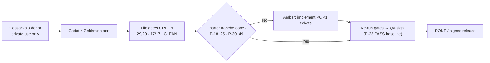
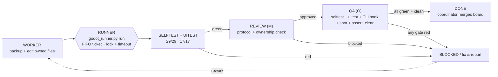
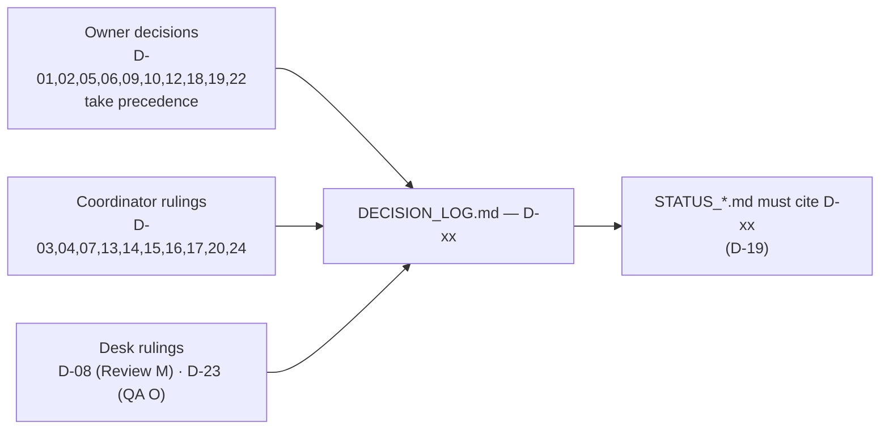

# ⚔️ RESUME — cold-start master index

> [!IMPORTANT]
> **Start here.** This is THE entry point for a human or a fresh agent with zero
> context. Read this one file, follow the links, and you can resume work in under
> five minutes. It does not re-derive facts — it cites `SWARM_OPS.md`,
> `SWARM_BOARD.md`, `docs/DECISION_LOG.md`, the `STATUS_*` docs, runner results and
> evidence ids. This is a documentation-only file: no Godot run and no code edit
> was made to produce it (`SWARM_OPS.md` §5c).


---

## 1. 🎯 TL;DR

This is a faithful singleplayer **random-skirmish** port of **Cossacks 3** (GSC
Game World) into **Godot 4.7**, built from the installed donor game's own meshes,
sprites, sounds and numbers (`C:\Games\Cossacks 3`, **private use only — never
redistributed**). The simulation, asset pipeline and round-4 landscape ladder
(L1–L8) are implemented and the file-level gates are green: **selftest 29/29,
uitest 17/17, clean-exit gate CLEAN** (`app/selftest.json`, `app/uitest.json`,
`QA_REPORT.md`, `app/tools/CLEAN_GATE.md`).

The **owner's charter (D-12)** is skirmish-first: true seed variety, multiple AI
opponents / teams on one map, donor-equivalent-or-better roster, maximum graphics
fidelity, and mass-army performance. Missions, campaigns, DLC maps, cutscenes and
network are **deferred** (`SWARM_OPS.md` §0).

> [!WARNING]
> **A signed gate does NOT mean the charter is delivered.** All four release
> gates are **PASS** — fresh O5 jobs #149–152, clean gate CLEAN, 0 orphans
> (`QA_REPORT.md` "FINAL VERDICT — O5"; **D-23**). The charter tranche
> (`SWARM_BOARD.md` P-18…P-25, P-30…P-49) is still open, so overall status is
> `amber`, not `green` (`docs/STATUS_SKIRMISH.md` §10). The working map size is
> **320 tiles** (**D-24**; `docs/audit/GEN.md`), not the old 160-tile baseline.



---

## 2. 📊 Quick facts

| Fact | Value | Evidence |
|---|---|---|
| Sim self-test | `29/29 PASS` (`"passed": true`) | `app/selftest.json`; `docs/STATUS_SKIRMISH.md` §2; `QA_REPORT.md` |
| UI journey test | `17/17 PASS` | `app/uitest.json`; `docs/STATUS_SKIRMISH.md` §2 |
| Clean-exit gate | `CLEAN` (exit `0`, no orphans, no stale lock) | `python app\tools\assert_clean.py --json`; `app/tools/CLEAN_GATE.md` §Exit codes |
| QA release gate | `PASS` — fresh O5 jobs #149–152, all `ok` | `QA_REPORT.md` "FINAL VERDICT — O5"; **D-23** |
| Working map size | `320 × 320` tiles (not 160) | `config.gd:46-47`, `game.gd:213-214`; **D-24**; `docs/audit/GEN.md` |
| Per-feature tests | `8 green / 6 red / 1 pending (08:55 snapshot; live churn)` of 15 (14 JSONs; `t_weather` none) | `app/tests/results/*.json`; `docs/reviews/REV_TESTS.md` |
| Nations in `NATIONS` | `20` (no `sco` yet) | `docs/research/RA_ROSTER.md` §4; `app/scripts/data.gd` |
| Unit sprite keys | `54` (≈299 actions) | `docs/research/RA_ROSTER.md` §4; `ASSET_AUDIT.md` (repo root) |
| Donor mechanics fully implemented | `28 / 57` | `docs/research/RB_MECHANICS.md` §2 |
| Building sprite keys | `1506` (215 nation sheets) | `docs/research/RA_ROSTER.md` §4 |
| Open board tickets | **~60** open of 72 rows (≈20 live, rest INTAKE/BLOCKED; ~12 closed/deferred/done) | `SWARM_BOARD.md` |
| Research backlog estimate | **~166** deduped working figure (upper bound ~195) | `docs/research/FORECAST.md` §0–§1 |
| Capacity | roster 1000 · WIP limit 20 · currently 20 live workers | `SWARM_OPS.md` §5; `SWARM_BOARD.md` |
| Godot queue | FIFO single door — `godot_runner.py` | `SWARM_OPS.md` §3.1; `app/tools/AGENT_PROTOCOL.md` §1 |

> [!NOTE]
> Older docs (`AGENT_PROTOCOL.md` §2, `SWARM_OPS.md` §3.4) still say **28/28** and
> the board still marks `P-04 farm_cap` BLOCKED, but current results are **29/29**
> and the release gate is **PASS** (D-21 gate-prose reconciliation; **D-23**).
> Trust `app/selftest.json` and `QA_REPORT.md` O5, not the stale prose. The 160×160
> map-size note is likewise stale: 320 is the working size (**D-24**).

---

## 3. 🐝 Swarm org — who owns what

Full live state, ownership and ticket ids: **[SWARM_BOARD.md](../SWARM_BOARD.md)**.
Roles, gates and capacity policy: **[SWARM_OPS.md](../SWARM_OPS.md)** §1, §5.

```mermaid
flowchart TB
  COORD["COORDINATOR (primary agent)<br/>intake · assignment · ownership arbitration · final merge"]
  COORD --> B["BUILDERS A–L<br/>assigned tickets, owned files only"]
  COORD --> N["N — feature triage<br/>tickets + acceptance criteria"]
  COORD --> M["M — REVIEW (read-only)<br/>blocks merge on protocol breach"]
  COORD --> QA["O — QA / release gate<br/>runs full suite, signs release"]
  COORD --> REV["REV-1..3 — test/doc review (read-only)"]
  COORD --> IMP["IMP-1..3 — improvers (no edits unless granted)"]
  M --> COMPL["Compliance (folded into M)<br/>private-use licence · no direct godot calls"]

  B --> RUNNER{{"godot_runner.py — FIFO lock<br/>ONE Godot at a time"}}
  QA --> RUNNER
  RUNNER --> GODOT[("Godot 4.7")]

  COORD -.parallel lanes, no runner cost.--> DC["DECOMP DA–DE<br/>docs/decomp/*"]
  COORD -.parallel lanes, no runner cost.--> RS["RESEARCH RA–RE<br/>docs/research/*"]
  COORD -.parallel lanes, no runner cost.--> DOC["DOCUMENTERS DOC-1..<br/>docs/STATUS_*.md + RESUME.md"]
```

| Lane | Workers | May edit | Godot runner? |
|---|---|---|---|
| Coordination | primary agent | board state, arbitration, merge | via runner only |
| Build | A–L | **only** files named in their ticket | via `godot_runner.py` only |
| Review | M (+ REV-1…3) | nothing (read-only gate, can BLOCK) | no |
| Improvers | IMP-1…3 | nothing unless granted | no |
| Triage | N | `SWARM_BACKLOG.md` | no |
| QA / release | O | `QA_REPORT.md` | via runner only (owns final suite) |
| Decompilation | DA–DE | their own `docs/decomp/*.md` | no — read-only Craft Anything on donor |
| Research | RA–RE | their own `docs/research/*.md` | no — web search/fetch only |
| Documentation | DOC-1… | their assigned `docs/STATUS_*.md` | no |

> [!WARNING]
> A file belongs to exactly **one** active ticket (`SWARM_OPS.md` §3.2).
> Contested files — `data.gd` (A vs AC), `world.gd` (D vs AB), `hud.gd`
> (D vs SC), `main.gd` (B) — need coordinator arbitration before any P0 work
> starts. Cross-file edits are a REVIEW BLOCK (`D-04`).

---

## 4. 🚦 Gate flow — worker → runner → Review → QA → DONE

Every Godot launch goes through the serialized runner. Review and QA are separate
desks so nobody reviews their own work (`SWARM_OPS.md` §6). The full ticket
lifecycle is `INTAKE → TRIAGED → ASSIGNED → IN_PROGRESS → REVIEW → QA → DONE`,
with any stage able to fall to `BLOCKED` (`SWARM_OPS.md` §2).



### Exact commands at each step

```bat
:: 0 — before anything: queue telemetry (D-16, AGENT_PROTOCOL §1b)
python app\tools\godot_runner.py status

:: 1 — back up every file you own before editing (D-04)
copy app\scripts\<file>.gd inbox\backup\<file>.gd.bak-<your-id>

:: 2 — worker acceptance: every Godot run through the runner, unique job id
python app\tools\godot_runner.py run --id <worker>-selftest --timeout 180 -- --headless --path app -- --self-test app/selftest.json
python app\tools\godot_runner.py run --id <worker>-uitest  --timeout 180 -- --headless --path app -- --ui-test app/uitest.json

:: 3 — small-test registry (routes through the runner itself)
python app\tools\test_all.py --only <test-ids>

:: 4 — REVIEW desk M reads the diff (read-only, may BLOCK)

:: 5 — QA desk O owns the final full suite
python app\tools\godot_runner.py run --id agentO-cli  --timeout 180 -- --headless --path app -- --cli app/cli.json --cli-seconds 60
python app\tools\godot_runner.py run --id agentO-shot --timeout 90  -- --path app -- --screenshot app/shots/g4_qa_gate.png --timeout 60
python app\tools\assert_clean.py --json

:: 6 — DONE: report to coordinator; ONLY the coordinator edits board State
```

> [!TIP]
> A FIFO queue wait of **100–400 s is not a hang** — give runner calls a tool
> timeout ≥ `300000 ms`, check `status` for `pending`/`now_serving`, and never
> re-submit a job just because it is slow (`app/tools/AGENT_PROTOCOL.md` §1b,
> `D-16`). Only `timed-out` / `error` / `skipped` results are problems. To clear a
> real orphan: `python app\tools\godot_runner.py doctor`.

---

## 5. 📚 Index of all docs

### Master & governance

| Doc | What it is |
|---|---|
| **[SWARM_OPS.md](../SWARM_OPS.md)** | Org, charter (§0), ticket lifecycle, non-negotiable gates, capacity |
| **[SWARM_BOARD.md](../SWARM_BOARD.md)** | Live ticket state, ownership, WIP slots, queue telemetry |
| **[DECISION_LOG.md](DECISION_LOG.md)** | D-xx audit trail — who decided what, when, why (D-19) |
| **[STATUS_TEMPLATE.md](STATUS_TEMPLATE.md)** | Required format for every `STATUS_<AREA>.md` (D-18) |
| **[COMMANDS.md](COMMANDS.md)** | Full manual: every Godot flag, Python tool, troubleshooting |

### Area status docs (start here for a specific lane)

| Doc | Area | Owner |
|---|---|---|
| **[STATUS_SKIRMISH.md](STATUS_SKIRMISH.md)** | Core sim, landscape L1–L8, charter tranche | DOC-1 |
| **[STATUS_GRAPHICS.md](STATUS_GRAPHICS.md)** | Sprites, terrain, FX, visual fidelity | DOC-2 |
| **[STATUS_AI.md](STATUS_AI.md)** | AI, squads, teams, multiple enemies; deep-CONFIG ignored-teams finding | DOC-3 |
| **[STATUS_TESTS.md](STATUS_TESTS.md)** | Runner / test infrastructure; 8 green / 6 red / 1 pending (08:55 snapshot; live churn); gate PASS (D-23) | DOC-4 |
| **[STATUS_DECOMP.md](STATUS_DECOMP.md)** | Decompilation lane findings; deep-DECOMP corrections (P-37/P-38) | DOC-5 |

> [!NOTE]
> All five area docs have landed. Their source material is in
> `app/tests/README.md`, `app/tests/manifest.json`, `app/tests/results/*.json`
> and `docs/decomp/*.md`. Independent D-22 audits live under `docs/audit/`.

### Research lane — `docs/research/`

| Doc | Scope |
|---|---|
| **[FORECAST.md](research/FORECAST.md)** | Aggregated gap forecast, charter re-scope, ~166-ticket research estimate, current board criticalities, capacity model |
| **[RA_ROSTER.md](research/RA_ROSTER.md)** | Nations / units / buildings / upgrades vs port — 40 tickets |
| **[RB_MECHANICS.md](research/RB_MECHANICS.md)** | 57-row mechanics checklist (28 implemented) — 22 tickets |
| **[RC_TERRAIN.md](research/RC_TERRAIN.md)** | Map / terrain / generator / editor — 56 tickets |
| **[RD_DLC.md](research/RD_DLC.md)** | DLC / seasonal packs / mission files — 24–31 tickets (deferred) |
| **[RE_VISUAL.md](research/RE_VISUAL.md)** | 10 visual categories vs footage — 36 tickets |

### Decompilation lane — `docs/decomp/`

| Doc | Scope |
|---|---|
| **[DA_PE.md](decomp/DA_PE.md)** | Packed EXEs, RTTI class names, `.aix` editor markers |
| **[DB_SCRIPTS.md](decomp/DB_SCRIPTS.md)** | `formations.cfg`, reseeding, `hotkeys.cfg`, `envscales.cfg` → board P-30…P-33 |
| **[DC_FORMATS.md](decomp/DC_FORMATS.md)** | OSS/OSM/AAF layouts decoded; `.osm` reader bug refuted (`fnd_7`) |
| **[DD_MAPS.md](decomp/DD_MAPS.md)** | `.aix` portable UTF-8 triggers; `.map` numeric grid closed |
| **[DE_AUDIO_UI.md](decomp/DE_AUDIO_UI.md)** | 20 nation tracks, `chop` sound, hotkeys → board P-12/P-13 |

### Other evidence docs

`[UNIT_BAKING_FIX.md](UNIT_BAKING_FIX.md)` ·
`[TERRAIN_GEN_RESEARCH.md](TERRAIN_GEN_RESEARCH.md)` ·
`[CONSISTENCY_AUDIT.md](CONSISTENCY_AUDIT.md)` ·
`[DLC_INVENTORY.md](DLC_INVENTORY.md)` ·
`[GUIDE1–4.md](guides/GUIDE4.md)` (round plans; GUIDE4 L1–L8 current) ·
root `QA_REPORT.md`, `REVIEW_REPORT.md`, `NAVAL_EVIDENCE.md`, `WAIVERS.md`,
`ASSET_AUDIT.md`, `app/tests/README.md`, `app/scripts/MAPGEN_STATUS.md`,
`app/shots/perf.md`.

<details>
<summary>Where runner results and backups live (click to expand)</summary>

- Runner job results: `app/.godot_queue/results/<ticket>_<id>/stdout.txt`, `stderr.txt`, `<ticket>.json`.
- Queue state: `python app\tools\godot_runner.py status` (`now_serving`, `pending`, lock, `max wait`).
- Small-test results: `app/tests/results/*.json` (14 present: 8 green / 6 red / 1 pending (08:55 snapshot; live churn)). The aggregate `summary.json` is **generated at runtime** by `test_all.py`, not committed; registry `app/tests/manifest.json`.
- Backups: `inbox/backup/<name>.bak-<worker-id>` — a missing backup blocks REVIEW→QA (D-04).
- Craft Anything evidence ids (`ev_…`, `fnd_…`) live in `docs/decomp/*.md` and `investigation.cany/investigation/*`.

</details>

---

## 6. ⌨️ First 10 commands to run (copy-paste)

Run from the **project root**, with a generous tool timeout (≥ `300000 ms`). Use
**your own unique job id prefix** in place of `resume-` when you become a worker.

```bat
python app\tools\godot_runner.py status
python app\tools\assert_clean.py
python app\tools\assert_clean.py --json
python app\tools\godot_runner.py run --id resume-selftest --timeout 180 -- --headless --path app -- --self-test app/selftest.json
python app\tools\godot_runner.py run --id resume-uitest --timeout 180 -- --headless --path app -- --ui-test app/uitest.json
python app\tools\godot_runner.py run --id resume-cli --timeout 180 -- --headless --path app -- --cli app/cli.json --cli-seconds 60
python app\tools\test_all.py --list
python app\tools\test_all.py
python app\tools\test_all.py --only t_build_flow t_mill_logic t_mine_unified t_visual_tuning t_mill_rotor
python app\tools\assert_clean.py --json
```

> [!CAUTION]
> **Never** type `godot ...` directly into a shell. Always go through
> `godot_runner.py` (`D-03`). A direct launch created six 100%-CPU orphan
> processes on 2026-11-21 (`D-01`). `test_all.py` is safe: it routes every Godot
> launch through the runner itself (`AGENT_PROTOCOL.md` §1b).

---

## 7. 🔥 Top critical items right now

From **[SWARM_BOARD.md](../SWARM_BOARD.md)** skirmish-first tranche — P-18…P-25,
P-30…P-49. States are as on the board; the release gate itself is **PASS (D-23)**
and the working map size is **320 (D-24)**. The master trace is **D-12** (owner's
skirmish charter); P-30…P-33 additionally trace to **D-07** (Craft Anything
decompilation lane), and P-46…P-49 to **D-22** (quality-first deep audits,
`docs/audit/GEN.md`).

| Ticket | Item | State / owner | Est. | Why (charter) | D-xx trace |
|---|---|---|---|---|---|
| **P-18** | Multiple AI opponents / teams on one random map | INTAKE · unassigned | ~8 h (triage first) | "multiple enemies on map" | D-12 |
| **P-19** | Skirmish options parity: relief, richness, season, teams, map size | INTAKE · unassigned | ~8 h | random-map fidelity | D-12 |
| **P-20** | Fidelity tranche 1: volley smoke, muzzle flash, arrow trails | INTAKE · unassigned | 4 tickets | maximum graphics fidelity | D-12 |
| **P-21** | Fidelity tranche 2: shadows, animated water, weather/seasons | INTAKE · unassigned | RE gaps 4/6/8 | maximum graphics fidelity | D-12 |
| **P-22** | Mass-army scale (200 → thousands) + squad experience/disband | INTAKE · unassigned | board tranche | large-army scale | D-12, D-06 |
| **P-23** | Upgrade-tree depth (firepower tiers, bayonet, cavalry, drills) | INTAKE · unassigned | ~12 tickets | donor-equivalent roster | D-12 |
| **P-24** | Scotland + nation-unique units + 12 baked-but-unwired sprites | DONE (partial) · A | RA top gaps | full unit/building roster | D-12 |
| **P-41** | Bake Scottish building sheets + unique-unit sprites (`buildings.json` has zero `sco_*` keys) | INTAKE · unassigned | P-24 follow-up | correct the P-24 overclaim | D-12, D-22 |
| **P-42** | Sim-layer support for N players/teams (`game.gd:229` hard-locks 2) | BLOCKED · A / coordinator | critical path | blocks P-18/P-19 | D-12, D-22 |
| **P-46 / P-47** | Forest flecks (≈300 one-tile) + seed-9 cliff 0% (post-collision height write) | INTAKE · unassigned | 1 dump+scan each | donor-faithful generator at 320 | D-22, D-24 |
| **P-48 / P-49** | Scan clearance boundary + stale 160×160 note | RESOLVED by IMPL-DOCS | pure-Python re-scan | audit-corrected QA harness | D-22, D-24 |
| **P-25** | HUD information fidelity (worker icons, 6 resources, deficit, score) | IN_PROGRESS · SC | 3 tickets | HUD fidelity | D-12 |
| **P-30** | Import `formations.cfg` per-ID bonuses (**149 formations, 46 nonzero, only 15 (2,2,7,7)** — deep-audit corrected) | INTAKE · unassigned | 6–8 h (DB fnd_22) | donor-equivalent mechanics | D-07, D-12, D-22 |
| **P-31** | Stage-level reseeding + generator version gates | INTAKE · unassigned | 16–24 h (DB fnd_24) — critical path | true seed variety | D-07, D-12 |
| **P-32** | Import `envscales.cfg` table (mines/stones scale + jitter) | INTAKE · unassigned | 4–6 h (DB fnd_26) | donor-accurate terrain truth | D-07, D-12 |
| **P-33** | Hotkey parity from `hotkeys.cfg` (243 bindings; `HOTKEYS={}` today) | INTAKE · unassigned | 8–12 h (DB fnd_23) | donor-equivalent UX | D-07, D-12 |

> [!TIP]
> Recommended pick order for a fresh builder: **P-31 → P-18 → P-19 → P-23**
> (the P0 critical path in `docs/STATUS_SKIRMISH.md` §4), but first resolve the
> contested-file arbitration (`game.gd`/`data.gd` = A, `ai.gd` = G, `menu.gd` =
> H). Nothing starts on an unassigned ticket without an exclusive file grant.

---

## 8. 🛡️ Rules that must never be broken

| Rule | Why / evidence | D-xx trace |
|---|---|---|
| **Never call `godot` directly** — always `godot_runner.py run --id <worker>-<purpose> --timeout <s> -- …` | Six 100%-CPU orphans on 2026-11-21; FIFO lock + hard timeout + tree kill | D-01, D-03, D-16 |
| **Disjoint file ownership** — a file belongs to exactly one active ticket | Parallel edits cause lost updates; cross-file edit = REVIEW BLOCK | D-04 |
| **Backup before edit** — `inbox/backup/<name>.bak-<worker-id>` | No backup = no rollback path = REVIEW→QA BLOCK | D-04 |
| **No redistribution** — donor files at `C:\Games\Cossacks 3` are private-use only | Licence; decomp is read-only and never copies donor into repo | D-07, D-09 |
| **Green before review** — selftest 29/29 + uitest 17/17 + clean gate exit 0 | Clean gate tracks hangs/infra failures; `failed` excluded so open gameplay tickets don't pin it red | D-13, D-14 |
| **Minimal diffs** — no "improvements" beyond the ticket, no renames of called symbols | Small verifiable diffs keep review tractable | D-04 |
| **Skirmish-only** — do not spend build slots on missions/campaigns/network | Owner charter defers them; re-task, don't leave running | D-12 |
| **Cold-readable docs with evidence + D-xx citations** | Audit trail and no re-derivation of facts | D-17, D-18, D-19 |

<details>
<summary>Full non-negotiable gate list (SWARM_OPS.md §3)</summary>

1. One Godot at a time — via `godot_runner.py`.
2. Disjoint file ownership.
3. Backup before edit.
4. Green before review — selftest + uitest after every code change.
5. No redistribution of donor assets.
6. Minimal diffs.

Also: queue waits are not hangs; do not re-submit jobs; job budget = at most two
runner jobs per code ticket (three only with a named repro); Review/QA own the
final suite (`app/tools/AGENT_PROTOCOL.md` §1b).

</details>

---

## 9. 🔗 Decision trace — the D-xx convention

**[docs/DECISION_LOG.md](DECISION_LOG.md)** is the audit trail for the port.
Every non-trivial choice is recorded as `D-xx` with decision maker, time,
rationale and evidence. When a status doc says *"naval is a port (D-11)"* or
*"skirmish-only (D-12)"*, follow that id to the log for the reasoning and source.



- **Convention:** a doc describes *what*; a `D-xx` id explains *why* and points to
  evidence. A decision can be superseded — record the new id and note
  `Supersedes: D-xx`.
- **Precedence:** owner decisions outrank coordinator or desk rulings.
- **Key ids for this index:** D-03 (runner-only), D-04 (ownership + backups),
  D-07 (decomp lane), D-09 (leave donor assets), D-12 (skirmish charter),
  D-13/D-14 (clean gate), D-16 (starvation), D-17/D-18/D-19 (docs + trace),
  **D-20** (`.osm` bug refuted), **D-22** (quality-first deep audits),
  **D-23** (release gate PASS), **D-24** (320 map size).

---

## ❓ Open questions (for the coordinator / owner)

- [x] **Runner deadlock — RESOLVED (D-23).** Fresh O5 re-run (#149–152) is PASS on all four gates; status is `amber` only because the charter tranche is open.
- [ ] **Contested files** — `data.gd`, `world.gd`, `hud.gd`, `main.gd` need arbitration before P0 tickets start.
- [ ] **Unassigned top tranche** — P-18…P-24, P-30…P-33 and the new P-40…P-47 need owners; who grants the first file grants?
- [ ] **Stale gates prose** — 28/28 and board P-04 BLOCKED conflict with current 29/29; `AGENT_PROTOCOL.md` §2, `SWARM_OPS.md` §3.4 and the board are coordinator-owned and were NOT edited by IMPL-DOCS (D-21/D-23 reconcile the docs).
- [x] **`STATUS_TESTS.md` / `STATUS_DECOMP.md`** — both landed; linked directly in §5.
- [ ] **Test-verdict figure** — on-disk JSONs read 4 green / 10 red / 1 pending at pass start and 8 green / 6 red / 1 pending by 08:55 (concurrent re-runs); the brief said 5/9/1. `app/tests/results/*.json` is the live source of truth — coordinator to confirm the published number.
- [ ] **P-48 method** — board/audit HAND-OFF B-2 said scan radius 5→6, which empirically regresses seed-8 clearance 94%→83%; IMPL-DOCS applied the inclusive `>=` boundary instead (94%→100%). Coordinator to update board P-48 and `docs/audit/GEN.md` §6.2.

---

**Related:** [SWARM_BOARD.md](../SWARM_BOARD.md) · [SWARM_OPS.md](../SWARM_OPS.md) ·
[DECISION_LOG.md](DECISION_LOG.md) · [FORECAST.md](research/FORECAST.md) ·
[STATUS_SKIRMISH.md](STATUS_SKIRMISH.md) · [STATUS_TEMPLATE.md](STATUS_TEMPLATE.md) ·
[docs/audit/GEN.md](audit/GEN.md) · [docs/reviews/REV_DOCS.md](reviews/REV_DOCS.md) ·
[root README.md](../README.md)
