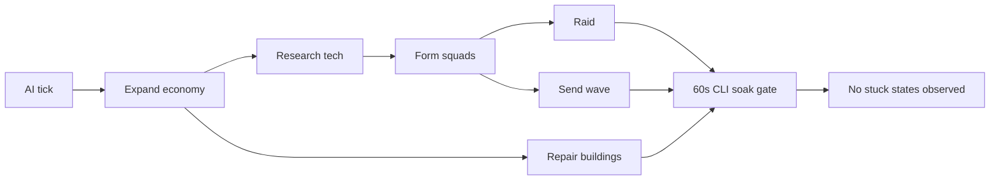
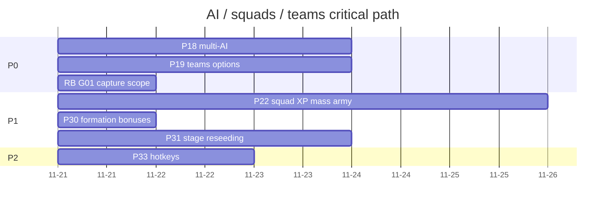

# ⚔️ STATUS — AI / squads / teams / multiple enemies

> [!IMPORTANT]
> Cold-readable status for the AI / squads / teams area. A human or a fresh
> agent should be able to read this file alone and know exactly what is done,
> what is critical, and how to resume. Every factual claim is cited to a board
> id, runner job id, report path, evidence id or code line — no uncited
> assertions. No Godot was run and no code was edited to produce this file.
> Independent **D-22** re-verification (`docs/audit/CONFIG_VERIFY.md`) confirmed
> the "opponents/teams emitted by menu but ignored by main" chain; the QA release
> gate is **PASS** on fresh O5 jobs #149–152 (**D-23**), and the working map size
> is **320** (**D-24**).


## 🎯 TL;DR

This area covers the skirmish AI (`app/scripts/ai.gd`), squad formations, and
the still-unbuilt ability to fight **multiple AI opponents and/or teams on one
random map**. Today a single AI opponent expands, researches, repairs and sends
squads and waves; formations (15–400 men, officers/drummers) and combat bonuses
exist in code, but the bonuses use **wiki values, not donor `formations.cfg`
values** (`RB_MECHANICS.md` §2; `DB_SCRIPTS.md` §3 gap G1). The AI audit
(board **G-01**) found no stuck states in three clean 60 s CLI soaks (jobs
#12/#24/#29). The single most important fact: the owner's top priority —
**multiple enemies / teams (P-18, P-19)** — is still **INTAKE and unassigned**,
and the sim is two-sided today (`SWARM_BOARD.md` P-18/P-19). That is the first
thing to pick up, not a polish item.

> [!WARNING]
> There are **two different "G-01"s**: board **G-01** is the AI audit; research
> gap **RB G-01** is economy-building capture scope. Do not merge them by id
> (`SWARM_BOARD.md`; `docs/research/RB_MECHANICS.md` §3 G-01).



*Conceptual map of the `ai.gd` paths observed by `docs/research/RB_MECHANICS.md`
§2–3 (`_raids`, `_waves`, `_repair`, repair at `ai.gd:378-386`) and the soak gate
(jobs #12/#24/#29, `QA_REPORT.md:12,78`) — not a decompiled control-flow graph.*

## 📊 At a glance

| Fact | Value | Evidence |
|---|---|---|
| AI behaviour paths | `expand / tech / squads / waves` present in `ai.gd` | `RB_MECHANICS.md` §2–3; board G-01 |
| Squad formations | `15/36/72/120/196/400`, officer + drummer | `RB_MECHANICS.md` §2 (S2, S11); `data.gd:222`; `game.gd:1809` |
| Squad replenish | implemented, loose units at officer | `RB_MECHANICS.md` §2 (`game.gd:1776-1806`) |
| Formation bonuses | code exists, **wiki values** (+2/+3, hold +9/+9) | `RB_MECHANICS.md` §2 (`game.gd:1737-1763`); `DB_SCRIPTS.md` §3 G1 |
| AI 60 s soak | **clean**: jobs #12 (`ok`), #24 (`ok`, `sim_seconds: 60.0`, `kills: 0`, `winner: -1`), QA #29 (0 stuck/ERROR) | `app/.godot_queue/results/00000012.json`, `00000024.json` + stdout; `QA_REPORT.md:12,78` |
| Fresh AI soak | job #82 `agentG2-cli` **SKIPPED**, never served | `results/00000082.json`; `QA_REPORT.md:90-104` |
| CLI squad snapshot | at 60 s: `player0_squads: 0`, `player1_squads: 0` | `00000024_agentG-cli/stdout.txt:4-11` |
| Selftest | `29/29 PASS`, `"passed": true` (ticket #43) | `QA_REPORT.md:110`; board P-26 |
| QA release gate | `PASS` — fresh O5 jobs #149–152, all `ok` | `QA_REPORT.md` "FINAL VERDICT — O5"; **D-23** |
| Area tests | `t_mass_army`, `t_squads` **GREEN**; `t_multi_ai`, `t_teams` **RED**; `t_weather` **PENDING** (no result JSON). All 15: `8 green / 6 red / 1 pending (08:55 snapshot; live churn)` | `app/tests/results/*.json`; `docs/reviews/REV_TESTS.md` |
| Deep-audit (D-22) | menu `opponents`/`teams` emitted but ignored by `main.gd` — **CONFIRMED** (independent full-path trace, 17 `cfg.get` sites); `game.gd:229` hardcodes 2 players; `new_player()` writes no `team` key | `docs/audit/CONFIG_VERIFY.md` claim 2; `docs/audit/SIM.md`; board P-42 |
| Board states | G-01 IN_PROGRESS; P-07/P-09/P-25 IN_PROGRESS; P-42 BLOCKED; P-18/P-19/P-22/P-30/P-31/P-33 INTAKE, unassigned | `SWARM_BOARD.md`; `REVIEW_REPORT.md:18` |

Overall progress: `████░░░░░░ 40%` — share of this area's five tracked gates that
are green: selftest (`QA_REPORT.md:110`), 60 s CLI soak (jobs #12/#24) and the
QA release gate (**D-23**) are green; `t_mass_army` and `t_squads` are green
per-feature tests, while `t_multi_ai` and `t_teams` remain **RED** with result JSONs
(`app/tests/results/`; 8 green / 6 red / 1 pending (08:55 snapshot; live churn) overall). It is **not** a
code-completeness score.

## ✅ DONE — verified

- [x] **G-01 AI audit** — expansion, teching, squad and wave paths reviewed;
  three 60 s CLI soaks show **no stuck states**, no script errors, clean exit
  (jobs #12/#24/#29; `REVIEW_REPORT.md:18`; `QA_REPORT.md:78`).
- [x] **Formation bonuses exist in code** — `_formation_atk` / `_formation_def`
  apply attack/defence and hold bonuses; sizes + officer requirements wired
  (`game.gd:1737-1763`, `data.gd:222`, `game.gd:1809`; `RB_MECHANICS.md` §2).
  Values are wiki-derived — P-30 exists to correct that (`DB_SCRIPTS.md` §3 G1).
- [x] **Squad formation + replenish path** — implemented (`game.gd:1776-1806`,
  `cmd_form_size` at `game.gd:1809`; `RB_MECHANICS.md` §2). Experience/disband
  still missing (`RB_MECHANICS.md` §3 G-13, board P-22).
- [x] **AI repair behaviour** — AI repairs damaged own buildings
  (`ai.gd:378-386`; `RB_MECHANICS.md` §2).
- [x] **Single-AI skirmish runs 60 s headless without hanging** — three clean
  soaks on record (jobs #12/#24/#29; `REVIEW_REPORT.md:24`).

> [!NOTE]
> The G-01 audit *findings* are done, but board G-01 is still **IN_PROGRESS**
> and the review desk recorded "NO CHANGE — no working-tree diff for `ai.gd`"
> (`SWARM_BOARD.md`; `REVIEW_REPORT.md:18`). Coordinator sign-off is pending;
> do not mark the ticket DONE yourself.

## 🚧 LEFT — by criticality

| Priority | Item | Ticket | Owner | Blocked by | Est. |
|---|---|---|---|---|---|
| 🔴 P0 | **Sim-layer support for N players/teams** — `game.gd:229` hard-locks 2 players, `new_player()` writes no `team` key (deep-CONFIG claim 2 **CONFIRMED**); hand-off `inbox/handoff-P18-agentG.md` | P-42 BLOCKED | A / coordinator | blocks P-18/P-19 | unestimated (`SWARM_BOARD.md`; `docs/audit/CONFIG_VERIFY.md`) |
| 🔴 P0 | **Multiple AI opponents on one map — OWNER'S TOP PRIORITY**; sim 2-sided; `t_multi_ai` **RED** (FAIL check 2: `map_starts=2` with 3 players) | P-18 INTAKE, unassigned | needs G (`ai.gd`) + A (`game.gd`) + menu owner | P-42 + file-ownership arbitration | unestimated (`SWARM_BOARD.md`) |
| 🔴 P0 | **Teams / diplomacy options on random map** — charter goal; overlaps P-14, H-01; `t_teams` **RED** | P-19 INTAKE, unassigned; P-14 BLOCKED | A (`data.gd`/`game.gd`) + menu owner | P-42 + same arbitration | unestimated (`SWARM_BOARD.md`) |
| 🔴 P0 | **Capture scope: only Town Hall capturable** — research RB G-01, not board G-01. Only `cen` has `"capture": true` (`data.gd:650`); capture loop handles mines (`game.gd:3573`) but flag missing on `sto`/`mar`/`mine_*` | RB G-01 (research P0), no board ticket yet | `data.gd` = A | owner A's queue; 1 data + 1 selftest ticket | 1 data + selftest (`RB_MECHANICS.md` §3) |
| 🟠 P1 | **Squad experience / disband + mass-army scale** — no disband on 30 % losses or officer death, no experience scaling; `t_squads` **GREEN**, `t_mass_army` **GREEN** (4 of 5 squad checks now PASS; squad cap P-40 remains) | P-22 INTAKE; RB G-13 | G + A + SC (`hud.gd`) | unestimated, needs grant | unestimated (`SWARM_BOARD.md`; `app/tests/results/`) |
| 🟠 P1 | **Generator emits one start per participant** — currently 2, third AI uses fallback | P-43 INTAKE | unassigned | `game.gd` (A), `pattern_gen.gd` (Q) | t_multi_ai FAIL check 2 |
| 🟡 P2 | **Guard AI-facing `say()`** with `if player == 0:` — 7 sites; 12× "Not enough resources." in t_multi_ai | P-44 INTAKE | unassigned | `game.gd` (A) | 7 one-line edits |
| 🟡 P2 | **Squad cap** — `Data.SQUAD_MAX = 195` caps at 193; donor ladder 15/36/72/120/196/400 | P-40 INTAKE | unassigned | `data.gd`, `game.gd` (A) | t_squads FAIL check 1 |
| 🟠 P1 | **Donor formation bonuses** — `formations.cfg`: 43 entries with `bonusdamage=2`, `bonusshield=2`, `bonusdamagehold=7`, `bonusshieldhold=7`; `GUIDE4.md` A04 wrongly says bonusdamage 0 | P-30 INTAKE; DB-01; RA G12 | A (`game.gd`, `data.gd`) | confirm values vs RA G12, correct GUIDE4 A04 | M — 6–8 h (`DB_SCRIPTS.md` §4) |
| 🟠 P1 | **Stage-level reseeding / generator version gates** — donor reseeds before every stage; port seeds once (`game.gd:114,213,885`, `mapgen.gd:48`). Working map size is 320 (**D-24**), so generator/QA scale by `s=2` (`docs/audit/GEN.md`) | P-31 INTAKE; DB-03 | A (`game.gd`, `data.gd`) | decomp critical path; gates 53..91 | L — 16–24 h (`DB_SCRIPTS.md` §4) |
| 🟡 P2 | **Hotkey parity** — donor `hotkeys.cfg` has 243 bindings; `Data.HOTKEYS = {}` (`data.gd:163`), no key handling found | P-33 INTAKE; DB-02; RB G-12 | config.gd / input_controller.gd owner unassigned | donor cfg vs wiki patrol P/Q | M — 8–12 h (`DB_SCRIPTS.md` §4) |

Priority key (`docs/STATUS_TEMPLATE.md`): P0 = blocks a good playable skirmish
or the test/release gate; P1 = visible fidelity or core feature; P2 = polish;
P3 = nice-to-have. Source ratings are preserved: RB calls its G-01 capture gap
P0; DB calls the formation/hotkey/reseed gaps "High" (`RB_MECHANICS.md` §3,
`DB_SCRIPTS.md` §3).



*Illustrative scheduling windows, not commitments or recorded dependencies —
`SWARM_BOARD.md` lists no formal dependency chain for these tickets. Only RB G-01,
P-30, P-31 and P-33 have cited estimates (`RB_MECHANICS.md` §3; `DB_SCRIPTS.md`
§4); P-18/P-19/P-22 are unestimated on the board.*

### 🧭 Decision trace

> [!IMPORTANT]
> Per **D-19**, every `docs/STATUS_*.md` cites the decisions that shaped it.
> Ticket ids and decision ids are separate namespaces; board ticket D-01 is
> written **BOARD D-01** to avoid collision with decision **D-01** (kill 6 leaked
> Godot processes). Full rationale in `docs/DECISION_LOG.md`.

| Decision | What it fixes in this area | Where it shows up here |
|---|---|---|
| **D-12** (Owner, 07:20) | Skirmish-only charter: multiple AI opponents/teams on one map are a first-class goal; missions/network deferred | TL;DR; §4 P-18/P-19; §5 Deferred |
| **D-07** (Coordinator, 06:30) | Craft Anything decomp surfaced donor AI truth (formations, reseeding, hotkeys) → P-30/P-31/P-33 | §4 rows; §8 decomp evidence |
| **D-22** (Owner, 08:10) | Quality-first deep audit: `docs/audit/CONFIG_VERIFY.md` independently confirmed the ignored opponents/teams chain | §2 deep-audit row; §4 P-42 |
| **D-23** (QA desk O, 08:17) | Release gate **PASS** — fresh O5 jobs #149–152; the tree parses and all four gates are green | §2 gate row; §7 gates |
| **D-24** (Coordinator, 08:30) | 320 tiles is the working map size; generator/QA scale with `s=2`, `mscale=2` | §4 P-31; `docs/audit/GEN.md` |
| **D-17 / D-18 / D-19** | Documentation lane, modern GitHub markdown, decision tracing | This file's structure (YAML, badges, alerts, Mermaid, trace) |

## 🗃️ Deferred (owner charter §0)

- Network / multiplayer — deferred by owner charter; no build-lane slot.
- Campaign AI / mission scripts — missions and campaigns are deferred.
- `.aix` triggers — board **P-16 DEFERRED**; donor RTTI shows `TAIXEDITOR`,
  `TAIXARGSEDITOR`, `XDScriptTrigger` but they stay parked (`docs/decomp/DA_PE.md`
  §3, fnd_13–16).
- DLC mission-map strategy — board **P-17 DEFERRED**.

<details>
<summary>Full deferred list (click to expand)</summary>

- missions / campaigns / `.aix` triggers — `SWARM_OPS.md` §0; `SWARM_BOARD.md` P-16.
- DLC mission maps — `SWARM_OPS.md` §0; `SWARM_BOARD.md` P-17.
- network / multiplayer — `SWARM_OPS.md` §0.
- If un-deferred by the owner, each would become a fresh triage ticket with
  acceptance criteria, not a build-lane slot (`SWARM_OPS.md` §0, §2).

</details>

## 👥 Ownership map

| File / area | Owner | Notes |
|---|---|---|
| `app/scripts/ai.gd` | **G** | Board G-01; RB G-11 mine demolition; P-18/P-22 AI work. |
| `app/scripts/game.gd`, `app/scripts/data.gd` | **A** | Board A-01; formation math (`game.gd:1737-1763`), replenish (`game.gd:1776-1806`), `data.gd:222/650`, P-30/P-31/RB G-01. |
| `app/scripts/menu.gd` (AI/teams work) | **G** by task assignment | Board H-01 lists **H** as menu owner (seed UI, `menu.gd.bak-agentH`); P-14/P-18/P-19 unassigned. Coordinator must arbitrate. |
| `app/scripts/hud.gd` | **SC** | Board P-25 (HUD fidelity, IN_PROGRESS). **BOARD D-01** also lists `hud.gd` under D — confirm before editing. |

> [!WARNING]
> Only the listed owner may edit those files. Cross-file edits are a REVIEW
> BLOCK under `SWARM_OPS.md` §3. New tickets P-18/P-19/P-22 are **unassigned** —
> they need exclusive file grants before work starts.

## 🧪 Acceptance gates

```bash
python app\tools\godot_runner.py status
python app\tools\assert_clean.py --json
python app\tools\godot_runner.py run --id <worker>-ai-cli --timeout 180 -- --headless --path app -- --cli app/cli.json --cli-seconds 60
python app\tools\godot_runner.py run --id <worker>-selftest --timeout 180 -- --headless --path app -- --self-test app/selftest.json
python app\tools\test_all.py --only t_multi_ai t_teams t_squads
python app\tools\test_all.py --only t_mass_army
```

Pass criteria:

- CLI soak result `status: ok`, `exit: 0`, report `sim_seconds: 60.0`; grep
  stdout+stderr for `stuck`, `ERROR`, `SCRIPT ERROR` (case-insensitive) = **0 hits**
  (jobs #12/#24; `QA_REPORT.md:12,78`). Skipped job #82 is **not** evidence.
- Selftest `app/selftest.json` `"passed": true`, **29/29**, 0 failures
  (`QA_REPORT.md:110`).
- `t_multi_ai` / `t_teams` / `t_squads` green = gates for P-18/P-19/P-22;
  `t_mass_army` green = P-22. On disk now: `t_mass_army` **GREEN**,
  `t_multi_ai`/`t_teams` **RED**, `t_squads` **GREEN**, `t_weather` **PENDING** (no JSON).
  Results are in `app/tests/results/*.json`; `summary.json` is generated at
  runtime by `test_all.py`. Uitest 17/17 is the general gate; the QA release gate
  is **PASS** on fresh O5 jobs #149–152 (**D-23**, `QA_REPORT.md`).
- Clean gate: no orphan Godot processes, no timed-out/skipped job for this area
  (`QA_REPORT.md:115-120`).

## 🔗 Evidence index

- Decisions: `docs/DECISION_LOG.md` — D-03 (runner only), D-04 (ownership), D-07 (decomp), **D-12** (skirmish charter), D-13/D-14 (clean gate), D-15 (test-per-file), D-16 (runner fixes), D-17/D-18/D-19 (docs), **D-22** (quality-first), **D-23** (release gate PASS), **D-24** (320 map size).
- Deep audits: `docs/audit/CONFIG_VERIFY.md` (claim 2 — ignored opponents/teams CONFIRMED), `docs/audit/SIM.md`, `docs/audit/GEN.md` (320-size coupling), `docs/audit/DECOMP.md`.
- Per-feature results: `app/tests/results/*.json` (14 written: 8 green / 6 red / 1 pending (08:55 snapshot; live churn)); `docs/reviews/REV_TESTS.md`; `app/tests/manifest.json`.
- Org/charter: `SWARM_OPS.md` §0, §4, §5c; `docs/STATUS_TEMPLATE.md`;
  `SWARM_BOARD.md` (G-01, P-14, P-16, P-17, P-18, P-19, P-22, P-25, P-26,
  P-30, P-31, P-33).
- Runner results: `app/.godot_queue/results/00000012.json`, `00000024.json` +
  `00000024_agentG-cli/stdout.txt`, `00000082.json`, `00000029*`; queued with no
  results: `app/.godot_queue/jobs/00000089.json`, `00000092.json`,
  `00000097.json`, `00000098.json`.
- QA/review: `QA_REPORT.md:12,66-78,106-120`; `REVIEW_REPORT.md:18,24`.
- Research: `docs/research/RB_MECHANICS.md` §2–3 (S2/S11–S13; G-01, G-11, G-12,
  G-13); `docs/research/RA_ROSTER.md` §3.5/§4/§5 (149 variants, +2/+2 / +7/+7 /
  +3/+3, 5 port shapes, `SQUAD_MAX=195`; G11/G12).
- Decomp: `docs/decomp/DB_SCRIPTS.md` fnd_22/23/24, §3–4; evidence ids
  `ev_2f2f15d9…`, `ev_24a1cc1a…`, `ev_e350e534…`, `ev_c7d983f3…`,
  `ev_f7f8bad9…`; tickets DB-01/02/03. `docs/decomp/DA_PE.md` fnd_13–16.
- Code: `app/scripts/ai.gd` (`_raids`, `_waves`, `_repair` at 378-386);
  `game.gd:1737-1763,1776-1806,1809,3573,114,213,885`;
  `data.gd:163,222,650`; `mapgen.gd:48`; `config.gd:111`;
  `app/tests/manifest.json:13-15,22`; `app/tools/test_all.py`.

## 🔄 How to resume (cold start)

1. [ ] Read this file, `SWARM_BOARD.md`, `SWARM_OPS.md` §0/§5c, and the relevant
   report above. Cite existing findings — do not re-derive from scratch.
2. [ ] Check `python app\tools\godot_runner.py status` and
   `python app\tools\assert_clean.py --json` before launching anything.
3. [ ] Pick the highest-priority unblocked ticket: **P-18 → P-19 → RB G-01 →
   P-22 → P-30 → P-31 → P-33**. Resolve owner arbitration first.
4. [ ] Back up owned files to `inbox\backup\<name>.bak-<your-id>`.
5. [ ] Implement, run §7 gates, move the relevant small test from `pending` to
   green, then update this file's §2 table with new job ids.
6. [ ] Report status to the coordinator — only the coordinator edits the board's
   State column (`SWARM_OPS.md` §4).

## ❓ Open questions

- [ ] Who closes G-01? Board says IN_PROGRESS, `REVIEW_REPORT.md:18` found no
  `ai.gd` diff — coordinator + G.
- [ ] Who owns P-18/P-19 across `ai.gd`/`game.gd`/`menu.gd` (G vs A vs H-vs-G)?
  Coordinator must grant disjoint ownership — blocks the owner's top priority.
- [ ] Are squads actually forming? Both 60 s CLI snapshots report
  `player0_squads: 0` / `player1_squads: 0` (`00000024_agentG-cli/stdout.txt`);
  what sim length does `t_squads` exercise? Owner G + test-T3.
- [ ] Which formation numbers win — wiki (+2/+3, +9/+9), donor cfg (+2/+2,
  +7/+7, +3/+3 at 400), or RA G12? A/DB; `GUIDE4.md` A04 is known wrong.
- [ ] Keep the two "G-01"s distinct: board AI audit vs RB capture scope.
- [x] Test results were missing; 14 result JSONs now exist (8 green / 6 red /
  1 pending at 08:55) — `app/tests/results/`. Green results for `t_multi_ai`/`t_teams`/
  `t_squads` remain the acceptance gates for P-18/P-19/P-22 (QA O).
- [x] Fresh AI soak — the #47 wedge is resolved (**D-23**); the release-gate CLI
  soak was re-run fresh as `agentO5-cli` #149 (`sim_seconds: 60.0`, 0 errors).
  A dedicated 60 s *AI* soak remains useful but is no longer release-blocking.
- [ ] Board P-40/P-42/P-43/P-44 reconciliation — coordinator: these newer tickets
  are INTAKE/BLOCKED on the board but now appear in this doc; confirm states.
- [ ] Hotkey authority: wiki patrol P vs `config.gd:111` Q; donor `hotkeys.cfg`
  (fnd_23) is authoritative — coordinator + RB G-10 doc fix.

---

**Related:** `docs/RESUME.md` · `SWARM_BOARD.md` · `SWARM_OPS.md` ·
`docs/DECISION_LOG.md` · `docs/STATUS_TEMPLATE.md` ·
`docs/audit/CONFIG_VERIFY.md` · `docs/audit/SIM.md` · `docs/audit/GEN.md` ·
`docs/reviews/REV_TESTS.md` · `docs/research/RB_MECHANICS.md` ·
`docs/research/RA_ROSTER.md` · `docs/decomp/DB_SCRIPTS.md` ·
`docs/decomp/DA_PE.md`
