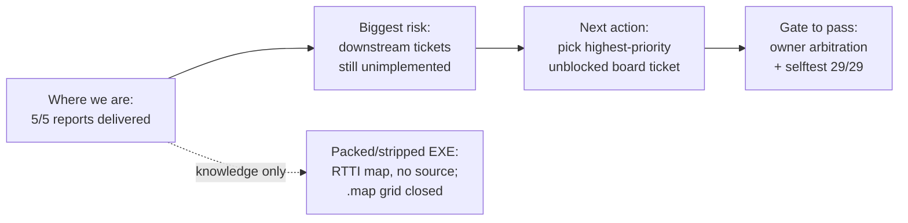
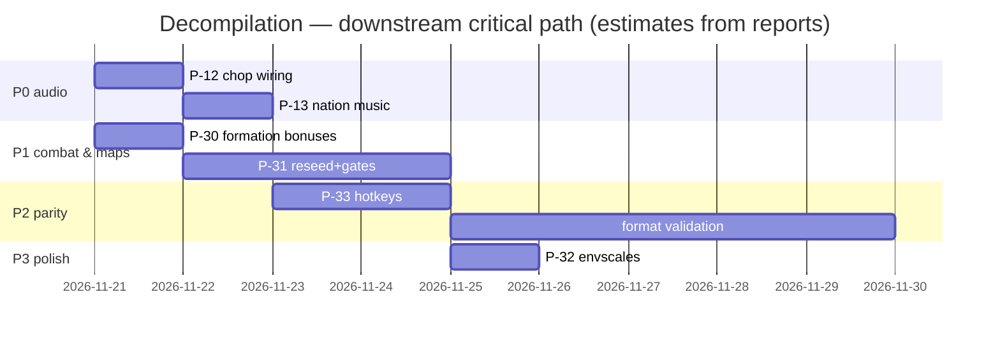

# ⚔️ STATUS — Decompilation

> [!IMPORTANT]
> Cold-readable status for the **decompilation lane** (§5a). A human or a fresh
> agent should be able to read this file alone and know what Craft Anything
> recovered from the installed donor, what is DONE, what remains, and how to
> resume. Every factual claim cites a board id, decision id, report path,
> evidence id (`ev_…`) or finding id (`fnd_…`) — no uncited assertions.
> **No Godot runs, no code edits, no donor execution** produced this document.


## 🎯 TL;DR

The decompilation lane used Craft Anything read tools against the installed,
**private-use-only** donor at `C:\Games\Cossacks 3` to turn closed formats and
scripts into documented, evidence-backed port knowledge — opened by the
coordinator on 2026-11-21 (**D-07**, `ev_e000f15b…`) and filtered through the
owner's **skirmish-only charter** (**D-12**, `SWARM_OPS.md` §0). The single most
important fact: **all five reports (DA–DE) are delivered and the knowledge lane
is complete** — donor text scripts and config are intact, OSS/OSM/AAF layouts are
size-closed, `.aix` is plain text, and the alleged `.osm` offset bug is refuted —
but the main EXE is packed/stripped so only an RTTI subsystem map (not source)
was recoverable, and the numeric `.map` grid stays closed. What remains are
**downstream build-lane tickets** (P-30…P-33, audio P-12/P-13, ~5 worker-days of
format validation) that other workers must implement; this lane's job was to
hand them the truth on a plate.



## 📊 At a glance

| Fact | Value | Evidence |
|---|---|---|
| Decompiler reports delivered | `5/5` (DA, DB, DC, DD, DE) | `docs/decomp/{DA_PE,DB_SCRIPTS,DC_FORMATS,DD_MAPS,DE_AUDIO_UI}.md` |
| Donor executables triaged | `6` (all PE32/x86, all stripped) | `DA_PE.md` §2; `ev_3e6df162…`, `ev_e7533ff3…` |
| Recovered RTTI class names | `111 X*` + `474 T*` | `DA_PE.md` §3; `ev_238c801…`, `ev_d9c6e28…` |
| Donor files inventoried | `17,237` files / `17,258` entries | `DC_FORMATS.md` §1; `ev_79424d3a…`; `DE_AUDIO_UI.md` `ev_bd4dc176…` |
| Mesh formats size-closed | `.oss` (335), `.osm` (3,897), `.aaf` (246) | `DC_FORMATS.md` §2; `ev_392885a6…`, `ev_0bbb20c1…`, `ev_6a6b0380…` |
| `.osm` offset bug | **REFUTED** — readers byte-identical | `DC_FORMATS.md` §3; `fnd_7`; board **P-06b CLOSED** |
| Open downstream tickets from decomp | `6` (P-12, P-13, P-30…P-33) | `SWARM_BOARD.md`; `STATUS_AI.md` §4 |
| Lane-opening / filter decisions | **D-07**, **D-12** | `docs/DECISION_LOG.md`; `ev_e000f15b…` |

**Knowledge-lane progress:** `██████████ 100%` — all five decomp reports written
and cited; every format/script question the lane set out to answer is answered.

**Downstream consumption:** `███░░░░░░░ 30%` — 1 of 6 derived tickets closed
(P-06b refutation); P-12/P-13/P-30…P-33 remain INTAKE/unassigned, owned by
build-lane workers, not this lane (board `SWARM_BOARD.md`).

> [!NOTE]
> "green" describes the **decompilation knowledge lane**, not the port. The
> LEFT items below are build tickets derived from these findings; they are
> tracked here so a cold reader can follow where the evidence landed.

## ✅ DONE — verified reports

- [x] **DA — PE triage & decompilability** — 6 stripped PE32 files triaged;
  main EXE `CODE` section 5.18 MB / entropy 6.61 readable, `.bind` packer stub
  entropy 7.96; 18,918 functions / 12,073 strings; 111 `X*` + 474 `T*` RTTI
  names; per-function Ghidra pseudo-C proven (`FUN_00404628`). Findings
  `fnd_13`–`fnd_16`; `docs/decomp/DA_PE.md` §§2–6; `ev_e7533ff3…`,
  `ev_60b49743…`, `ev_5b735a49…`, `ev_238c801…`, `ev_b0e5246…`.
- [x] **DB — text scripts & config truth** — `generator.cfg` (6 base paths + 9
  DLC5 + ~70 `Freq` families), `hotkeys.cfg` (243 lines), `formations.cfg`
  (149 entries, 43 with bonuses), `envscales.cfg`, `startingsettings.cfg`,
  `dogenerate.inc` stage order and reseed points read. Findings `fnd_12`,
  `fnd_22`–`fnd_26`; `docs/decomp/DB_SCRIPTS.md` §§1–4; `ev_a2c1ea36…`,
  `ev_e350e534…`, `ev_2f2f15d9…`, `ev_c7d983f3…`.
- [x] **DC — format inventory & `.osm` verdict** — OSS/OSM/AAF layouts decoded
  and size-closed on two meshes each; full 17k-file extension census; `.map`
  grid declared closed. The alleged `.osm` offset bug **REFUTED**: correct
  longs are 12/13/14, both readers already use them and produce byte-identical
  output; only a stale comment remains in `bake_naval.py:80-84`. Findings
  `fnd_3`, `fnd_6`–`fnd_9`; `docs/decomp/DC_FORMATS.md` §§1–4; `ev_79424d3a…`,
  `ev_0bbb20c1…`; board **P-06b CLOSED**.
- [x] **DD — DLC `.map` / `.aix` formats** — `.map` header TLV stream decoded to
  offset 429 (`OSWMap13` marker, build 2843/2844), numeric grid opaque;
  **`.aix` confirmed plain UTF-8 text**, not compiled AI blobs (correction to
  worker AD). 18 of 49 maps have a companion `.aix`. Findings `fnd_4`, `fnd_5`,
  `fnd_10`, `fnd_11`; `docs/decomp/DD_MAPS.md` §§1–4; `ev_157a40d6…`,
  `ev_43b589e…`, `ev_440b9c16…`, `ev_04b61c03…`.
- [x] **DE — audio / UI / locale** — exact **20 missing nation `.ogg` tracks**
  identified; chop is a silent event (`chop` → `workwood` one-line fix);
  locale tables (11 languages) and `.inc`/`.aix` UI definitions exist but port
  hardcodes English. Findings `fnd_17`–`fnd_21`; `docs/decomp/DE_AUDIO_UI.md`;
  `ev_bd4dc176…`, `ev_90e0959…`, `ev_75d79f6…`, `ev_cf45b67…`.
- [x] **Cross-lane terrain research read in** — `docs/research/RC_TERRAIN.md`
  (56-gap backlog, ranked top 10; six missing skirmish map options); informs
  the P-19 skirmish-options work, not a decomp deliverable itself.

> [!NOTE]
> Only items with a cited report are listed here. The `.osm` refutation has no
> `D-xx` in `docs/DECISION_LOG.md` — it is recorded as finding `fnd_7` and
> board **P-06b CLOSED**; the related naval-mesh readability decision is **D-11**.

### What could and could not be recovered

| Recovered ✅ | Could not recover ❌ | Why | Evidence |
|---|---|---|---|
| RTTI subsystem map (585 names), intact text scripts / config, decoded OSS/OSM/AAF layouts, `.aix` as plain text, `.map` header/UID/markers | Original Delphi source, gameplay literals, packed stub, function↔name links | All 6 PEs stripped; `.bind` entropy 7.96; entry point inside packer; running donor prohibited so no memory dump; RTTI strings carry **0 code xrefs** | `DA_PE.md` §3–4; `ev_ec5fbf04…`; `DC_FORMATS.md` §2; `DD_MAPS.md` §4 |
| Exact donor values for formations, hotkeys, envscales, generator stages | Numeric `.map` heightmap / placement coordinates / orientation; packer unpacking | Closed binary, no public spec, dimensions unknown; "absence is not proof a routine is absent" (analysis stopped at 6M instructions, 1,238 indirect jumps) | `DB_SCRIPTS.md` §2–3; `DD_MAPS.md` §3–4; `DA_PE.md` §4; `ev_60b49743…` |

## 🚧 LEFT — downstream work by criticality

These are build-lane tickets that consume the decomp findings. Priorities below
preserve the source ratings (DE calls audio P0; DB calls formation/reseed/hotkey
"High"; board assigns P1/P2). Criticality key: 🔴 P0 = blocks a good playable
skirmish or the gate · 🟠 P1 = visible fidelity / core feature · 🟡 P2 = polish ·
⚪ P3 = nice-to-have.

| Priority | Item | Board / source ticket | Owner | Blocked by | Est. | Evidence |
|---|---|---|---|---|---|---|
| 🔴 P0 | Wire `chop` → `workwood` (files exist; silent event) | **P-12** / DE T-DE-01 | unassigned | `main.gd` owner B | 0.25 d | `DE_AUDIO_UI.md` §"Chop"; `fnd_18`; board P-12 |
| 🔴 P0 | Port 20 missing nation music tracks + fallback theme (`bav` default silent) | **P-13** / DE T-DE-02 | unassigned | audio asset owner | 1 d | `DE_AUDIO_UI.md` §"Nation music"; `fnd_19`; `ev_bd4dc176…` |
| 🟠 P1 | Import donor formation bonuses (43 entries: damage/shield 2, hold 7); fix `GUIDE4.md` A04 | **P-30** / DB-01 | unassigned (game.gd/data.gd = A) | owner arbitration | 6–8 h | `DB_SCRIPTS.md` §3 G1; `fnd_22`; `ev_2f2f15d9…`, `ev_24a1cc1a…` |
| 🟠 P1 | Stage-level reseeding + generator version gates (9 reseed points, versions 53–91) — **critical path** | **P-31** / DB-03 | unassigned (game.gd/data.gd = A) | owner arbitration; replay fixture | 16–24 h | `DB_SCRIPTS.md` §3 G3; `fnd_24`; `ev_c7d983f3…`, `ev_f7f8bad9…` |
| 🟡 P2 | Hotkey parity from `hotkeys.cfg` (243 bindings vs `Data.HOTKEYS={}`) | **P-33** / DB-02, DE T-DE-03 | unassigned (config.gd / input_controller.gd) | confirm donor authoritative over wiki | 8–12 h | `DB_SCRIPTS.md` §3 G2; `fnd_23`, `fnd_20`; `ev_e350e534…` |
| 🟡 P2 | Format validation sweep — run OSS/OSM/AAF readers over all 335/3,897/246 files + `.pattern`, TGA/DDS audit | DC T-1…T-6 | unassigned (tool owner) | none | **~5 worker-days** | `DC_FORMATS.md` §4; `fnd_6`–`fnd_9` |
| ⚪ P3 | Import `envscales.cfg` per-object scales + jitter (mines 0.3152, stones 0.329, 0.85–1.15) | **P-32** / DB-06 | unassigned (data.gd/world.gd) | low visual priority | 4–6 h | `DB_SCRIPTS.md` §3 G6; `fnd_26`; `ev_2c4d3cf4…` |
| ⚪ P3 | RTTI→module map (DA-1) + `config.exe` text-config harvest (DA-3) | DA-1, DA-3 | unassigned | knowledge tickets, low risk | ~2 tickets | `DA_PE.md` §5; `fnd_14`, `fnd_16` |

- [ ] P-12 — one-line fix + sound-fires smoke test.
- [ ] P-13 — 20 assets + alias/fallback + smoke test.
- [ ] P-30 — import 149 IDs + masks, replace `_formation_atk/_def`, selftest 43 cases.
- [ ] P-31 — reseed before each stage, version gates, replay fixture.
- [ ] P-33 — parse `hotkeys.cfg`, wire `InputEventKey`, preserve ctrl/alt/shift.
- [ ] DC T-1…T-6 — validation sweep; `.map` full decode explicitly NOT included.
- [ ] P-32 — import envscales table; apply scale/min/max.



## 🗃️ Deferred (owner charter §0 / D-12)

These stay documented, **not** as active build tickets. Per **D-12** the
skirmish-only charter filters all decompilation output; mission/campaign/packed-
EXE work is parked.

- **Mission-map RE / `.map` numeric grid** — closed binary, no spec, 87 ×
  ~44 MB; DC recommends "won't fix" (T-7, 3–5 d) and DD rates exact decode
  HIGH-risk (option B, 6–8 d). Deferred by `SWARM_OPS.md` §0; would become a
  mission-fidelity ticket only if the charter changes. `DC_FORMATS.md` §4;
  `DD_MAPS.md` §5 (`ev_16c59dcb…`, `fnd_5`).
- **`.aix` campaigns / mission triggers** — board **P-16 DEFERRED**; DD proved
  `.aix` is plain text (`fnd_11`) and hand-translation is cheap, but campaigns
  are out of scope. RTTI shows `TAIXEDITOR`/`XDScriptTrigger` (`DA_PE.md` §3).
- **DLC mission-map strategy** — board **P-17 DEFERRED**; 49 `.map` files
  across 7 DLC dirs, all missions (`DD_MAPS.md`; `ev_157a40d6…`).
- **Packed EXE function anchoring (DA-2)** — timeboxed spike to anchor
  `XMapGenerator`/`XCastleGenerator`/`XPath` to CODE functions; high risk
  (stripped, no string xrefs, packed stub), and the skirmish charter means
  text-config truth (DA-3) wins instead. `DA_PE.md` §5; **D-12**.

<details>
<summary>Full deferred list (click to expand)</summary>

- missions / campaigns / `.aix` triggers — **P-16**, `SWARM_OPS.md` §0, D-12
- DLC mission maps / mission-map RE — **P-17**, `DC_FORMATS.md` T-7, `DD_MAPS.md` option B
- packed EXE unpacking / function anchoring — `DA_PE.md` §4/§5 (running donor prohibited)
- network / multiplayer — `SWARM_OPS.md` §0, D-12
- full locale translation (10 remaining languages, 264 BMP / 8 CUR parity) — DE T-DE-05, P3

</details>

## 🧭 Decision trace

> [!IMPORTANT]
> Per **D-19**, every `docs/STATUS_*.md` must cite a decision id where a
> decision shaped the work. These are the ones that shaped this lane.

```mermaid
timeline
  title Decisions that shaped the decompilation lane
  06:30 : D-07 opened Craft Anything investigation<br/>ev_e000f15b… : read-only, private-use
  07:20 : D-12 skirmish-only charter<br/>mission/campaign EXE RE parked
  07:45 : D-17 documentation lane created<br/>cold-readable status docs
  07:50 : D-18 modern GitHub markdown required<br/>this file's format
  07:55 : D-19 decisions must be traced<br/>D-07 / D-12 cited here
```

| Decision | Made by | How it shaped this lane | Evidence |
|---|---|---|---|
| **D-07** (06:30) | Coordinator | Opened the read-only Craft Anything investigation on the installed donor; no donor execution, no copying into repo — the constraint every report in §DONE obeys | `docs/DECISION_LOG.md` D-07; `ev_e000f15b…` |
| **D-12** (07:20) | **Owner** | Skirmish-only charter: mission-map RE, `.aix` campaigns and packed-EXE function anchoring are deferred; generator/gameplay scripts, rosters and formats kept — the filter applied in §Deferred | `docs/DECISION_LOG.md` D-12; `SWARM_OPS.md` §0 |
| D-17 / D-18 / D-19 (07:45–07:55) | Coordinator / Owner | Documentation lane, modern GitHub markdown and decision tracing — why this file has YAML, badges, Mermaid and a decision trace | `docs/DECISION_LOG.md`; `docs/STATUS_TEMPLATE.md` |

## 👥 Ownership map

| File / area | Owner | Notes |
|---|---|---|
| `docs/STATUS_DECOMP.md` | **DOC-5** | This file only; no other file owned by this agent. |
| `docs/decomp/DA_PE.md` … `DE_AUDIO_UI.md` | DA–DE (authors) | Read-only reports; do not edit without re-tasking the decomp lane. |
| Downstream code (`game.gd`, `data.gd`, `main.gd`, `audio.gd`, `config.gd`, `input_controller.gd`) | A / B / L / config owner | **Not** this lane. P-12 blocked on B (`main.gd`); P-30/P-31 on A; see `STATUS_AI.md` §6. |
| Shared Craft Anything brief/plan/handoff | Coordinator only | Decompilers use read tools + `core_finding_record` only (`SWARM_OPS.md` §5a). |

> [!WARNING]
> Only the listed owner may edit a file. Cross-file edits are a REVIEW BLOCK
> under `SWARM_OPS.md` §3. Derived tickets need exclusive file grants before
> any build worker edits (board `SWARM_BOARD.md`).

## 🧪 Acceptance gates

The decomp lane itself has **no Godot gate** (no runner use, §5a). Downstream
tickets inherit the standard gates — all runs via `godot_runner.py`, one at a
time; check the queue first with `python app\tools\godot_runner.py status`.

```bash
python app\tools\godot_runner.py run --id <worker>-selftest --timeout 180 -- --headless --path app -- --self-test app/selftest.json
python app\tools\test_all.py --only <ticket-test-ids>
python app\tools\assert_clean.py --json
```

Pass criteria: selftest `29/29`, uitest `17/17`, clean gate exit `0`. Specific
gates: P-12/P-13 sound-fires smoke test; P-30 selftest of 43 nonzero formation
bonuses; P-31 replay fixture (same seed → same map); P-33 preserves ctrl/alt/shift
combos; DC sweep produces a bounded failure list. (Basis: `STATUS_AI.md` §7;
`DB_SCRIPTS.md` §4; `DE_AUDIO_UI.md` §worker-ticket estimate.)

## 🔗 Evidence index

**Reports:** `docs/decomp/DA_PE.md` · `DB_SCRIPTS.md` · `DC_FORMATS.md` ·
`DD_MAPS.md` · `DE_AUDIO_UI.md` · `docs/research/RC_TERRAIN.md`

**Decision ids:** **D-07** (lane opened), **D-12** (skirmish filter), D-11
(naval meshes readable), D-17/D-18/D-19 (doc lane / markdown / tracing) —
`docs/DECISION_LOG.md`.

**Board ids:** P-06b (`.osm` CLOSED), P-12, P-13, P-16/P-17 (DEFERRED),
P-30, P-31, P-32, P-33 — `SWARM_BOARD.md`.

**Finding ids:**
`fnd_3` format census · `fnd_4` DLC inventory · `fnd_5` opaque grid (inferred) ·
`fnd_6` OSM layout · `fnd_7` `.osm` bug verdict · `fnd_8` OSS layout ·
`fnd_9` text/raster families · `fnd_10` map header framing · `fnd_11` `.aix` =
text · `fnd_12` generator text · `fnd_13`–`fnd_16` PE triage/RTTI/config ·
`fnd_17`–`fnd_21` audio/hotkey/locale · `fnd_22` formations · `fnd_23` hotkeys ·
`fnd_24` reseeding · `fnd_25` · `fnd_26` envscales.

**Evidence ids (full, key samples):**
`ev_3e6df1626fba0e3b1d70a677860fa53cc311d9d3efca9fa54a9248c403784a01` (PE list) ·
`ev_e7533ff33eadc37298d3877bfad230213f3f00888319b896daa71be2b868abc6` (main EXE triage) ·
`ev_60b497434aa3e6cb68b019fd0a3b016ec0415ef6ec1a3189726faa8d3752f4c4` (EXE overview) ·
`ev_5b735a491cc638691498fe03747ea46d507f784402ed40fa0557c5a30f9227f1` (segments) ·
`ev_238c8015b7909d79fa22c73b8a440ac86b817dffbd2fda074063e1d4ec6ba92f` + `ev_d9c6e28bcfbe87f1ca6233632d24e92b7e4a56b545a35343ef92de0bd4af5457` (RTTI names) ·
`ev_b0e5246a12e6fe1f1f18eb1d22acaecc02b13dc00be18a25c6c3fddd9eb15df8` (clean pseudo-C) ·
`ev_79424d3a59928f76f0f2bdc4b50777f5831c2b3cba358db49a59b2f9e588eab0` (file census) ·
`ev_392885a608730538a874722dbd0c6e6b3e0ad14e030c533695e835f47aa829b8` (OSS) ·
`ev_0bbb20c11bb3e0ce0d9c17d0fa68816cf348ae46d0d3a2dbc029019e27d0d136` (OSM) ·
`ev_6a6b0380c96f96da8d583413f39352e7b4b1f054532df69124760c6ddbf5a71f` (AAF) ·
`ev_157a40d6bda3ffbdd8e925ee1ee5a254e8c08c6732ada2f33eda4d67afa54536` (DLC inventory) ·
`ev_1945338e30b07a3c7407e25237c2ebecb0c4ec84b28c4150361266d8d5e5ffd3` (`.aix` text) ·
`ev_bd4dc176de0eb461bfee69e52e7fc061fafa35647d5798ad9bdef1a7fbcee676` (donor archive) ·
`ev_a2c1ea36d1b9ae6291daebfece8116360ce70a7c5d4e497bbfae9406993fd17f` (generator.cfg) ·
`ev_2f2f15d9978753481d7bc5524ba311bcedd404b14be13db732763876a120975c` (formations.cfg) ·
`ev_e350e5343dc29b1559a50058fc03717713697e925c727d517757b8db70056cf1` (hotkeys.cfg) ·
`ev_c7d983f3b81252b8bf4f816d1d14293c1d3cc838f5eb7a9c0170ba8ddbce85e7` (reseed points).

## 🔄 How to resume (cold start)

1. [ ] Read this file, `SWARM_BOARD.md`, `SWARM_OPS.md` §0 and §5a/§5c, and
   `docs/DECISION_LOG.md` (D-07, D-12). Do **not** re-derive facts — cite them.
2. [ ] Remember the compliance boundary: donor is PRIVATE USE ONLY; never copy
   donor files into the repo, never run a donor executable, never use the Godot
   runner for a decomp task (D-07; `SWARM_OPS.md` §5a).
3. [ ] Pick the highest-priority **unblocked** downstream ticket from §LEFT:
   **P-12 → P-13 → P-30 → P-31 → P-33 → format sweep → P-32** (P-31 is the
   decomp critical path). Resolve owner arbitration first (A owns game.gd/data.gd,
   B owns main.gd).
4. [ ] Back up owned files to `inbox\backup\<name>.bak-<worker-id>` before edit.
5. [ ] Implement, then run §Acceptance gates; move the board state via the
   coordinator only (`SWARM_BOARD.md`, `SWARM_OPS.md` §4). Update §LEFT of this
   file with the new board/ticket id and test result.
6. [ ] If a new format/script is recovered, append its `ev_…`/`fnd_…` id to
   §Evidence index and, if a decision is involved, log a D-xx in
   `DECISION_LOG.md` (D-19).

## ❓ Open questions

- [ ] **No `D-xx` for the `.osm` refutation.** Recorded as `fnd_7` + board
  P-06b CLOSED only; should the coordinator add a decision id for the audit trail
  (D-19)? Related: D-11 (naval meshes readable).
- [ ] **Who owns the 6 downstream tickets?** P-12/P-13/P-30…P-33 are
  INTAKE/unassigned. P-12 blocked on B (`main.gd`); P-30/P-31 need A; P-33 needs
  a config/input owner. Coordinator must grant disjoint ownership (§3.2).
- [ ] **Formation numbers:** port wiki (+2/+3, hold +9/+9) vs donor
  `formations.cfg` (+2/+2, hold +7/+7, +3/+3 at 400). Confirm before P-30;
  `GUIDE4.md` A04 ("bonusdamage 0") is known wrong (DB G1; STATUS_AI open Q).
- [ ] **Hotkey authority:** wiki patrol P vs port `config.gd` Q; donor
  `hotkeys.cfg` (fnd_23) is authoritative. Resolve before P-33.
- [ ] **Packer / absent literals:** 0 matches for `morale`/`AStar`/`Regiment` and
  0 code xrefs on RTTI names — does this mean absent mechanics or just strings
  hidden by the packer? Analysis is incomplete (6M-instruction stop, 1,238
  unresolved jumps). `DA_PE.md` §4.
- [ ] **`.map` decode go/no-go:** if mission fidelity were ever un-deferred,
  fund DD option D (1 bounded spike then procedural mimic), not open-ended option
  B. Currently deferred by D-12.
- [ ] **RC_TERRAIN top-10 (45 tickets)** overlaps P-19 skirmish options — who
  sequences RC G1–G3 (size/seasons/relief) versus the decomp-derived P-30/P-31?

---

**Related:** `docs/RESUME.md` · `docs/STATUS_AI.md` · `docs/STATUS_TEMPLATE.md` ·
`SWARM_BOARD.md` · `SWARM_OPS.md` (§0, §5a, §5c) · `docs/DECISION_LOG.md` (D-07, D-12) ·
`docs/decomp/DA_PE.md` · `docs/decomp/DB_SCRIPTS.md` · `docs/decomp/DC_FORMATS.md` ·
`docs/decomp/DD_MAPS.md` · `docs/decomp/DE_AUDIO_UI.md` · `docs/research/RC_TERRAIN.md`
