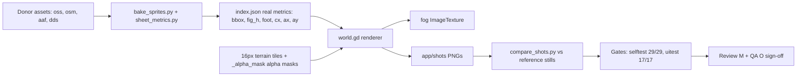
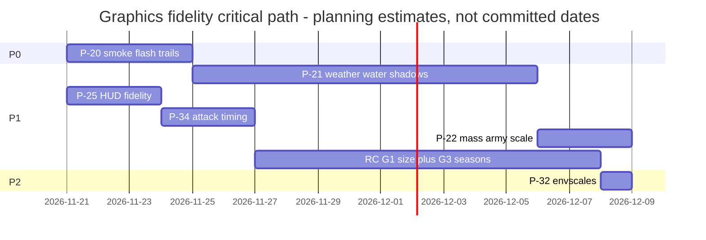

# ⚔️ STATUS — Graphics / fidelity

> [!IMPORTANT]
> Cold-readable status for **graphics / visual fidelity**. A human or a fresh agent
> should be able to read this file alone and know exactly what is done, what is
> critical, and how to resume. Every factual claim cites a ticket id, runner job,
> report path or evidence id — no uncited assertions. *Why* things are the way they
> are is traced to decision ids below and in `docs/DECISION_LOG.md` (D-19). This is a
> documentation-only file: no Godot run and no code edit was made to produce it
> (`SWARM_OPS.md` §5c). Independent D-22 deep analysis (`docs/audit/RENDER.md`)
> corrected two claims below; see §🔬 Deep-audit corrections.


## 🎯 TL;DR

The port's **asset and terrain foundations are in place**: 54 baked unit keys
(299 actions), 215 nation building sheets, real per-action sprite metrics, 16 px
terrain tiles with `_alpha_mask` alpha blending (not the dead dmask path, P-36) and
fog, and the GUIDE4 L1–L8 visual ladder implemented at code level through L8 — the
first chosen backlog (D-02) under the maximum-fidelity skirmish charter (D-12)
(L8 visual proof is pending P-35) (`README.md` as cited by `docs/research/RE_VISUAL.md` L2;
`docs/ASSET_AUDIT.md`; `app/scripts/world.gd:28,521,652`; `docs/guides/GUIDE4.md`
§L1–L8). The single most important fact: **it is not yet donor-faithful in motion** —
the signature effects (volley smoke, muzzle flash, arrow trails), weather/seasons,
animated water, shadows and mass-army scale are still open as P0/P1 tickets
(`SWARM_BOARD.md` P-20/P-21/P-22; `docs/research/RE_VISUAL.md` §4 gaps 1/2/4/6/8).
Selftest `29/29` is a simulation gate, **not** a visual proof.



## 📊 At a glance

| Fact | Value | Evidence |
|---|---|---|
| Selftest | `29/29 PASS` | `app/selftest.json` (29 `step` entries); runner `79 agentSE-selftest` in `docs/UNIT_BAKING_FIX.md` §11 |
| Unit sprite sheets | `54` keys / `299` action sheets, `0` missing, `0` orphan | `docs/ASSET_AUDIT.md` summary; `docs/research/RE_VISUAL.md` L2 |
| Building sheets | `215` nation sheets; `buildings.json` `1506` keys, `0` missing | `docs/research/RE_VISUAL.md` L2; `docs/ASSET_AUDIT.md` summary |
| Sprite metrics | real, not defaults — `0` `fig_h=1.0` outliers across 299 actions | `docs/UNIT_BAKING_FIX.md` §11.1 |
| Terrain tiles | `16 px/tile`, chunked; operative seam defence = `_alpha_mask` in `_build_chunk`, not the dead `terrain_masks` dmask array | `app/scripts/world.gd:700-709,712-798`; `docs/audit/RENDER.md` §B.2 (claim 3 PARTIAL); board P-36 |
| Fog | per-tile `fog_explored`/`fog_vis` alpha `ImageTexture`, `Data.FOG_OF_WAR` | `app/scripts/world.gd:18-24,147-162` |
| Visual ladder | L1–L5 + L7 implemented; L8 code-correct but visually unproven (P-35); L6 20-seed verification in progress | `docs/guides/GUIDE4.md` §L1–L8; `docs/audit/RENDER.md` §C; `SWARM_BOARD.md` B-01, P-35 |
| Naval asset bake | `anim/naval/index.json` has `yacht` key, subset schema | `docs/UNIT_BAKING_FIX.md` §11.3; `NAVAL_EVIDENCE.md` §2 |
| FX / scale ceiling | `FX_CAP 220`, `SPRITE_CELL 160`, pop cap default `200` vs donor thousands | `docs/research/RE_VISUAL.md` §3/§4 gap 2 (GUIDE4 §0066–0072, §L1/§55) |
| Open fidelity backlogs | `36` RE tickets total (`23` top-5); `56` RC tickets total (`45` top-10) | `docs/research/RE_VISUAL.md` §4; `docs/research/RC_TERRAIN.md` §5 |

Overall visual-ladder progress: `███████░ 88%` — 7 of 8 GUIDE4 L-steps implemented
at code level (L1/L2/L3/L4/L5/L7/L8); L6's 20-seed verification is open
(`SWARM_BOARD.md` B-01), and L8's cited shot is contradicted, so its *visual* proof
is pending P-35 (`docs/audit/RENDER.md` §C.2). This bar measures code-level ladder
implementation, **not** donor visual parity.

> [!WARNING]
> Selftest `29/29` proves simulation behaviour, not visual fidelity. No image was
> visually inspected by the research lane (`docs/research/RE_VISUAL.md` §0/§5), and
> headless `--screenshot` writes nothing in this environment, so in-game visual
> proof still needs a windowed capture or the `test_drive.py` bridge
> (`docs/UNIT_BAKING_FIX.md` §7). The `compare_shots.py` `0.80` score is a smoke
> check, not a calibrated fidelity threshold (`docs/COMMANDS.md` §11).

> [!NOTE]
> Ticket ids and decision ids are distinct namespaces; ticket ids are written as
> `BOARD X-01` in this doc.

### Decision trace

| Decision | Meaning | Relevance to graphics |
|---|---|---|
| **D-10** | Owner: the mill rotor is an unfinished feature — finish it (`docs/DECISION_LOG.md`) | P-09 goes to AB with `world.gd` ownership; until it closes it blocks P-20 smoke, P-21 weather/water and P-32 envscales. |
| **D-11** | Coordinator: naval waiver withdrawn — meshes are readable (`docs/DECISION_LOG.md`; `NAVAL_EVIDENCE.md` §2) | Naval is a port, not a waiver: yacht bake done, full naval layer P-10 open. |
| **D-12** | Owner: skirmish-only charter with **maximum graphics fidelity** (`docs/DECISION_LOG.md`; `SWARM_OPS.md` §0) | Opens the fidelity tranche P-18…P-25; parks DLC/mission visuals and cinematics. |
| **D-16** | Coordinator: fixed runner starvation bugs (`docs/DECISION_LOG.md`) | Makes selftest `29/29` and other gates trustworthy, including the C-01/P-26 animation metric fixes. |
| **D-18** | Owner: docs must be modern GitHub-flavored markdown (`docs/DECISION_LOG.md`) | This file's YAML front matter, badges, alerts, two Mermaid diagrams, task lists and `<details>` block. |

Also cited below: **D-02** (L1–L8 chosen backlog), **D-03** (single runner door),
**D-09** (raw donor assets left as-is), **D-15** (test-per-file), **D-17**
(cold-readable status docs), **D-19** (status docs must cite D-xx), **D-22**
(quality-first deep audit supersedes "good enough") — `docs/DECISION_LOG.md`.

### 🔬 Deep-audit corrections (D-22)

Independent pixel measurements and source reads by deep-RENDER
(`docs/audit/RENDER.md`, decision **D-22**) override the earlier worker-report
claims where they disagree:

| Claim | Original status | Audit verdict | Correction |
|---|---|---|---|
| **7** — `g4_l8_ghost_audit.png` proves the L8 transparent ghost | DONE (shot cited as proof) | **CONTRADICTED visually** — only a footprint ring, cursor line and "Not enough resources."; no translucent building, no red X (`docs/audit/RENDER.md` §C.2) | L8 is **code-confirmed** (`world.gd:1614-1637`) but **visually UNVERIFIED**; shot likely predates the `fx_layer` fix. Moved out of DONE; re-capture under **P-35**. |
| **3/4** — "dmask anti-seam masks" are the live seam defence | DONE (L2) | **PARTIAL** — `_alpha_mask` + coherent grid confirmed in `_build_chunk`; the returned `terrain_masks` dmask array is never read by draw code (`docs/audit/RENDER.md` §B.2) | Operative path is `_alpha_mask` (`world.gd:700-709`, used `:751,785`); dmask array assigned at `world.gd:92`/`main.gd:850` is dead. Comments at `world.gd:647,668-669,690` wrongly say red channel / "binary" — **P-36**. |
| **1** — `index.json` sprite metrics are real measurements | DONE | **CONFIRMED 3/3** by independent Pillow re-measurement (`docs/audit/RENDER.md` §A) | None — claim retained; the weaker "donor-accurate" visual claim stays UNVERIFIED (claim 2). |

## ✅ DONE — verified

- [x] **L1 terrain roles** — dark under trees, light main ground, khaki shore/desert, fourth worn fleck (`docs/guides/GUIDE4.md` §L1/§0249–0301).
- [x] **L2 seamless tiles + masks** — 16 px tiles, coherent `mix_grid` variants, `_alpha_mask` alpha masks in `_build_chunk`, LRU/amortized chunks (`docs/guides/GUIDE4.md` §L2/§0332–0399; `app/scripts/world.gd:521,652,700-709,712-798`). The returned `terrain_masks` dmask array is dead code, not the seam defence — board P-36 (`docs/audit/RENDER.md` §B.2).
- [x] **L3 clusters** — forests, quarries, mines, food rects, sacred starts, bushes (`docs/guides/GUIDE4.md` §L3/§0424–0516).
- [x] **L4 stumps** — felled trees become walkable stumps that do not block gather/path (`docs/guides/GUIDE4.md` §L4/§0545–0613).
- [x] **L5 heightmap** — per-tile `height[]`, `height_at()`, slope/cliff rule, combat height-aware (`docs/guides/GUIDE4.md` §L5/§0642–0713).
- [x] **Peasant stride fixes** — base `peasant` `walk.duration` `0.667 → 1.08 s` (agentC2) plus the 8 national variants (P-26/SE); 8 scalar `index.json` values only, no rebake (`docs/UNIT_BAKING_FIX.md` §10/§11.2; `SWARM_BOARD.md` C-01, P-26).
- [x] **Roster-wide metric audit** — all 54 keys / 299 actions audited; `fig_h`, `foot`, `cx`, `bbox` present on every action; selftest `29/29` (`docs/UNIT_BAKING_FIX.md` §11.1/§11; runner `79 agentSE-selftest`).
- [x] **Asset integrity clean** — 32/32 literal targets, 299 action sheets and 1506 building keys all resolve, 0 orphan `.import` files (`docs/ASSET_AUDIT.md` summary). Raw donor assets retained by D-09; licence-exposure items remain (§10 open questions).
- [x] **Naval yacht bake** — `yacht` key present in `app/assets/models/anim/naval/index.json`; donor `.oss`/`.osm` readers verified byte-identical (`docs/UNIT_BAKING_FIX.md` §11.3; `NAVAL_EVIDENCE.md` §2; `docs/decomp/DC_FORMATS.md` §3/fnd_7). Naval is a port, not a waiver (D-11).

> [!NOTE]
> Only items with a cited report or passing gate are listed here. Claimed-but-unverified
> work belongs in §4. L6's *tooling* exists (`scan_map.py`) but the 20-seed verification
> ticket B-01 is still IN_PROGRESS, so L6 is not claimed as fully done. The **L8 ghost is
> code-confirmed but visually contradicted** by its cited shot, so it was moved out of
> this list to P-35 (`docs/audit/RENDER.md` §C; `SWARM_BOARD.md` P-35). The naval bake
> follows D-11 and raw donor `.dds`/`.lib`/`.mat`/`.obj` files stay as-is by D-09. The
> peasant/roster metric fixes are tickets C-01/P-26 (not a D-xx); D-15 (test-per-file)
> and D-16 (runner fixes) are why their `29/29` gate can be trusted
> (`docs/DECISION_LOG.md`).

## 🚧 LEFT — by criticality

| Priority | Item | Ticket | Owner | Blocked by | Est. |
|---|---|---|---|---|---|
| 🔴 P0 | Volley/musket smoke, muzzle flash, arrow trails, impact FX | P-20 | unassigned | `world.gd` held by AB until P-09 closes | `4` tickets — RE gap 1 |
| 🟠 P1 | Weather/seasons + animated water + cast shadows/lighting | P-21 | unassigned | `world.gd` (AB); terrain assets | `11` tickets — RE gaps 4/6/8 |
| 🟠 P1 | Mass-army scale (default 200 → thousands) + squad disband | P-22 | unassigned | `game.gd`/`data.gd` (A), `ai.gd` (G), `hud.gd` (SC) | `3` tickets — RE gap 2 |
| 🟠 P1 | HUD information fidelity (6 resources, worker brackets, idle/empty-mine icons, score) | P-25 | SC (IN_PROGRESS) | — | `3` tickets — RE gap 3 |
| 🟠 P1 | Attack frame timing + remaining animation metric outliers | P-34 (+ P-26 follow-ups) | unassigned (P-26/SE DONE) | `anim/index.json`, `game.gd` (A) | `3` tickets — RE gap 10; `50` short attacks, `9` walk + `68` foot outliers (`docs/UNIT_BAKING_FIX.md` §11.4) |
| 🟠 P1 | RC map-size scaling, seasons, relief/terrain type | P-19 / RC G1,G3,G2 | unassigned | `data.gd`/`game.gd` (A), `world.gd` (AB) | `6+5+4=15` RC tickets |
| 🟠 P1 | Full naval layer beyond the yacht bake (ships, shipyard, naval AI, shore) | P-10 / RE gap 5 | AC (P-10 IN_PROGRESS) | naval assets + `game.gd` (A) | `7` tickets — RE gap 5 |
| 🟡 P2 | `envscales.cfg` import (mines/stones scale + jitter) | P-32 | unassigned | `data.gd` (A), `world.gd` (AB) | `4–6 h` — DB fnd_26 |
| 🟡 P2 | Re-capture genuine L8 ghost shot (translucent nation sheet + red X), replace `g4_l8_ghost_audit.png` citation | P-35 | unassigned | `world.gd` held by AB until P-09 closes; needs a windowed build | `1` ticket — audit claim 7 CONTRADICTED (`docs/audit/RENDER.md` §C.2) |
| 🟡 P2 | Remove/gate dead `terrain_masks` dmask build; fix alpha/red-channel comments at `world.gd:647,668-669,690` | P-36 | unassigned | `world.gd` (AB), `main.gd:850` (A) | `1` ticket — audit claim 3/4 PARTIAL (`docs/audit/RENDER.md` §B.2) |
| 🟡 P2 | Pattern/decor family expansion (dcr1-3, hills, swamp/lake, desert) | RC G7 | unassigned | `pattern_gen.gd` (Q-01) | `8` RC tickets |
| ⚪ P3 | Setup-menu six map options; forest type; river glints/currents; editor match flags | P-14 / P-19, RC G14/G8/G10 | unassigned | `menu.gd` (H), `data.gd` (A) | `2+2+3+4` tickets — RE gap 7, RC |

Criticality key: 🔴 P0 blocks a good playable skirmish or the release gate; 🟠 P1 visible
fidelity or core feature; 🟡 P2 polish; ⚪ P3 nice-to-have (`docs/STATUS_TEMPLATE.md` §4).
P-18…P-25 exist because of the D-12 charter; the naval row (P-10) exists because of
D-11 (`docs/DECISION_LOG.md`).



Durations are the sum of the cited per-gap ticket estimates, laid out as a dependency
sketch only — no start dates were committed by the coordinator.

## 🗃️ Deferred (owner charter §0)

- Cinematics / cutscenes — explicitly deferred; no build-lane slot (`SWARM_OPS.md` §0).
- DLC visuals tied to missions (winter/desert mission-map art) — mission packs are deferred, but the *season* visual system itself stays live as P-21/RC G3 (`SWARM_OPS.md` §0; `docs/research/RC_TERRAIN.md` §2.1).
- `.aix` campaign triggers and `.map` mission geometry — P-16/P-17 DEFERRED (`SWARM_BOARD.md`).
- Network / multiplayer — deferred by charter (`SWARM_OPS.md` §0).

<details>
<summary>Full deferred list (click to expand)</summary>

- missions / campaigns / `.aix` triggers (P-16)
- DLC mission packs and mission-bound visuals (P-17)
- network / multiplayer
- full `.map` binary decoder — recommended "won't fix" (DC T-7, 3–5 d optional; `docs/decomp/DC_FORMATS.md` §4)

</details>

## 👥 Ownership map

| File / area | Owner | Notes |
|---|---|---|
| `app/scripts/world.gd` | AB | D-10: finish the mill rotor (P-09); until it closes, P-20/P-21/P-32 all wait. **BOARD D-01 (worker D, L8 ghost + block-rules audit)** is also auditing this file (`SWARM_BOARD.md` P-09 and **BOARD D-01**; `docs/DECISION_LOG.md` D-10). |
| `app/scripts/hud.gd` | SC | P-25 HUD fidelity IN_PROGRESS (`SWARM_BOARD.md` P-25). |
| `app/assets/models/anim/index.json` | SE — DONE / released | P-26 complete; future edits need a new owner assignment (`SWARM_BOARD.md` P-26; `docs/UNIT_BAKING_FIX.md` §11.2). |
| `game.gd`, `data.gd` | A | Sim/option layer touched by P-22, P-19, P-32 (board A-01, P-06 note). |
| `ai.gd` | G | P-22 mass-army AI (board G-01). |
| `pattern_gen.gd`, `mapgen.gd` | Q | RC pattern/shape work (board Q-01). |
| `menu.gd` | H | Six map options / skirmish shell (board H-01, P-14). |
| Naval bake pipeline, naval assets | AC | P-10 yacht bake done; full naval layer open (board P-10; `NAVAL_EVIDENCE.md`). |
| FX / effects assets | unassigned | P-20 needs an owner before work starts (`SWARM_BOARD.md` P-20). |

> [!WARNING]
> Only the listed owner may edit those files. Cross-file edits are a REVIEW BLOCK
> under `SWARM_OPS.md` §3; `world.gd` is the busiest contention point, so P-09 must
> close before P-20/P-21/P-32 can be assigned there.

## 🧪 Acceptance gates

```bash
python app\tools\godot_runner.py status
python app\tools\godot_runner.py run --id doc2-selftest --timeout 180 -- --headless --path app -- --self-test app/selftest.json
python app\tools\godot_runner.py run --id doc2-uitest --timeout 180 -- --headless --path app -- --ui-test app/uitest.json
python app\tools\godot_runner.py run --id doc2-shot --timeout 90 -- --headless --path app -- --screenshot app/shots/p35_ghost_recheck.png --timeout 60
python app\tools\test_all.py --only <test-ids>
python app\tools\assert_clean.py --json
python app\tools\scan_map.py --dir scans
python app\tools\compare_shots.py --shot app/shots/p35_ghost_recheck.png --ref app/shots/ref_peasants.png
```

Pass criteria: selftest `29/29` (`app/selftest.json`), uitest `17/17`, clean-gate exit
`0`, small tests green in `app/tests/results/summary.json` (`docs/COMMANDS.md`; runner
protocol `SWARM_OPS.md` §3.1/§3.4). Visual acceptance also needs a **windowed** capture
and a human eyeball against `app/shots/final_nations.png`, `app/shots/g2_final.png`,
`app/shots/g4_final_land.png`, `app/shots/ours_musk_sprite.png` and
`app/shots/ref_peasants.png` — names only; the research lane did not open them
(`docs/research/RE_VISUAL.md` L4/§5). Never use the `compare_shots.py` `0.80` score as a
fidelity gate until a per-check threshold is calibrated (`docs/COMMANDS.md` §11).
The single runner door is D-03; test-per-file and runner starvation fixes are
D-15/D-16 (`docs/DECISION_LOG.md`). For **P-35** the **windowed** capture must visibly
show the alpha-0.45 nation sheet and the blocked-state red X — `g4_l8_ghost_audit.png`
is NOT acceptable proof (`docs/audit/RENDER.md` §C.2; `SWARM_BOARD.md` P-35). Headless
`--screenshot` writes nothing here (`docs/UNIT_BAKING_FIX.md` §7).

## 🔗 Evidence index

- Reports: `docs/audit/RENDER.md` (D-22 deep audit, 9 claims — claims 7 CONTRADICTED, 3/4 PARTIAL), `docs/research/RE_VISUAL.md` (10 gaps, 36 tickets), `docs/research/RC_TERRAIN.md` (56 tickets, top-10), `docs/decomp/DC_FORMATS.md`, `docs/decomp/DE_AUDIO_UI.md`, `docs/UNIT_BAKING_FIX.md`, `ASSET_AUDIT.md`, `NAVAL_EVIDENCE.md`, `docs/guides/GUIDE4.md` §L1–L8, `docs/COMMANDS.md`.
- Runner results: `79 agentSE-selftest` (waited 139.6 s, ran 41.4 s, `29/29`) in `docs/UNIT_BAKING_FIX.md` §11; queue results under `app/.godot_queue/results/<ticket>_<id>/` (`docs/COMMANDS.md`).
- Backups: `inbox/backup/index.json.bak-agentSE`, `inbox/backup/UNIT_BAKING_FIX.md.bak-agentSE` (`docs/UNIT_BAKING_FIX.md` §11).
- Craft Anything evidence ids (decomp): `ev_392885a6…` (`.oss`), `ev_0bbb20c1…` (`.osm`), `ev_6a6b0380…` (`.aaf`), `ev_f83c1680…` (`.pfx` particle source, relevant to P-20), `fnd_7` (OSM offset bug refuted) — `docs/decomp/DC_FORMATS.md` §1/§3.
- Craft Anything evidence ids (audio/UI): `ev_bd4dc176…` (audio inventory), `ev_90e0959…` (`en/gui.txt`), `ev_75d79f6…` (`menu.cfg`), `fnd_17`–`fnd_21` — `docs/decomp/DE_AUDIO_UI.md`.
- Board: `SWARM_BOARD.md` (P-09, P-10, P-19/20/21/22/25/26/32/34/35/36, C-01, B-01; **BOARD D-01** = worker D's L8 ghost audit — a ticket id, not a decision id).
- Decisions: `docs/DECISION_LOG.md` — D-01 (kill 6 leaked Godot processes), D-02, D-03, D-09, D-10, D-11, D-12, D-15, D-16, D-17, D-18, D-19, D-22 (quality-first deep audit), with rationale and evidence.

## 🔄 How to resume (cold start)

1. [ ] Read this file, `SWARM_BOARD.md`, `docs/DECISION_LOG.md` (the "why"), and `SWARM_OPS.md` §0 (charter, D-12) / §5c (doc lane, D-17).
2. [ ] Check `python app\tools\godot_runner.py status` before launching anything (`SWARM_BOARD.md` §Queue telemetry).
3. [ ] Pick the highest-priority unblocked ticket from §4 — P-20 first, but confirm P-09 closed so `world.gd` is free.
4. [ ] Back up owned files to `inbox\backup\<name>.bak-<your-id>` (`SWARM_OPS.md` §3.3).
5. [ ] Implement, run the §7 gates, and update this file's §2 table when done.
6. [ ] For any visual ticket, add a windowed screenshot to `app/shots/` and record it here; selftest alone is not acceptance (§2 warning).

## ❓ Open questions

- [ ] Who assigns P-20 (FX/effects owner is `unassigned`)? Coordinator — nothing can start on the top gap of the D-12 charter (`SWARM_BOARD.md` P-20; `docs/DECISION_LOG.md` D-12).
- [ ] When does P-09 (D-10) close and release `world.gd`? AB / coordinator — blocks P-20/P-21/P-32 (`SWARM_BOARD.md` P-09; `docs/DECISION_LOG.md` D-10).
- [ ] Are the 9 walk and 68 `foot` outliers intentional, and is `n*0.12` the right attack-timing rule for one-shot `fire_t`? SE + owner of `game.gd` — needed before P-34 fixes (`docs/UNIT_BAKING_FIX.md` §11.4).
- [ ] Can the donor `.pfx` particle source (1 file, semantics unmapped) seed the smoke emitter, or must sprites be authored? Decomp lane / P-20 owner (`docs/decomp/DC_FORMATS.md` §1 fnd).
- [ ] Does the 20-seed L6 verification hold? B — B-01 IN_PROGRESS (`SWARM_BOARD.md`).
- [ ] What to do with the 468 tracked raw `.dds` + 8 `.lib/.mat` donor decals and `_mill_tmp/` scratch? Compliance/coordinator — licence exposure, not broken references (`ASSET_AUDIT.md` §Recommended actions).
- [ ] Does the port's bottom-left minimap actually mismatch the donor? Needs a human view of the S11 screenshot; research lane could not see it (`docs/research/RE_VISUAL.md` §5).
- [ ] Was `g4_l8_ghost_audit.png` captured before the `fx_layer` fix (`world.gd:1618-1621`)? AB / coordinator — decides whether P-35 is a pure re-capture (`docs/audit/RENDER.md` §C.2; `SWARM_BOARD.md` P-35).
- [ ] Delete the dead `terrain_masks` build and correct the alpha/red-channel comments (`world.gd:647,668-669,690`)? `world.gd` owner — comment-only, no behaviour change (`docs/audit/RENDER.md` §B.2; `SWARM_BOARD.md` P-36).
- [ ] Where are the `app/.godot_queue/results/` artifacts for runner `79 agentSE-selftest`? QA O — none found by the audit; the job id is currently a doc citation only (`docs/audit/RENDER.md` §Open questions 6).

---

**Related:** `docs/RESUME.md` · `docs/DECISION_LOG.md` · `docs/audit/RENDER.md` · `SWARM_BOARD.md` · `SWARM_OPS.md` · `docs/STATUS_TEMPLATE.md` · `docs/research/FORECAST.md` · `docs/research/RE_VISUAL.md` · `docs/research/RC_TERRAIN.md`
