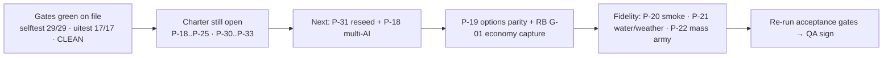
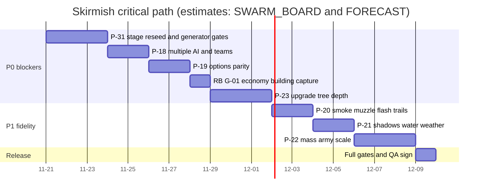

# ⚔️ STATUS — Skirmish port

> [!IMPORTANT]
> Cold-readable status for the **random-skirmish port**. A human or a fresh agent
> should be able to read this file alone and know exactly what is done, what is
> critical, and how to resume. Every factual claim cites a ticket id, runner job
> id, report path or evidence id — no uncited assertions. This area is governed
> by the owner's **skirmish-first charter** (`SWARM_OPS.md` §0, **D-12**);
> missions, campaigns and network are explicitly deferred (D-12).


## 🎯 TL;DR

This is the singleplayer random-skirmish port of **Cossacks 3** into **Godot 4.7**
(`README.md` §What this is). The core simulation and the entire round-4 landscape
programme (L1–L8: terrain roles, seamless tiles, resource clusters, walkable
stumps, heightmap, seed + headless scan, unit anims, transparent building ghost)
are implemented and the file-level gates are green: selftest **29/29**, uitest
**17/17**, clean-exit gate **CLEAN** (`app/selftest.json`, `app/uitest.json`,
`QA_REPORT.md` final gate; `app/tools/CLEAN_GATE.md`). The single most important
fact: **green gates do not mean release-ready** — the owner's skirmish-first
charter (multiple AI opponents/teams, option parity, donor fidelity, mass-army
scale; **D-12**) is still an open P0/P1 tranche (`SWARM_BOARD.md` P-18…P-25,
P-30…P-33; `docs/research/FORECAST.md` §0), and QA's final independent re-run was
blocked by a runner deadlock, not signed (`QA_REPORT.md` FINAL GATE RE-RUN; the
runner is deliberately single-door per **D-03**).



## 📊 At a glance

| Fact | Value | Evidence |
|---|---|---|
| Sim self-test | `29/29 PASS` (`"passed": true`) | `app/selftest.json`; `QA_REPORT.md` final re-run, runner #70 / ticket 43 |
| UI journey test | `17/17 PASS` (`"passed": true`) | `app/uitest.json`; `QA_REPORT.md` gate table, runner #19 |
| Clean-exit gate | `CLEAN` (0 orphans, lock free, no timeout/error/skipped jobs) | `python app\tools\assert_clean.py --json`; `QA_REPORT.md` final gate; `app/tools/CLEAN_GATE.md` §Exit codes |
| Nations in `NATIONS` | `20` (no `sco`) | `docs/research/RA_ROSTER.md` §4; `app/scripts/data.gd` |
| Unit sprite keys | `54` | `docs/research/RA_ROSTER.md` §4 (`anim/index.json`) |
| Building sprite keys | `1506` (13 families × nations) | `docs/research/RA_ROSTER.md` §4 (`anim/buildings.json`) |
| Sim building types | `18` | `docs/research/RA_ROSTER.md` §4 (`BUILDINGS_BASE`) |
| Map size | `160 × 160` tiles (donor 640) | `app/scripts/data.gd:33-34` |
| Landscape programme | `L1–L8` implemented | `docs/guides/GUIDE4.md` §L1–L8; `README.md` project map |
| Small-test registry | `20` tests (`5 ready`, `15 pending`) | `app/tests/manifest.json` |
| Donor mechanics fully implemented | `28 / 57` | `docs/research/RB_MECHANICS.md` §2 status line |
| Open P0 tranche | `P-18, P-19, P-23, P-31` + `RB G-01` | `SWARM_BOARD.md`; `docs/research/RB_MECHANICS.md` §3 |

Overall progress: `█████░░░░░ ~49%` — **share of donor mechanics classified
`IMPLEMENTED` (28 of 57 rows)**, the only fully cited coverage metric
(`docs/research/RB_MECHANICS.md` §2). It does not measure the deferred content
scale or fidelity work.

> [!NOTE]
> **Why the port is shaped this way (decision ids):** donor assets are kept
> as-is and never redistributed — P-07/P-08 CLOSED (**D-09**); naval moved from
> waiver to port after readable meshes were found — P-10 (**D-11**); everything
> outside random skirmish (missions/campaigns/network) is parked by owner
> decision (**D-12**). See the Decision trace in §8.

## ✅ DONE — verified

- [x] **L1 terrain roles** (dark under trees, light meadow, khaki shore/desert, worn fleck) — `docs/guides/GUIDE4.md` §L1; `README.md` project map (L1–L8 implemented).
- [x] **L2 seamless tiles** with quality presets (low/med/high, grain preserved) — `docs/guides/GUIDE4.md` §L2; `app/scripts/data.gd:110-121` `set_quality`.
- [x] **L3 discrete resource clusters** (forests/quarries/mines/fields, guaranteed ring + re-plant) — `docs/guides/GUIDE4.md` §L3.
- [x] **L4 trees + walkable stumps** (live trees block, felled become passable stumps) — `docs/guides/GUIDE4.md` §L4.
- [x] **L5 heightmap** (low swells walkable, steep cliffs block) — `docs/guides/GUIDE4.md` §L5.
- [x] **L6 seed + scan pipeline** (`--seed` wired, `scan_map.py` headless quality metrics, 20-seed loop) — `docs/guides/GUIDE4.md` §L6; `SWARM_BOARD.md` B-01 (verification still IN_PROGRESS).
- [x] **L7 unit anims + metrics sweep** — `docs/guides/GUIDE4.md` §L7; `SWARM_BOARD.md` C-01 (QA) and P-26 (DONE): 8 scalar fixes, national peasant walks `0.667 → 1.08 s`, selftest 29/29, no rebake.
- [x] **L8 transparent building ghost + `can_place` block rules** — `docs/guides/GUIDE4.md` §L8; `SWARM_BOARD.md` ticket D-01 (audit IN_PROGRESS; implementation landed).
- [x] **Selftest 29/29 and uitest 17/17** — `app/selftest.json`, `app/uitest.json`; `QA_REPORT.md` final re-run, runner #70 / ticket 43.
- [x] **Clean-exit gate CLEAN** — `python app\tools\assert_clean.py --json`; `QA_REPORT.md` final gate; historical timeout #20 acknowledged under D-14 (`app/tools/CLEAN_GATE.md` §Resolved historical failures).
- [x] **Roster scale**: 20 nations / 54 unit keys / 1506 building keys / 160×160 maps — `docs/research/RA_ROSTER.md` §4; `app/scripts/data.gd:33-34`.
- [x] **AI opponent** expands, techs, forms squads, attacks in waves — `README.md` "Computer opponent"; `docs/research/RB_MECHANICS.md` §2 (`ai.gd` waves/`_raids`); `SWARM_BOARD.md` G-01 (audit in flight).
- [x] **Formations, squads, morale, routs** — sizes 15–400, +2/+3 and hold +9/+9 bonuses; `README.md` "Line warfare"; `docs/research/RB_MECHANICS.md` §2; selftest steps `formation`, `formation_bonus`, `morale`, `flee`, `squad`, `replenish` (`app/selftest.json`).
- [x] **Economy + mine ladder** — 1.664/s mine income, ÷625 upkeep, mine upgrades II→VII to 95 workers; `docs/research/RB_MECHANICS.md` §2 (`data.gd:54,56,763-780`); `README.md` controls; selftest `mine`.
- [x] **Capture (partial)**: peasant capture and town-hall capture work — `docs/research/RB_MECHANICS.md` §2 (`game.gd:3212-3225,3537-3577`); `SWARM_BOARD.md` P-03 DONE; selftest `capture`, `peasant_capture`. Economy-building capture is still **MISSING** (`RB_MECHANICS.md` G-01) — see §4.
- [x] **17c/18c transition + national exclusions** (`ukr`/`tur`/`alg`) — `docs/research/RB_MECHANICS.md` §2 "18c transition" = IMPLEMENTED (`data.gd:167-178`).
- [x] **Headless test harness never hangs** — `SWARM_BOARD.md` F-01 DONE: `quit()`-in-`_initialize()` eliminated, 0 direct `quit()` calls, F3 jobs ok (1.99 s / 11.15 s).

> [!NOTE]
> Only items with a passing gate or a cited report are listed above.
> Claimed-but-unverified work (e.g. L6 verification B-01, L8 audit ticket D-01,
> AI audit G-01) is noted inline and stays open in §4 / §10.

## 🚧 LEFT — by criticality

| Priority | Item | Ticket | Owner | Blocked by | Est. |
|---|---|---|---|---|---|
| 🔴 P0 | Stage-level reseeding + generator version gates for true random maps (donor reseeds before every stage; port uses one seed — critical path) | P-31 | unassigned | A owns `game.gd`/`data.gd` | 16–24 h (`FORECAST`/DB fnd_24) |
| 🔴 P0 | Multiple AI opponents / teams on one random map | P-18 | unassigned | G (`ai.gd`), H (`menu.gd`), A (`game.gd`) | board tranche (~8 h) |
| 🔴 P0 | Skirmish options parity: relief, richness, season, teams, map size (incl. P-14 menu options) | P-19 / P-14 | unassigned | A (`data.gd`/`game.gd`), H (`menu.gd`), B (`main.gd`) | board tranche (~8 h) |
| 🔴 P0 | Economy-building capture (market/mines/storehouse — donor capturable; flag absent, behaviour half-wired) | RB G-01 (new) | unassigned | A owns `data.gd` | 1 ticket (`RB_MECHANICS.md` §3) |
| 🔴 P0 | Upgrade-tree depth: firepower tiers, bayonet, steel grades, cavalry, drills | P-23 (RB G-02…G-05) | unassigned | A (`data.gd`/`game.gd`) | ~12 tickets; G-02/G-03 are P0 within it |
| 🟠 P1 | Fidelity tranche 1: volley smoke, muzzle flash, arrow trails | P-20 | unassigned | D/AB (`world.gd`), L (`audio.gd`) | ~4 tickets (`FORECAST` RE) |
| 🟠 P1 | Fidelity tranche 2: shadows, animated water, weather/seasons | P-21 | unassigned | D/AB (`world.gd`) | RE gaps 4/6/8 |
| 🟠 P1 | Mass-army scale (200 → thousands) + squad experience/disband (RB G-13) | P-22 | unassigned | A (`game.gd`), G (`ai.gd`), SC (`hud.gd`) | board tranche |
| 🟠 P1 | Scotland + nation-unique units + 12 baked-but-unwired sprites | P-24 (RA G01–G08) | unassigned | A (`data.gd`), C/SE (anim assets) | RA top gaps; cheapest visible wins |
| 🟠 P1 | HUD information fidelity (worker icons, 6 resources, deficit, score) | P-25 | SC | — | IN_PROGRESS (board) |
| 🟠 P1 | Import donor formation bonuses from `formations.cfg` (43 variants; port uses wiki values) | P-30 | unassigned | A (`game.gd`/`data.gd`) | 6–8 h (DB fnd_22) |
| 🟠 P1 | Hotkey parity from donor `hotkeys.cfg` (243 bindings; `HOTKEYS={}` today) | P-33 / RB G-12 | unassigned | P (`config.gd`), D (`input_controller.gd`) | 8–12 h (DB fnd_23) |
| 🟠 P1 | Naval port (54 readable meshes, 5 animated `.oss`, 24 `.aaf`) — waiver withdrawn, so this is an active port, not a deferral (D-11) | P-10 (RA G02–G04) | AC | A (`data.gd` entries) | IN_PROGRESS; `NAVAL_EVIDENCE.md` |
| 🟠 P1 | Damage protection off-by-one (`WK` arrow=5/cannonball=7 vs 6-slot `prot`) | P-06 | unassigned | A owns `data.gd` | BLOCKED (I-01 spot-check) |
| 🟠 P1 | Capture preconditions + guard defence (RB G-09); foreign town-hall unlock (RB G-07) | RB G-07/G-09 (new) | unassigned | A (`game.gd`/`data.gd`) | 3 tickets (`RB_MECHANICS.md` §3) |
| 🟡 P2 | Import `envscales.cfg` table (mine 0.3152, stone 0.329, 0.85–1.15 jitter) | P-32 | unassigned | A (`data.gd`), D (`world.gd`) | 4–6 h (DB fnd_26) |
| 🟡 P2 | `chop` sound maps to nothing (`_play(["chop"])` → `["workwood"]`) | P-12 | unassigned | B owns `main.gd` | one-line (DE decomp) |
| 🟡 P2 | Nation music: 20 donor tracks absent (only `rus`/`ukr`) | P-13 | unassigned | L (`audio.gd`, assets) | add files + fallback |
| 🟡 P2 | Attack-frame timing (50 actions below `n*0.12`, one-shot `fire_t`) | P-34 | unassigned | C/SE (anim index), A (`game.gd`) | dedicated frame-level ticket (SE) |
| 🟡 P2 | AI does not deny mines by demolition before capture (RB G-11) | RB G-11 (new) | unassigned | G owns `ai.gd` | 1 ticket (`RB_MECHANICS.md` §3) |
| ⚪ P3 | Doc drift: unit capture "NOT implemented", worker caps 2 vs 3, patrol Q vs P (RB G-10) | RB G-10 | I | — | 1 doc-only ticket (owner I, IN_PROGRESS) |
| ⚪ P3 | Build-time/rate unit mismatch (market 286 s, tower 1500 s) — UNVERIFIABLE (RB G-14) | RB G-14 | unassigned | — | 1 research/doc ticket |

Priority key: 🔴 P0 = blocks a good playable skirmish or the test/release gate;
🟠 P1 = visible fidelity or core feature; 🟡 P2 = polish; ⚪ P3 = nice-to-have.
Sources: `SWARM_BOARD.md` P-14, P-18…P-25, P-30…P-34 (P-18…P-25 created by the
skirmish-only decision, **D-12**); `docs/research/RB_MECHANICS.md` §3;
`docs/research/RA_ROSTER.md` §5; `docs/research/FORECAST.md` §0.



## 🗃️ Deferred (owner charter §0, D-12)

- **Missions, campaigns, `.aix` triggers** — skirmish-only charter defers all campaign/mission work (**D-12**); ticket P-16 would be the placeholder (`SWARM_OPS.md` §0; `SWARM_BOARD.md` P-16 DEFERRED).
- **DLC mission maps** — DLC packs and mission-map geometry are out of scope under D-12; P-17 is the placeholder (`SWARM_OPS.md` §0; `FORECAST.md` §0).
- **Network / multiplayer** — explicitly deferred by the owner charter (D-12; `SWARM_OPS.md` §0).
- **Cinematics / cutscenes** — deferred with missions (D-12; `FORECAST.md` §0).
- **Exact `.map` terrain-grid decoder** — closed format; mission work parked, only procedural mimicry is relevant (`FORECAST.md` §3, DD finding).

<details>
<summary>Full deferred list (click to expand)</summary>

- Campaigns and `.aix` trigger scripts (P-16) — DE found `.aix` are plain UTF-8 trigger scripts (18 files, 6 unique), portable but out of scope under D-12 (`FORECAST.md` §2).
- DLC mission-map packs (P-17) — 5 content DLCs + 2 seasonal packs on disk; 24–31 research tickets parked by D-12 (`FORECAST.md` §1).
- Network / multiplayer — owner charter §0, D-12.
- Cutscenes / cinematics — D-12; `FORECAST.md` §0.
- Full `.map` numeric-grid RE (+3–5 days) — deferred with missions; `.map` header/markers/placements decode but numeric arrays have an undocumented stride (`FORECAST.md` §3, DD).

</details>

## 👥 Ownership map

| File / area | Owner | Notes |
|---|---|---|
| `game.gd`, `selftest.gd` | A | A-01 IN_PROGRESS; many P0 tickets need `game.gd` but are unassigned (`SWARM_BOARD.md`) |
| `data.gd` | A | Contested: AC needs entries for P-10 naval (D-11); RB gaps target `data.gd` |
| `main.gd`, `scan_map.py`, `scans/**` | B | B-01 IN_PROGRESS; P-11/P-12/P-15 blocked on B |
| `world.gd`, `input_controller.gd` | D | board ticket D-01 (ghost audit); `world.gd` contested with AB (P-09 mill rotor, D-10) |
| `hud.gd` | D + SC | board ticket D-01 lists `hud.gd`; P-25 assigns `hud.gd` to SC — coordinator arbitration needed |
| `ai.gd` | G | G-01 audit IN_PROGRESS (60 s CLI soak) |
| `menu.gd`, `scenes/**` | H | H-01 IN_PROGRESS; P-18/P-19 need menu options |
| `mechanics.json`, `MECHANICS.md` | I | I-01 IN_PROGRESS; RB G-10 doc fixes |
| `nav.gd` | J | J-01 (AStarGrid2D usage) |
| `audio.gd`, audio assets | L | L-01; P-13 nation music |
| `camera.gd`, `config.gd` | P | P-07; P-33 hotkeys need `config.gd` |
| `anim/index.json`, `sheet_metrics.py`, anim assets | C (QA), SE (DONE) | C-01 / P-26; P-34 attack frames |
| `app/tests/**` | F | F-01 DONE; 15 pending small-test authors own their `t_*.gd` (D-15; `app/tests/manifest.json`) |
| `assert_clean.py`, `CLEAN_GATE.md` | Z | Z-01 clean gate; `failed` statuses excluded by D-13, historical failures `ack`-ed by D-14 |
| `NAVAL_EVIDENCE.md`, naval bake pipeline | AC / W | P-10 / W-01 (D-11) |
| Review / triage / QA | M / N / O | read-only desks (`SWARM_OPS.md` §1; D-17) |

> [!WARNING]
> Only the listed owner may edit a file. Cross-file edits are a **REVIEW BLOCK**
> under `SWARM_OPS.md` §3 (**D-04**). Contested files above (`data.gd`,
> `world.gd`, `hud.gd`, `main.gd`) must be arbitrated by the coordinator before
> assignment; unassigned P0 tickets cannot start until their owning files are free.

## 🧪 Acceptance gates

> [!NOTE]
> DOC-1 is in the documentation lane (`SWARM_OPS.md` §5c; D-17) — it does **not**
> run Godot or edit code. These are the exact gates an implementer or QA (O-01)
> must run. Every Godot launch goes through `godot_runner.py`; no direct `godot`
> calls (single-door rule, **D-03**). That serialization is also why the build
> lane is capped at WIP 20 under a 1000-ticket roster (**D-05 / D-06**) and why
> per-feature tests live in one file each (**D-15**).

```bash
python app\tools\godot_runner.py run --id <area>-selftest --timeout 180 -- --headless --path app -- --self-test app/selftest.json
python app\tools\godot_runner.py run --id <area>-uitest  --timeout 180 -- --headless --path app -- --ui-test app/uitest.json
python app\tools\godot_runner.py run --id <area>-cli     --timeout 180 -- --headless --path app -- --cli app/cli.json --cli-seconds 60
python app\tools\godot_runner.py run --id <area>-shot    --timeout 90  -- --path app -- --screenshot app/shots/g4_qa_gate.png --timeout 60
python app\tools\test_all.py --only t_build_flow t_mill_logic t_mine_unified t_visual_tuning t_mill_rotor
python app\tools\assert_clean.py --json
```

Pass criteria (`QA_REPORT.md` gate table; `app/tools/CLEAN_GATE.md` §Exit codes):

- selftest `"passed": true` with **29/29** steps (`app/selftest.json`);
- uitest `"passed": true` with **17/17** steps (`app/uitest.json`);
- CLI soak 60 s with `sim_seconds: 60.0` and **0** `stuck`/`ERROR`/`SCRIPT ERROR` hits (`QA_REPORT.md` round 1, runner #29);
- clean gate exit `0` — no orphan Godot processes, no stale lock, no `timed-out`/`error`/`skipped` jobs; `failed` statuses are deliberately excluded (D-13) and resolved historical failures are `ack`-ed (D-14);
- relevant small tests green in `app/tests/results/summary.json` (`app/tools/test_all.py`, D-15);
- bounded FIFO queue wait via `python app\tools\godot_runner.py status` (round-1 max 431.81 s, mean 170.06 s — `QA_REPORT.md` telemetry).

## 🔗 Evidence index

- Decision audit trail: [docs/DECISION_LOG.md](DECISION_LOG.md) — all D-xx ids and their rationale (D-19); Decision trace table below.
- `QA_REPORT.md` — gate tables, runner ids #13/#19/#29/#44 and #70/#74/#76/#75; round-1 PASS gates; final re-run verdict and clean-gate CLEAN.
- `app/selftest.json`, `app/uitest.json` — current step-by-step results (29/29, 17/17).
- `app/tools/CLEAN_GATE.md`, `python app\tools\assert_clean.py --json` — clean-gate definition and CLEAN verdict; historical #20 acknowledged (D-14).
- `app/tests/manifest.json`, `app/tests/results/summary.json` — 20-test registry (5 ready / 15 pending) and small-test aggregate (D-15).
- `docs/guides/GUIDE4.md` §L1–L8 — landscape programme scope and verification steps (D-02 selected this backlog).
- `docs/research/RA_ROSTER.md` §4/§5 — roster counts (20/54/1506), baked-but-unwired sprites, gap list G01–G17.
- `docs/research/RB_MECHANICS.md` §2/§3 — 57-row mechanics checklist (28 IMPLEMENTED), gaps G-01…G-14.
- `docs/research/FORECAST.md` §0/§1/§3 — re-scope (D-12), report totals, decompilation findings and capacity model.
- `SWARM_BOARD.md` — tickets A-01, B-01, C-01, D-01, F-01, G-01, P-03, P-04, P-06, P-07, P-08, P-09, P-10…P-15, P-16, P-17, P-18…P-25, P-30…P-34.
- `README.md` — product summary, controls, project map.
- Runner results: `app/.godot_queue/results/<ticket>_<id>/` (`stdout.txt` / `stderr.txt`); queue state via `python app\tools\godot_runner.py status`.
- Craft Anything evidence ids: DB fnd_22 (formations), fnd_23 (hotkeys), fnd_24 (reseeding), fnd_26 (envscales); DC fnd_7 (`.osm` reader bug refuted); DE (20 nation tracks, `chop`, hotkeys); DD (`.aix` portable, `.map` grid closed); investigation opened by D-07.

### 🧭 Decision trace

The five decision topics that most shape this area (D-05/D-06 are one capacity
decision); full rationale in [docs/DECISION_LOG.md](DECISION_LOG.md).

| Decision | What it fixes in this area | Where it shows up here |
|---|---|---|
| **D-12** (Owner, 07:20) | Skirmish-only charter: random encounters, max fidelity, AI ≥ donor, multiple enemies, squads; missions/campaigns/network deferred | TL;DR, §4 P-18…P-25, §5 Deferred |
| **D-03** (Coordinator, 05:56) | All Godot via `godot_runner.py` (FIFO lock + timeout); no direct `godot` — prevents the orphan-process failure of D-01 | TL;DR (runner deadlock), §7 gates |
| **D-05 / D-06** (Owner, 06:00 / 06:10) | AAA scale: 100-ticket roster → 1000, WIP 20 build lane, parallel research/decompilation lanes | §7 gates note (why the build lane is throttled) |
| **D-11** (Coordinator, 07:05) | Naval waiver withdrawn — readable meshes make it an active port (P-10), not a deferral | §2 scope note, §4 P-10, §6 ownership |
| **D-15** (Coordinator, 07:35) | One feature per test file + `manifest.json`/`test_all.py` + 15 test authors, so tests parallelise | §2 registry row, §7 gates, §6 `app/tests/**` |

Supporting ids cited above: **D-04** (disjoint ownership), **D-09** (donor assets
as-is), **D-10** (mill rotor), **D-13** / **D-14** (clean-gate `failed` exclusion
and `ack`), **D-16** (runner starvation fixes), **D-17** / **D-18** / **D-19**
(documentation lane, modern markdown, decision trace), **D-02** (L1–L8 backlog).

## 🔄 How to resume (cold start)

1. [ ] Read this file, `SWARM_BOARD.md`, `SWARM_OPS.md` §0 and [docs/DECISION_LOG.md](DECISION_LOG.md), then the relevant report (§8).
2. [ ] Check `python app\tools\godot_runner.py status` before launching anything — confirm the queue is not wedged (see §10; earlier starvation fixes are D-16).
3. [ ] Pick the highest-priority unblocked ticket from §4 (P-31 and P-18 first); confirm its owning file is free in §6.
4. [ ] Back up owned files to `inbox\backup\<name>.bak-<your-id>`.
5. [ ] Implement, run the §7 gates through the runner, then update this file's §2 table and the ticket's board state via the coordinator.

## ❓ Open questions

- [ ] **Runner deadlock** — QA's final re-run (O2) was never served: `now_serving = 47` pinned, pending job #47 owner PID 7444 dead, no lock so the stale-reclaim branch never fires (`QA_REPORT.md` FINAL GATE RE-RUN). Earlier starvation fixes exist (D-16), but this missing-lock case may be distinct. Coordinator/QA: is it fixed, and can an independent full re-run be signed? This is why status is `amber`, not `green`.
- [ ] **Stale board P-04** — board still marks `farm_cap` BLOCKED, but `app/selftest.json` now shows `farm 500 -> 525 -> 500` PASS and `QA_REPORT.md` final re-run is 29/29. Coordinator: reconcile the board.
- [ ] **A-01 scope** — board still lists A-01 IN_PROGRESS on `build`, yet the `build` step passes and selftest is green (`QA_REPORT.md` round 1 §Selftest step failure). Coordinator: close or re-scope.
- [ ] **Contested files** — `hud.gd` (board D-01 vs SC/P-25), `world.gd` (board D-01 vs AB/P-09, D-10), `data.gd` (A vs AC/P-10, D-11). Coordinator: arbitrate before assigning P0 work.
- [ ] **Patrol hotkey P vs Q** — RB G-12 / P-33: wiki says P, port uses Q (`config.gd:111`). Donor `hotkeys.cfg` is authoritative and was not re-read — who verifies? (`docs/research/RB_MECHANICS.md` §3/§4).
- [ ] **Scotland denominator** — 21 nations in current game-data extraction vs 20 in the Steam guide; port matches 20 (`docs/research/RA_ROSTER.md` §6). Decide target roster size for P-24.
- [ ] **Exit-time resource leaks** — selftest (9 ObjectDB instances, 2 resources) and screenshot (GLES3 texture/RID, `RenderingServer::get_singleton()` null) are non-fatal but unassigned (`QA_REPORT.md` round 1 §Screenshot exit-time errors).
- [ ] **Map scale** — port map is 160×160 tiles vs donor 640 (`app/scripts/data.gd:33-34`). Is this adequate for the P-22 mass-army goal? Owner decision needed.

---

**Related:** [docs/RESUME.md](RESUME.md) (master index — to be created per `SWARM_OPS.md` §5c) · [SWARM_BOARD.md](../SWARM_BOARD.md) · [SWARM_OPS.md](../SWARM_OPS.md) · [docs/research/FORECAST.md](research/FORECAST.md)
