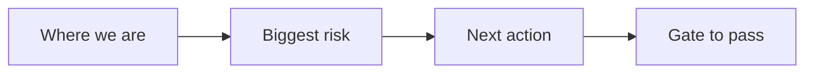
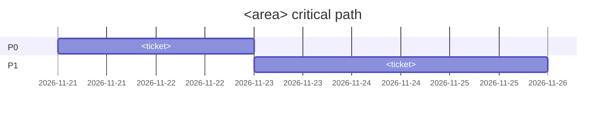

# ⚔️ STATUS — <AREA>

> [!IMPORTANT]
> Cold-readable status for **<AREA>**. A human or a fresh agent should be able
> to read this file alone and know exactly what is done, what is critical, and
> how to resume. Cite evidence (ticket id, runner job id, report path, evidence
> id) for every factual claim — no uncited assertions.


## 🎯 TL;DR

One paragraph. What this area is, its current state, and the single most
important fact. Write it for someone who has never seen the project.



## 📊 At a glance

| Fact | Value | Evidence |
|---|---|---|
| e.g. self-test | `29/29 PASS` | `app/selftest.json`, runner #N |
| e.g. critical tickets | `N` | `SWARM_BOARD.md` |

Overall progress: `█████░░░░░ 50%` — explain what the bar measures.

## ✅ DONE — verified

- [x] Item — evidence (ticket / job id / report path).
- [x] Item — evidence.

> [!NOTE]
> Only include items with a passing gate or a cited report. Claimed-but-untested
> work belongs in §4 with status `unverified`.

## 🚧 LEFT — by criticality

| Priority | Item | Ticket | Owner | Blocked by | Est. |
|---|---|---|---|---|---|
| 🔴 P0 | | | | | |
| 🟠 P1 | | | | | |
| 🟡 P2 | | | | | |
| ⚪ P3 | | | | | |

P0 = blocks a good playable skirmish or the test/release gate; P1 = visible
fidelity or core feature; P2 = polish; P3 = nice-to-have.



## 🗃️ Deferred (owner charter §0)

- Item — why deferred, and the ticket it would become if un-deferred.

<details>
<summary>Full deferred list (click to expand)</summary>

- missions / campaigns / `.aix` triggers
- DLC mission maps
- network / multiplayer

</details>

## 👥 Ownership map

| File / area | Owner | Notes |
|---|---|---|
| | | |

> [!WARNING]
> Only the listed owner may edit those files. Cross-file edits are a REVIEW
> BLOCK under `SWARM_OPS.md` §3.

## 🧪 Acceptance gates

```bash
python app\tools\godot_runner.py run --id <area>-selftest --timeout 180 -- --headless --path app -- --self-test app/selftest.json
python app\tools\test_all.py --only <test-ids>
python app\tools\assert_clean.py --json
```

Pass criteria: selftest `29/29`, uitest `17/17`, clean gate exit `0`, relevant
small tests green in `app/tests/results/summary.json`.

## 🔗 Evidence index

- Report: `docs/...`
- Runner results: `app/.godot_queue/results/<ticket>_<id>/`
- Craft Anything evidence ids: `ev_...`

## 🔄 How to resume (cold start)

1. [ ] Read this file, `SWARM_BOARD.md`, and `SWARM_OPS.md` §0.
2. [ ] Check `python app\tools\godot_runner.py status` before launching anything.
3. [ ] Pick the highest-priority unblocked ticket from §4.
4. [ ] Back up owned files to `inbox\backup\<name>.bak-<your-id>`.
5. [ ] Implement, run §7 gates, then update this file's §2 table.

## ❓ Open questions

- [ ] Question — who answers, and why it matters.

---

**Related:** `docs/RESUME.md` · `SWARM_BOARD.md` · `SWARM_OPS.md` · `docs/research/FORECAST.md`
