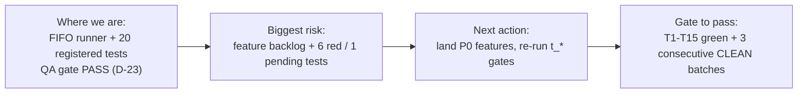
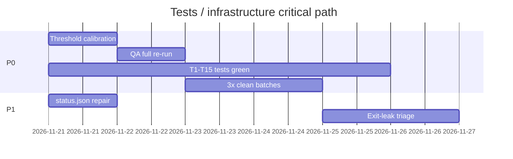

# ⚔️ STATUS — Tests / runner infrastructure

> [!IMPORTANT]
> Cold-readable status for the **test / runner infrastructure** layer. A human or
> a fresh agent should be able to read this file alone and know exactly what is
> done, what is critical, and how to resume. Every factual claim is cited to a
> ticket, runner job id, report path, code line or decision id (D-xx) — no
> uncited assertions. This doc was written read-only: **no Godot runs, no code
> edits** (`SWARM_OPS.md` §5c).


## 🎯 TL;DR

Every Godot launch in this project goes through one Python FIFO runner
(`app/tools/godot_runner.py`) — there is no direct `godot` call — and on top of
it sit two test layers: the monolithic 29-step selftest / 17-step uitest gates
and a registry of 20 small single-feature tests. The infrastructure itself
works: mutual exclusion, hard timeout with process-tree kill, telemetry, a
read-only clean gate, and a documented `ack`/`unwedge` recovery path, with
selftest **29/29**, uitest **17/17** and the clean gate **CLEAN** after 9
historical failures were acknowledged (`QA_REPORT.md:110,112,117`). The single
most important fact: the **QA release gate is PASS** — after the `game.gd` parse
blocker was cleared, desk O re-ran all four gates with fresh `agentO5-*` ids
(#149–152), all `ok`/exit 0 with advanced mtimes and a CLEAN clean gate
(`QA_REPORT.md` "FINAL VERDICT — O5"; **D-23**). The earlier #47 wedge is a
resolved historical incident, not a current release blocker. What remains open is
the **feature backlog** (P-18…P-49) and 6 red / 1 pending per-feature tests (08:55 snapshot).



## 📊 At a glance

| Fact | Value | Evidence |
|---|---|---|
| Runner entry point | `app/tools/godot_runner.py run --id <id> --timeout <s> -- <args>` | `app/tools/godot_runner.py:2-33`; `AGENT_PROTOCOL.md` §1 (D-03) |
| Mutual exclusion | one Godot at a time — FIFO tickets + `O_EXCL` `godot.lock` | `godot_runner.py:112-129,144-175`; `SWARM_OPS.md` §3.1 |
| Hard timeout / kill | `--timeout` default 120 s; `kill_tree` = `taskkill /PID /T /F` (Win), `killpg(SIGKILL)` (POSIX) | `godot_runner.py:194-205,495` |
| Stale recovery | `STALE_SEC = 300 s`; dead-holder PID check; `unwedge` command | `godot_runner.py:54,243-301` (D-16) |
| Max-wait ceiling | `--max-wait 3600 s` default (queue wait, not hang) | `godot_runner.py:496`; `AGENT_PROTOCOL.md` §1b |
| Peak observed healthy wait | `max wait 431.81 s`, mean `170.06 s` — bounded, FIFO-fair | `QA_REPORT.md:55,60-61`; `status.json` ticket 42 |
| The wedge | ticket 48 `agentQ-uitest`: `wait = 1199.33 s`, `skipped` | `app/.godot_queue/results/00000048.json`; `QA_REPORT.md:97-104` |
| Ack'd historical failures | **9** result jsons: #20 + #48, #66–#72 | `app/.godot_queue/results/000000{20,48,66,67,68,69,70,71,72}.json` (D-14) |
| Selftest | `29/29 PASS`, 0 failures (job #43 `agentA-final-selftest`) | `app/selftest.json` (`passed:true`); `QA_REPORT.md:110`; board P-26 |
| Uitest | `17/17 PASS` (jobs #19 `agentO-uitest`, #74 `agentO2-uitest`) | `app/uitest.json` (`passed:true`); `QA_REPORT.md:11,111` |
| CLI 60 s soak / screenshot | PASS: jobs #29/#76 (CLI), #44/#75 (shot) | `QA_REPORT.md:12,13,95` |
| Clean gate | CLEAN on a quiet queue after acks: 0 processes, lock free, no failures | `QA_REPORT.md:112,117`; `CLEAN_GATE.md:40-47` (D-13) |
| Small-test registry | **20** tests in `manifest.json`: 5 `ready` + 15 `pending` (T1–T15) | `app/tests/manifest.json:5-26` (D-15) |
| Per-test result JSONs | **14 written**: `8 green / 6 red / 1 pending (08:55 snapshot; live churn)` (`t_weather` has no JSON); `summary.json` is generated at runtime | `app/tests/results/*.json`; `docs/reviews/REV_TESTS.md` |
| QA final gate state | **PASS** — fresh O5 jobs #149–152, all `ok`, CLEAN gate, 0 orphans | `QA_REPORT.md` "FINAL VERDICT — O5"; **D-23** |

Overall progress: `██████░░ 75%` — measures **release-gate readiness, 6 of 8
subsystems green**: runner FIFO/timeout ✅, selftest ✅, uitest ✅, CLI+shot ✅,
clean gate ✅, QA desk re-sign ✅ (**D-23**); small-test suite green ❌ (4/15),
fidelity threshold calibrated ❌. Sources: rows above + §4 below.

<details>
<summary>How the FIFO runner enforces "never hangs" (click to expand)</summary>

1. `take_ticket()` allocates a monotonic ticket under a short `spool.lock`
   (`godot_runner.py:115-129`) — a later ticket can never pass an earlier one.
2. `claim_godot_lock()` uses `os.open(..., O_CREAT|O_EXCL|O_WRONLY)`: exactly one
   winner (`godot_runner.py:144-152`); spool dirs are per-job so screenshots and
   test output cannot be clobbered (`godot_runner.py:17-19`).
3. `wait_for_turn()` polls `now_serving`; a dead holder (PID gone) or a truly
   stale lock is reclaimed, then `advance_serving()` moves the queue
   (`godot_runner.py:273-302`). Age alone is **not** enough — it wrongly skipped
   live waiters #48/#84 (code comment at `godot_runner.py:292-295`, D-16).
4. `Popen` runs Godot; after `--timeout` the whole process tree is killed and
   `kill_tree` reaps it — ticket 20 exited `-9` with **zero** orphan left
   (`godot_runner.py:194-205`; `QA_REPORT.md:46`).
5. `record()` writes `results/<ticket>.json` and appends wait/run/status to
   `status.json` (last 500) — that telemetry is the measurable anti-starvation
   proof (`godot_runner.py:178-188`; `SWARM_OPS.md` §5, §6).
6. `doctor` kills true orphans; `unwedge` advances past dead holders only when
   the lock is free **and** zero Godot processes are alive; `ack <ticket>`
   marks a resolved historical failure so the clean gate can pass
   (`godot_runner.py:243-270,460-486`; `CLEAN_GATE.md:105-117`).

```mermaid
sequenceDiagram
  participant W as Worker
  participant R as Runner (FIFO)
  participant G as Godot (1 at a time)
  participant S as status.json / results
  W->>R: run --id <worker>-<purpose> --timeout <s>
  R->>R: take_ticket() + O_EXCL godot.lock
  R->>S: record wait start
  R->>G: launch (Popen)
  alt finishes within timeout
    G-->>R: exit 0 / non-zero
  else exceeds --timeout
    R->>G: kill_tree (taskkill /T /F or SIGKILL)
  end
  R->>S: record {wait, run, status}
  R-->>W: result dir app/.godot_queue/results/<ticket>_<id>/
  Note over R,S: Wedged 2026-11-21: dead holder #47 left no lock,<br/>age-based reclaim never fired → #48 waited 1199 s.
  Note over R,S: Fix (D-16): PID-liveness reclaim + `unwedge`;<br/>9 historical failures acknowledged (D-14).
```

</details>

## ✅ DONE — verified

- [x] **Single-door runner built** — FIFO ticket lock, hard timeout, process-tree
  kill, spool isolation, stale recovery, telemetry. Evidence:
  `app/tools/godot_runner.py:2-33,112-205`; `AGENT_PROTOCOL.md` §1; D-03.
- [x] **Orphan hang pattern eliminated** — `quit()` in `_initialize()` replaced
  with `call_deferred("quit", ...)` in 5 test scripts + `mill_render_test.gd`;
  headless guard added; grep shows 0 direct `quit()` calls under `app/tests/**`.
  Board **F-01 DONE**; jobs #37 `agentF3-windowed` (11.15 s) and #38
  `agentF3-headless` (1.99 s) both `ok`, 0 orphans. Evidence: `app/tests/README.md:3-65`;
  `SWARM_BOARD.md:13`; `CLEAN_GATE.md:115-117`.
- [x] **Wedge root cause diagnosed** — ticket 47 owner PID 7444 died before
  `advance_serving(47)`; no lock file ⇒ `godot_lock_age() = 0.0` ⇒ stale-reclaim
  branch never fired; `now_serving` pinned at 47. Evidence: `QA_REPORT.md:97-104`.
- [x] **Wedge fixed** — `wait_for_turn()` now reclaims only on genuine
  dead-holder PID evidence (plus `unwedge` for controlled recovery). Evidence:
  `godot_runner.py:243-301`; D-16.
- [x] **Runner back in service after the wedge** — jobs #73 `agentAB-uitest`,
  #74 `agentO2-uitest`, #75 `agentO2-shot`, #76 `agentO2-cli`, #77
  `agentSC-selftest`, #78 `agentB-uitest`, #79 `agentSE-selftest` all `ok`.
  Evidence: `app/.godot_queue/results/0000007{3,4,5,6,7,8,9}.json`.
- [x] **9 historical failures acknowledged** — #20 (resolved F-01 hang) and
  the 8 wedge skips #48, #66–#72, so the gate counts them without going red.
  Evidence: result jsons `000000{20,48,66,67,68,69,70,71,72}.json`; D-14;
  `CLEAN_GATE.md:105-117`.
- [x] **Selftest gate green** — `passed: true`, 29/29 steps, 0 failures
  (the earlier `farm_cap` failure is fixed). Evidence: `app/selftest.json`;
  `QA_REPORT.md:110`; `docs/UNIT_BAKING_FIX.md:332`; board P-26.
- [x] **Uitest gate green** — `passed: true`, 17/17 steps. Evidence:
  `app/uitest.json`; `QA_REPORT.md:11,111`.
- [x] **Clean gate defined and passing on a quiet queue** — `assert_clean.py`
  checks Godot processes, lock age and history; `failed` (test-red) excluded by
  ruling. Verdict CLEAN: `processes {clean:true,count:0}`, `lock {state:"free"}`,
  no failures; exit 0. Evidence: `app/tools/CLEAN_GATE.md:3-47,90-103`;
  `QA_REPORT.md:112,117`; D-13.
- [x] **Small-test framework shipped** — 20 registered tests; one feature per
  file; per-test result JSON schema `{"id","passed","checks":[...]}`;
  `call_deferred` quit rule; headless guard for render tests. Evidence:
  `app/tests/manifest.json`; `app/tests/README.md:67-99`; `test_all.py:2-17`;
  D-15.
- [x] **`test_all.py` aggregator shipped** — `--list`, `--only`,
  `--include-pending`; every launch delegated to the runner with `manifest-<id>`
  job ids; writes `app/tests/results/summary.json` (generated at runtime); exit 1
  on any failure. Evidence: `app/tools/test_all.py:37-109`; `app/tests/README.md:88-99`.
- [x] **QA release gate PASS (D-23)** — the #47 wedge and the `game.gd` parse
  blocker were cleared; desk O re-ran all four gates fresh: #149 selftest 29/29,
  #150 uitest 17/17, #151 CLI 60 s clean (0 errors), #152 screenshot non-blank.
  All `ok`, all mtimes advanced, clean gate CLEAN, 0 orphans. Evidence:
  `QA_REPORT.md` "FINAL VERDICT — O5"; `docs/DECISION_LOG.md` D-23.
- [x] **Per-feature result JSONs landed** — 14 of 15 written; at the 08:55
  snapshot: 8 green (`t_audio_events`, `t_hud_fidelity`, `t_mass_army`, `t_naval`,
  `t_smoke_fx`, `t_squads`, `t_upgrades`, `t_water`), 6 red (`t_anim_metrics`,
  `t_capture`, `t_map_variety`, `t_multi_ai`, `t_roster_scotland`, `t_teams`),
  1 pending (`t_weather`, compile bug). Live re-runs are still moving these —
  `app/tests/results/*.json` is the source of truth. Evidence:
  `docs/reviews/REV_TESTS.md`.

> [!NOTE]
> Only items with a passing gate or a cited report appear above. The QA desk's
 *final* sign-off **is** listed now: **D-23** (fresh O5 re-run). Earlier FAIL
 verdicts in `QA_REPORT.md` are superseded sections retained as history.

## 🚧 LEFT — by criticality

| Priority | Item | Ticket / test | Owner | Blocked by | Est. |
|---|---|---|---|---|---|
| 🔴 P0 | **Calibrate `compare_shots.py` threshold** — default `0.80` is explicitly *not* a fidelity threshold; the smoke pair scores ~0.78/FAIL. Must calibrate per-check against `reference/videos.md` stills and record evidence before QA can use it as a red gate. | N-24 acceptance / GUIDE4 stills step | coordinator + QA O | owner ruling + reference stills | small (calibration pass) |
| ✅ DONE | **QA final sign-off — DONE (D-23).** Desk O's fresh O5 re-run (#149–152) is PASS on all four gates; the earlier FAIL/wedge sections in `QA_REPORT.md` are superseded history. | O-01 / `QA_REPORT.md` "FINAL VERDICT — O5" | O (QA desk) | — | — |
| 🔴 P0 | **Get T1–T15 per-feature tests green** — 14 result JSONs exist: **8 green**, **6 red**, **1 pending** (`t_weather`) at 08:55; see §3 DONE for the split. Green JSONs are the acceptance gates for P-18…P-24 / P-10. | `t_upgrades`…`t_audio_events` | test-T1…test-T15 | features landing + runner slots | per-test, 1 job each |
| 🔴 P0 | **Prove the runner fix with repetition** — CLEAN_GATE.md §N-20 asks for 3× selftest/uitest/CLI/shot batches, asserting clean after each and bounded `max wait`; not yet recorded post-fix. | Z-01 / N-20 | Z + O | quiet queue | 3 batches |
| 🟠 P1 | **Queue latency watch** — healthy peak was 431.81 s (mean 170.06 s) at 24 pending; the wedge produced 1199.33 s waits at `--max-wait 3600`. With WIP 20, keep `max wait` bounded and treat a pinned `now_serving` as the P0 signature. | SWARM_OPS §5 / `status.json` telemetry | coordinator | monitoring | ongoing |
| 🟠 P1 | **`app/.godot_queue/status.json` is malformed** (trailing `}}` at line 1298) — `assert_clean.py` silently falls back to an empty history (`total:0`), so the history signal is blind. Observed read-only during this doc pass; confirm with the spool owner. | runner spool / Z-01 | coordinator + Z | verify not a live-write artifact | quick |
| 🟠 P1 | **Exit-time resource leaks** — selftest logged 9 leaked ObjectDB instances + 2 resources in use; screenshot logged GLES3 texture/RID leak and null `RenderingServer::get_singleton()`. Non-fatal but unfiled. | QA_REPORT defects 2 (`QA_REPORT.md:76`) | L / J / F + asset lifecycle | owner arbitration | unestimated |
| 🟠 P1 | **Fresh AI CLI soak** — #82 `agentG2-cli` was SKIPPED in the wedge; existing clean soaks #12/#24/#29 pre-date the fix. | G-01 (`STATUS_AI.md:30,187-189`) | G | runner slot | 1 job |
| ⚪ P2 | **`summary.json` is a runtime artifact** — 14 `<id>.json` files exist; the aggregate `app/tests/results/summary.json` is generated only by `test_all.py` and is not committed. Docs now label it "generated", not present. | `test_all.py` acceptance | test authors + O | aggregate run | trivial |
| ✅ DONE | **`docs/RESUME.md` master index exists** — the template/related-footer reference resolves (`docs/RESUME.md`, DOC-6). | D-17/D-19 doc lane | coordinator / DOC desk | — | — |

P0 = blocks a good playable skirmish or the test/release gate; P1 = visible
fidelity or core feature; P2 = polish; P3 = nice-to-have (`STATUS_TEMPLATE.md:60-61`).



### 🧭 Decision trace

> [!IMPORTANT]
> Per **D-19**, status docs cite the decisions that explain *why*. Full rationale
> in `docs/DECISION_LOG.md`.

| Decision | What it fixes in this area | Where it shows up here |
|---|---|---|
| **D-03** (Coordinator, 05:56) | Single FIFO runner door — no direct `godot` | TL;DR, §3 runner mechanics, §7 gates |
| **D-13 / D-14** (Coordinator) | Clean gate excludes `failed` (test-red); `ack` for resolved historical infra failures | §2 ack row, §7 recovery commands |
| **D-15** (Coordinator, 07:35) | One feature per test file + `manifest.json`/`test_all.py` + 15 authors | §2 registry/result rows, §6 ownership |
| **D-16** (Coordinator, 07:40) | Runner starvation fixes (PID-liveness reclaim + `unwedge`) | §3 wedge root-cause/fix, §7 recovery |
| **D-22** (Owner, 08:10) | Quality-first deep audit supersedes "good enough"; `docs/audit/*.md` claim tables | §8 evidence index |
| **D-23** (QA desk O, 08:17) | Release gate **PASS** — fresh O5 jobs #149–152 supersede the FAIL/stale-artifact window | TL;DR, §2, §3 DONE, §4, §7 |
| **D-24** (Coordinator, 08:30) | 320 tiles is the working map size; QA thresholds scale (`scan_map.py`, `docs/audit/GEN.md`) | §7 `scan_map.py` gate; P-48/P-49 |

## 🗃️ Deferred (owner charter §0)

Nothing in this layer is deferred by the charter; the runner, gates and tests
serve the in-scope skirmish port. The *tests for* deferred features stay
unregistered rather than becoming active work:

<details>
<summary>Full deferred list (click to expand)</summary>

- missions / campaigns / `.aix` triggers — `SWARM_OPS.md` §0; board P-16 DEFERRED.
- DLC mission maps — board P-17 DEFERRED.
- network / multiplayer — `SWARM_OPS.md` §0.
- No test ticket exists for these; do not create one without an owner decision.

</details>

## 👥 Ownership map

| File / area | Owner | Notes |
|---|---|---|
| `docs/STATUS_TESTS.md` | **DOC-4 (this doc)** | sole file owned for this task; no code edits, no Godot runs |
| `app/tools/godot_runner.py` | coordinator | FIFO/timeout/ack/unwedge code; D-03, D-14, D-16 |
| `app/tools/assert_clean.py`, `CLEAN_GATE.md` | **Z** (board Z-01) | read-only clean gate; D-13 |
| `app/tests/**` | **F** (board F-01 DONE; P-09 note says F owns until it reports) | hang fixes + small-test scripts |
| `app/tests/manifest.json`, `test_all.py` | test authors / coordinator | one test per file, D-15 |
| `t_upgrades`…`t_audio_events` (T1–T15) | test-T1…test-T15 | `manifest.json:11-25` owners |
| `docs/COMMANDS.md` (`compare_shots.py` note) | **E** (board E-01) | threshold calibration note at `COMMANDS.md:294-319` |
| `QA_REPORT.md` | **O** (QA desk, O-01) | must re-issue the final verdict |
| review of all diffs | **M** (read-only) | gate owner, `SWARM_OPS.md` §1 |

> [!WARNING]
> Only the listed owner may edit those files. Cross-file edits are a REVIEW
> BLOCK under `SWARM_OPS.md` §3. This doc agent touched **only**
> `docs/STATUS_TESTS.md`.

## 🧪 Acceptance gates

```bash
# Always check the queue before launching anything
python app\tools\godot_runner.py status

# Selftest — expect app/selftest.json "passed": true, 29/29
python app\tools\godot_runner.py run --id <area>-selftest --timeout 180 -- --headless --path app -- --self-test app/selftest.json

# Uitest — expect app/uitest.json "passed": true, 17/17
python app\tools\godot_runner.py run --id <area>-uitest --timeout 180 -- --headless --path app -- --ui-test app/uitest.json

# CLI soak + screenshot (QA batch, O-01)
python app\tools\godot_runner.py run --id <area>-cli --timeout 180 -- --headless --path app -- --cli app/cli.json --cli-seconds 60
python app\tools\godot_runner.py run --id <area>-shot --timeout 90 -- --path app -- --screenshot app/shots/g4_qa_gate.png --timeout 60

# Small-test registry
python app\tools\test_all.py --list
python app\tools\test_all.py --only t_upgrades t_squads
python app\tools\test_all.py

# Clean gate — exit 0 only on a quiet queue
python app\tools\assert_clean.py --json

# Recovery only when justified
python app\tools\godot_runner.py unwedge        # refuses if lock held or any Godot alive
python app\tools\godot_runner.py ack <ticket> --reason "<fix evidence>"
```

Pass criteria: selftest `29/29`, uitest `17/17`, CLI soak `sim_seconds: 60.0`
with **0** `stuck`/`ERROR`/`SCRIPT ERROR` hits, clean gate exit `0` with 0
orphans, and the relevant tests green in `app/tests/results/summary.json`
(`STATUS_TEMPLATE.md:104-105`; `QA_REPORT.md:6-15`; `AGENT_PROTOCOL.md` §2).
Give every runner call a tool timeout ≥ 300000 ms — a queue wait is **not** a
hang, and re-submitting creates duplicate tickets (`AGENT_PROTOCOL.md` §1b).
Job budget: docs/tool-only = 0 jobs; code ticket ≤ 2 (selftest + uitest); a
third only for a named repro (`AGENT_PROTOCOL.md` §1b). Never call `godot`
directly (D-03).

> [!WARNING]
> A live DIRTY verdict during swarm churn is expected, not a gate failure: at
> doc time `assert_clean.py --json` reported 1 live Godot (PID 21148, a selftest
> in flight) and a young held lock — rerun on a quiet queue. `CLEAN_GATE.md:99-103`.

## 🔗 Evidence index

- **Org / decisions:** `SWARM_OPS.md` §0, §3, §5, §5c, §6; `docs/DECISION_LOG.md`
  D-03 (single door), D-13 (exclude `failed`), D-14 (`ack`), D-15 (small tests),
  D-16 (starvation fix), D-18 (modern markdown), D-19 (traceability).
- **Runner:** `app/tools/godot_runner.py:2-33` (docstring), `112-188` (tickets,
  lock, telemetry), `194-205` (kill_tree), `243-302` (unwedge + wait_for_turn),
  `460-486` (ack), `493-516` (CLI); `app/tools/AGENT_PROTOCOL.md` §1, §1b;
  `app/tools/CLEAN_GATE.md:3-47,90-117`.
- **Runner results:** `app/.godot_queue/results/00000020*.json` (timeout, acked),
  `00000042*.json` (max wait 431.81 s), `00000043*.json` (selftest 29/29),
  `00000048*.json` (**1199.33 s** wedge skip, acked), `00000066*.json`–
  `00000072*.json` (wedge skips, acked), `00000074*.json`–`00000079*.json`
  (post-wedge `ok`); pending jobs `00000047.json` (dead holder), `00000089.json`,
  `00000092.json`, `00000097.json`, `00000098.json` (T-tests).
- **QA / review:** `QA_REPORT.md:6-15,43-78` (round 1), `82-126` (final re-run,
  wedge verdict, CLEAN gate, open questions); `docs/STATUS_AI.md:29-34,187-189`
  (skipped AI soak / queued T-tests); board `SWARM_BOARD.md` F-01, Z-01, O-01,
  P-26.
- **Tests:** `app/tests/manifest.json:5-26` (20 tests, owners), `app/tests/README.md:3-99`
  (hang rule, framework), `app/tools/test_all.py:2-109` (harness),
  `app/selftest.json`, `app/uitest.json` (`passed:true`; 29/29 and 17/17).
- **Threshold:** `docs/COMMANDS.md:294-319` (N-24 comparator, why `0.80` is not a
  fidelity threshold); `reference/videos.md` (stills to calibrate against).

## 🔄 How to resume (cold start)

1. [ ] Read this file, `SWARM_BOARD.md`, `SWARM_OPS.md` §0/§3/§5c/§6 and
   `docs/DECISION_LOG.md` D-03/D-13/D-14/D-15/D-16. Do not re-derive facts.
2. [ ] Check `python app\tools\godot_runner.py status` (`now_serving`, `pending`,
   lock, `max wait`) and `python app\tools\assert_clean.py --json`. A pinned
   `now_serving` with no live Godot = wedge → coordinator `unwedge`, not a
   re-submit. Expect `failed` statuses; only `timed-out`/`error`/`skipped` are
   infra failures, and resolved ones are `ack`-ed (D-13/D-14).
3. [ ] Pick the highest-priority unblocked item from §4: threshold calibration →
   QA full re-run → 3× clean batches → T1–T15 green → P1 hygiene.
4. [ ] Back up any owned file to `inbox\backup\<name>.bak-<your-id>` before
   editing; only the §6 owner may edit it (`AGENT_PROTOCOL.md` §0).
5. [ ] Run the exact §7 gates through the runner with generous tool timeouts.
   Verify `app/selftest.json` / `app/uitest.json` and `assert_clean.py --json`
   on a **quiet** queue; update this file's §2 table with new job ids.
6. [ ] Report files changed, job ids, gate results and open questions to the
   coordinator. Only the coordinator edits the board's State column
   (`SWARM_OPS.md` §4).

## ❓ Open questions

- [x] **QA verdict re-issued — D-23 (resolve).** Desk O's fresh O5 re-run
  (#149–152) is PASS on all four gates with advanced mtimes; the earlier FAIL
  sections are superseded history. Release is **signed**, not blocked.
- [ ] **Who calibrates the fidelity threshold?** The `0.80` smoke value is not a
  gate; need a per-check value + evidence note. — **E + O**, blocks GUIDE4/N-24
  acceptance (`COMMANDS.md:315-319`).
- [ ] **Is the malformed `status.json` (trailing `}}`, line 1298) a live-write
  artifact or a real corruption?** It makes `assert_clean.py` skip the history
  check. — **Z / coordinator**, P1 (`assert_clean.py:167-186`).
- [x] **Per-feature test results landed (partly).** 14 of 15 JSONs exist:
  **8 green / 6 red / 1 pending (08:55 snapshot)** (`t_weather`). Green = the
  eight named in §3; red = `t_anim_metrics`, `t_capture`, `t_map_variety`,
  `t_multi_ai`, `t_roster_scotland`, `t_teams`. — **test-T1…T15 + O**. The figure
  moved 4/10/1 → 8/6/1 during this pass as other workers re-ran tests; the brief
  said 5/9/1. Coordinator to confirm the published figure.
- [ ] **Was the wedge fix validated under WIP-20 load?** No 3× clean-batch
  record post-D-16; `max wait` target after fix is undefined. — **Z + O**.
- [ ] **Are the exit-time leaks filed?** ObjectDB/resources (selftest) and GLES3
  texture/RID (screenshot) remain non-fatal and unassigned. — **coordinator**,
  P1 (`QA_REPORT.md:25-29,33-41,76`).
- [ ] **Do skipped jobs #81–#86 need `ack` too?** 9 tickets are acknowledged; #85
  (`t-upgrades`) and #82/#83/#84 were skipped with "serving=86" and no ack on
  file. — **coordinator**, queue hygiene (`results/0000008{1,2,3,4,5}.json`).

---

**Related:** `docs/STATUS_TEMPLATE.md` · `docs/STATUS_AI.md` ·
`docs/DECISION_LOG.md` · `docs/RESUME.md` · `docs/audit/GEN.md` ·
`docs/reviews/REV_TESTS.md` · `SWARM_BOARD.md` · `SWARM_OPS.md` ·
`QA_REPORT.md` · `app/tests/README.md` · `app/tools/CLEAN_GATE.md`
