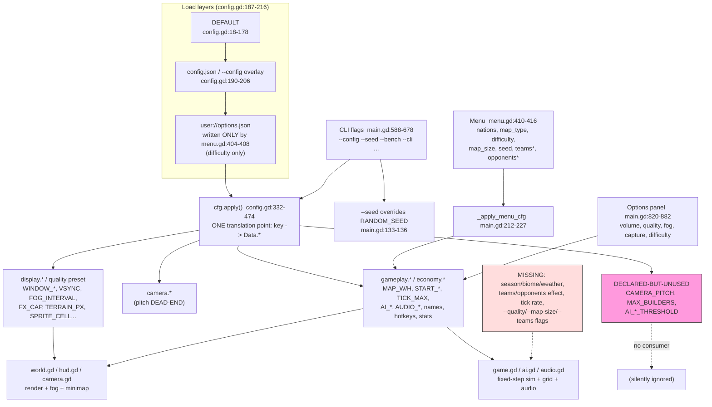

# 🔬 Deep audit — CONFIG / EFFICIENCY

> [!IMPORTANT]
> This is the deep-audit deliverable for area `CONFIG_EFFICIENCY` (assignment:
> `docs/audit/README.md:45`). **Quality first (D-22):** this document establishes a
> baseline and writes *future* tickets. It does **not** optimise or "improve"
> anything now. Configurability and efficiency are required for the final port
> but are a LATER tranche — "do not sacrifice fidelity for speed now"
> (`SWARM_OPS.md:132-134`, `docs/DECISION_LOG.md:53`). This agent changed **no
> code** and launched **no runner jobs**.

## 0. Scope, method and honesty notes

- **Sources read (all `observed`):** `SWARM_OPS.md` §0, §5b-QUALITY;
  `docs/audit/README.md`; `docs/DECISION_LOG.md` (D-12, D-22);
  `docs/STATUS_TESTS.md`; `app/shots/perf.md`; `SWARM_BOARD.md`;
  `app/config.json`; `app/scripts/config.gd`; `app/scripts/data.gd`;
  `app/scripts/main.gd`; `app/scripts/world.gd`; `app/scripts/game.gd`;
  `app/scripts/menu.gd`; `app/scripts/camera.gd`; `app/scripts/audio.gd`;
  `app/scripts/input_controller.gd`; `app/scripts/hud.gd`; `app/scripts/ai.gd`;
  `app/tests/t_weather.gd`; `app/shots/bench.json`; the runner result directory
  `app/.godot_queue/results/`.
- **Labels** follow `SWARM_OPS.md:125` / `docs/audit/README.md:22`: `observed`
  (read directly), `derived` (computed from observed values), `inferred`
  (plausible but not proven). No `inferred` statement below is promoted to fact.
- **Verification limit:** most findings are a single read of the current tree.
  Per `SWARM_OPS.md:121-124` a finding needs a second method or agent before it
  is accepted. Items corroborated by two independent sources are called out;
  the rest are recorded as **baseline observations pending re-verification**.
- **No invented numbers.** Every FPS / ms figure below is copied from a cited
  file or explicitly marked NOT MEASURED.

---

## 1. Configurability audit

### 1.1 Settings flow at a glance (`observed`)

- `config.gd:18-178` declares `DEFAULT` — every key is optional.
- `config.gd:187-216` `load_all()` merges three layers in order:
  1. built-in `DEFAULT`;
  2. first readable candidate file (`res://config.json`, then on-disk, then
     `user://config.json` — `config.gd:221-234`), then an optional `--config`
     overlay (`config.gd:196-206`);
  3. `user://options.json` (`config.gd:209-215`). **Observed:** the only writer
     of that third layer is `menu.gd:404-408`, and it writes **only**
     `{"ai": {"difficulty": ...}}`.
- `main.gd:130-132` calls `cfg.load_all(config_path)` then `cfg.apply()` once,
  at startup, **before** any mode dispatch.
- `config.gd:332-474` `apply()` is the single translation point: config key →
  `Data.*` static field. Runtime systems then read `Data.*` (verified by the
  consumer counts in §1.3).
- CLI flags are parsed in two passes (`main.gd:126-127`) by `_parse_args()`
  (`main.gd:588-678`); `--seed` overrides the config seed after `apply()`
  (`main.gd:133-136`), and the in-game menu overrides several fields again in
  `_apply_menu_cfg()` (`main.gd:212-227`).

### 1.2 Status vocabulary

| Status | Meaning |
|---|---|
| **APPLIED** | Key is read in `config.gd.apply()` (or flag in `_parse_args`) **and** a runtime consumer reads the resulting `Data.*` / field. |
| **PARTIAL** | Applied on one path only, or overridden / not persisted on another path. |
| **DECLARED-BUT-UNUSED** | `apply()` writes the `Data.*` field but no runtime system reads it. |
| **MISSING** | A user-facing control exists in the UI or donor but has no config key, no parse, or no runtime effect. |

### 1.3 Display, camera, gameplay

| # | Setting (config key / CLI) | Lives at | Runtime consumer | Status | Notes |
|---|---|---|---|---|---|
| D1 | `display.window_width`, `window_height` | `config.json:15-16`; `config.gd:20-21` | `config.gd:336-337` → `main.gd:151,341,504,573` | APPLIED | Window sized at startup / mode changes. |
| D2 | `display.fullscreen` | `config.json:17`; `config.gd:22` | `config.gd:338` → `main.gd:342,505` | APPLIED | — |
| D3 | `display.vsync` | `config.json:18`; `config.gd:23` | `config.gd:339` → `main.gd:345,508` | **PARTIAL** | Screenshot path unconditionally disables vsync at `main.gd:584`, overriding the setting. |
| D4 | `display.pixels_per_meter` | `config.json:19`; `config.gd:24` | `config.gd:340` → `world.gd` | APPLIED | — |
| D5 | `display.fog_of_war` | `config.json:20`; `config.gd:25` | `config.gd:341` → `world.gd:159`, `main.gd:863` | APPLIED | Also live-toggleable in Options panel (`main.gd:860-865`). |
| D6 | `display.quality` | `config.gd:29` only (absent from `config.json`) | `config.gd:344` → `Data.set_quality()` `data.gd:134-145` → `game.gd`, `world.gd`, `hud.gd`, `mapgen.gd` | APPLIED | Default `high`; live change in Options panel rebuilds caches (`main.gd:842-858`). |
| D7 | `display.terrain_px`, `sprite_cell`, `fx_cap`, `fog_interval`, `minimap_interval` | preset-driven via `data.gd:138-145`; optional overrides `config.gd:345-349` | `world.gd:90,150,265-266,835,1653`; `hud.gd:910`; `main.gd:175-176` | APPLIED | Not present as explicit keys in shipped `config.json`; preset supplies values. |
| D8 | `display.unit_scale` | `config.json:21`; `config.gd:30` | `config.gd:350` → `world.gd:1376` | APPLIED | — |
| D9 | `display.show_centroids` | `config.json:22`; `config.gd:31` | `config.gd:351` → `world.gd` | APPLIED | **Coupling:** also gates the building drop-circle shadow (`world.gd:492`). |
| D10 | `display.units_opaque` | `config.json:23`; `config.gd:32` | `config.gd:352` → `world.gd` | APPLIED | — |
| C1 | `camera.pitch_degrees` | `config.json:26`; `config.gd:35` | `config.gd:356` → `Data.CAMERA_PITCH`; **no reader** (`camera.gd:19-27` reads only height/margin/speed/zoom) | **DECLARED-BUT-UNUSED** | Rendered pitch is not driven by this key. |
| C2 | `camera.min_height`, `max_height`, `edge_margin`, `corner_margin`, `key_scroll_speed`, `mouse_scroll_speed`, `zoom_step` | `config.json:27-33`; `config.gd:36-42` | `config.gd:357-363` → `camera.gd:19-27` | APPLIED | — |
| G1 | `gameplay.mode` | `config.json:36`; `config.gd:45` | `main.gd:140` | APPLIED | CLI `--battle` overrides (`main.gd:139-142`). |
| G2 | `gameplay.map_width_tiles`, `map_height_tiles` | `config.json:37-38`; `config.gd:46-47` | `config.gd:366-367` → `Data.MAP_W/H` (121/99 refs across game/world/camera/hud/mapgen) | APPLIED | Menu `map_size` overrides both (`main.gd:221-223`). |
| G3 | `gameplay.random_seed` | `config.json:39`; `config.gd:48` | `config.gd:368` → `game.gd:114` | APPLIED | Overridden by `--seed` (`main.gd:133-136`) and menu seed (`main.gd:224-225`). |
| G4 | `gameplay.nation0`, `nation1` | `config.json:67-68`; `config.gd:49-50` | `config.gd:390-392` → `Data.PLAYER_NATIONS` → `game.gd:230-231` | APPLIED (caveat) | `Data.PLAYER_NAMES` is assigned here (`config.gd:393`) then **overwritten** by `names.player` at `config.gd:450`. Menu path re-derives names correctly (`main.gd:213-215`). |
| G5 | `gameplay.map_type` | `config.json:69`; `config.gd:51` | `config.gd:388` → `game.gd`, `mapgen.gd` | APPLIED | — |
| G6 | `gameplay.start_option` | `config.json:70`; `config.gd:52` | `config.gd:389` → `game.gd` | APPLIED | — |
| G7 | `gameplay.start_resources` | `config.json:40-47`; `config.gd:53` | `config.gd:376-380` → `game.gd` | APPLIED | — |
| G8 | `gameplay.start_peasants`, `build_queue_limit`, `max_builders_sent` | `config.json:48-50`; `config.gd:54-56` | `config.gd:369-371` → `game.gd` (e.g. `game.gd:2333`) | APPLIED | — |
| G9 | `gameplay.victory`, `score_limit`, `corpse_life` | `config.json:51-53`; `config.gd:57-60` | `config.gd:372-375` → `game.gd`, `hud.gd` | APPLIED | — |
| G10 | `gameplay.max_tick_seconds` | `config.json:53`; `config.gd:59` | `config.gd:374` → `Data.TICK_MAX` → `game.gd:2390` | APPLIED | Clamp on a single tick, **not** the step rate (see P1 below). |
| G11 | `gameplay.deposits`, `battle_army` | `config.json:54-66`; `config.gd:61-62` | `config.gd:381-387` → `game.gd` | APPLIED | — |
| G12 | **season / biome / weather** | no key in `config.json` or `DEFAULT`; `Data.BIOME := "summer"` `data.gd:161` | menu emits no `biome` (`menu.gd:410-416`); `_apply_menu_cfg` *would* read it (`main.gd:217`) but nothing supplies it; `config.gd.apply()` never writes `Data.BIOME` | **MISSING** | Independently documented as a baseline gap in `app/tests/t_weather.gd:120-132` ("apply() ignores it"). Season is therefore effectively hardcoded. |
| G13 | **teams / opponent count** | menu UI `menu.gd:23-24,240-241`; emitted `menu.gd:412` | `_apply_menu_cfg` ignores both (`main.gd:212-227`); `game.gd:230-231` hardcodes `players[0]`/`players[1]`; `ai.gd:403-409` has team logic but nothing sets `players[].team` | **MISSING** | Ties to board P-18/P-19 (`SWARM_BOARD.md:46-47`). |
| G14 | `sim tick rate` (`Data.FPS = 32.0`, `data.gd:32`) | `data.gd:32`; no config key | fixed step `1.0 / Data.FPS` in `main.gd:910` | **MISSING** (hardcoded) | Only the dt *clamp* is configurable (G10). |

### 1.4 Economy, AI, audio, names, hotkeys, stat tables

| # | Setting | Lives at | Runtime consumer | Status | Notes |
|---|---|---|---|---|---|
| E1 | `economy.gather.{food,wood,stone}.{hits,carry,interval}` (9 leaves) | `config.json:73-89`; `config.gd:65-69` | `config.gd:413-421` → `Data.GATHER` → `game.gd` | APPLIED | — |
| E2 | `economy.build_progress_per_hit`, `build_hit_interval` | `config.json:90-91` | `config.gd:396-397` → `game.gd` | APPLIED | — |
| E3 | `economy.max_builders` | `config.json:92`; `config.gd:72` | `config.gd:398` → `Data.MAX_BUILDERS`; **no runtime reader** (game.gd uses `MAX_BUILDERS_SENT` at `game.gd:2333`) | **DECLARED-BUT-UNUSED** | — |
| E4 | `mine_income_per_second`, `delivery_radius_m`, `upkeep_divisor` | `config.json:93-95` | `config.gd:399-401` → `game.gd`, `hud.gd` (e.g. `game.gd:3570`) | APPLIED | — |
| E5 | `personal_space`, `formation_spacing` | `config.json:96-97` | `config.gd:402-403` → `game.gd`, `input_controller.gd` | APPLIED | — |
| E6 | `morale_base`, `morale_rout_threshold`, `officer_damage_bonus`, `drummer_speed_bonus` | `config.json:98-101` | `config.gd:404-407` → `game.gd` (e.g. `game.gd:3113`) | APPLIED | — |
| E7 | `priest_heal_per_second`, `artillery_deploy_seconds` | `config.json:102-103` | `config.gd:408-409` → `game.gd:3156` etc. | APPLIED | — |
| E8 | `famine_grace_seconds`, `famine_drain_per_second`, `market_rate` | `config.json:104-106` | `config.gd:410-412` → `game.gd`, `hud.gd` | APPLIED | — |
| A1 | `ai.enabled` | `config.json:109`; `config.gd:89` | `config.gd:424` → `ai.gd` | APPLIED | — |
| A2 | `ai.think_interval` | `config.json:110`; `config.gd:90` | `config.gd:425` → `ai.gd:24,466` | **PARTIAL** | `easy` multiplies ×1.6 at startup (`config.gd:432-433`), but a menu/Options difficulty change (`main.gd:219-220`, `main.gd:876`) does **not** re-apply the multiplier. |
| A3 | `ai.food_threshold`, `wood_threshold`, `stone_threshold` | `config.json:111-113`; `config.gd:91-93` | `config.gd:426-428` → `Data.AI_*_THRESHOLD`; **no reader in `ai.gd`** (which now uses target quotas — `ai.gd:62`) | **DECLARED-BUT-UNUSED** | — |
| A4 | `ai.attack_force` | `config.json:114` (=120; `DEFAULT` 60 at `config.gd:94`); `config.gd:429` | `config.gd:429` → `ai.gd:336,471` | **PARTIAL** | Applied at startup; difficulty scaling (`config.gd:432-436`) not re-applied by menu/Options. `perf.md:29-30` documents the 260→120 change. |
| A5 | `ai.max_peasants` | `config.json:115` (=40; `DEFAULT` 14 at `config.gd:95`); `config.gd:430` | `config.gd:430` → `ai.gd` | APPLIED | — |
| A6 | `ai.difficulty` | `DEFAULT` only (`config.gd:96`) — absent from `config.json`; live in menu/Options | `config.gd:431-436` (startup scaling), `game.gd:2394` (hard cheat on `hard`), `main.gd:219-220,873-876` | **PARTIAL** | Startup scales thresholds; menu/Options set the string only, so the live change alters only the `hard` resource cheat and the label. |
| S1 | `audio.enabled` | `config.json:118`; `config.gd:99` | `config.gd:439` → `audio.gd` | APPLIED | — |
| S2 | `audio.master_volume_db`, `ambient_volume_db` | `config.json:119-120`; `config.gd:100-101` | `config.gd:440-441` → `audio.gd`, `main.gd:827-834` | **PARTIAL** | Runtime sliders write `Data.*` directly; `menu.gd:404-408` persists only difficulty, so volume changes are lost on restart. |
| N1 | `names.units`, `names.buildings` (16 + 18 labels) | `config.json:169-204`; `config.gd:137-175` | `config.gd:444-448` → `C3Config.unit_name()/building_name()` (`config.gd:476-481`) → `hud.gd:440,448,713-724` | APPLIED | — |
| N2 | `names.player` | `config.json:205-208`; `config.gd:176` | `config.gd:449-450` → `Data.PLAYER_NAMES` → `game.gd` | **PARTIAL** | Overwrites the nation-derived names from G4; coincides with the shipped nations so the mismatch is latent, not currently visible. |
| H1 | `controls.hotkeys` (~25 action binds + 15 build binds) | `config.json:123-166`; `config.gd:104-135` | `config.gd:453-463` → `Data.HOTKEYS` → `input_controller.gd:46-54`, `hud.gd:740`, `uitest.gd:324` | **PARTIAL** (applied, incomplete coverage) | Binding application is real; donor parity is not — board P-33 cites 243 donor bindings vs this small set (`SWARM_BOARD.md:57`). |
| T1 | `units.*` stat overrides (12 sids), `buildings.*` (14 sids) | `config.json:210-828` | `config.gd:466-473` → `Data.UNITS`/`BUILDINGS` (built by `data.gd:876-880`) → `game.gd` | APPLIED | These are the donor stat numbers; deep-SIM/deep-RENDER own their fidelity audit. |

**Coverage summary (`derived` from the table above).** Of the **73 scalar/leaf
settings** declared by `config.gd.DEFAULT` / `config.json`: **64 APPLIED**,
**5 DECLARED-BUT-UNUSED**, **4 PARTIAL**, **0 contradicted**. Grouped features
(names tables, hotkey table, unit/building stat tables) are applied with the
caveats noted. Distinct **MISSING** user-facing controls: season/biome/weather,
teams/opponent count, tick rate, and CLI flags for quality/map-size/teams.

### 1.5 CLI / flag parsing (`main.gd:588-678`)

| Flag | Parse site | Status | Notes |
|---|---|---|---|
| `--config <file>` | `main.gd:645-648` | APPLIED | Overlay merged in `config.gd:196-206`. |
| `--dump-config` | `main.gd:649-650` | APPLIED | Prints and exits `main.gd:143-147`. |
| `--seed <int\|random>` | `main.gd:663-670` | APPLIED | Overrides config seed `main.gd:133-136`. |
| `--bench`, `--stats`, `--fast`, `--speed` | `main.gd:653-662` | APPLIED | Bench path `main.gd:172-183,947-962`. |
| `--cli`, `--cli-seconds` | `main.gd:629-638` | APPLIED | `perf.md:83` shows `--cli-seconds 30` overriding config's 60 s. |
| `--screenshot`, `--screenshot-frames` | `main.gd:593-600` | APPLIED | — |
| `--self-test`, `--ui-test`, `--ui-only` | `main.gd:605-616` | APPLIED | — |
| `--journey`, `--timeout`, `--test-api` | `main.gd:601-604,639-644` | APPLIED | — |
| `--seq`, `--seq-seconds`, `--seq-step` | `main.gd:617-627` | APPLIED | — |
| `--battle`, `--dump-map` | `main.gd:651-652,671-674` | APPLIED | — |
| `--quality`, `--map-size`, `--teams` | none | **MISSING** | No such flags; only config/menu paths. |

---

## 2. Efficiency baseline — measured vs claimed

### 2.1 What is actually MEASURED

| Item | Value (copied, not invented) | Source / runner job id | Verdict |
|---|---|---|---|
| Headless bench, debug (`--bench`, 300/side) | `fps 1.1897334`, `sim_ms_per_tick 196.029`, `units 618`, `sim_seconds 30.0`, `wall_seconds 189.118`, `headless_sim_only true` | `app/shots/bench.json:1-8` (exact numbers match `app/shots/perf.md:47`) | MEASURED **artifact**, but **no runner job id on file** — see §2.2. |
| CLI 30 s soak | wall (Godot) `10.61 s`; queue wait `253.43 s`; total `264.04 s`; exit `0/ok`; `sim_seconds 30.0`; 0 kills/shots; stderr empty | runner job **#28 `agentT-cli30`**, `app/.godot_queue/results/00000028*`; `perf.md:79-85` | MEASURED, runner-attributed. |
| Self-test (same T-01 batch) | wall `25.88 s`; wait `227.62 s`; total `253.50 s`; exit `1/failed`; **27/28** (`farm_cap` red); 9 ObjectDB leaks | runner job **#27 `agentT-selftest`**, `perf.md:86-91` | MEASURED, runner-attributed; historically red (now green per #43). |
| Anti-starvation telemetry | `completed 31`, `max wait 256.60 s`, `mean wait 95.89 s`, `max run 60.43 s` | `godot_runner.py status`, cited `perf.md:94` | MEASURED (runner queue, not game FPS). |
| Latest green gates (secondary) | selftest **29/29** job **#43 `agentA-final-selftest`**; uitest **17/17** jobs **#19 / #74**; CLI soak #29/#76; screenshot #44/#75 | `docs/STATUS_TESTS.md:61-64,137-149` | MEASURED, runner-attributed. |
| Peak healthy queue wait | `max wait 431.81 s`, mean `170.06 s` | `STATUS_TESTS.md:58` (`QA_REPORT.md:55`) | MEASURED (queue, not game). |

### 2.2 What is NOT measured / not reproducible

- **Bench provenance (`observed`):** no result json under
  `app/.godot_queue/results/` contains `--bench` or a `bench report` line (grep
  of that directory: 0 matches). `bench.json` exists on disk but cannot be tied
  to a runner ticket. Verdict: **UNVERIFIED provenance** — the numbers are
  real artifacts, but there is no reproducible job id. Do **not** present them
  as a QA-signed benchmark.
- **Windowed FPS / headless picture parity:** no display in this container.
  `perf.md:58-60,96-105` explicitly says NOT MEASURED. Do not read the 1.19 fps
  headless row as a windowed figure.
- **Pre-G8 baseline:** not measured; would need a separate worktree
  (`perf.md:49-50`). Therefore any "G8 made it faster" claim is UNVERIFIED.
- **Gate G15.3** (headless sim ≤ 8 ms/tick @600 units): **NOT MET** — measured
  196.03 ms/tick, debug GDScript interpreter (`perf.md:51-57`). This is a
  quality/environment result, not a reason to cut fidelity.
- **No FPS figure exists** in the T-01 jobs: `perf.md:92` says "not measured —
  `--bench` was not part of these jobs".

### 2.3 Implemented efficiency mechanisms (`observed` — code read, not a benchmark)

| Mechanism | Evidence | What code actually does | Perf effect |
|---|---|---|---|
| Fixed-step accumulator | `main.gd:907-923` | `dt` clamped 0.25; `acc += dt*speed`; `step = 1/Data.FPS` (=1/32); max 64 steps/frame; bails at deadline-500 ms. | MECHANISM CONFIRMED; cost unmeasured. |
| Per-tick spatial grid | `game.gd:68,116-152,2402` | `_grid_rebuild()` clears and refills `grid` (`GRID_M = 8.0`, `game.gd:69`) each tick; `grid_query()` bounds aura/target/splash/separate searches (call sites `game.gd:1511,1545,2499,3148,3174,3316,3333,3352,3436,3608`). | MECHANISM CONFIRMED; "asymptotic improvement" is `inferred` (`perf.md:56-57`) — no before/after numbers. |
| Separation pass | `game.gd:2435,2444-2495` | Second local grid (`lgrid`) built per tick for unit–unit push-apart. | MECHANISM CONFIRMED; contributes to 196 ms/tick per `perf.md:54`. |
| Nav budget | `game.gd:13-14,2392` | `NAV_PER_TICK = 2` group orders per tick. | MECHANISM CONFIRMED. |
| Chunk LRU | `world.gd:25-27,800-825` | `CHUNK_T = 32`; `terrain_order` evicts oldest when > 24 chunks, `queue_free()` on evict. | MECHANISM CONFIRMED; no hitch measurement. |
| 2 chunks/frame cap | `world.gd:810-819` | `if built >= 2: return` — at most two `Sprite2D` chunk bakes per `sync()`. | MECHANISM CONFIRMED; the "no multi-second hitch" comment (`world.gd:420`) is a claim, not a measurement. |
| Tile-block LRU | `world.gd:44-46,615-634` | `BLK_CACHE = 32`; `blk_order` touch-on-hit, evict oldest past 32. | MECHANISM CONFIRMED. |
| Fog / minimap intervals | `world.gd:150,833-836`; `hud.gd:910`; `main.gd:175-176` | `fog_timer` counts down and calls `_update_fog()` only when it hits 0; minimap timer in hud; bench mode pins both to 9999. | MECHANISM CONFIRMED. |
| Quality-scaled mapgen | `data.gd:119-129`; `game.gd:241,534` | `Data.mapgen_budget()` picks pattern density by `QUALITY`; low disables decor/stamps. | MECHANISM CONFIRMED. |
| Shadow gating | `world.gd:492,1381` | Unit contact shadow off at `low`; building drop-circle additionally requires `Data.SHOW_CENTROIDS` (default false) even at `high`. | PARTIAL vs `perf.md:64-67` ("shadows on/off"): there is no standalone shadow toggle, and the building shadow is off by default at *all* presets. |

---

## 3. Claim table (per `docs/audit/README.md:30-36`)

Verdicts: CONFIRMED / CONTRADICTED / UNVERIFIED / PARTIAL.

| # | Claim | Evidence | Verification method | Verdict | Correction needed |
|---|---|---|---|---|---|
| 1 | "One JSON file controls every user-facing setting." | `config.gd:1-10`; `config.json:1-829`; missing G12/G13/G14/H1 gaps | Read DEFAULT, apply(), menu, CLI parsers | **CONTRADICTED** | Future ticket CFG-02 (season), CFG-07 (teams/opponents), CFG-08 (tick rate), CFG-03 (hotkey parity). |
| 2 | "Every key is optional and merged over donor defaults." | `config.gd:187-216,292-298` | Code read + `_merge` recursion | **CONFIRMED** (second source: `config.json:2-9` readme) | none |
| 3 | "The in-game Options panel persists user choices via `user://options.json`." | `config.gd:209-215` comment vs `menu.gd:404-408` (writes difficulty only) | Two-file cross-read | **CONTRADICTED** | CFG-05 (persist volume/quality/fog/capture). |
| 4 | "AI difficulty easy/hard changes AI behaviour at runtime." | startup scaling `config.gd:431-436`; menu/Options set string only `main.gd:219-220,876`; cheat `game.gd:2394` | Three-site cross-read | **PARTIAL** | CFG-04 (single `apply_difficulty()` helper; call on all paths). |
| 5 | "`camera.pitch_degrees` is configurable." | `config.gd:35,356`; no reader in `camera.gd:19-27` | Consumer grep across `app/scripts` | **CONTRADICTED** | CFG-06 (wire pitch) or remove key. |
| 6 | "`economy.max_builders` and `ai.{food,wood,stone}_threshold` are applied." | `config.gd:398,426-428`; 0 runtime readers | Consumer grep | **CONTRADICTED** | CFG-09 (implement consumers or delete dead keys). |
| 7 | "Nation selection sets player names." | `config.gd:393` then overwrite `:450`; menu re-derives `main.gd:213-215` | Two-read cross-check | **PARTIAL** | CFG-10 (remove duplicate assignment / single source of truth). |
| 8 | "`config.json` quality presets: low disables shadows." | `perf.md:64-67`; `world.gd:492,1381` | Code read | **PARTIAL** | Unit shadow off at low CONFIRMED; building shadow already off at every preset (also gated by `SHOW_CENTROIDS`). Document precisely in PERF-04. |
| 9 | "Low preset fog/minimap intervals = 1.0 / 0.5." | `perf.md:67` vs `data.gd:139` (1.5 / 1.0) | Direct value comparison | **CONTRADICTED** | PERF-04 (correct the presets doc to code values, or change code after quality gate). |
| 10 | "Headless bench: 1.19 fps @618 units, 196.0 ms/tick." | `bench.json:2-5`; `perf.md:47` (identical) | Two independent file reads | **CONFIRMED** as artifact | PERF-01 (attach a runner job id / reproducible command). |
| 11 | "The bench result is a runner-job-backed QA measurement." | grep of `app/.godot_queue/results/**` for `--bench`/`bench report`: 0 matches | Directory-wide grep | **UNVERIFIED** | PERF-01. |
| 12 | "Windowed FPS is ~1.19 fps." | `perf.md:58-60,96-105` (explicitly NOT MEASURED); `bench.json:3` says `headless_sim_only` | Read both | **CONTRADICTED** | PERF-02 (measure on display-capable machine before any claim). |
| 13 | "T-01 jobs measured FPS." | `perf.md:92` (not measured; `--bench` absent) | Read perf.md + job list | **CONTRADICTED** | none — already correctly stated in source; keep as-is. |
| 14 | "G15.3 (≤8 ms/tick @600 units) is met." | `perf.md:51-57` (196 ms/tick; NOT met) | Read gate text + bench artifact | **CONTRADICTED** | PERF-03 / PERF-05 (re-measure after quality work; do not lower fidelity to meet it). |
| 15 | "Grid rewrite cut the old full-scan cost asymptotically." | `perf.md:56-57`; `game.gd:116-152` | Code read + note that no before/after benchmark exists | **UNVERIFIED** (`inferred`) | PERF-03 (before/after benchmark in a worktree). |
| 16 | "At most 2 terrain chunks baked per frame; LRU cap 24." | `world.gd:25-27,810-825` | Code read | **CONFIRMED** | none |
| 17 | "Tile blocks are LRU-cached at 32 entries." | `world.gd:44-46,615-634` | Code read | **CONFIRMED** | none |
| 18 | "Sim uses a fixed 1/32 s step with a 64-step/frame ceiling." | `main.gd:907-923`; `data.gd:32` | Code read | **CONFIRMED** | CFG-08 (make rate configurable later; keep default 32). |
| 19 | "Fog and minimap update intervals are applied and configurable." | `world.gd:833-836`; `hud.gd:910`; `config.gd:348-349` | Code read | **CONFIRMED** | none |
| 20 | "Seed variety / `--seed random` works through config." | `main.gd:663-670,133-136`; `config.gd:368` | Code read | **CONFIRMED** (board B-01 owns the pipeline; not re-verified here) | none |

---

## 4. Settings-flow diagram (config → runtime)

---

## 5. What must NOT be traded away

Per **D-12** (`docs/DECISION_LOG.md:43`; charter `SWARM_OPS.md:9-17`) and
**D-22** (`SWARM_OPS.md:114-134`), the final port is *max fidelity* skirmish.
Configurability/efficiency are a later tranche and **must not** be used as an
excuse to degrade the picture or the sim. Explicitly protected:

- **Donor-accurate sprites, metrics and animation timing** — including the
  unit/building stat tables (`config.json:210-828`) and the animation-frame
  work under P-26/P-34. A "fast" preset may change *how often* work runs, not
  *what* is drawn.
- **Smoke, muzzle flash, arrow trails, contact shadows, water and weather /
  seasons** — fidelity tranches P-20/P-21; P-12/P-13 (audio), P-25 (HUD),
  P-30/P-31/P-32 (donor truth). The low preset's `decor:false`/`stamps:false`
  (`data.gd:120-121`) is a *density* budget, not permission to delete these
  systems.
- **Large-army scale and multiple AI opponents/teams** (P-18/P-22, D-12) —
  do not cap unit counts or opponent counts to make the bench green.
- **Simulation truth** (deep-SIM's remit: damage, economy, capture,
  formations) — no "fast math" shortcuts that change outcomes. A benchmark
  may only alter *scheduling*, never results.
- **Acceptance evidence** — G15.3 is currently RED (§2.2). Per D-22 rule 4
  (`docs/audit/README.md:24`) an unmeasured improvement is `UNVERIFIED`, not
  `done`. Do not close a perf ticket by lowering the gate or dropping a check.
- **The single-door runner discipline** (D-03) — every future perf measurement
  still goes through `godot_runner.py`; no direct `godot` calls
  (`SWARM_OPS.md:62-63`).

---

## 6. FUTURE TICKETS — `DEFERRED-UNTIL-QUALITY` (D-22)

> [!WARNING]
> **All tickets below are DEFERRED until the quality-first deep audits
> (`SIM.md`, `RENDER.md`, `DECOMP.md`) and the QA gate are signed.** They are
> recorded here so the tranche is ready, **not** assigned or started. Each
> ticket is small and owns **one file**. Priority P1 = do first in the tranche,
> P2 = next, P3 = polish. Do not start any of them to "fix" the current RED
> G15.3 gate — that gate is a quality/environment finding (§2.2).

### 6.1 Configurability (10 tickets)

| ID | Prio | One owned file | Small change | Acceptance criterion |
|---|---|---|---|---|
| CFG-01 | P1 | `app/config.json` | Add explicit `display.quality`, `display.terrain_px`, `sprite_cell`, `fx_cap`, `fog_interval`, `minimap_interval` keys at preset values, so presets are visible/editable in one place. | `--dump-config` shows the keys; changing `quality` changes rendered output; selftest 29/29, uitest 17/17. |
| CFG-02 | P1 | `app/scripts/config.gd` | In `apply()`, set `Data.BIOME` from `gameplay.biome`/`season` (with `weather` documented); closes the `t_weather.gd:120-132` gap. | `t_weather` `config_season_accepted` green; season changes terrain hash via the real world path. |
| CFG-03 | P2 | `app/config.json` | Extend `controls.hotkeys` toward donor `hotkeys.cfg` (P-33, 243 bindings) in small batches. | Each added bind reachable from `input_controller.gd:46-54` and asserted in a small test. |
| CFG-04 | P1 | `app/scripts/data.gd` | Add one `apply_difficulty(q)` helper that applies the ×1.6 / ×0.7 / ×1.3 multipliers once; make it idempotent. | Calling it twice yields the same `AI_*` values as today's startup path. |
| CFG-05 | P1 | `app/scripts/menu.gd` | Extend `_save_options()` to persist volume / quality / fog / capture (currently difficulty only). | Restart restores all Options-panel choices; no other file edited. |
| CFG-06 | P2 | `app/scripts/camera.gd` | Consume `Data.CAMERA_PITCH` (or document its removal) — dead key C1. | Changing `camera.pitch_degrees` visibly changes camera; no other key regresses. |
| CFG-07 | P1 | `app/scripts/game.gd` | Apply emitted `opponents`/`teams` from menu cfg into player dicts / player count (closes G13; P-18/P-19). | 2v1 and 3-opponent setups create the right players and team checks in `ai.gd:403-409` fire. |
| CFG-08 | P2 | `app/scripts/main.gd` | Make the fixed-step rate configurable (`--tick-rate` / config key) without changing the default 32; keep the 64-step ceiling. | Default behaviour byte-for-byte unchanged; alternate rate produces proportional sim time. |
| CFG-09 | P2 | `app/scripts/ai.gd` | Either implement `AI_*_THRESHOLD` consumers or mark the three keys deprecated in config docs (closes E3/A3 dead keys). | No key remains silently ignored; small test asserts whichever path is chosen. |
| CFG-10 | P2 | `app/scripts/config.gd` | Remove the duplicate `PLAYER_NAMES` assignment (`config.gd:393` vs `:450`) so nation-derived and `names.player` names have one source of truth (claim #7). | Changing `gameplay.nation0/nation1` alone changes the displayed player names; menu path unchanged. |

### 6.2 Performance (5 tickets)

| ID | Prio | One owned file | Small change | Acceptance criterion |
|---|---|---|---|---|
| PERF-01 | P1 | `app/shots/perf.md` | Re-run `--bench` through `godot_runner.py`, record the ticket id and command beside `bench.json`, and fix the low-preset fog/minimap values (claim #9). | A reader can reproduce `bench.json` from a named runner job; no direct `godot` call. |
| PERF-02 | P1 | `app/shots/perf.md` | Record windowed FPS + headless picture parity from a display-capable machine; explicitly separate it from `headless_sim_only`. | A signed measurement replaces "NOT MEASURED"; the 1.19 fps row is never labelled windowed. |
| PERF-03 | P1 | `app/tests/t_bench_grid.gd` (new small test) | Before/after benchmark of `_grid_rebuild` + `grid_query` in a worktree to replace the `inferred` asymptotic claim (#15) with numbers; target G15.3 only after fidelity sign-off. | Report with job id; conclusion labelled `observed`, not `inferred`. |
| PERF-04 | P2 | `app/scripts/data.gd` | Make chunk budget (`2/frame`, LRU 24, `BLK_CACHE 32`) config-driven *without lowering any value*; keep defaults identical. | Default build renders identically; raising/lowering budget is a measured, reversible knob. |
| PERF-05 | P2 | `app/shots/perf.md` | Document release-export vs debug-interpreter benchmark difference; separate GDScript overhead from algorithmic cost. | Two attributed runs; no fidelity item from §5 changed to obtain the number. |

**Future ticket count: 15** (10 configurability + 5 performance). Every one is
`DEFERRED-UNTIL-QUALITY` per D-22.

---

## 7. Report to coordinator

- **Settings coverage summary (`derived`):** 73 scalar/leaf settings declared —
  **64 APPLIED**, **5 DECLARED-BUT-UNUSED** (`camera.pitch_degrees`,
  `economy.max_builders`, `ai.food/wood/stone_threshold`), **4 PARTIAL**
  (`display.vsync`, `ai.think_interval`, `ai.attack_force`, `ai.difficulty`;
  plus grouped caveats on volume persistence, hotkey coverage and player names).
  **MISSING** controls: season/biome/weather, teams/opponent count effect, tick
  rate, and three CLI flags (`--quality`, `--map-size`, `--teams`).
- **Measured vs claimed perf:** the only numeric perf artifact is
  `bench.json` (1.19 fps / 196.03 ms/tick / 618 units, `headless_sim_only`),
  which matches `perf.md:47` but has **no runner job id** — UNVERIFIED
  provenance. Runner-attributed measurements exist for CLI/soak/selftest/uitest
  (jobs #27, #28, #43, #19/#74, #29/#76, #44/#75) but **none measured FPS**.
  Windowed FPS, pre-G8 baseline and the "asymptotic grid improvement" are
  explicitly NOT MEASURED / `inferred`. G15.3 remains RED.
- **Future ticket count:** 15, all deferred (§6).
- **Files changed:** exactly one — `docs/audit/CONFIG_EFFICIENCY.md`. No code
  edits, no runner jobs.
- **Open questions:**
  1. Who owns re-running `--bench` through the runner and attaching a job id to
     `bench.json`? (PERF-01; coordinator + QA.)
  2. Is `Data.CAMERA_PITCH` intended to be implemented or removed? (CFG-06.)
  3. Should `economy.max_builders` and the three AI thresholds be implemented
     or deprecated? (CFG-09.)
  4. Is the double `PLAYER_NAMES` assignment (`config.gd:393` vs `:450`) a bug
     or intentional precedence? (CFG-10 / deep-SIM.)
  5. Who supplies a display for windowed FPS + parity? (PERF-02.)
  6. Do the dormant `menu.gd` team/opponent fields need a sim-layer ticket
     before or after P-18/P-19? (CFG-07.)
  7. Second-agent re-verification of this single-read baseline is still owed
     per `SWARM_OPS.md:121-124` — in particular the "no runtime consumer"
     findings (#5/#6) and the bench-provenance grep (#11).

---

**Related:** `docs/audit/README.md` · `docs/DECISION_LOG.md` (D-12, D-22) ·
`SWARM_OPS.md` §0, §5b-QUALITY · `app/shots/perf.md` · `docs/STATUS_TESTS.md` ·
`SWARM_BOARD.md` · `app/config.json` · `app/scripts/config.gd`
