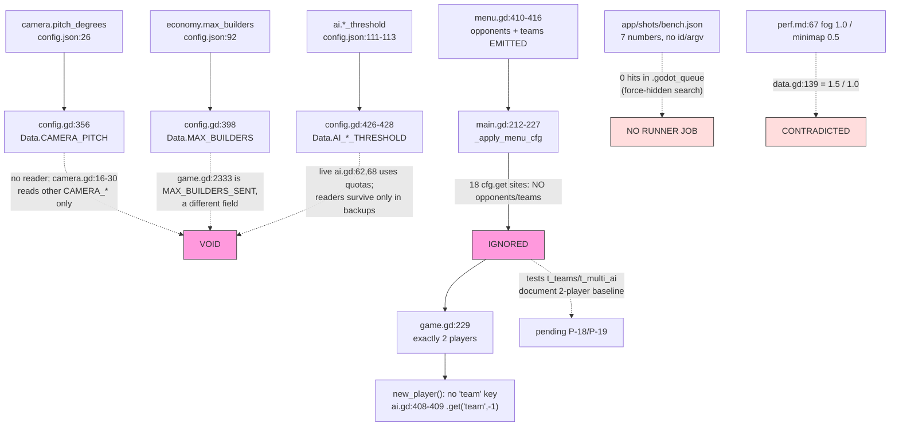

# 🔬 Independent verification — deep-CONFIG (D-22)

> [!IMPORTANT]
> This is the **second-agent / different-method** check owed by
> `SWARM_OPS.md:121-124` and `docs/audit/README.md:20-21`. It re-verifies three
> high-impact claims from `docs/audit/CONFIG_EFFICIENCY.md` (deep-CONFIG's
> single-read baseline). I read `SWARM_OPS.md` §5b-QUALITY, `docs/audit/README.md`
> and `docs/audit/CONFIG_EFFICIENCY.md` **before** investigating. I changed **no
> code, no board, no other doc**; this file is my only write.

## 0. Method (deliberately different from the baseline)

deep-CONFIG's own honesty note (`CONFIG_EFFICIENCY.md:35-38`) says most findings
are a *single read* and that its consumer checks were a grep of `app/scripts`
for **literal config key names** (`CONFIG_EFFICIENCY.md:216-217`). My method:

1. **Search the key *and* its destination field.** A runtime consumer reads the
   `Data.*` field, not the JSON key string, so a key-name grep alone can miss a
   reader (or be fooled by a near-neighbour such as `MAX_BUILDERS_SENT`). I first
   established the exact mapping from `config.gd.apply()`:
   `camera.pitch_degrees`→`Data.CAMERA_PITCH` (`config.gd:356`),
   `economy.max_builders`→`Data.MAX_BUILDERS` (`:398`),
   `ai.food/wood/stone_threshold`→`Data.AI_{FOOD,WOOD,STONE}_THRESHOLD`
   (`:426-428`). I then grepped the **whole repo, all file types** (`.gd`,
   `.json`, `.md`, `.tscn`, `.txt`, `.log`, tooling `.py`) for both forms, plus
   generic `pitch`.
2. **Force-hidden raw traversal** with PowerShell `Get-ChildItem -Recurse -Force`
   for (a) the five `Data.*` field names across the whole repo except `.git`, and
   (b) the bench numbers and queue records, so dot-directories (`.godot_queue`)
   and gitignored files cannot be silently skipped by ripgrep's defaults. The
   field-name sweep completed: its only hits were the expected declarations /
   writers (`config.gd:356,371,398,426-428`; `data.gd:41,51,60-62,147`), the
   data files (`config.json:50,92`; `boost.json:44,86`), the near-neighbour
   `game.gd:2333` (`MAX_BUILDERS_SENT`), and doc hits — **no live consumer in any
   hidden or gitignored location**.
3. **Read the live call sites, not names:** emit → cfg reads → player
   construction → team read; enumerate *every* `cfg.get(` in `main.gd`; check the
   `new_player()` dict schema; read the test files that encode the intended
   behaviour.
4. **Separate observation / derived / inference** per `README.md:22`. Backups
   under `inbox/backup/` are treated as historical evidence, **not live code**.

Verdict vocabulary: `CONFIRMED` / `REFUTED` / `UNVERIFIED` (task wording);
`REFUTED` == README's `CONTRADICTED` (`docs/audit/README.md:36`).

## 1. Claim table

| # | Claim (deep-CONFIG) | deep-CONFIG evidence | MY method (independent) | Verdict | Correction needed |
|---|---|---|---|---|---|
| 1 | "5 settings declared-but-unused": `camera.pitch_degrees`, `economy.max_builders`, `ai.food/wood/stone_threshold` (`CONFIG_EFFICIENCY.md:90,113,121,216-217,344-345`) | Key-name grep of `app/scripts`; single read; "no runtime reader" for `CAMERA_PITCH`, `MAX_BUILDERS`, `AI_*_THRESHOLD` | Repo-wide all-file grep of **keys and mapped `Data.*` fields** + read of live consumers (`camera.gd:16-30`, `ai.gd:62-68`, `game.gd:188-199,2333`) + backup provenance + `MECHANICS.md` cross-check (§2 below) | **CONFIRMED** (all 5) | No verdict change. Add two corroborating facts to the baseline: the AI-threshold fields **had live readers in backups** and went dead in the quota rewrite; `app/MECHANICS.md:268,273` independently documents pitch as fixed. Keep CFG-06/CFG-09. |
| 2 | "teams/opponent-count emitted by menu but ignored by main" (G13, `CONFIG_EFFICIENCY.md:104`; missing control at `:137,348`) | Menu emits `opponents`/`teams` (`menu.gd:412`); `_apply_menu_cfg` ignores them (`main.gd:212-227`); `game.gd:230-231` hardcodes 2 players; team logic exists in `ai.gd:403-409` | End-to-end trace: read emit payload; **enumerate all 17 `cfg.get(` sites in `main.gd` (+2 `pending_cfg.get`)**; read `_apply_menu_post`; read `game.gd:226-231` + `new_player()` schema; grep `.team`/`"team"` across all scripts; enumerate AI instantiation; read `t_teams.gd` / `t_multi_ai.gd` (§3) | **CONFIRMED** | No verdict change. Precision: the 2-player hardcode is `game.gd:229` (nation assignment `:230-231`); `new_player()` never creates a `"team"` key, so `ai.gd:408-409` always falls back to `-1`. Keep CFG-07. |
| 3a | "bench.json has no runner job id / provenance unverified" (`CONFIG_EFFICIENCY.md:172-177,221-222`) | grep of `app/.godot_queue/results/**` for `--bench`/`bench report`: 0 matches | Force-hidden raw search of **all** of `.godot_queue` (jobs + results + status) for `bench`, the exact full-precision numbers and `headless_sim_only`: 0 hits; repo-wide hidden search for those numbers returns only `bench.json` itself and the audit doc; job schema inspected; unrelated `PERF tick_ms` telemetry identified and ruled out (§4) | **CONFIRMED** | No verdict change. Two doc-precision notes: (i) "numbers exactly match `perf.md:47`" is true only to *displayed rounding*; (ii) the queue is not devoid of perf telemetry — `PERF tick_ms` lines exist in 4 windowed jobs but are neither FPS nor this artifact. Keep PERF-01. |
| 3b | "perf.md's low-preset fog/minimap values contradict `data.gd:139` exactly as claimed" (`CONFIG_EFFICIENCY.md:220`, claim #9) | `perf.md:67` = 1.0 / 0.5 vs `data.gd:139` = 1.5 / 1.0; verdict CONTRADICTED | Direct value comparison, then compared `perf.md`'s pair against **all three** presets in `set_quality()` (`data.gd:137-145`) to rule out a "different preset" explanation (§4.2) | **CONFIRMED** | No verdict change. Strengthen PERF-01 text: the recorded 1.0/0.5 pair matches **no** preset in code (high 0.5/0.25, medium 0.8/0.5, low 1.5/1.0), so it is stale, not an alternate-preset choice. |

## 2. Claim 1 detail — the five dead settings

### 2.1 `camera.pitch_degrees` → `Data.CAMERA_PITCH` — CONFIRMED dead

`observed` hits, repo-wide all file types:

- Declaration: `app/scripts/config.gd:35` (`"pitch_degrees": -32.0` in `DEFAULT`);
  shipped value `app/config.json:26`; also `app/shots/boost.json:20`.
- Writer: `app/scripts/config.gd:356` → `Data.CAMERA_PITCH = num("camera.pitch_degrees", -32.0)`.
- Field declaration: `app/scripts/data.gd:147` (`static var CAMERA_PITCH := -32.0`).
- **No live reader.** `camera.gd:16-30` (`bind()`) reads exactly
  `CAMERA_EDGE_MARGIN` (`:19`), `CAMERA_CORNER_MARGIN` (`:20`),
  `CAMERA_KEY_SPEED` (`:21`), `CAMERA_MOUSE_SPEED` (`:22`), `CAMERA_ZOOM_STEP`
  (`:23`), `CAMERA_MIN_HEIGHT` (`:26`), `CAMERA_MAX_HEIGHT` (`:27`). The rest of
  `camera.gd` (`:33-92`) is position clamping, wheel zoom and edge/arrow scroll —
  no rotation, no pitch, no `CAMERA_PITCH`.
- Generic `pitch` search: the only live-code hits are `config.gd:35,356` and
  `audio.gd:131` (`p.pitch_scale` — audio playback, unrelated). No `.tscn`, test,
  tool or runner record reads it. (`app/scenes/main.tscn` is the only scene file;
  no hits.)
- **Second, independent source:** `app/MECHANICS.md:268` says
  `pitch angle | −32° (fixed)` and `:273` says `... pitch stays −32°`. A doc that
  describes the donor behaviour independently calls the pitch *fixed* — exactly
  what a dead config key implies. (`app/mechanics.json:61` names the same
  "camera pitch" donor field.)

`derived`: changing `camera.pitch_degrees` in `config.json` changes only a static
number that nothing reads; rendered pitch cannot change.

### 2.2 `economy.max_builders` → `Data.MAX_BUILDERS` — CONFIRMED dead

- Declaration `config.gd:72`; shipped `app/config.json:92`; `boost.json:86`.
- Writer `config.gd:398` → `Data.MAX_BUILDERS`; field declaration `data.gd:51`.
- **No live reader.** A naive grep for `MAX_BUILDERS` *does* return
  `app/scripts/game.gd:2333` (`if sent >= Data.MAX_BUILDERS_SENT:`) — but that is
  the **distinct** field `MAX_BUILDERS_SENT` (`data.gd:41`, written from a
  **different** key `gameplay.max_builders_sent` at `config.gd:371`). Resolving
  the two fields at their declaration sites is what turns an ambiguous substring
  hit into a clean "no reader" result. No other live reference to bare
  `MAX_BUILDERS` exists.

### 2.3 `ai.{food,wood,stone}_threshold` → `Data.AI_*_THRESHOLD` — CONFIRMED dead

- Declarations `config.gd:91-93`; shipped `app/config.json:111-113`;
  `boost.json:105-107`.
- Writers `config.gd:426-428`; field declarations `data.gd:60-62`.
- **No live reader.** Current `ai.gd` never mentions the fields. Its economy is
  `ai.gd:62` comment `--- economy: target quotas instead of threshold ping-pong ---`
  and `ai.gd:68` `var want := {"food": int(n * 0.35), "wood": int(n * 0.25),
  "stone": int(n * 0.15)}` — hardcoded quota fractions, no threshold lookup.
- **New provenance (`observed` in backups, not live):** `inbox/backup/ai.gd.bak:45,49,51`
  (and `.bak3`, `.g2bak`) contain the former readers:
  `if res.food < Data.AI_FOOD_THRESHOLD ...`, `elif res.wood < Data.AI_WOOD_THRESHOLD:`,
  `elif res.stone < Data.AI_STONE_THRESHOLD and ...`.
  `derived`: these keys were once live and became dead when AI economy moved to
  target quotas. This is a *mechanism*, not merely an absence — it upgrades the
  baseline's single-read negative finding.

### 2.4 Consolidated force-hidden sweep (completed, `observed`)

The raw `Get-ChildItem -Recurse -Force` sweep for the five field names over the
entire repo (excluding `.git`, including dot-directories and gitignored paths)
returned only: `config.json:50,92`; `boost.json:44,86`;
`config.gd:356,371,398,426-428`; `data.gd:41,51,60-62,147`; `game.gd:2333`
(the distinct `MAX_BUILDERS_SENT`); and doc hits (`CONFIG_EFFICIENCY.md`,
`CONFIG_VERIFY.md`). There is **no reference to any of the five fields outside
their declaration/writer sites anywhere on disk**. This closes the last path by
which a hidden consumer could have refuted claim 1.

## 3. Claim 2 detail — the emitted-but-ignored menu fields

Full data path, each hop `observed`:

```
menu.gd:410-416  _emit_start  -> cfg{"opponents": opponents, "teams": teams_mode, ...}
                    |  (UI: menu.gd:23-24 vars; :240-241 option rows)
                    v
main.gd:212-227  _apply_menu_cfg  -> reads nation0/1, map_type, biome,
                    start_option, difficulty, map_size, seed, mode
                    ** NO cfg.get("opponents") / cfg.get("teams") **
main.gd:229-250  _apply_menu_post -> reads load_save, descr, mission only
                    v
game.gd:226-231  setup() -> players = [new_player(0,...,false),
                                      new_player(1,...,true)]   // exactly 2
                    nations set for [0] and [1]
game.gd:188-199  new_player() -> dict has NO "team" key
                    v
ai.gd:408-409    _is_enemy -> p.get("team", -1)  // always -1 -> never fires
```

- Exhaustive `cfg.get(` enumeration in `main.gd`: `:213,214,215,216,217,218,220,222,223,225,227` in `_apply_menu_cfg`, `:233,239,240` in `_apply_menu_post`, `:426,435,436` (load/async paths) — 17 sites — plus `:728,735` using `pending_cfg.get` for campaign progress. Neither field appears at any of them. No generic "iterate cfg keys" path exists.
- AI instantiation: `main.gd:408,464,553` create `C3AIScript.new(game, 1)` (one AI for player 1); `:410,465,558` add `cli_ai0` for player 0 in CLI mode only. There is no loop over `opponents`.
- Grep for `.team` / `"team"` in all live scripts: **only** `ai.gd:408-409`. Nothing sets the field (the only `players.append` in `game.gd` is deserialization at `:3770`).
- **Corroboration from tests (`observed`):** `app/tests/t_teams.gd:16-18` — "On the current build the simulation layer is still two-player-only, so several checks fail ... a pending feature"; `app/tests/t_multi_ai.gd:8-10` — "The current engine hardcodes a two-player setup/generator, so several checks FAIL on the baseline." These tests add players via `new_player()` + `players.append()` themselves (`t_teams.gd:71-76`, `t_multi_ai.gd:90-103`) — i.e. they bypass the menu path precisely because it does nothing.
- Side note (consistency, not a new finding): `_apply_menu_cfg:217` reads `biome`, which the menu never emits (`menu.gd:410-416`) — matching deep-CONFIG's G12 MISSING note (`CONFIG_EFFICIENCY.md:103`).

## 4. Claim 3 detail — bench provenance + the preset contradiction

### 4.1 Provenance: no runner evidence ties `bench.json` to a job — CONFIRMED

`app/shots/bench.json:1-8` in full: seven numbers (`fps 1.18973339396567`,
`headless_sim_only true`, `sim_ms_per_tick 196.029051041667`, `sim_seconds 30.0`,
`units 618`, `wall_seconds 189.118`). There is **no** `id`, `job`, `ticket`,
`command`, `argv`, `timestamp` or `runner` field.

Searches performed:

| Search | Scope | Result |
|---|---|---|
| `bench.json`, `--bench` | whole repo, all file types | Hits only in code/docs/backups (`main.gd:953` writer, `:653` flag; `docs/COMMANDS.md:177`; `GUIDE3.md:1024,1260`; `perf.md:4,43,92,104`); **zero** hits in `.godot_queue` |
| `bench` | `.godot_queue`, raw `Get-ChildItem -Recurse -Force` (jobs + results + status.json, hidden included) | **0 matches** — no job `id` or `argv` contains it |
| `1.18973339396567\|196.029051041667\|189.118` | repo-wide, force-hidden, excluding `.git` | Only `app/shots/bench.json:2,4,7` and `docs/audit/CONFIG_EFFICIENCY.md:163`. **No runner result, no job file, not even `perf.md`** (which carries rounded values only) |
| `headless_sim_only` | whole repo | Only `bench.json:3`, `main.gd:952` (writer), backups, and the audit doc |
| `fps\|perf\|1.19\|196.0\|618\|sim_ms` | `.godot_queue`, force-hidden | See nuance below |

Runner job schema (`app/.godot_queue/results/00000028.json:1-22`) shows exactly
what a tying record would look like: `ticket`, `id` (`agentT-cli30`), `argv`
(`--headless --path app -- --cli app/cli.json --cli-seconds 30`), `wait`, `run`,
`exit`, `status`, and stdout/stderr paths. **No such record names `--bench` or
the artifact.** `perf.md:92` independently states `--bench` was not part of the
T-01 jobs; `perf.md:71-75` attributes other numbers to jobs #27/#28 by name.

`derived`: `bench.json` is a real on-disk artifact (its shape matches the writer
at `main.gd:952-953`) but is **not reproducible from a named runner job**. It
must not be presented as QA-signed. Verdict UNVERIFIED provenance stands.

**Nuance found by my broader search (does not change the verdict):** four
windowed job stdouts contain a debug line from `main.gd:936` —
`00000005_agentD-ghost/stdout.txt:5`, `00000015_agentH-menu:5`,
`00000044_agentO-shot:5`, `00000075_agentO2-shot:5` — e.g.
`PERF tick_ms=5.22 ai_ms=2.36 sync_ms=68.52 steps_per_frame=0.8 ...`. These are
*not* FPS, carry no `units`/`sim_seconds`/`headless_sim_only`, and come from
windowed runs (`00000044:2` shows an NVIDIA OpenGL device, `sync_ms` is nonzero).
They are unrelated to the 618-unit headless bench. Therefore the baseline's
narrow statement ("no result contains `--bench` or a `bench report` line") holds;
only a *broader* claim that the queue holds no perf telemetry at all would need
qualification.

**Rounding precision:** the baseline says the `bench.json` numbers "exact[ly]
match `perf.md:47`". They agree to *displayed* precision only: `1.18973339396567`
→ `1.19`, `196.029051041667` → `196.0`, `189.118` → `189.1`, `618`/`30.0` exact.
Cosmetic wording correction, not a factual error.

### 4.2 Fog/minimap contradiction: exactly as claimed — CONFIRMED

| Preset | `perf.md:64-67` | `data.gd:134-145` (`set_quality`) | Match? |
|---|---|---|---|
| low | terrain_px 8, sprite_cell 64, fx_cap 60; **fog 1.0, minimap 0.5** | `:138` 8/64/60; `:139` **FOG_INTERVAL 1.5, MINIMAP_INTERVAL 1.0** | terrain/fx match; **both intervals wrong by 0.5** |
| medium | terrain_px 12, sprite_cell 96, fx_cap 120 (no intervals stated) | `:141-142` 12/96/120; fog 0.8, minimap 0.5 | terrain/fx match |
| high | terrain_px 16, sprite_cell 160, fx_cap 220, shadows on | `:144-145` 16/160/220; fog 0.5, minimap 0.25 | terrain/fx match |

`observed`: the contradiction is literal — `perf.md:67` says `fog_interval 1.0,
minimap_interval 0.5`; `data.gd:139` says `FOG_INTERVAL = 1.5; MINIMAP_INTERVAL
= 1.0`. `derived`: perf.md's 1.0/0.5 pair equals **no** preset in code (high
0.5/0.25, medium 0.8/0.5, low 1.5/1.0), so it is stale documentation, not a
deliberate different-preset choice. deep-CONFIG's claim #9 verdict
(`CONTRADICTED`) and its PERF-01 fix instruction are correct.

## 5. What changed in my confidence

- **Claim 1 — up, with a mechanism.** A second all-file-type search (keys *and*
  destination fields) found no live consumer, but the decisive additions were
  (a) the **backup readers** for the AI thresholds, showing the keys went dead in
  the quota rewrite rather than never being wired, and (b) `MECHANICS.md:268,273`
  independently calling pitch *fixed*. I also had to resolve the
  `MAX_BUILDERS` / `MAX_BUILDERS_SENT` name collision; that check makes the
  "no reader" result stronger than deep-CONFIG's key-name grep could be.
- **Claim 2 — up.** Tracing the payload through four concrete layers (emit →
  exhaustive `cfg.get` list → hardcoded player dict → `.get("team", -1)` with no
  writer), plus two test files that explicitly describe the two-player baseline,
  removed the main refutation risk (a hidden generic cfg loop or a test harness
  that sets teams). Both were checked and ruled out.
- **Claim 3 — provenance up, telemetry wording qualified.** The force-hidden raw
  search is stricter than the tool grep, so "no bench job" is now high-confidence.
  However, I *lowered* confidence in any sweeping statement like "the runner has
  no perf data": unrelated `PERF tick_ms` telemetry does exist in four windowed
  jobs. The bench-specific verdict and the fog/minimap contradiction are
  unaffected. I also downgraded "exact numbers match" to "match to displayed
  precision".

No claim moved to REFUTED or UNVERIFIED; all three high-impact claims stand.

## 6. Data-flow diagram (verified dead paths)



## 7. Report

**Verdicts**

1. **5 declared-but-unused settings — CONFIRMED.** No live reader for
   `CAMERA_PITCH` (`data.gd:147`; writer `config.gd:356`; `camera.gd:16-30` reads
   only other camera fields; `MECHANICS.md:268,273` calls pitch fixed), bare
   `MAX_BUILDERS` (`data.gd:51`; `game.gd:2333` is the *other* field
   `MAX_BUILDERS_SENT`), or `AI_*_THRESHOLD` (`data.gd:60-62`; live `ai.gd:62,68`
   uses quotas; former readers at `inbox/backup/ai.gd.bak:45,49,51`).
2. **teams/opponents emitted but ignored — CONFIRMED.** `menu.gd:412` emits both;
   no `cfg.get` for either anywhere in `main.gd:212-250,435-436,728,735`;
   `game.gd:229` hardcodes two players; `new_player()` (`game.gd:188-199`) defines
   no `team` key, so `ai.gd:408-409` always reads `-1`; `t_teams.gd:16-18` and
   `t_multi_ai.gd:8-10` independently document the two-player baseline.
3. **bench provenance UNVERIFIED / fog-minimap contradiction CONFIRMED.** Force-
   hidden search of all of `app/.godot_queue` for `bench`, the exact numbers and
   `headless_sim_only`: **0 matches**; repo-wide, those numbers exist only in
   `bench.json:2,4,7` and `CONFIG_EFFICIENCY.md:163`. `perf.md:67` (1.0/0.5)
   contradicts `data.gd:139` (1.5/1.0), and matches no preset in code.

**Files changed:** exactly one — `docs/audit/CONFIG_VERIFY.md`. No code, board,
or other docs; no runner jobs launched.

**Open questions**

1. Should CFG-06 *restore* the old pitch reader or delete the key? `MECHANICS.md`
   says donor pitch is fixed at −32°, which favours **deleting** the key rather
   than making it configurable (owner fidelity call).
2. For CFG-09, should the AI thresholds be re-wired (backup reader pattern at
   `ai.gd.bak:45-51` is available) or deprecated? The quota rewrite is the
   deliberate current design, so deprecation may be correct.
3. Who reproduces `bench.json` through `godot_runner.py` and records the ticket
   id (PERF-01), and who fixes `perf.md:66-67` — doc to code values or code to
   doc values? The doc's 1.0/0.5 matches no preset either way.
4. Does the unrelated `PERF tick_ms` telemetry (`main.gd:936`) deserve its own
   runner-attributed measurement, or stay a debug print? It is too small-scale
   (windowed, few units) to substitute for G15.3.
5. CFG-07 (apply emitted opponents/teams) — before or after P-18/P-19? The
   written tests `t_teams.gd` / `t_multi_ai.gd` are already the acceptance
   harness; they need the sim layer and menu wiring, not weaker assertions.

**Related:** `docs/audit/README.md` · `docs/audit/CONFIG_EFFICIENCY.md` ·
`SWARM_OPS.md` §5b-QUALITY · `app/scripts/{config,data,main,menu,game,ai,camera}.gd` ·
`app/shots/{bench.json,perf.md}` · `app/.godot_queue/**`.
