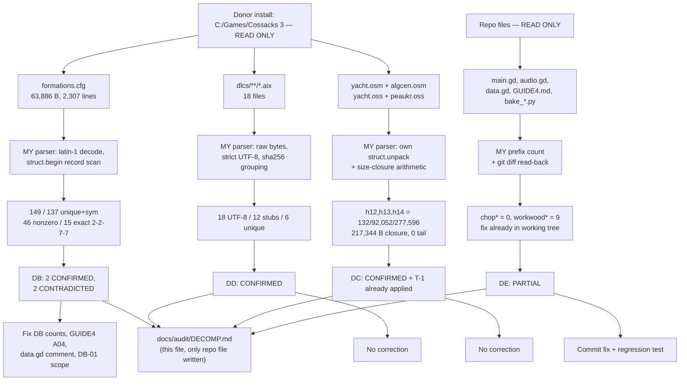

# 🔬 Deep audit: DECOMP

> [!IMPORTANT]
> Quality-first, unhurried re-verification (D-22). I did **not** accept any
> DA–DE report at face value. Every number below was re-derived with a method
> **different from the original decompiler's**: DB used Craft Anything
> `core_text_read`; I used read-only Python byte reads with an explicit
> `latin-1` decode and my own record parser. DC used Craft Anything byte
> inspection; I wrote my own `struct.unpack` script. DD used Craft Anything
> plus Python; I used strict UTF-8 decoding, hex dumps and SHA-256 grouping
> over **all** 18 files. DE used `core_text_read` + basename diff; I used a
> filesystem prefix count plus `git diff`.

**Scope / compliance (observed).** The installed donor at
`C:\Games\Cossacks 3` was opened **read-only**. No donor executable was run,
no donor file was copied, converted or committed into the repository, no game
code was edited and no Godot process was launched. The only repository file
written is this document. Analysis scripts live outside the repo in
`C:\Users\Maxym.Oboyshev\AppData\Local\Temp\opencode\de_comp_*.py` (not
committed, not part of the port). Reproducible parser rules and arithmetic are
inlined below so the findings do not depend on those temp files.

**Label convention (observed / derived / inferred).** Counts, header values
and byte dumps are *observed*. Closure results and count comparisons are
*derived* from those observations. Statements about why a value exists (e.g.
legacy `_OLD` bonuses) are *inferred* and marked as such.

---

## 1. Claim table

| # | Claim | Original evidence | YOUR independent method (different from original) | Verdict | Required correction |
|---|---|---|---|---|---|
| 1a | GUIDE4 A04 "formations.cfg bonusdamage 0 (masks only)" is wrong — donor formations carry real bonuses | DB `fnd_22`, `docs/decomp/DB_SCRIPTS.md` §2.4/G1; `ev_2f2f15d9…`, `ev_24a1cc1a…` | Python `latin-1` decode of all 63,886 B + own `struct`-free record parser over 2,307 lines; count nonzero bonus fields | **CONFIRMED** — 46 of 149 formations have ≥1 nonzero bonus; GUIDE4 A04 is false | Correct GUIDE4 A04 (line 1131) and the identical stale comment at `app/scripts/data.gd:215`; DB-01 stays open with corrected numbers |
| 1b | "`formations.cfg` has 149 formations, 137 with symmetry=1" | DB `fnd_22`, §2.4 | Same parser; `id =` record count, unique-ID count, symmetry distribution | **CONFIRMED** — 149 records, 149 unique IDs, sym=1 → **137**, sym=0 → 12 | none |
| 1c | "**43** entries carry non-zero bonuses" | DB `fnd_22`, §2.4 and gap G1 | Same parser; count records where any of the 4 bonus fields ≠ 0 | **CONTRADICTED** — exact value is **46**, not 43. No natural filter I tried reproduces 43 (bonusdamage≠0 → 44; all-four-nonzero → 44; excluding 2 negative outliers → 42) | Replace "43" with "46" in DB-01 acceptance criteria and the gap table |
| 1d | "43 formations have `bonusdamage=2, bonusshield=2, bonusdamagehold=7, bonusshieldhold=7`" | DB `fnd_22`, §2.4 quoted block + gap G1 | Same parser; exact 4-tuple frequency distribution | **CONTRADICTED** — exact `(2,2,7,7)` count is **15**, not 43. Bonuses are heterogeneous: `(1,1,1,1)`×22, `(3,3,7,7)`×3, `(2,1,2,1)`×2, `(0,1,1,0)`×2, plus 2 legacy outliers. DB's example list also mislabels SQUARE400/KARE400 (really 3/3/7/7) and TRI*/PRUS*/SHER* (really 1/1/1/1 or legacy) as 2/2/7/7 | Rewrite DB's quoted block with the exact 15 IDs and the full 8-tuple distribution in §3.1; do **not** implement a flat "all bonuses = 2/2/7/7" table |
| 2 | `.aix` files in `dlcs\` are plain UTF-8 text trigger scripts, not compiled AI blobs | DD `fnd_11`, `docs/decomp/DD_MAPS.md` §2/§3.2; `ev_43b589eb…`, `ev_b39facc…`, `ev_04b61c03…` | Raw byte read of **all 18** files; strict `.decode('utf-8')`, NUL/non-ASCII byte census, SHA-256 grouping, first-12-line text dump of 3 files | **CONFIRMED** — 18/18 decode as UTF-8; 0 NUL, 0 bytes >127 (they are 7-bit ASCII, CRLF, no BOM). 12 identical 393 B stubs (`e16db4ebf8fd…`), 6 unique. Text begins `section.begin` with `[*] = ;…` script lines | None. Optional precision tweak: describe as "7-bit ASCII (UTF-8-compatible) with CRLF", not merely "UTF-8" |
| 3a | `.osm` section offsets are header longs **12/13/14** (0-based), not 10/11/12 | DC `fnd_6`/`fnd_7`, `docs/decomp/DC_FORMATS.md` §2.2/§3 | My own `struct.unpack_from("<17i", …)` on `yacht.osm` and `algcen.osm`; three independent arithmetic closures + source check of the reader's zip list | **CONFIRMED** — yacht h[12..14]=132 / 92,052 / 277,596; algcen=132 / 42,180 / 145,980; every closure exact and both end offsets equal file size. `bake_sprites.py:487-492` maps `ou/ot/of` to h[12]/h[13]/h[14] | None. DC's T-1 comment ticket is already satisfied in the current tree (`bake_naval.py` is an untracked new file whose docstring says "there is no defect") |
| 3b | `yacht.oss` size closes exactly at **217,344 B** with the decoded layout | DC `fnd_8`, `docs/decomp/DC_FORMATS.md` §2.1 table | My own `struct.unpack` script: read 6-int header, walk the per-vertex weight lists element-by-element (not DC's number), then add bone tracks | **CONFIRMED** — header k=311, fps=30, b=20, v=584, fc=947, t=793; 24+7,008+11,364+6,344+11,364+**7,080 (593 pairs read)+174,160 = 217,344** = on-disk size, 0 tail bytes. Cross-check `peaukr.oss` closes at 312,376 B too | None |
| 4 (optional) | "`chop` is a silent prefix-mapping bug: port plays `["chop"]` but only `workwood*` files exist" | DE `fnd_18`, `docs/decomp/DE_AUDIO_UI.md` §"Chop", ticket T-DE-01 | Filesystem prefix count + `git diff -- app/scripts/main.gd` + read of `audio.gd:81-92` | **PARTIAL** — donor/port inventory CONFIRMED (`chop*` = **0**, `workwood*.ogg` = **9**, mechanism `begins_with` confirmed), but the "port is still silent" half is **CONTRADICTED by the current working tree**: `main.gd:1065` already reads `_play(["workwood"], -8.0, ev.pos)` | Mark T-DE-01 as fixed **in working tree only**; commit the one-line change and add a regression assertion. Update DE's report so it does not request the fix twice |

**Summary of verdicts:** 1a CONFIRMED · 1b CONFIRMED · 1c CONTRADICTED · 1d
CONTRADICTED · 2 CONFIRMED · 3a CONFIRMED · 3b CONFIRMED · 4 PARTIAL. All
three mandatory checks were completed with exact numbers; the optional fourth
was also completed. The one material error found is in **DB fnd_22** (counts
43 → 46 nonzero, and 43 → 15 for the specific 2/2/7/7 tuple), which propagates
into `docs/decomp/DB_SCRIPTS.md` §2.4, gap G1, DB-01's acceptance criteria and
the stale comments in `GUIDE4.md` / `data.gd`.

---

## 2. Verification chain



---

## 3. Detailed findings

### 3.1 DB `fnd_22` — `formations.cfg` (mandatory check 1)

**File facts (observed).** Path
`C:\Games\Cossacks 3\data\game\var\formations.cfg`; 63,886 bytes; header
bytes `66 6f 72 6d 61...` (`"forma…"`). UTF-8, cp1252 and latin-1 all decode
the file with identical character counts (63,886) — the file is 7-bit ASCII,
so my choice of encoding cannot bias the count. `splitlines()` → **2,307**
lines, matching DB's reported `total_lines`. Lines containing `bonus` →
**596** = 149 × 4, an early hint that every formation carries all four bonus
fields.

**Parser rule (reproducible).** Iterate lines; on `[*] : struct.begin` start a
record; on `struct.end` append it if it contains `id`; otherwise capture
`key = value` for keys `symmetry`, `bonusdamage`, `bonusshield`,
`bonusdamagehold`, `bonusshieldhold`. This yields **149 records, 149 unique
IDs**, every one carrying all five fields.

**Distributions (derived, exact):**

| field | value → count |
|---|---|
| symmetry | 0→12, 1→**137** |
| bonusdamage | -10→1, 0→105, 1→22, **2→17**, 3→3, 5→1 |
| bonusshield | -5→1, 0→103, 1→26, **2→15**, 3→3, 9→1 |
| bonusdamagehold | -27→1, 0→103, 1→24, 2→2, **7→18**, 95→1 |
| bonusshieldhold | -19→1, 0→105, 1→24, **7→18**, 80→1 |

**Exact 4-tuple frequencies** `(bonusdamage, bonusshield, bonusdamagehold, bonusshieldhold)`:

| tuple | count | interpretation |
|---|---:|---|
| (0,0,0,0) | 103 | no bonus |
| (1,1,1,1) | 22 | uniform small bonus |
| **(2,2,7,7)** | **15** | the specific tuple DB over-counted |
| (3,3,7,7) | 3 | LINE400, SQUARE400, KARE400 |
| (2,1,2,1) | 2 | SHER_OLD, SHER0_OLD |
| (0,1,1,0) | 2 | SHER3_OLD, SHER03_OLD |
| (-10,9,95,-19) | 1 | TRI_OLD — legacy/outlier (inferred) |
| (5,-5,-27,80) | 1 | PRUS_OLD — legacy/outlier (inferred) |

**Totals (derived):** any nonzero bonus = **46**; exact `(2,2,7,7)` = **15**;
hold=7 on both hold fields = **18** (the 15 above plus the 3 `400` forms).

The **15** exact `(2,2,7,7)` IDs are:
`LINE15, LINE36, LINE72, LINE120, LINE196, SQUARE15, SQUARE36, SQUARE72,
SQUARE120, SQUARE196, KARE15, KARE36, KARE72, KARE120, KARE196`.
(Note `SQUARE15` and `KARE15` have `symmetry = 0`; the other 13 have 1.)
DB's quoted "same for … SQUARE15/36/72/120/196/**400**,
KARE15/36/72/120/196/**400**, **TRI\*, PRUS\*, SHER\***" is therefore wrong on
two counts: the `400` forms are `(3,3,7,7)`, and the `TRI/PRUS/SHER` families
are mostly `(1,1,1,1)` with two legacy outliers.

**Where DB was right.** 149 formations, 137 with symmetry=1, and — most
importantly — the *direction* of the claim: `GUIDE4.md:1131` says
`bonusdamage 0 (masks only; port bonuses wiki)`, and `app/scripts/data.gd:215`
repeats `bonusdamage 0 there`. Both are factually false: bonuses exist and are
nonzero in 46 records. The port's `Data.FORMATIONS` (5 shape multipliers,
`data.gd:217-223`) and `game.gd:_formation_atk/_def` (wiki-derived 5/9/2/4/1/3,
`game.gd:1740-1766`) do not read these donor fields at all. So DB-01 remains a
valid **high-severity** ticket; only its numbers and its flat "all = 2/2/7/7"
scope are wrong. Correct scope: import all 149 IDs and the real per-ID 4-field
bonus table, with the two negative/outlier legacy records either preserved
verbatim or explicitly quarantined by an owner decision (that choice is
*inferred* scope, not a donor fact).

### 3.2 DD `fnd_11` — `.aix` text scripts (mandatory check 2)

**Filesystem census (observed).** `glob dlcs/**/*.aix` → **18** files, exactly
as DD reported. SHA-256 grouping: one hash `e16db4ebf8fd…` covers **12**
byte-identical 393 B stubs (`polmis1-5`, `scemis1-5`, `celmis1`, `celmis2`);
six unique files: `spamis2` 595 B, `turmis1` 712 B, `turmis2` 466 B,
`turmis3` 595 B, `netmis4` 833 B, `scemis12` 596 B. This matches DD's
distribution exactly.

**Byte/text evidence (observed).** First bytes of `polmis1.aix`:
`73 65 63 74 69 6f 6e 2e 62 65 67 69 6e 0d 0a …` = `section.begin\r\n`.
Across all 18 files: UTF-8 strict decode succeeds for **18/18**, non-ASCII
bytes = **0**, NUL bytes = **0**. First lines of the sampled files:

```
polmis1.aix (393 B)          netmis4.aix (833 B)
section.begin                section.begin
   Name = Initial               Name = netmis4
   UsedFileName =               UsedFileName =
   Code : struct.begin          Code : struct.begin
      [*] = ;Log('mission…         [*] = ;const cPlPlayer = 0;
   struct.end                      [*] = ;const cPlfra1 = 3;
section.end                         [*] = ;const cPlayerFarm = 4000;
                                    …
```

The `[*] = ;…` lines are the game's script statements stored verbatim as
text (DD's observation). Verdict: **CONFIRMED**. Sharpening only: the files
are 7-bit ASCII with CRLF — they are UTF-8-decodable because ASCII is a strict
subset, not because they contain multi-byte UTF-8. Nothing was copied; the
files were opened in place.

### 3.3 DC `fnd_6`/`fnd_7` — `.osm` and `.oss` layouts (mandatory check 3)

**`.osm` header (observed, my own `struct.unpack_from("<17i", …)`).**
`yacht.osm` = 427,436 B; magic h[0]=`0x32504449` = `"IDP2"`; h[1]=8;
h[2]=h[3]=256; h[4]=149,840; h[5]=1; h[6..8]=9,364 / 11,490 / 7,731;
h[9]=0; h[10]=1; h[11]=68; **h[12]=132; h[13]=92,052; h[14]=277,596**;
h[15]=h[16]=427,436. `algcen.osm` = 224,412 B with
**h[12..14]=132 / 42,180 / 145,980** and h[15]=h[16]=224,412.

**Closures (derived, all exact):**

```
yacht.osm:   132 + 11,490*8   = 92,052   (= h[13])
             92,052 + 7,731*24 = 277,596 (= h[14])
             277,596 + 16 + 9,364*16 = 427,436 (= h[15] = h[16] = filesize)
algcen.osm:  132 +  5,256*8   = 42,180
             42,180 + 4,325*24 = 145,980
             145,980 + 16 + 4,901*16 = 224,412 (= filesize)
```

Also verified: h[11] + ns×64 = 68 + 1×64 = 132 = h[12], i.e. the 64-byte
section record ends exactly where UVs begin (DC's table wording here is
slightly ambiguous, its arithmetic is correct). Reading longs 10/11/12 would
give 1 / 68 / 132 — a triangle offset inside the UV array — so DC's
"correct indices 12/13/14" half is right. Separate source check:
`app/tools/bake_sprites.py:487-492` zips the header names in order and seeks
`h["ou"]`, `h["ot"]`, `h["of"]` = h[12], h[13], h[14]. The alleged 10/11/12
reader does not exist in the current tree. Verdict for 3a: **CONFIRMED**.

**`.oss` closure (derived from my own walk).** `yacht.oss`:
k=311, fps=30, b=20, v=584, fc=947, t=793. I read the geometry blocks
sequentially and then walked all 584 weight lists element-by-element:

```
header                    24
vertices        584 * 12 =  7,008
faces           947 * 12 = 11,364
UVs             793 *  8 =  6,344
UV-index triples 947*12 = 11,364
weights (walked): 584 count words + 593 (bone,weight) pairs * 8 = 7,080
bone tracks 20*311*7*4   = 174,160
TOTAL                    = 217,344  == on-disk size; tail = 0
```

Cross-check `peaukr.oss`: 24 + 6,924 + 11,052 + 5,864 + 11,052 + 6,980
(584 pairs) + 270,480 = **312,376** = on-disk size, tail 0. Verdict for 3b:
**CONFIRMED**. Note the weight bytes were *read*, not copied from DC's table —
they independently reproduce DC's 7,080 B / 593 pairs and 6,980 B / 584 pairs.

**Process observation.** DC's T-1 "correct the stale comment" is already
reflected in the working tree: `app/tools/bake_naval.py` is **untracked** and
its docstring (lines 80-84) now states "there is no defect". No action needed,
but the file being untracked means the correction is not yet in git — a
durability risk, not a factual error.

### 3.4 DE `fnd_18` — the `chop` event (optional check 4)

**Inventory (observed).** `app/assets/sounds/`: `workwood1.ogg` …
`workwood9.ogg` present (9 files, each with a `.import`), `chop*` → **0 files**.
`audio.gd:81-92` `names_for()` matches with `begins_with(pre)` and requires the
remainder to be empty or start with a digit; so `"chop"` matches nothing and
`"workwood"` matches `workwood1..9`. DE's mechanism is correct.

**Current tree (observed).** `app/scripts/main.gd:1063-1065` reads:

```
"chop":
    world.add_fx("chop", ev.pos)
    _play(["workwood"], -8.0, ev.pos)
```

`git diff` shows this is an **uncommitted** change:
`- _play(["chop"], -8.0, ev.pos)` → `+ _play(["workwood"], -8.0, ev.pos)`.
So DE's report was accurate when written, but the bug is **not present now**.
Verdict: **PARTIAL** — underlying donor/port observation CONFIRMED, present-tense
bug claim CONTRADICTED. Required correction: commit the one-line fix and add a
small regression assertion; do not re-issue T-DE-01 as an open task.

---

## 4. Where I could not verify

These items are explicitly **UNVERIFIED by me** and remain at the original
author's word. None was required by this audit's four checks, but they bound
the scope of this document so it is not mistaken for a full DA–DE re-review.

| Area | What I did not do | Why |
|---|---|---|
| **DA (PE triage)** | Re-run `core_target_triage`, `native_strings_*`, RTTI counts, entropy values (`.bind` 7.96/7.97, `WUS1` 7.91), Ghidra pseudo-C for `FUN_00404628`, 18,918-function/12,073-string counts, 0-code-xref claim | Requires Craft Anything native analysis in Deep mode; I deliberately used a different, non-Craft method and did not open the PE files. **Donor executables were never run** (prohibited), so packed-stub claims cannot be checked here either |
| **DD `.map` binary layout** | The 53-byte TLV header, break at offset 429, sub-header constants, `~19 MiB` zero region, marker counts/offsets, `GameMapEnd` trailer | I verified only the `.aix` half; the maps are 39–142 MB each and a full structural walk was outside this task. DD's numeric-grid "CLOSED" finding is *inferred*, not re-tested |
| **DC reader-equivalence claim** | That `bake_sprites.read_osm_first` and `bake_naval.read_osm_hull` return byte-identical arrays and the quoted bbox | I confirmed the *source indices* (both use longs 12/13/14) and the *format* closures, but did not execute either reader (Blender/import environment). The byte-identical-runtime half stays UNVERIFIED |
| **DC git-history claim** | "true in every commit `4b1404c` … `edef9e8`" | I checked only the current working tree; I did not walk full history |
| **DB other config families** | `generator.cfg` terrain/pattern weights, `dogenerate.inc` stage order/constants/reseed lines/version gates, `startingsettings.cfg`, `envscales.cfg`, `hotkeys.cfg`, gaps G2–G7, 50–74 h estimates | My task named the formation claim specifically; those remain DB's observations only |
| **DE other families** | 325 donor / 305 port / 20-missing nation-track census, locale `gui.txt` strings, `menu.cfg` bindings, hotkey gap table, UI cursor/icon/font claims | Only the chop sub-claim was in scope; I read `audio.gd` prefix logic but did not re-census audio or locale |
| **All 18 `.aix` full content** | I decoded and rendered the first 12 lines of 3 files and byte-censused all 18; I did not hand-translate all 6 unique scripts into mission config | Translation is a port task (deferred by the skirmish-only charter), not an audit task |
| **Working-tree mutability** | Whether the uncommitted `main.gd` chop fix and untracked `bake_naval.py` survive to the next commit | `git status` shows `M app/scripts/main.gd` and `?? app/tools/bake_naval.py` at audit time (2026-11-21). Verdicts 3a/4 describe the tree *as inspected*; a later commit could change them |

---

## 5. Open questions / follow-up

1. **Owner decision — `DB-01` scope.** Should the two legacy outliers
   `TRI_OLD (-10,9,95,-19)` and `PRUS_OLD (5,-5,-27,80)` be imported verbatim,
   clamped, or quarantined? They are distinct from the ordinary 1/1/1/1 and
   2/2/7/7 families (inference: older encoding or debug values). No donor
   evidence establishes their semantics; do not guess.
2. **Owner decision — which formation IDs are reachable in skirmish.** The
   donor has 149 IDs; the port exposes 5 shape labels. DB-01 should name the
   mapping rule or keep all 149 as data even if only a subset is selectable.
3. **Commit hygiene.** Land the already-present `chop → workwood` fix and the
   corrected `bake_naval.py` docstring, or explicitly record them as owned
   uncommitted work; otherwise a clean checkout reintroduces both findings.
4. **Stale comments.** `GUIDE4.md:1131` and `data.gd:215` both assert
   `bonusdamage 0`. Assign to the doc/data owner with DB-01; this audit does
   not edit them (file ownership: this agent owns only this document).
5. **Re-audit trigger.** If DB rewrites `fnd_22`, re-run my parser and expect
   149 / 137 / 46 / 15; those four numbers are the acceptance signature.

---

## 6. Files changed / compliance

- **Written:** `docs/audit/DECOMP.md` (this file) — the only repository file
  touched by this agent.
- **Not changed:** any code, `app/**`, `docs/decomp/**`, `docs/guides/**`,
  `docs/DECISION_LOG.md`, `SWARM_OPS.md` or board state. No Godot run, no
  donor executable run, no donor file copied into the repo.
- **Temp-only analysis scripts** (outside repo, not committed):
  `de_comp_probe.py`, `de_comp_formations.py`, `de_comp_aix.py`,
  `de_comp_mesh.py` in `C:\Users\Maxym.Oboyshev\AppData\Local\Temp\opencode\`.

---
*deep-DECOMP · D-22 deep audit · 2026-11-21 · 3 mandatory + 1 optional claim verified independently.*
