# 🔬 Deep audit — generator / random-map quality

> [!IMPORTANT]
> Quality-first protocol (`SWARM_OPS.md` §5b-QUALITY, decision D-22). No
> speculative fixes. Every claim below is backed by a dump, a scan, a runner
> job id, a file:line, or a donor-derived constant. Observations are labelled
> `observed`, calculations `derived`, and attributions `inferred`.

**Mandate.** Worker B's L6 scan reported RED random-map metrics that conflict
with the owner's "good random skirmish" goal. This audit independently
reproduces those numbers, traces the scale factor to its exact entry points,
establishes ONE causal chain, and proposes the smallest correction with
predicted metric changes. File ownership for this agent: `docs/audit/GEN.md`
and (only if unambiguous) `app/scripts/mapgen.gd`. **No code was edited.**

---

## 1. Reproduction (independent)

### 1.1 Runner dumps

Three fresh, uniquely-ticketed headless dumps were submitted through the
serialized runner (one Godot at a time, `AGENT_PROTOCOL.md` §1):

```
python app\tools\godot_runner.py run --id deepGEN-dump7 --timeout 300 --max-wait 3600 -- \
  --headless --path app -- --dump-map scans/gen_audit_7.json --seed 7
python app\tools\godot_runner.py run --id deepGEN-dump8 --timeout 300 --max-wait 3600 -- \
  --headless --path app -- --dump-map scans/gen_audit_8.json --seed 8
python app\tools\godot_runner.py run --id deepGEN-dump9 --timeout 300 --max-wait 3600 -- \
  --headless --path app -- --dump-map scans/gen_audit_9.json --seed 9
```

> [!NOTE]
> At submission the queue was saturated (`now_serving=106`, `pending=58`,
> `max wait=348 s`, `mean wait=275 s`). Jobs were allocated up front in one
> batch; `max_wait=3600` keeps them from being dropped. Runner results land
> under `app\.godot_queue\results\<ticket>_deepGEN-dumpN\`.
>
> **Infra incident (recorded, not a finding):** the parallel batch was defeated
> by the known runner queue bugs — tickets 127/128 were `skipped
> (serving=129)` and ticket 126 (`deepGEN-dump8`) started but crashed in
> `record()` with `PermissionError` on `status.json.tmp` (Windows file-lock
> race, the same family as D-16). No `gen_audit_*.json` was written. Once the
> queue drained (`pending=0`, lock free), the same three dumps were
> re-submitted **sequentially** as `deepGEN-redump7/8/9` to avoid the skip
> race. This is infrastructure noise, not evidence about map quality.
>
> **Retry succeeded:** `deepGEN-redump7` (ticket 162, waited 373.04 s, run
> 16.33 s), `deepGEN-redump8` (ticket 173, waited 440.28 s, run 13.91 s),
> `deepGEN-redump9` (ticket 185, waited 113.28 s, run 6.86 s) — all `END ok`.
> **The three fresh dumps are byte-for-byte identical (SHA-256) to B's
> `scan_7/8/9.json`**: `8F2DCB17…`, `1C3864CF…`, `784C43A6…` respectively.
> This is both an independent reproduction and a determinism proof.

### 1.2 Scan output (verbatim, `python app\tools\scan_map.py --dir scans`)

```
scan_7.json mask=land/4pl_mask_land_125_gauss.png water=9.6 sand=2.3 dark=1.1 rock=0.0 patches=306 mean=4 coast=100 cliff=100 tile=100 reach=False
scan_8.json mask=land/4pl_mask_land_200_gauss.png water=0.0 sand=0.0 dark=1.1 rock=0.0 patches=315 mean=4 coast=100 cliff=100 tile=100 reach=False
scan_9.json mask=land/4pl_mask_land_150_gauss.png water=0.0 sand=0.0 dark=1.1 rock=0.0 patches=303 mean=4 coast=100 cliff=0 tile=100 reach=False
--- means over 3 seeds ---
water 3.2
sand 0.8
dark 1.1
rock 0.0
patches 308.0
mean_sz 3.8
sand_ring 100.0
cliff 66.7
tileflow 100.0
reachability 0/3
FAIL:
  scan_7.json patches=306,mean_sz=4,reach=FAIL
  scan_8.json patches=315,mean_sz=4,purity=100 clear=94,reach=FAIL
  scan_9.json patches=303,mean_sz=4,cliff=0,reach=FAIL
```

**`observed`** — B's numbers reproduce exactly: patches 306/315/303
(mean 308 vs target 8–14), mean patch size 3.8 (target 40–90), reachability
0/3 (target 100% × 4 resource kinds), mine clearance 94% on seed 8, cliff
0% on seed 9. Verdict: **CONFIRMED**. The "water 0% on seeds 8/9" is
`water=0.0` in the scan output, examined in claim 9.

Cross-check with the L6-definition diagnostic (`scans/_l6_report.py`, which
counts wood nodes as forest too) gives patches 336/335/329, mean 3.7 — red
under both patch definitions.

### 1.3 Post-fix re-scan (B landed HAND-OFF B-1 during this audit)

Re-running the scan after B's `scan_map.py` change (size-scaled reach radius)
gives, on the three fresh dumps only:

```
gen_audit_7.json ... patches=306 mean=4 ... cliff=100 tile=100 reach=True
gen_audit_8.json ... patches=315 mean=4 ... cliff=100 tile=100 reach=True
gen_audit_9.json ... patches=303 mean=4 ... cliff=0   tile=100 reach=True
--- means over 3 seeds ---
patches 308.0
mean_sz 3.8
cliff 66.7
reachability 3/3
FAIL:
  gen_audit_7.json patches=306,mean_sz=4
  gen_audit_8.json patches=315,mean_sz=4,purity=100 clear=94
  gen_audit_9.json patches=303,mean_sz=4,cliff=0
```

**`observed`** — reachability is now **3/3** (was 0/3); all other REDs
(patches, mean size, seed-8 clearance 94 %, seed-9 cliff 0 %) are unchanged.
B's production fix (`scan_map.py:132-136,166,203`) matches this audit's
predicted hand-off line-for-line — independent convergence between the
auditor's temporary read-only test and the owner's implementation.

---

## 2. Generator stage order

```mermaid
flowchart TD
    CFG["config.gd:46-47,366-367 · map_width_tiles=320<br/>main.gd:222-223 · menu.gd:30<br/>game.gd:213-214 MAP_W=320"]
    CFG --> S["game.gd:242 _st_mscale = clamp(320/160,1,2) = 2.0"]

    subgraph G1["_gen_base() — game.gd:523"]
      MASK["C3MapGen.pick + build (mapgen.gd:39,112)<br/>mask → height/forest/starts"]
      DOME["domes (game.gd:556-569)<br/>height += before collision"]
      TYPE["terrain typing (game.gd:576-616)"]
      COLL["collision pass (game.gd:621-642)<br/>steep → terrain 5 + blocked"]
      MASK --> DOME --> TYPE --> COLL
    end

    subgraph G2["_gen_patterns() — game.gd:442"]
      PGEN["C3PatternGen.build (pattern_gen.gd:37)<br/>s = 320/160 = 2.0  (:47)<br/>area_scale = 4.0  (:248)"]
      RINGS["mine rings (pattern_gen.gd:13,217)<br/>14-22 ×2 = 28-44 tiles"]
      STAMP["stamp paint (game.gd:468-511)<br/>forest: ≤10 scattered tiles (:471)<br/>hill: height += 0.25 (:487) AFTER collision"]
      PGEN --> RINGS --> STAMP
    end

    GROVE["_gen_forests / _gen_finish (game.gd:674-677,728-731)<br/>4 grove discs, mscale=2.0"]
    RES["_gen_resources() → _gen_finish() → _assign_tileblocks()"]
    DUMP["main.gd:470 _dump_map() → scans/*.json"]
    SCAN["scan_map.py · reach 25 tiles (pre-fix :157)<br/>B-1 scaled it to 50 at 320 (:132-136)<br/>fixed 5-tile clearance (:74)<br/>8-16 patches / scaled mean (:224-229)"]

    S --> G1
    COLL --> G2
    STAMP --> GROVE --> RES --> DUMP --> SCAN

    classDef bad fill:#ffe6e6,stroke:#c00;
    classDef warn fill:#fff4d6,stroke:#c90;
    class RINGS,STAMP,SCAN bad;
    class PGEN,GROVE warn;
```



**`derived`** — the single trigger is the configured map size 320
(`config.gd:46-47`, `main.gd:222-223`, `menu.gd:30`, `game.gd:213-214`).
It produces three coupled multipliers:

| Multiplier | Source | Value at 320 | What it scales |
|---|---|---|---|
| `s` | `pattern_gen.gd:9,47` (`map_w / DONOR_UNITS`) | **2.0** | footprint cells (`:76-77`), CIRCLE3 region radius (`:145`), keep-clear ellipses (`:168-169`), tile step (`:181`), mine ring distance (`:217`) |
| `area_scale` | `pattern_gen.gd:248` (`map_w*map_h / 160²`) | **4.0** | recipe stamp counts (`:265`) |
| `mscale` | `game.gd:242` (`clamp(map_w/160,1,2)`) | **2.0** | grove paint radius / scatter (`:674-677`) |

The QA harness in `scan_map.py` was written for the old 160-tile baseline and
was **not** scaled: reach radius was fixed at 25 tiles (pre-fix `:157`),
clearance stays 5 tiles (`:74`), patch count stays 8–16 (`:224`) — only the
*mean* patch size is scaled by area (`:227`). This mismatch is the common root
of the RED metrics. B has since fixed the reach term (`HAND-OFF B-1`, now
`scan_map.py:132-136,166,203`); clearance, patch count and the generator
defects remain.

---

## 3. Evidence chain (one root cause, three branches)

**Root cause (one chain).** The 2026-11-20 refactor scaled every generator
radius/count by map size (`s=2`, `area_scale=4`, `mscale=2`) while three
downstream assumptions remained calibrated at 160 tiles: the scan thresholds,
the forest terrain-painting density, and the ordering of the collision pass
relative to hill height mutations.

### Branch A — reachability: stale threshold, generator is donor-faithful

- **`observed`** — nearest ore node per seed: gold 27.9–29.7, iron 29.7–36.4,
  coal 30.4–37.3 tiles; `within25 = 0` for all three ores on all three seeds.
- **`derived`** — `MINE_RINGS[0] = [14,22]` (`pattern_gen.gd:13`) × `s=2`
  (`pattern_gen.gd:217`) = **28–44 tiles**. The observed minima sit exactly at
  the ring's inner edge. No ore can ever fall inside the scan's original fixed
  25-tile BFS (pre-fix `scan_map.py:157`).
- **`observed` (donor)** — `dogenerate.inc` places mines at `14+RandomExt*8`
  units (`DB_SCRIPTS.md:67`); the donor map is 320 cells = 160 units
  (`pattern_gen.gd:9`), so 14–22 units = **28–44 cells** on the donor's own
  320-cell map. The port's 28–44 tiles at 320 tiles is therefore
  **donor-equivalent**. Generating closer ore would *break* fidelity.
- **`observed` (historical)** — GUIDE4 logs `reach=10/10` for seeds 7–16 on
  2026-11-20 (`GUIDE4.md:1266-1268`) and `reach OK` for seed 7
  (`GUIDE4.md:2174`), when the map was 160 tiles.
- **`observed` (hypothesis test)** — a temporary read-only copy of the scan
  with ONLY `if d >= 25` → `if d >= 50` (`scan_map_reach50.py`) turns
  `reachability 0/3` into `3/3` with no generator change.
- **`observed` (fix landed)** — B implemented exactly that scaling as
  `reach_radius(map_w)` (`scan_map.py:132-136`, used at `:203`); the post-fix
  scan reports `reachability 3/3` on all six dumps (§1.3).

→ **reach RED was a QA-harness calibration artifact, not a generator defect —
now CLOSED.**

### Branch B — forest patches: sparse sod × 4× stamp count

- **`observed`** — patch-size histogram is bimodal and identical in shape on
  all seeds: seed 7 `{1:300, 2:2, 168:1, 195:1, 231:1, 243:1}`, seed 8
  `{1:310, 2:1, 194:1, 199:1, 216:1, 252:1}`, seed 9 `{1:299, 197:2, 211:1,
  253:1}`. That is exactly **4 big belts (168–253 tiles) + ~300 one-tile
  flecks**.
- **`observed`** — the 4 big patches' centroids lie 17.4–18.9 tiles from a
  start, at offsets ≈(+13,−13.5) and (−15.7,+9). Those are the start grove
  discs from `game.gd:674-677` and `:729-731` (scaled by `mscale=2`).
- **`derived`** — a grove disc has radius `4.5 * TILE * mscale = 4.5*2*2 =
  18 m = 9 tiles`, i.e. ≈π·9² ≈ 254 tiles before feathering/overlap. The
  observed 168–253 tile big patches match that area, confirming the
  attribution quantitatively.
- **`derived`** — each forest stamp paints terrain 2 only for
  `forest_nodes_here < 10 and rng.randf() < 0.10` (`game.gd:468-475`): at most
  ten *scattered* tiles per stamp, deliberately avoiding a "grey/green
  checker" wash. `area_scale=4` multiplies the recipe counts at
  `pattern_gen.gd:248,265`, so ~4× as many stamps contribute flecks. Multiply
  the two and ~300 isolated single tiles are the expected result.

→ **patches/mean RED is a real generator geometry defect** (sparse painting
amplified by size scaling), not a measurement artifact.

### Branch C — cliff 0% on seed 9: height mutated after collision

- **`observed`** — seed 9 has 7 "steep" tiles (`dh` 0.503–0.513, just above
  the 0.5 gate), all `terrain=0`, all `blocked=0` → `cliff = 0%`. Seed 7 has
  4 steep tiles, all `terrain=5` and blocked → 100%. Seed 8 has 0 steep tiles
  → gate defaults to 100%.
- **`observed`** — the collision pass that paints steep tiles rock + blocked
  runs inside `_gen_base()` at `game.gd:621-642`, *before* `_gen_patterns()`.
- **`observed`** — a repo-wide grep finds only **one** post-collision height
  write: `game.gd:487` `height[ii] += 0.25` in the hill-stamp branch of
  `_gen_patterns()`.
- **`inferred` (high confidence)** — the 7 tiles were gentle at collision
  time and crossed the 0.5 threshold only after overlapping hill stamps added
  +0.25. Their steepness is marginal (≤0.513), consistent with a 0.25 bump on
  an existing ≈0.26 slope. Not directly provable from the dump (stamp
  footprints are not serialised), but no other code path can do it.

→ **cliff RED is an ordering defect**, not a donor slope-rule divergence.

### Branch D — mine clearance 94%: one boundary case

- **`observed`** — seed 8's only failing ore is iron at (197.0, 479.0), exactly
  **10.0 m** from wood at (197.0, 469.0). 17 of 18 deposits pass → 94%.
- **`derived`** — `scan_map.py:74` requires `d² > (5*2.0)² = 100.0`; a distance
  of exactly 10.0 fails the strict `>`. GUIDE4 already documents the knob
  `clear 5->6 (L460)` at `GUIDE4.md:1168`.

→ **a one-tile threshold boundary**, not a placement failure.

### Branch E — water 0% on seeds 8/9: mask property, not a defect

- **`observed`** — both dumps carry `mask_water = 0.0` and generate
  `water = 0.0`; the scan's water gate (`scan_map.py:222`) therefore **passes**
  for them. The masks are `land/4pl_mask_land_200_gauss.png` and
  `land/4pl_mask_land_150_gauss.png`. `MAP_TYPE="land"` is the configured
  default (`data.gd:160`, `config.gd:51,388`). GUIDE4's seed-8 water example
  used an *islands* mask (`GUIDE4.md:2175`), i.e. a different `MAP_TYPE`.

→ **CONTRADICTED as a defect claim**; land masks are correctly dry.

---

## 4. Claim table

| # | Claim | Evidence | Verification method | Verdict | Correction needed |
|---|---|---|---|---|---|
| 1 | B's RED metrics reproduce | runner `deepGEN-redump7/8/9` (tickets 162/173/185, all ok); byte-identical dumps (SHA-256 `8F2DCB17…`/`1C3864CF…`/`784C43A6…`); scan output §1.2; patches 306/315/303, mean 3.8, clear 94%, cliff 0% | fresh dump + scan + hash comparison + `scans/_l6_report.py` (333 patches) | CONFIRMED | none (reproduction only) |
| 2 | `s = map_w/160 = 2.0` enters all donor-unit radii | `pattern_gen.gd:9,47,76-77,145,168-169,181,217`; `config.gd:46-47,366-367`; `game.gd:213-214` | read all entry points; calculate values at 320 | CONFIRMED | none in this file |
| 3 | `area_scale=4` × `mscale=2` amplify counts/groves | `pattern_gen.gd:248,265`; `game.gd:242,674-677` | calculation + 4 grove centroids at +13/−13.5, −15.7/+9 tiles | CONFIRMED | see HAND-OFF A-1 |
| 4 | Ore sits 28–44 tiles out; none within 25 (pre-fix) | `pattern_gen.gd:13,217`; pre-fix `scan_map.py:157`; observed minima 27.9–37.3, `within25=0` | code calculation + dump geometry | CONFIRMED | HAND-OFF B-1 (landed by B) |
| 5 | Reach RED is a stale-threshold artifact | temp `scan_map_reach50.py` → reach 3/3; B's landed fix `scan_map.py:132-136,166,203` → §1.3 post-fix scan reach 3/3; GUIDE4:1266; donor units `DB_SCRIPTS.md:67` | single-variable test + production fix re-scan | CONFIRMED — fix LANDED & VERIFIED | none (HAND-OFF B-1 closed by B) |
| 6 | Forest = 4 grove discs + ~300 flecks | patch histogram §3 branch B; `game.gd:468-475,674-677,729-731` | BFS patch histogram + centroid attribution | CONFIRMED | HAND-OFF A-1 |
| 7 | Cliff 0% is post-collision height mutation | `game.gd:487` only post-collision height write vs `:621-642`; seed 9: 7 steep, terrain 0, unblocked, dh 0.503–0.513 | grep all height writes + dump steep-tile audit | CONFIRMED (attribution `inferred`) | HAND-OFF A-2 |
| 8 | Clearance 94% is a strict-`>` boundary case | seed 8 iron (197,479) vs wood (197,469) d=10.0; `scan_map.py:74`; `GUIDE4.md:1168` | pair distance calculation | CONFIRMED | HAND-OFF B-2 |
| 9 | "water 0% on 8/9" is a defect | mask_water=0.0, water=0.0, gate passes; `data.gd:160`; `GUIDE4.md:2175` | meta inspection + gate logic | CONTRADICTED | none |
| 10 | `mapgen.gd` is implicated | `mapgen.gd:112-199` only samples mask→height/forest/starts; `_st_forest` written at `game.gd:545`, never read | full read + call-site grep | CONTRADICTED | none — do NOT edit mapgen.gd |
| 11 | One knob fixes all REDs | B-1 alone closed reach (3/3) but left patches 308/mean 3.8/clear 94/cliff 0 RED (§1.3); patches need A-1, cliff A-2, clearance B-2 | branch-by-branch verification + post-fix re-scan | CONTRADICTED | structural fix, HAND-OFF A + B-2 |

---

## 5. Before / after comparison

Values are from the three reproduced seeds. "VERIFIED" means measured on the
fresh dumps after the fix landed (§1.3); "PREDICTED" still needs one dump+scan
iteration after the owning worker edits their file.

| Metric | Target (GUIDE4) | GUIDE4 baseline @160 (seed 7) | Before — @320, pre-fix | After B-1 — LANDED & VERIFIED | After A-1 + A-2 + B-2 |
|---|---|---|---|---|---|
| patches | 8–14 (`GUIDE4.md:781,1196`) | 12 (`:2174`) | 306 / 315 / 303 | 306 / 315 / 303 (RED, unchanged) | ~8–16 **PREDICTED** (flecks merge into belts) |
| mean patch size | 40–90 @160 → 160–480 @320 (`scan_map.py:227`) | within 40–90 | 3.8 | 3.8 (RED, unchanged) | rises toward 96–768 band **PREDICTED**; needs one scan to tune |
| reachability | 100 % × 4 kinds (`GUIDE4.md:787`) | OK (`:2174`); 10/10 (`:1266`) | **0/3** | **3/3 VERIFIED** on all six dumps | 3/3 |
| mine clearance | 100 % (`GUIDE4.md:783`) | 100 | 100 / **94** / 100 | 100 / 94 / 100 (RED, unchanged) | 100/100/100 **PREDICTED** (B-2) |
| cliff ring | >80 % (`GUIDE4.md:788,1198`) | 100 (`:2174`) | 100 / 100 / **0** | 100 / 100 / **0** (RED, unchanged) | 100/100/100 **PREDICTED** (A-2) |
| water vs mask | ±5 pp | 9.6 vs 10.2 | pass on all 3 | pass | pass |
| sand ring / tileflow | ≥90 % / ≥99 % | 98 / 100 | 100 / 100 | pass | pass |

GUIDE4's own atomic evidence (`GUIDE4.md:2173-2174`) is the control: same seed
7, same `land_125` mask, same water 9.6 % vs 10.2 %, but `patches 12, reach OK`
at 160 tiles versus `patches 306` before the B-1 fix at 320 tiles. The mask and
seed are constant; the map size (and its three multipliers) is the variable.

---

## 6. Proposed correction — and why no edit was made here

### 6.1 The single-knob correction — LANDED and verified

**`HAND-OFF B-1` (owner B, `app/tools/scan_map.py`, fix at now
`:132-136,166,203`):** replace the fixed reach radius with a size-scaled one:

```python
def reach_radius(map_w):
    return max(1, int(round(25.0 * float(map_w) / 160.0)))  # 50 at w=320
...
if d >= radius:
    continue
```

This audit first tested the change with a temporary read-only copy
(`scan_map_reach50.py`): reachability 0/3 → 3/3. **B independently landed the
same fix during the audit**, and the post-fix production scan confirms
`reachability 3/3` on all six dumps (§1.3). It is a QA-harness calibration, not
a fidelity regression — ore stays donor-faithful at 28–44 tiles. This ticket is
**CLOSED**; the three remaining REDs need the structural work below.

### 6.2 Why a structural fix is still required

No single knob fixes patches *and* cliff *and* clearance, because their causes
live in three different places, two of which are in A's owned file:

- **`HAND-OFF A-1` (owner A, `game.gd:468-475` + `:248`-driven counts):** stop
  painting ≤10 scattered tiles per forest stamp. Paint a contiguous core of
  each scaled footprint (the donor's belts are discrete clumps) and review the
  4× recipe count so the belt count lands in 8–16. Back up `game.gd` first;
  re-run dump + scan; note that any RNG-draw change shifts deterministic seeds
  and the GUIDE4 baseline should be re-baselined.
- **`HAND-OFF A-2` (owner A, `game.gd:487` vs `:621-642`):** remove the
  post-collision `height[ii] += 0.25`, **or** re-run the steep-tile /
  rock-paint / blocked pass after `_gen_patterns()` so newly steepened tiles
  are blocked. Predicted: seed 9 cliff 0 % → 100 %.
- **`HAND-OFF B-2` (owner B, `scan_map.py:74`):** ~~change clearance radius
  5 → 6 tiles~~ **CORRECTED 2026-11-21 by IMPL-DOCS:** radius 5→6 (10 m→12 m)
  was verified to REGRESS clearance to **83 %** — it excludes 3 of 18 deposits,
  not just the 10.0 m boundary case. The correct fix is the **inclusive `>=`
  boundary** at 10 m, which yields **94 % → 100 %** on all six dumps. The
  diagnosis in §Branch D (strict `>`) was right; the proposed knob was wrong.
  Board P-48 reflects the corrected method.
- **`HAND-OFF Q` (owner Q, `app/scripts/MAPGEN_STATUS.md:71`):** the note
  "Current maps are 160x160, so safe" is stale — the configured size is 320.
  Document the `s`/`area_scale`/`mscale` coupling; no code change requested.
- **Coordinator decision:** confirm whether 320 is the shipping map size.
  Reverting to 160 is *another* single knob and would restore reach, but it
  does **not** fix flecks (≈160 still remain) or the cliff ordering defect, so
  it is not recommended as the fix.
- **Rejected alternative:** changing `DONOR_UNITS` from 160 to 320
  (`pattern_gen.gd:9`) would also make `s=1` and move ore to 14–22 tiles, which
  passes the 25-tile scan — but that halves the donor's 28–44 *cell* mine
  distance and therefore breaks the fidelity the owner asked for
  (`DB_SCRIPTS.md:67`, `pattern_gen.gd:9`). Rejected: calibrate the QA harness,
  not the generator.

### 6.3 Files changed by deep-GEN

- `docs/audit/GEN.md` — **new** (this file).
- **No code changed by deep-GEN.** `mapgen.gd` was examined but not edited: it
  only samples the donor mask into height/forest/starts (`mapgen.gd:112-199`)
  and emits no terrain paint, stamps, mines or collision data; its `forest`
  output is stored at `game.gd:545` and never read. Editing it would be a
  speculative change outside the evidence chain (D-22 rule 1). No backup
  needed.
- **Not by this agent:** `app/tools/scan_map.py` was changed concurrently by B
  (the size-scaled reach fix, §1.3); `scans/gen_audit_7/8/9.json` are this
  agent's fresh dumps. Neither game.gd, pattern_gen.gd, scan_map.py nor the
  board was edited by deep-GEN.

---

## 7. Open questions / unknowns

1. **Provenance of the 320 default** — `config.gd:46-47`, `main.gd:222-223`
   and `menu.gd:30` all say 320 while the GUIDE4 baseline says 160. B-1 landed
   a *scaled* scan rather than a map-size revert, which implies 320 is the
   working assumption; the coordinator should still record that decision in
   `docs/DECISION_LOG.md` so future QA tools scale their thresholds too.
2. **Donor distance units** — `DB_SCRIPTS.md:67` quotes `14+RandomExt*8` and
   `RC_TERRAIN.md:90` calls them "donor units" (×2 cells/unit). This is
   `derived`, not independently re-decompiled; if they were *cells*, the
   generator (not the scan) would be wrong. Impact: high for fidelity, none
   for the B-1 calibration (which is verified either way).
3. **Exact post-fix belt size** — A-1's predicted mean patch size needs one
   dump+scan cycle; do not claim the 8–14/40–90 target is green until measured.
4. **Cliff attribution** — branch C's link to `game.gd:487` is `inferred`
   (stamp footprints are not serialised in the dump). A-2's re-scan is the
   confirming experiment.
5. **Multi-start asymmetry** — Q's open item (`MAPGEN_STATUS.md:61-67`)
   CIRCLE2 marking inside the per-start loop remains untested here; it could
   contribute to clearance variance on future multi-player maps, out of scope
   for this 2-start audit.
6. **Runner saturation** — the queue averaged 275–426 s wait (max 881 s); the
   first parallel batch lost two jobs to the skip bug and one to a
   `status.json.tmp` write race. QA should submit re-verification dumps
   **sequentially** with `max_wait ≥ 3600`, or fix those two runner bugs,
   before trusting a bulk dump sweep.
