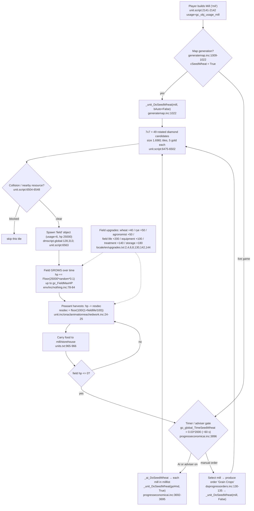

# 🔬 Deep audit: MICRO

> [!IMPORTANT]
> Owner report (2026-11-21): *"mill doesn't auto create crop fields around it as
> it were in original and there is no button to fill crop fields and make them
> grow and many similar minuscle things, check all of them."*
> This audit answers both reported items from **donor script text** (not guesswork)
> and sweeps the rest of the small player-visible loops. Quality-first, unhurried
> (D-22): evidence before claims, `observed` / `derived` / `inferred` separated,
> `UNVERIFIED` used generously. **No code, board, test, config or other doc file
> was edited. `docs/audit/MICRO.md` is the only file written. No Godot was run.**

> [!NOTE]
> **Compliance.** Donor at `C:\Games\Cossacks 3` was read **read-only** with
> Python `open(...,'rb')` + `latin-1` decode (no donor executable run, no donor
> file copied into the repo). Port facts come from read-only reads of
> `app/scripts/*.gd`, `app/README.md`, `app/MECHANICS.md`, `docs/guides/GUIDE1-4.md`
> and the existing research/audit docs. Web claims are labelled `S1…S16` exactly
> as in `docs/research/RB_MECHANICS.md` / `docs/research/RA_ROSTER.md`.

> [!WARNING]
> `game.gd` and `data.gd` are owned by other workers and are being edited
> concurrently (see `SWARM_BOARD.md` quality-first warning). All `file:line`
> citations below were content-matched at the time of reading on 2026-11-21;
> a few may drift by ±10 lines. Each citation is paired with the literal
> symbol/string so it can be re-found after a shift.

> [!TIP]
> Read §2 first for the two owner-reported items; §3 is the full inventory;
> §5 is the ranked **Top 20**; `
` in §6 holds the long tail.

---

## 1. Method and evidence standard

| Label | Meaning used here |
|---|---|
| `observed` | Literal donor script line or port code line read this pass. |
| `derived` | Count / behaviour computed from observed lines (e.g. `cRow*cRow = 49`). |
| `inferred` | Attribution or motive; always marked as such. |
| `CONFIRMED` / `CONTRADICTED` / `PARTIAL` / `UNVERIFIED` | Per `docs/audit/README.md` claim-table verdicts. |

Port-state semantics: **IMPLEMENTED** = a code path exists and matches the donor
description; **PARTIAL** = exists but reduced, renamed, estimated or wired to a
different trigger; **MISSING** = no code path found; **UNVERIFIED** = claimed in
docs/public sources but not confirmed in code or donor bytes here.

**Counts (observed, counted from the §3 table).** 68 features enumerated ·
27 IMPLEMENTED · 23 PARTIAL · 17 CONFIRMED MISSING · 1 UNVERIFIED. Around 25 of
the 68 are already represented by an existing board ticket (P-/G-/DB-/RB- ids
shown in the table); the rest are new micro-candidates.

---

## 2. Owner-reported items — donor truth, precisely

### 2.1 (a) "Mill doesn't auto-create crop fields around it"

**Donor truth (observed, donor scripts):**

| Fact | Donor evidence | Label |
|---|---|---|
| The mill owns a `_unit_DoSeedWheat(millHandle, bAuto)` procedure | `data/scripts/lib/unit.script:6470` | observed |
| It lays a **7 × 7 = 49** diamond of field tiles around the mill (`const cRow = 7; cCount = cRow*cRow; size = 1.6981`; rotated 45°, `size2 = sqrt(2*size*size)`) | `unit.script:6475-6502` | observed + derived (`49`) |
| Each candidate tile is skipped if it collides (5×5 rotated collision scan) or sits near another food/wood/stone resource (`rad/3`) | `unit.script:6504-6548` | observed |
| Each surviving field costs **5 gold** (`field` price `gc_resource_type_gold = 5`) and is created with `PlayerExecuteStateByHandle(...,'WriteNewP')` + `_unit_ApplyCostByID` | `unit.script:1691-1694`, `6552-6565` | observed |
| Fields are created **at map generation** for mills already built (`cSeedWheat = True`; `usage=gc_obj_usage_mill` and `bbuilt` → `_unit_DoSeedWheat(goHnd, False)`) | `data/scripts/common.inc/generatemap.inc:46`, `1009-1022` | observed |
| Fields are **re-seeded on a timer** for every mill: `_ai_DoSeedWheat` loops `gPlayer[].aidata.milllist` → `_unit_DoSeedWheat(goHnd, True)`; period gate `gc_global_TimeSeedWheat = 0.03*2000` | `data/scripts/units/global.inc/progresseconomicai.inc:3688-3700`, `3896-3900`; `data/scripts/dmscript.global:1487` | observed |
| For a human player the timer runs only when the **economy adviser** is on (`adviser.benable/beconomy/bcontrolpeasants`) | `progresseconomicai.inc:3876-3899` | observed |
| Community measurement agrees: "around 40 field tiles per mill", 2 peasants harvest a field tile | Steam discussion `https://steamcommunity.com/app/333420/discussions/0/350542683212516833/` (web) | inferred (external cross-check) |

**Donor farm loop (Mermaid):**

**Port today (observed):**

- `data.gd:723-724` — `"mil"` is `{"stores":["food"], "drop":true, ...}`. There is
  **no field creation hook** on building it; no `fields`/`produce`/`sow` key.
- Fields exist only as **map-generation props**: two 5×4 seed-wheat strips per
  start (`game.gd:686-694`), a re-plant after keep-clear (`:721-727`) and 6
  straggler patches (`:695-706`) — all `_add_res("food", ..., 50, 0.6)`.
- No growth/regeneration: fields are `hits`/`max_hits` resource nodes. A depleted
  node stays at 0 until re-sown; there is no per-tick `hits` recovery.
- The wheat is drawn as a **static procedural golden sheaf** because the baked
  `field.png` is unlit black stalks (`world.gd`, field draw case; see
  `app/MECHANICS.md:623,1027-1028` in the "original-fidelity" pass).

**Verdict:** owner report **(a) CONFIRMED**. The mill/driven auto-field ring and
the manual mill production order are absent; the port has map-gen fields only.

### 2.2 (b) "No button to fill/sow crop fields and make them grow"

**Donor truth (observed):**

| Fact | Donor evidence | Label |
|---|---|---|
| Manual sowing is a **production order on the mill**: order type `gc_obj_order_type_produce` whose `produceid` has `usage = gc_obj_usage_field` → `_unit_DoSeedWheat(myHnd, False)`, then the order is removed | `data/scripts/units/building.inc/doprogressorders.inc:120-136` | observed |
| The button is literally **"Grain Crops"** (`@field` in the English unit strings) | `data/locale/en/units.txt:1016-1017` | observed |
| Mill description: "Serves production and processing of grain cultures. The peasants can deliver harvested food to the mill." | `data/locale/en/units.txt:965-966` | observed |
| Growth: a field's `hp` rises by `Floor(gc_FieldMaxHP*random*0.1)` toward `gc_FieldMaxHP = 25000` on its no-op/tick event | `data/scripts/env/env.inc/nothing.inc:78-84`; `dmscript.global:128` | observed |
| Harvest decay is slowed by the **field-life** upgrade (`gc_upg_type_fieldlifeperc = 23`) | `dmscript.global:760`; `player.script:1830-1831`; `country.script:3490,3714` | observed |
| Upgrade labels/values: wheat +40%, rye +50%, agronomists +50%, field capacity +200%, equipment +100%, treatment +140%, storage +180% | `data/locale/en/upgrades.txt:2,4,6,8,130,142,144` | observed |

**Port today (observed):**

- `cmd_resow(e, node)` at `game.gd:1623-1629`: a peasant re-sows a **depleted**
  (`hits <= 0`) food node. Tick `game.gd:2988-3009`: walk to slot, work **2 s**,
  pay **20 food**, set `fn.hits = fn.max_hits`, emit `construct` event with tag
  `field`, then switch straight to `gather`.
- Trigger: **right-click a depleted field** with peasants selected
  (`input_controller.gd:289-293` — `if hits <= 0 and type == "food": cmd_resow`),
  or the AI's opportunistic resow (`ai.gd:78-82`). **There is no button, no mill
  production order, no adviser, no timer.** The R key is attack-ground/rally;
  no key is bound to sow.
- `field_cap` upgrades exist (`data.gd` `UPGRADES_BASE`, `aca_field1` ×3 and
  `bla_field1` ×2) and scale every food node's `max_hits`/`hits`
  (`game.gd:2084-2089`). This is a **yield** multiplier, not donor field-life
  decay-slowing. `aca_rye1` is +40% (donor +50%); `mil_food2` is +250% (donor
  +180%) — two wrong numbers.

**Verdict:** owner report **(b) PARTIAL-CONFIRMED**. A re-sow interaction
*exists*, but the donor's **mill "Grain Crops" button/order**, its **auto-timer**,
and the fields' **over-time growth** do not. From a player's chair it presents
exactly as the owner described: no visible "fill/grow" affordance.

### 2.3 Claim table for the two reported items

| # | Claim | Evidence | Verification method | Verdict | Correction needed |
|---|---|---|---|---|---|
| 1 | Donor mill auto-creates up to 49 crop fields around itself | `unit.script:6470-6570` (`cRow=7`, `cCount=49`, `size=1.6981`, 5 gold); `generatemap.inc:1009-1022`; Steam cross-check ~40 tiles/mill | Two independent methods: donor byte read this pass + community measurement + prior `MECHANICS.md:338` "mill stores food" (no field) | **CONFIRMED** (donor) / **CONFIRMED MISSING** (port) | P-50: wire mill build → field ring |
| 2 | Donor has a manual "Grain Crops" sow order on the mill | `doprogressorders.inc:120-136`; `units.txt:1016-1017` | Donor byte read + locale lookup; port `data.gd:723-724` has no `produce`/field train | **CONFIRMED** (donor) / **CONFIRMED MISSING** (port) | P-51: mill produce button/order |
| 3 | Donor fields grow over time to `gc_FieldMaxHP=25000` | `nothing.inc:78-84`; `dmscript.global:128`; `onaclanimationreachedwork.inc:24-25` | Donor byte read, cross-checked against upgrade labels in `upgrades.txt` | **CONFIRMED** (donor) / **CONFIRMED MISSING** (port) | New ticket: field HP regrowth |
| 4 | Port re-sows fields with no UI button | `cmd_resow` `game.gd:1623`; right-click `input_controller.gd:289-293`; 2 s / 20 food `game.gd:3001-3009` | Direct read of command, trigger and tick; `config.gd:103-135` has no sow key | **PARTIAL** | P-51 must add the button, not a new command from scratch |
| 5 | "Port has no keyboard parity / `Data.HOTKEYS` is empty" (DB gap G2, RB gap G2) | `data.gd:163` declares `{}` **but** `config.gd:463` assigns `Data.HOTKEYS = hk_def` from `DEFAULT_CONFIG.controls.hotkeys` (`config.gd:103-135`); `input_controller.gd:43-54` reads it | Whole-file grep of `Data.HOTKEYS` + read of config loader + live UI test `hotkeys_live` (`uitest.gd:324`) | **CONTRADICTED** (stale) | Correct DB_SCRIPTS G2 / RB G2; do NOT re-ticket parity wholesale — only the specific deviations in §3 remain |

---

## 3. Feature inventory — all 68 enumerated

Legend: ✅ IMPLEMENTED · 🟨 PARTIAL · ❌ MISSING · ❔ UNVERIFIED · impact 🔴 HIGH / 🟠 MED / 🟡 LOW · size **S** (1 file) / **M** (2–4) / **L** (5+).

| # | Feature | Donor evidence | Port state | Port evidence (`file:line`) | Impact | Size | Test id |
|---:|---|---|---|---|:---:|:---:|---|
| 1 | Mill auto-creates crop-field ring | `unit.script:6470-6570`, `generatemap.inc:1009-1022` | ❌ | `data.gd:723-724`; fields only at `game.gd:686-706` | 🔴 | M | P-50 / `t_mill_fields` (new) |
| 2 | Mill "Grain Crops" sow button / order | `doprogressorders.inc:120-136`, `units.txt:1016-1017` | ❌ | no `produce` key on `mil`; `config.gd:130-134` build keys only | 🔴 | S | P-51 / `t_sow_button` (new) |
| 3 | Field grows / regenerates over time | `nothing.inc:78-84`, `dmscript.global:128` | ❌ | `game.gd:2988-3009` only restores on resow | 🟠 | M | `t_field_growth` (new) |
| 4 | Auto re-sow timer (~60 s) + adviser | `progresseconomicai.inc:3688-3700,3896`, `dmscript.global:1487` | 🟨 | `ai.gd:78-82` opportunistic resow only | 🟠 | M | `t_autosow` (new) |
| 5 | Manual re-sow of depleted field | implied by 1–4 | ✅ | `cmd_resow` `game.gd:1623`; right-click `input_controller.gd:289-293`; 2 s/20 food `:3001-3009`; selftest `resow` | 🟡 | — | `resow` (exists) |
| 6 | Field-life upgrade (slow harvest decay) | `dmscript.global:760`, `country.script:3490/3714`, `upgrades.txt:8,130` | 🟨 | `aca_field1`/`bla_field1` scale `hits` as `field_cap` `game.gd:2084-2089` (different effect) | 🟠 | S | `t_fieldlife` (new) |
| 7 | Wheat / rye / agronomist harvest upgrades | `upgrades.txt:2,4,6` | 🟨 | `data.gd:764-767` `aca_wheat1` +40 %, `aca_rye1` +40 % (donor +50 %), no agronomist row | 🟡 | S | `t_upg_values` (new) |
| 8 | Grain treatment / storage values | `upgrades.txt:142,144` | 🟨 | `data.gd:769-770` +140 % (ok), +250 % (donor +180 %) | 🟡 | S | `t_upg_values` |
| 9 | Resource drop-off at storehouse/mill/town hall | `dmscript.global:210` (3-tile radius) | ✅ | `nearest_drop` `game.gd:1433`, `_gather_deliver :3485-3516`; `drop:true` `data.gd:702,722,724` | 🟡 | — | `gather` (exists) |
| 10 | Worker slots per node (food 3/wood 2/stone 3) | `dmscript.global:222-225` | 🟨 | food capped at 2 `game.gd:3435-3439`; wood/stone ❔ | 🟡 | S | G-13 / `t_worker_caps` |
| 11 | Mill = food store, peasants deliver to mill | `units.txt:965-966` | ✅ | `data.gd:723-724` `stores:["food"], drop:true` | 🟡 | — | `gather` |
| 12 | Famine warning then HP drain | video pass, `MECHANICS.md:18-21` | ✅ | `game.gd:2557-2562` "Famine!" + `:2500s` drain; config `famine_grace_s=120` | 🟡 | — | `t_famine` (if any) |
| 13 | Mill/windmill ambient sound | `gui.script:3234-3303` `amb_windmill` volume by distance | ❌ | `audio.gd:55-62` only `amb_atmosphere` | 🟡 | S | P-13 / `t_sound_ambient` |
| 14 | Guard order actually guards a target | `hotkeys.cfg` `G=guard/cancelguard` | 🟨 | `cmd_guard` exists `game.gd:1661` but G → `cmd_stand_ground` `input_controller.gd:524-526`, `hud.gd:129-131`; guard tick `:2944-2963` | 🟠 | S | `t_guard_order` (new) |
| 15 | Cancel-guard (G again) | `hotkeys.cfg` `guard/cancelguard` | ❌ | no toggle in `input_controller.gd:524-526` | 🟡 | S | `t_guard_order` |
| 16 | Patrol with player-defined waypoints | S9 hotkey `P` | 🟨 | Q key + fixed ±6 m segment `input_controller.gd:125-128,514-517`; `cmd_patrol :1668` | 🟠 | S | G-12 / `t_patrol` |
| 17 | Hold fire / feuer frei / engage D/E/V | S9, `hotkeys.cfg` | ✅ | `input_controller.gd:413-427`; `cmd_hold_fire :1646`, `cmd_engage :1650` | 🟡 | — | `order_keys` (exists) |
| 18 | Stand ground / no stand ground S/C | `hotkeys.cfg` | ✅ | `input_controller.gd:518-523`; `cmd_stand_ground :1638` | 🟡 | — | `order_keys` |
| 19 | Attack-move A | `hotkeys.cfg` | ✅ | `input_controller.gd:113-115,438`; cursor `attack` | 🟡 | — | `order_keys` |
| 20 | Bombard / attack-ground R | `hotkeys.cfg` `R=attackpoint` | ✅ | `input_controller.gd:475-482`; `cmd_attack_ground game.gd:1675`; artillery-only | 🟡 | — | `hotkeys_live` |
| 21 | Rally flag + new units walk out | `MECHANICS.md:457-458` | ✅ | `set_rally game.gd:268`, exit `:3551`, flag `world.gd:1675-1685` | 🟡 | — | `rally_panel` |
| 22 | Garrison enter/unload (cap 10, heal 2/s) | GUIDE3 estimate, S4/S8 | 🟨 | `cmd_enter/cmd_unload game.gd:1680-1707`, `hud.gd:497-500,595-597`, garrison shots `:3594`; cap/heal estimated | 🟡 | S | `garrison` / `garrison_keys` |
| 23 | Garrison sortie with attack target | S5 capture defence | ❌ | `cmd_unload` releases in a ring with `order:none` `game.gd:1695-1707` | 🟡 | S | `t_sortie` (new) |
| 24 | Delete own selection (deny capture) | S5 | ✅ | `input_controller.gd:401-409`; `cmd_delete game.gd:2654` | 🟡 | — | `delete` (if any) |
| 25 | Repair damaged own building | S4, S5 | ✅ | right-click path `input_controller.gd:262-272`; tick `game.gd:3010-3028`; AI `ai.gd:378-386` | 🟡 | — | `repair` (if any) |
| 26 | Context-sensitive donor cursors (11) | `hotkeys.cfg` / cursor bmps | 🟨 | `input_controller.gd:34-38` loads 11, `_update_cursor :588-626` uses ~7; `wait`/`gain*` ❔ | 🟡 | S | `cursor_ctx` |
| 27 | Control groups 1–9 store / recall / jump | GUIDE3 §groups | ✅ | `input_controller.gd:361-380` (Ctrl store, plain recall, Shift jump) | 🟡 | — | `groups` |
| 28 | Control-group append (Ctrl+Shift+n) | donor group semantics ❔ | ❌ | no append branch `input_controller.gd:364-380` | 🟡 | S | `t_group_append` (new) |
| 29 | Double-click select same type on screen | `MECHANICS.md:594`, GUIDE3 | 🟨 | `input_controller.gd:210-219` (units only, `<0.35 s`, on-screen) | 🟡 | S | `t_dblclick` (new) |
| 30 | Shift-add to selection | GUIDE3 | ✅ | `input_controller.gd:220-224` | 🟡 | — | `groups` |
| 31 | Same-type select Z / add Shift+Z | `hotkeys.cfg` Z variants ×4 | 🟨 | `input_controller.gd:502-510,546-554` (2 of 4 variants) | 🟡 | S | `t_sametype` (new) |
| 32 | Select all / idle peasants / buildings / idle mines / all peasants | `hotkeys.cfg` Ctrl+A/P/B/M/backtick | ✅ | `input_controller.gd:490-545` | 🟡 | — | `hotkeys_live` |
| 33 | Alt+M minimap toggle | `hotkeys.cfg` | ✅ | `input_controller.gd:511-513` | 🟡 | — | `hotkeys_live` |
| 34 | Minimap click to move/attack | donor minimap | ✅ | `hud.gd:964→978`, `minimap_order input_controller.gd:95-108` | 🟡 | — | `minimap_frustum` |
| 35 | Edge scroll + arrow keys + wheel zoom-to-cursor | `MECHANICS.md:264-273`, `camera.cfg` | ✅ | `camera.gd:1-11`, zoom-to-cursor `MECHANICS.md:645` | 🟡 | — | UI suite |
| 36 | F5/F9 quick save/load | GUIDE3 | ✅ | `input_controller.gd:381-390`, `main.gd:781/793` | 🟡 | — | `save_load_ui` |
| 37 | Space pause + 1x/2x/4x speed buttons | `MECHANICS.md:459` | ✅ | `hud.gd:259-273,325-332` | 🟡 | — | UI suite |
| 38 | Capture progress % readout | S5 capture procedure | 🟨 | `hud.gd:697-698`; only `cen` has `capture:true` `data.gd:701` | 🟠 | S | G-01 / `t_capture` |
| 39 | Capture economy buildings (market/mines/storehouse) | S3, S5, S6, S7 | ❌ | `data.gd:701` only `cen`; loop half-wired `game.gd:3603-3641` | 🔴 | S | G-01 |
| 40 | Capture preconditions (defeat non-capturable, guard) | S5 | ❌ | `game.gd:3537-3557` proximity only | 🟠 | M | G-09 |
| 41 | Foreign town hall unlocks that nation | S5 | ❌ | `game.gd:3632-3638` flips owner/score/farm only | 🟠 | M | G-07 |
| 42 | AI denies mines by demolition | S3 | ❌ | `ai.gd` no such rule | 🟡 | S | G-11 |
| 43 | Construction progress bar + stages s1–s4 | `unit.script:6574-6607` visual stages | 🟨 | bar `hud.gd:452,766`; stage load `world.gd:483-486` (sprites ❔ — `MECHANICS.md:582-585` says stage meshes were skipped) | 🟡 | S | `t_stages` (new) |
| 44 | HUD: 6 resources, deficit, score, worker icons | `MECHANICS.md:612-617` | 🟨 | `hud.gd:887-902` textual; worker icons ❔ | 🟡 | S | P-25 |
| 45 | Contextual hints (build reason, rally, group, ghost) | donor adviser hints | ✅ | `hud.show_hint :798`; `input_controller.gd:115,180-186,254,369,482,571-575` | 🟡 | — | UI suite |
| 46 | Economy adviser auto-control / tutorial hints | `progresseconomicai.inc:3876-3899`, `tutmis1` | ❌ | no `adviser` symbol in `app/scripts/**`; tutorial missions deferred by D-12 | 🟡 | M | `t_adviser` (new, deferred-scope check) |
| 47 | Market buy / sell / exchange modes | S7 | 🟨 | 4 fixed barter pairs, one rate `game.gd:2167-2191`, `hud.gd:508-518` | 🟠 | M | G-08 / `t_market` |
| 48 | Market rate floor / first-mover recovery | S15 | 🟨 | monotonic drift to 0.35 `game.gd:2189` | 🟡 | S | G-08 |
| 49 | Academy/blacksmith research buttons | S4 | ✅ | `hud.gd` upgrade buttons; `research()`/`apply_upgrade` `game.gd:2019-2162` | 🟡 | — | `upgrade` (exists) |
| 50 | Firepower tier / bayonet / cavalry / drill upgrades | S4, RB G-02..G-05 | ❌ | `data.gd:750-781` only ~12 rows | 🟠 | M | P-23 |
| 51 | Medical science heal-all upgrade | S4 | ❌ | no `aca_med1` in `data.gd` | 🟠 | S | G-06 |
| 52 | Formation families 149 vs 5 | `formations.cfg`, S2/S4 | 🟨 | `data.gd` `FORMATIONS` 5 shapes | 🟠 | M | P-30 / G-11 |
| 53 | Per-formation bonus table (not wiki constants) | `formations.cfg` 46 nonzero | 🟨 | `_formation_atk/_def game.gd:1740-1766` hard-coded wiki values | 🟠 | M | P-30 |
| 54 | Formation keeps order after moving | S10 | ❔ | formation offsets exist; not re-verified here | 🟡 | S | `t_form_order` (new) |
| 55 | Squad veteran/experience raises bonuses | S13, RB G-13 | ❌ | no `experience` symbol in code | 🟠 | M | RB G-13 / `t_experience` |
| 56 | Squad disband on morale/officer death | S13 | 🟨 | board P-40 says `disband` selftest PASS; detail ❔ | 🟡 | S | P-40 |
| 57 | Officer replenish F on its officer | S11 | ✅ | `input_controller.gd:449-459`; `cmd_replenish game.gd:1776-1806` | 🟡 | — | `squads` |
| 58 | Formation size ladder 15…400 | S2/S4 | 🟨 | buttons `hud.gd:502-507`; `SQUAD_MAX=195` caps at 193 `data.gd:224` | 🟠 | S | P-40 / `t_squads` |
| 59 | Officer/drummer aura, priest heal | video pass | 🟨 | estimated values `data.gd:72-81`, `game.gd:2194+` | 🟡 | — | `morale` |
| 60 | Grapeshot auto at short range | S3/S8/S16 | ✅ | `_pick_weapon game.gd:1765-1771`; `data.gd:318-319,384-385` | 🟡 | — | combat suite |
| 61 | Mortar only buildings | S3/S14 | ✅ | `only_buildings data.gd:395`, `game.gd:3525` | 🟡 | — | combat suite |
| 62 | Tower fortification immunity | S8 | ✅ | `game.gd:3227`; grenade uses cannonball kind | 🟡 | — | combat suite |
| 63 | +25 % ranged range uphill / cannon LOS ridges | S7, GUIDE2 S7 | ✅ | `MECHANICS.md:560` | 🟡 | — | `t_terrain_range` (if any) |
| 64 | Corpses linger | video pass | ✅ | `game.gd:64` corpses, `world.gd` death sheets | 🟡 | — | `volley` |
| 65 | Event sound cues (musket/arrow/cannon/sabre/footsteps/etc.) | 305 donor sounds | 🟨 | `main.gd:1029-1103` subset; no food/stone/mine work sounds | 🟡 | S | `t_work_sounds` (new) |
| 66 | `chop` → `workwood` mis-map | DE decomp (board P-12) | ❌ | `main.gd:1065` calls `["chop"]` (no file); fix is one line | 🟡 | S | P-12 |
| 67 | Nation music tracks (20 missing, only ukr/rus) | P-13 / DE decomp | ❌ | `audio.gd:16,41-48` fallback `ukr` | 🟡 | S | P-13 |
| 68 | Build hotkeys from donor (`J=tem`, `P=por`, `D=dip`, …) | `hotkeys.cfg` read this pass | 🟨 | `config.gd:130-134` matches core set; `J=tem`/`P=por` absent (Cathedral/Shipyard not ported — RA G03/G05) | 🟡 | S | `t_mnemonics` (new) |

**Status totals (observed from the table):** IMPLEMENTED 27 · PARTIAL 23 ·
MISSING 17 · UNVERIFIED 1. Rows 39–42, 50–51, 55, 66–67 overlap existing
research/board tickets and are cross-references, not new work claims.

---

## 4. Notable corrections to prior worker reports

> [!NOTE]
> These are `derived` from the reads above and are offered for the coordinator
> to reconcile; **this audit changed no other file.**

1. **Keyboard parity is not missing wholesale** (DB gap G2 / RB gap G2,
   `docs/decomp/DB_SCRIPTS.md:136`, `docs/research/RB_MECHANICS.md:136`).
   `config.gd:463` populates `Data.HOTKEYS`; `input_controller.gd:43-54` reads it.
   Only individual deviations remain: patrol Q vs P (G-12), G-as-guard (row 14),
   and two donor build keys for absent buildings (row 68).
2. **Construction stages are partially wired** (`world.gd:483-486` loads
   `<sid>_s1..s4`), contradicting the older `MECHANICS.md:582-585` prose that
   says stage meshes were skipped. Whether the sprite files actually exist is
   `UNVERIFIED`; do not close P-/stage tickets on the prose alone.
3. **The port does have a field re-sow loop** (`cmd_resow`). P-51 should be
   scoped as "add the donor's mill sow button/auto-timer/growth", **not** "add
   any field command", or a worker will duplicate existing code.

---

## 5. ✅ Top 20 micro-features to implement next

Ranked by **player-visible impact × frequency ÷ cost**; "already ticketed" items
are kept because the owner asked for the complete small-loop picture.

- [ ] **1. Mill auto-creates crop fields on build** — 🔴 HIGH / **M** — rows 1, 3. Ticket **P-50**. AC: build a mill on open ground → a 7×7 rotated diamond of `field` food nodes appears, collision/resource-skipped, ≤49 tiles; matches donor count within collision variance. (`t_mill_fields`)
- [ ] **2. Mill "Grain Crops" sow button / order** — 🔴 HIGH / **S** — row 2. Ticket **P-51**. AC: select mill → a "Grain Crops" button seeds the ring once for 5 gold/tile; no other resource button is renamed. (`t_sow_button`)
- [ ] **3. Field growth over time** — 🟠 MED / **M** — row 3. AC: a fresh field's capacity rises on a timer toward a cap; depleted fields visibly regrow instead of staying bare. (`t_field_growth`)
- [ ] **4. Capture economy buildings** — 🔴 HIGH / **S** — row 39. Ticket **G-01**. One data flag set unlocks the half-wired loop in `game.gd:3603`. Add a market/mine capture step. (`t_capture`)
- [ ] **5. Guard order actually guards** — 🟠 MED / **S** — row 14. AC: G on a selected soldier then right-click a friendly building follows it and auto-attacks approaching foes; G again cancels. (`t_guard_order`)
- [ ] **6. Patrol with waypoints + P key** — 🟠 MED / **S** — row 16. Ticket **G-12**. AC: P then two clicks define a route; default falls back to current ±6 m. (`t_patrol`)
- [ ] **7. Auto re-sow timer / adviser gate** — 🟠 MED / **M** — row 4. AC: every mill re-seeds depleted fields on a ~60 s cadence; human obeys adviser setting. (`t_autosow`)
- [ ] **8. Field-life upgrade with correct effect** — 🟠 MED / **S** — row 6. AC: field-life research slows harvest depletion (not only `max_hits` scaling); `aca_rye1` +50 %, `mil_food2` +180 %. (`t_fieldlife`)
- [ ] **9. Market buy/sell/exchange** — 🟠 MED / **M** — row 47. Ticket **G-08**. AC: three distinct market operations, rate floor ~0.35 with recovery. (`t_market`)
- [ ] **10. Squad veteran/experience** — 🟠 MED / **M** — row 55. Ticket **RB G-13**. AC: surviving squads gain experience that raises formation bonuses; persists across formation changes. (`t_experience`)
- [ ] **11. Capture preconditions + guard defence** — 🟠 MED / **M** — row 40. Ticket **G-09**. AC: a guarded building resists capture until defenders are gone. (`t_capture_guard`)
- [ ] **12. Foreign town hall unlocks nation** — 🟠 MED / **M** — row 41. Ticket **G-07**. (`t_capture_nation`)
- [ ] **13. Firepower/bayonet/cavalry/drill upgrades** — 🟠 MED / **M** — row 50. Ticket **P-23**. (`t_upgrade_tree`)
- [ ] **14. Medical science "heal all"** — 🟠 MED / **S** — row 51. Ticket **G-06**. (`t_heal_all`)
- [ ] **15. Field visuals (growth/deletion states)** — 🟠 MED / **S** — row 6 visual half. AC: a depleted field stops showing ripe wheat; a re-sown field shows growth. (`t_field_visual`)
- [ ] **16. Per-formation bonus table import** — 🟠 MED / **M** — rows 52–53. Ticket **P-30** (correct scope: 46 nonzero, 15 exact 2-2-7-7, not "43"). (`formation_bonus`)
- [ ] **17. Squad cap to donor ladder (400)** — 🟠 MED / **S** — row 58. Ticket **P-40**. (`t_squads`)
- [ ] **18. Worker slots per node (food 3/wood 2/stone 3)** — 🟡 LOW / **S** — row 10. Ticket **G-13**. (`t_worker_caps`)
- [ ] **19. Mill/windmill ambient + missing work sounds** — 🟡 LOW / **S** — rows 13, 65. AC: windmill audible near a working mill; separate food/stone/mine work cues. (`t_sound_ambient`)
- [ ] **20. `chop` → `workwood` + nation music fallback** — 🟡 LOW / **S** — rows 66–67. Tickets **P-12**, **P-13**. (`t_sound_cues`)

> [!TIP]
> Items 1–3 and 7–8 form one coherent **farming tranche** and should be
> assigned to a single owner set (`game.gd`, `data.gd`, `world.gd`, `input_controller.gd`,
> `hud.gd`) to avoid a half-wired state where fields appear but cannot be sown.

---

## 6. 
 Full long tail — the other 48 rows, grouped

🟢 Economy &amp; gathering (rows 9–13 already in table)

- **Delivery path** is implemented end-to-end (`nearest_drop`, `_gather_deliver`), including the "hold the load if no store reachable, try another next tick" anti-stall at `game.gd:3490-3508`. No new ticket.
- **Famine** warning rate-limits the message (`famine_msg_t = 10`) and gold famine drains morale `game.gd:2567-2571`; exact donor numbers remain `estimated` — keep as-is, do not tune.
- **Cost escalation** ×3 town halls / ×1.5 others `game.gd:2311-2319` matches the Steam guide; no micro-ticket.
- **Staggered construction**: each site spawns at 25 % HP `game.gd:2324`, builder hits advance progress; donor 0.359 s/hit / 30 builders (`MECHANICS.md:346-352`) is matched by `data.gd` constants. Stage *art* is the only open half (row 43).

🟢 Orders, selection &amp; camera (rows 14–37)

- `attack_move`, `stand_ground`, `no_stand_ground`, `hold_fire`, `feuer_frei`, `engage`, `attack_ground`, `unload`, `patrol`, `stop`, `guard` all have `cmd_*` functions in `game.gd:1600-1679`; the only broken wiring is **G→stand_ground** (row 14) and the ±6 m patrol (row 16).
- `minimap_order` chooses attack-move when any enemy is within 6 m of the destination, otherwise move (`input_controller.gd:99-108`) — a reasonable donor approximation; no ticket.
- Double-click uses `Time.get_ticks_msec()` with a 0.35 s window and selects only **on-screen** same-type units (`input_controller.gd:210-219`); donor double-click may include off-screen same-type — `UNVERIFIED` (row 29).
- Control-group **append** and the extra same-type-select variants (Ctrl+Z / Ctrl+Shift+Z) are the only group gaps (rows 28, 31).

🟢 UI, capture &amp; research (rows 38–51)

- The HUD already shows a `CAPTURE n%` line (`hud.gd:697-698`) and build/train progress bars (`hud.gd:452,766`); the missing part is *which* buildings are capturable (row 39) and capture preconditions (row 40).
- Research is one upgrade per blacksmith/academy at a time (`game.gd:3555`), matching the donor's per-building research queues; depth (row 50) is the gap, not the loop.
- The hint label (`hud.show_hint`) is used for build-placement reasons, rally, group storage, ghost text and attack-move — a genuine donor-like feedback loop; do not re-ticket.

🟢 Combat micro (rows 52–64)

- Grapeshot auto-selection, mortar building-only fire, tower immunity, uphill range bonus, ridge LOS blocking and lingering corpses are all implemented and documented in `MECHANICS.md` / `RB_MECHANICS.md`. No new micro-tickets.
- `formation keeps order after moving` is the only combat item still `UNVERIFIED` (row 54) — confirm with one replay before spending a ticket.
- `squad disband` is ambiguous: RB §2 called it MISSING while board P-40 reports its selftest check PASS. Re-run that one check rather than coding blind (row 56).

🟢 Audio &amp; hotkeys (rows 65–68)

- The sound-dispatch table in `main.gd:1064-1103` covers footsteps, musket, arrow, cannon, sabre, alarm, construct, button click, arrow impact, cannon explosion, `workwood`, death and building-complete. Gaps are only: `chop` (P-12), food/stone/mine work sounds, mill ambience and nation music (P-13).
- `config.gd:130-134` build mnemonics reproduce the donor core set (`C/H/B/E/S/L/O/M/I/R/T/W/N/D/K`); `J=tem` (Cathedral) and `P=por` (Shipyard) are absent because those buildings are absent — tracked by RA G03/G05, do not treat as hotkey bugs.

🟢 Items deliberately out of micro scope (owner charter D-12)

- Tutorial/campaign missions (`tutmis1` etc.), `.aix` triggers and the adviser UI are **deferred** by the skirmish-only charter. Row 46 is recorded only so the micro-sweep is complete; do not open a build ticket without an owner decision.
- Naval (RA G02–G04, P-10), Cathedral (RA G05) and Scotland (RA G01, P-41) are roster/building tickets, not micro-features; they are cross-referenced in row 68 only.

---

## 7. Open questions

1. **Exact donor auto-sow period.** `gc_global_TimeSeedWheat = 0.03*2000` is
   observed; under the port's `0.03125 s/frame` convention (donor `gc_time_to_frames=32`)
   this is ~60–62 s. The unit conversion is `derived`, not directly measured;
   confirm against a timed donor replay before hard-coding.
2. **Field capacity vs field life.** Donor fields have a 25 000 HP pool that
   regenerates; the port's `max_hits` is a yield count. The mapping
   `gc_FieldMaxHP → max_hits` and `fieldlife → slowed decay` is `inferred`;
   P-50/P-51 should decide the data model before implementation.
3. **Manual sow amount.** The donor comment says auto mode seeds less than a
   manual press, but `bAuto` is not actually read inside `_unit_DoSeedWheat` in
   this build — both paths use `cRow=7`. Treat "49" as the upper bound; collision
   skips explain the community's ~40 tiles/mill.
4. **Stage sprites.** `world.gd:483-486` loads `<sid>_s1..s4`, but older docs say
   stage meshes were never baked. Check `app/assets/models/anim/` before
   closing row 43.
5. **`formation keeps order after moving`** and **squad disband** need one
   replay/selftest each (rows 54, 56); both are `UNVERIFIED` here by design.
6. **Worker caps for wood/stone** (`dmscript.global:222-225`) were not traced to
   a specific port line; row 10 is PARTIAL with the food half confirmed only.

---

## 8. Files changed by this audit

- `docs/audit/MICRO.md` — new (this file). **No other file written.**
- Temporary analysis scripts were written only to
  `C:\Users\Maxym.Oboyshev\AppData\Local\Temp\opencode\` (outside the repo) and
  read only donor text; no donor file was copied into the repository.

---

## Related

`docs/audit/README.md` · `docs/audit/SIM.md` · `docs/decomp/DB_SCRIPTS.md` ·
`docs/research/RB_MECHANICS.md` · `docs/research/RA_ROSTER.md` ·
`docs/DECISION_LOG.md` (**D-12** skirmish-only charter, **D-22** quality-first) ·
`SWARM_BOARD.md` (P-50, P-51, G-01, P-12, P-13, P-23, P-30, P-40) ·
`app/README.md` (controls table) · `app/MECHANICS.md`.
