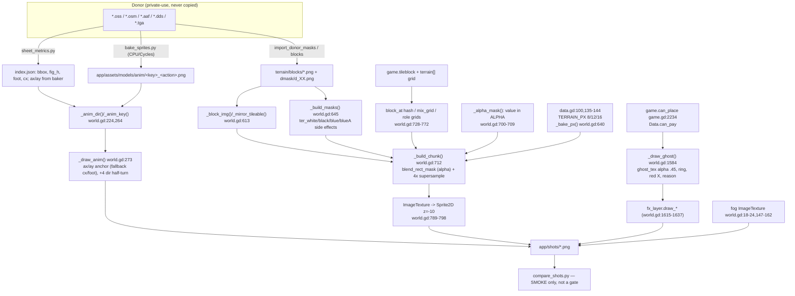

# 🔬 Deep audit — RENDER

> [!IMPORTANT]
> Independent re-verification of four visual-fidelity claims, done **without
> trusting the worker reports that asserted them**. Every verdict below rests on
> a measurement made for this audit (Pillow on the actual PNG bytes), a direct
> read of the named source lines, or an explicitly labelled `observed` /
> `derived` / `inferred` judgement. Where a thing cannot be measured in this
> environment it is marked `UNVERIFIED`, never `done`. Protocol:
> `SWARM_OPS.md` §5b-QUALITY, `docs/audit/README.md`, decision D-22.

**Files owned/changed by this agent:** `docs/audit/RENDER.md` only.
**Godot runs used:** none. **Donor assets accessed:** none (private-use rule,
`SWARM_OPS.md` §3.5). **Runner job ids:** none generated by this audit; the
`79 agentSE-selftest` id is *reported* in `docs/UNIT_BAKING_FIX.md` §11/§11.1 and
was **not** independently re-run here (no `app/.godot_queue/results/` artifacts
exist in the working tree).

---

## Render pipeline (as read from code)

---

## Claim table

| # | Claim | Evidence | Verification method | Verdict | Correction needed |
|---|---|---|---|---|---|
| 1 | Unit-sheet index metrics (bbox/fig_h/foot/cx) are real pixel measurements, not defaults; sheets are 8 cols × N rows and edge-clean | 3 sheets: `peasant_walk`, `musketeer_attack`, `hussar_walk`; measured union bboxes vs `index.json` — see §A | Independent Pillow re-measurement from raw PNG bytes, replicating `app/tools/sheet_metrics.py:33-48` | **CONFIRMED** (3/3) | none |
| 2 | "Unit sprites are donor-accurate" (visually faithful to the donor game) | No donor pixel access permitted; RE_VISUAL.md §0/§5 says no image was ever inspected by the research lane | Cannot be measured here; only internal index↔PNG consistency was measured | **UNVERIFIED** | windowed donor-vs-port eyeball ticket (see open questions) |
| 3 | "Terrain tiles blend without seams at 16 px" | `_build_chunk` world.gd:712-798; `_bake_px` :640; `data.gd:100,144` | Source read + Godot doc check of `blend_rect_mask` channel semantics | **PARTIAL** — code-level anti-seam design CONFIRMED; visual result UNVERIFIED | no code fix; new windowed capture if the visual claim must be proven |
| 4 | Mask ramp/alpha and coherent-variant code are correct | `_build_masks` :645-698 (edge ramp :672-678), `_alpha_mask` :700-709, `block_at`/`mix_grid` :728-751 | Source read + Godot docs (`blend_rect_mask` uses mask **alpha**) | **CONFIRMED for the operative path**; stale/misleading code in a dead path | comment-only ticket: remove red-channel/"binary" claims and dead `terrain_masks` path |
| 5 | Quality presets can produce seams | `data.gd:135-144` (low 8 px, medium 12 px, high 16 px); `_bake_px` returns 32/48/64 | Derived numerically from the same code; no render run | **UNVERIFIED visually** (no seam mechanism derived in code) | none |
| 6 | L8 ghost draws a **transparent nation building**; red X + reason; validation before `pay_cost` | `world.gd:1602-1637`, `_bld_key` :343-352, `_bld_tex` :470-481; `game.gd:2234-2288`, :2300/:2320 | Direct source read | **CONFIRMED at code level** | none |
| 7 | The cited audit shot evidences claim 6 | `app/shots/g4_l8_ghost_audit.png` (visually inspected, incl. 3× centre crop) | Image read + Pillow crop | **CONTRADICTED visually** — no translucent building sprite, no red X; only ring + cursor line + reason text | re-capture with a windowed build after the layer fix |
| 8 | Screenshot similarity scores establish donor fidelity | `app/tools/compare_shots.py:15-18,105-129`; 3 runs in §D | Tool run + input-dimension check | **UNVERIFIED / not a gate** — raw smoke numbers only, mismatched crops/resolutions | none; 0.80 is explicitly uncalibrated |
| 9 | RE_VISUAL category table: what is present/absent in real port shots | `final_nations.png`, `g4_l8_ghost_audit.png`, `g4_final_land.png`, plus sprite close-ups; §D | Direct image inspection; each statement tagged observed / inferred | **PARTIAL** — see per-category table | open P-20/P-21/P-22/P-25 tickets already cover the gaps |

---

## A. Unit sprite re-measurement (claim 1 / claim 2)

**Method (independent of the index).** For each sheet I opened the PNG with Pillow
12.1.1, computed `cols = width // cell`, `rows = height // cell`, then took the
union of per-cell `Image.getbbox()` over all `rows × cols` cells (cell-local
pixels) — the same algorithm `app/tools/sheet_metrics.py:33-48` uses to *write*
the index. I also computed the docstring's `alpha>8` variant, and hashed each
row strip to confirm the frames are distinct rather than duplicated. No index
value was read until after the measurement.

| Unit / action (file) | PNG | Layout measured | Index `frames` | Measured union (getbbox) | Measured fig_h / foot / cx | Index bbox / fig_h / foot / cx | Distinct row hashes | Edge-touch cells |
|---|---|---|---|---|---|---|---|---|
| `peasant` / `walk` | `peasant_walk.png` | 1280×1920, cell 160 → **8 cols × 12 rows** | 12 | `[61,56,99,115]` | `0.3688 / 0.7188 / 0.5` | `[61,56,99,115]` / `0.3688 / 0.7188 / 0.5` | 12 / 12 | 0 |
| `musketeer` / `attack` | `musketeer_attack.png` | 1280×1920 → **8 cols × 12 rows** | 12 | `[8,17,152,134]` | `0.7312 / 0.8375 / 0.5` | `[8,17,152,134]` / `0.7312 / 0.8375 / 0.5` | 12 / 12 | 0 |
| `hussar` / `walk` | `hussar_walk.png` | 1280×1920 → **8 cols × 12 rows** | 12 | `[34,29,127,145]` | `0.725 / 0.9062 / 0.5031` | `[34,29,127,145]` / `0.725 / 0.9062 / 0.5031` | 12 / 12 | 0 |

**Observed:** all three measured unions, fig_h, foot and cx match `index.json`
**exactly** (getbbox method). Every one of the 3×96 = 288 measured cells has a
non-empty alpha bbox; every row strip has a distinct hash; no cell ink touches a
cell border (union x ∈ [8,152], y ∈ [17,145] worst case, all strictly inside
0..160). This also independently reproduces the "0 `fig_h=1.0` outliers" and
"zero CLIP" findings of `docs/UNIT_BAKING_FIX.md` §10/§11.1 on a fresh sample.

**Method nuance (not a defect):** the `alpha>8` variant moves the x-bounds by
exactly 1 px on the left/right extents (e.g. `peasant_walk` union `[61,56,98,115]`
→ `cx 0.4969`; `hussar_walk` `[35,29,126,144]` → `fig_h 0.7188`, `foot 0.9`).
This explains agentC's earlier `cx 0.4969` reading in
`docs/UNIT_BAKING_FIX.md` §10: it is a 1-px antialias-threshold difference
between `getbbox()` (nonzero) and "alpha>8", **not** an index error. `fig_h` and
`foot` are unaffected for `peasant`/`musketeer` and shift by ≤0.0062 for
`hussar`.

**Verdict 1: CONFIRMED** — the index metrics are genuine measurements of the
actual pixels for all three sampled units, and the sheets are 8×N with N=12
frames as declared.

**Verdict 2: UNVERIFIED** — "donor-accurate" in the *visual* sense cannot be
established here. I had no donor asset access (forbidden by `SWARM_OPS.md` §3.5)
and this audit did not run the donor. What **is** confirmed is the weaker,
mechanical claim: the port's own anchor/scale metadata is internally consistent
with its sprite bytes. I visually inspected `ours_peasant_sprite.png` and
`ours_musk_sprite.png` (§D) — they show recognisable, reasonably detailed
uniformed figures with tools/muskets — but with no donor-side reference sheet to
compare, calling them "donor-accurate" would be an inference, not a measurement.

---

## B. Terrain seams and coherent variants (claims 3 / 4 / 5)

### B.1 What the code actually does (all `observed`)

`_build_chunk()` (`world.gd:712-798`) does **not** blit per-cell tiles. It:

1. Creates **one continuous donor crop** for the chunk:
   `_wrap_crop(_block_img("grass1"), cx*S, cy*S, S)` (`:720`). `_wrap_crop`
   (`:566-583`) does modular blits over a source mirror-tiled to 1024 px
   (`_block_img`, `:613-635`), so the base layer has no per-cell texture switch.
2. Blends a second continuous grass texture using `mix_grid` (`:734-751`): a
   `(CHUNK_T+1)² = 33×33` value grid where each node sums the hashed tile-block
   names of the **4 surrounding tiles** (`block_at`, `:728-730`; `hash(bn)` at
   `:745`). This is the coherent-variant code: neighbouring tiles with the same
   block name contribute the same value, so there is no per-cell noise.
3. Blends terrain-role overlays (types 1/2/4/5/3) from **global** tile-coordinate
   grids (`:753-785`) — the value at a chunk-border node is computed from the
   same world tiles in both neighbouring chunks, so the two chunks agree there.
4. Converts those grids to masks with `_alpha_mask` (`:700-709`): it writes the
   coverage value `v` into the **alpha** channel `Color(1,1,1,v)` then resizes
   bilinearly to chunk size. `blend_rect_mask` is given that mask (`:751`, `:785`)
   and, per the Godot 4 class reference, *"dst pixels and src pixels will blend
   if the corresponding mask pixel's alpha value is not 0"* — i.e. the mask's
   **alpha** governs the blend, which is exactly the channel `_alpha_mask`
   supplies.
5. Bakes at `bpx = mini(TERRAIN_PX*4, 64)` (`:640`) and downsamples to
   `CHUNK_T*px` with bilinear interpolation (`:786-788`), turning thresholded
   edges into soft gradients in the final 16 px/tile output.

### B.2 The `dmask` path is vestigial (important correction to the status docs)

`_build_masks()` (`:645-698`) loads `dmask/d_06..d_23.png`, applies the organic
edge ramp `v = alpha * clamp(min_distance_to_border / max(1, px*0.35))`
(`:672-678`), and returns an array. That array is assigned to `terrain_masks`
(`world.gd:92`, `main.gd:850`) but **never read by any draw code** — a repo-wide
grep for `terrain_masks` finds only the declaration (`:38`) and those two
assignments. The *only* things from `_build_masks` that `_build_chunk` consumes
are its side-effect images `ter_white/ter_black/ter_blue/ter_blueA`
(`:684-697`, used at `:774-780` for the water glaze).

Consequences, all `derived`:
- The "donor dmask anti-seam masks" phrasing in `docs/STATUS_GRAPHICS.md` §2/§DONE
  (L2) and the "dmask masks" in its Mermaid diagram describes a code path that
  is **not in the render path** for terrain blending. The live seam defence is
  the smooth global value-grid + alpha masks of `_build_chunk`.
- Two comments in the dead path are wrong about Godot: `:647` and `:690` call
  `blend_rect_mask` "binary", and `:668-669` says "uses the red channel" while
  `:700-701` correctly says "reads the MASK'S ALPHA channel". `_build_masks`
  writes its ramp value into RGB (`Color(v,v,v)`, alpha 1) and `_alpha_mask`
  writes it into alpha (`Color(1,1,1,v)`) — the two assumptions are opposite.
  Because the former's output is unused, the contradiction is harmless at
  runtime, but it is a real maintenance trap. **Ticket:** comment-only cleanup
  + delete/gate the dead `terrain_masks` build, owned by `world.gd`'s owner.

**Verdict 4: CONFIRMED** for the operative path (alpha masks, coherent hash grid,
supersample); the dmask array is dead but its stale comments need correction.

### B.3 Can the code produce seams, and under what quality presets?

Quality presets in `data.gd:135-144`:

| Preset | `TERRAIN_PX` | `_bake_px()` | Chunk bake `S = 32*bpx` | Final chunk image `32*px` | `cx*S mod 1024` (base offset) |
|---|---|---|---|---|---|
| low | 8 | 32 | 1024 | 256 | 0 (every chunk) |
| medium | 12 | 48 | 1536 | 384 | alternates 0 / 512 |
| high | **16** | 64 | 2048 | 512 | 0 (every chunk) |

`observed`/`derived` analysis:

- **No systematic per-tile seam mechanism exists in the operative code.** The
  base crop, the mix grid and the role grids are all continuous in world/tile
  space; role-mask boundary nodes are computed identically from both sides of a
  chunk border; the final bilinear downsample softens edges. Equal neighbours
  are pixel-identical; differing ones cross-fade over a full tile — as the
  inline comment at `:721-724` claims.
- At **high (16 px)** and **low (8 px)**, `S` is an exact multiple of the 1024-px
  mirror source period, so `posmod(cx*S,1024)=0` for every chunk: every chunk
  samples the base art from the same origin. This is **seamless but repetitive**
  (the base texture repeats every 32 tiles), not a discontinuity. At **medium
  (12 px)** the offset alternates 0/512 — still seamless because the source is
  mirror-tileable at the 1024 boundary, but it is a different repeat pattern.
  This repetition is an `inferred` visual-quality concern, not a measured seam.
- A seam *could* appear if a future change (a) fed `terrain_masks` (RGB ramp)
  into `blend_rect_mask`, which would read alpha=1 everywhere and produce hard
  block edges, or (b) replaced the global grid with a per-cell local grid.
  Neither is present now.

**Verdict 3: PARTIAL.** Code-level anti-seam design is CONFIRMED. The *visual*
claim "blends without seams at 16 px" is **UNVERIFIED**: no windowed capture was
re-taken for this audit, and `docs/UNIT_BAKING_FIX.md` §7 records that headless
`--screenshot` writes nothing in this environment. Existing shots
(`g4_final_land.png`, `final_nations.png`) were taken at the default high preset
but I did not re-derive their generation settings, so I do not use them as a
seam measurement.

**Verdict 5: UNVERIFIED visually.** The preset table above is derived from code;
I did not render low/medium presets and cannot measure their seams.

---

## C. L8 ghost — transparent nation building (claim 6 / claim 7)

### C.1 Code-level verification — all `observed`, cited file:line

| Element | Location | Finding |
|---|---|---|
| Ghost requested | `world.gd:1588-1590` | sid from `hud.build_ghost_sid`; empty → no ghost |
| Cursor → world | `world.gd:1591-1595` | viewport mouse → inverse canvas xform → `wp`; bounds check |
| Mine sid resolution | `world.gd:1598` | `game.resolve_mine_sid(sid, wp)` picks mine matching deposit |
| Validation | `world.gd:1602` | `var chk := game.can_place(0, sid, wp)` — **read-only** legality check |
| Resource gate | `world.gd:1603-1606` | `Data.can_pay(...)` folded into `ok`; reason set to `"Not enough resources."` when short |
| Transparency | `world.gd:1607`, `:1617` | ring `Color(...,0.5)`; building tint `Color(1,1,1,**0.45**)` when ok, `Color(1,0.4,0.4,**0.45**)` when blocked |
| Sprite path | `world.gd:1609-1615`, `_bld_tex` `:470-481`, `_bld_key` `:343-352`, `_bld_anim` `:375-384` | `_bld_tex` → `_bld_key` prefers **nation sheet** `<nat>_<sid>.png` in `_anim_dir()` if it exists, else shared static sprite; ghost gets `finished=true, progress=1.0` so it uses the finished sheet |
| Draw target | `world.gd:1618-1628` | draws on **`fx_layer`** (`draw_texture_rect` with `tint`), with an explicit comment that drawing on `bld_layer` made the sprite silently disappear |
| Footprint ring | `world.gd:1631` | `_ground_ellipse(fx_layer, ..., c, 2.5)` — green when ok, red when blocked |
| Red X | `world.gd:1633-1635` | two `fx_layer.draw_line` calls crossing at the cursor in `Color(1,0.2,0.2,0.9)` when `not ok` |
| Reason | `world.gd:1636-1637` | `hud.show_hint(reason)` when blocked and reason non-empty |
| Validation **before** pay | `game.gd:2290-2322` | `place_building`: `can_place` at **:2300**, early return at **:2301-2304**, `pay_cost` only at **:2320** — no debit on an illegal placement. `can_place` itself (`:2234-2288`) checks bounds, ore deposit, water, resource nodes, live buildings, blocked ground |

**Verdict 6: CONFIRMED** at source level. Every element of the claim — alpha
0.45 transparent building, nation-sheet path, red X, reason hint, and
`can_place`-before-`pay_cost` ordering — is present with the cited lines. Note
the ghost preview uses `Data.can_pay` (a non-mutating check), not `pay_cost`.

### C.2 Visual check of the cited evidence shot — contradiction

I opened `app/shots/g4_l8_ghost_audit.png` (1280×720) and a 3× Pillow crop of
its centre (x 500..800, y 150..520). **Observed:**

- A white/cream **footprint ellipse with 4 yellow dots** and a thin vertical
  cursor line ending in a small blue arrow at the ring centre.
- The centre-top string **"Not enough resources."** — the `show_hint` reason is
  visibly rendered, which corroborates `world.gd:1636-1637`.
- Large, fully opaque nation buildings (ornate red/white Russian-style hall and
  thatched huts), 7–8 small soldiers, forest clusters, dirt patch, top resource
  bar and minimap.
- **No translucent building sprite is visible at the ring centre**, and **no red
  X** is visible. The ring is not visibly green or red either.

**Inference (clearly labelled):** the most likely explanation is that this PNG
was captured **before** the `fx_layer` fix described at `world.gd:1618-1621`
(the comment explicitly records the historical failure mode "the ghost sprite
silently never appears — only the footprint ring did"), or that `_bld_tex`
returned null for the selected sid at capture time. Either way the shot does
**not** evidence the transparent-building claim, even though the current code
does. `docs/STATUS_GRAPHICS.md` §DONE cites this exact PNG as the L8 proof.

**Verdict 7: CONTRADICTED visually.** Correction needed: a fresh **windowed**
capture showing the translucent nation sheet and the blocked-state red X, with
the capture date/tool recorded. Until then treat claim 6 as code-confirmed but
visually unproven.

---

## D. Screenshot comparison vs `RE_VISUAL.md` (claims 8 / 9)

### D.1 Comparator runs (raw smoke numbers only)

Tool: `python app/tools/compare_shots.py --shot … --ref … --json`
(read-only; method `norm_mad` because scikit-image is unavailable).
Input dimensions differ substantially in every pair — the tool resizes the shot
to the reference size (`compare_shots.py:100-102`), so these are **not** aligned
like-for-like comparisons.

| Shot | Ref | Score | Default smoke verdict (≥0.80) | Honest reading |
|---|---|---|---|---|
| `app/shots/ours_peasant_sprite.png` (480×480) | `ref_peasants.png` (320×220) | `0.6045` | FAIL | A 4-cell sprite isolation sheet vs a donor scene crop — different subject and framing. Number is not interpretable as fidelity. |
| `app/shots/ours_musk_sprite.png` (480×480) | `ref_peasants.png` (320×220) | `0.6061` | FAIL | Same mismatch; musketeer sheet vs peasant-in-field crop. |
| `app/shots/final_nations.png` (1280×720) | `ref_huts.png` (400×270) | `0.7025` | FAIL | Full HUD scene vs a small building crop; whole-frame resize dominates the score. |

The tool itself states at `compare_shots.py:15-18` that `0.80` is a **SMOKE-TEST
placeholder, NOT a fidelity gate**, and emits the same note in its JSON
(`note` field). `docs/STATUS_GRAPHICS.md` §2 warning and §7 repeat this. **No
threshold claim is made here**: the numbers are recorded only as evidence that
the comparator ran. **Verdict 8: UNVERIFIED / not a gate.**

### D.2 What is visibly present/absent (tag: observed vs inferred)

I directly inspected `ref_peasants.png`, `ours_peasant_sprite.png`,
`ours_musk_sprite.png`, `final_nations.png`, `g4_l8_ghost_audit.png` (incl. crop),
and `g4_final_land.png`. Mapped onto the `docs/research/RE_VISUAL.md` §3 category
table:

| RE_VISUAL category | What I actually saw | Tag / verdict for this sample |
|---|---|---|
| **UI / HUD** | `final_nations.png` / `g4_l8_ghost_audit.png`: 6 resource icons with counts (ghost shot shows 799 wood / 800 stone / 400 iron / 200 gold / 150 food / 150 coal), `units 8/200`, `score 1160`, II/1x/2x/4x/Menu, bottom-left Town-Hall panel with HP and Rally [R], bottom-right minimap. | **observed present**: 6-resource strip + minimap + speed controls. **observed absent** in these shots: idle-villager icon, unused-mine icon, bracketed worker counts, red-negative-gold state. Consistent with RE_VISUAL "Partial". |
| **Menu / setup** | Not captured in the shots inspected; `g4_menu_audit.png` exists but was not opened in this pass. | **UNVERIFIED** (no observation made). |
| **Units** | `ours_peasant_sprite.png`: 4 facing cells of a grey-tunic peasant with shoulder tool; `ours_musk_sprite.png`: 4 cells of a white-uniformed musketeer with long musket in firing poses; `g4_l8_ghost_audit.png`: ~7 small grey/orange soldiers around the hall. | **observed**: individual units render with period-looking uniforms and equipment; tests of §A confirm 12 distinct frames. **inferred**: visual similarity to donor is plausible but not proven (see claim 2). |
| **Buildings** | `final_nations.png`: two thatched huts + a tall ornate wooden Russian-style hall; `g4_l8_ghost_audit.png`: red/white brick-and-timber hall with arched gateway; `ref_peasants.png`: donor thatched huts with haystacks/fences. | **observed present**, nation-specific architecture visibly distinct. Closest category to donor parity, as RE_VISUAL says. |
| **Terrain** | `final_nations.png`: fog ring, green grass, brown worked dirt, forest clusters, selection ring. `g4_final_land.png`: wider grass + worn dirt + stone scatter + rows of yellow crop circles (decor/farms). | **observed present**: base biome, fog, decor. **observed absent**: winter/desert palettes. Seams not measured here (see §B). |
| **Weather / seasons** | No snow, rain, seasonal tint or clouds in any shot inspected. | **observed absent** in this sample; matches RE_VISUAL "Absent" and P-21. |
| **Effects / smoke** | No volley smoke, muzzle flash, arrow trails or impact puffs in any shot inspected. `g4_final_land.png` shows only static yellow crop markers. | **observed absent** in this sample (supports RE_VISUAL gap 1 / P-20). **inferred** that no emitter exists is *not* claimed here — code audit of the FX layer is out of this task's scope. |
| **Water / naval** | No water or ships in the land shots inspected. | **observed absent** in this sample; matches RE_VISUAL "Absent". |
| **Formations** | Soldiers in `g4_l8_ghost_audit.png` are scattered, not in a visible line/column/square with officer+drummer. | **observed** only loose placement; formation *mechanics* were not exercised in these static shots — **UNVERIFIED** visually, not a contradiction of the port's formation implementation. |
| **Scale** | HUD reads `units 8/200` in every shot. | **observed**: 8 units, cap 200 — far below donor's thousands, exactly the RE_VISUAL "Partial / far below donor" finding (P-22). |

**Verdict 9: PARTIAL.** The sampled shots corroborate RE_VISUAL's strongest
parity categories (buildings, base terrain, units-as-assets) and its absent
categories (weather, water, signature smoke, mass scale). Every statement above
is tied to a named PNG and labelled; the only category I did not observe at all
(menu) is marked UNVERIFIED rather than guessed.

---

## Files changed

- `docs/audit/RENDER.md` (new) — this report only.

No code, script, index, asset, screenshot or status document was modified.
Temporary analysis scripts and crops were written outside the repo to
`%LOCALAPPDATA%\Temp\opencode\` and are not part of the deliverable.

## Open questions

1. **Donor-accuracy proof (claim 2).** Needs a human/windowed side-by-side of
   `ours_peasant_sprite.png` / `ours_musk_sprite.png` against the donor sprite
   sheets — forbidden to automate here by the private-use rule. Coordinator /
   compliance to decide who may view the donor reference.
2. **Ghost visual proof (claim 7).** `g4_l8_ghost_audit.png` does not show the
   transparent building. Was it captured before the `fx_layer` fix at
   `world.gd:1618-1621`? Whoever owns `world.gd` (AB) should re-capture a
   windowed shot and replace the citation in `docs/STATUS_GRAPHICS.md` §DONE.
3. **Dead dmask path (claim 4).** Should `_build_masks`' returned `terrain_masks`
   array and its red-channel/"binary" comments be removed, given no draw code
   reads it? Comment-only ticket for the `world.gd` owner; no behaviour change.
4. **Seam verification (claims 3/5).** Low/medium/high presets were analysed from
   code only. A windowed screenshot at 8/12/16 px, or a deterministic seam
   metric on adjacent chunk borders, would move these from UNVERIFIED to
   CONFIRMED. Note the high/low base-texture repetition (every 32 tiles) is a
   separate visual-quality question worth its own ticket.
5. **`alpha>8` vs `getbbox` (§A).** The 1-px discrepancy is understood, not
   fixed. If the project wants index metrics to match the `alpha>8` docstring
   exactly, `sheet_metrics.py` should be made consistent — but that changes
   54×N values and is out of scope for this read-only audit.
6. **Runner evidence.** No `app/.godot_queue/results/` artifacts exist in the
   tree; the `79 agentSE-selftest` job id remains a doc citation only. QA (O)
   should confirm the current gate state before any of the above is merged.
