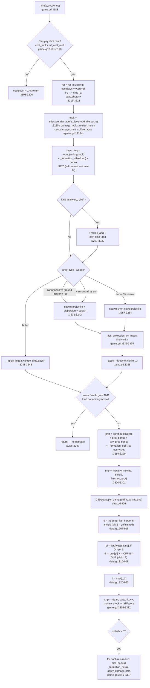

# 🔬 Deep audit: SIM

> [!IMPORTANT]
> Quality-first, unhurried audit (D-22). I accepted **no** worker claim at face
> value. Every number below was re-derived with a method different from the
> original reporter: donor `formations.cfg` was re-read in full through Craft
> Anything `core_text_read` and parsed by my own record parser; the damage path
> was re-derived from the actual byte-level code and an explicit index
> enumeration; the parse state was established with **two** runner jobs after a
> concurrent edit was detected. **No code, board, test or config file was
> edited. This document is the only file written.**

**Scope / compliance (observed).** Donor at `C:\Games\Cossacks 3` was opened
read-only; no donor executable was run and no donor file was copied into the
repo. All Godot work went through `app/tools/godot_runner.py` (tickets 125 and
148 under id `deep-sim-syntax` / `deep-sim-syntax-current`). Code was read only.

**Label convention.** Counts, code lines, runner exit codes and stderr text are
`observed`. Index enumerations, the root-cause attribution and the staleness
argument are `derived` from those observations. Motives/timing of the concurrent
edit are `inferred` and marked as such.

---

## 1. Claim table

| # | Claim | Evidence | Verification method | Verdict | Correction needed |
|---|---|---|---|---|---|
| 1a | Donor `formations.cfg` carries real combat bonuses (`bonusdamage/bonusshield` 2, hold 7/7); GUIDE4 A04's "bonusdamage 0, masks only" is false | Donor `formations.cfg` full read: `ev_c1b8dc95…` (lines 1–2000), `ev_7a4ce540…` (2001–2307), first page `ev_9f9d6302…`; DB `fnd_22` §2.4 | `core_text_read` of **all 2,307 lines** in 2 pages + own JS record parser over `id`/`bonusdamage`/`bonusshield`/`bonusdamagehold`/`bonusshieldhold` fields; independent corroboration by `docs/audit/DECOMP.md` §1 claim 1a (different method: Python `latin-1` byte read) | **CONFIRMED** — 46 of 149 formations have ≥1 nonzero bonus; exactly 15 are `(2,2,7,7)` and 18 have hold `7/7`. Donor `LINE15` block reads `bonusdamage=2 / bonusshield=2 / bonusdamagehold=7 / bonusshieldhold=7` verbatim | Correct `GUIDE4.md` A04 and the stale comment in `data.gd`; keep P-30 open with the corrected numbers (below) |
| 1b | "`formations.cfg` has **43** formations with bonusdamage/shield 2 and hold 7/7" (DB fnd_22 / board P-30) | `docs/decomp/DB_SCRIPTS.md` §2.4, gap G1; `SWARM_BOARD.md` P-30 | Same full-file parse; exact 4-tuple frequency distribution | **CONTRADICTED** — only **15** formations are exactly `(2,2,7,7)`; **46** have any nonzero bonus; **18** have hold `7/7` (the 15 plus `LINE400/SQUARE400/KARE400` = `(3,3,7,7)`). Full distribution in §4.1 | Replace "43" in P-30 and DB-01 acceptance criteria; **do not** implement a flat 2/2/7/7 table — bonuses are heterogeneous and include legacy `_OLD` outliers with negative values |
| 1c | Port `game.gd` uses **wiki** formation values instead of donor values | `game.gd:1740-1766` `_formation_atk` / `_formation_def`; in-code comment at `:1748` literally "wiki:"; `selftest.json:104-106` expects "formed bonus +2 (hold +9)" | Direct read of both functions + cross-check of the selftest expected value; enumeration of every branch | **CONFIRMED** — port normal melee = +2 atk / +3 def, hold melee = +9 atk / +9 def, cav = +1/+1 (hold +5/+4). Donor hold is **7/7** for 18 formations, not 9/9; there is no per-formation lookup at all | P-30 must replace the hard-coded wiki constants with a donor-derived per-formation lookup and update the `formation_bonus` selftest expectation |
| 2 | P-06: off-by-one in `apply_damage` protection indexing — `WK` `arrow=5`/`cannonball=7` vs 6-slot `prot` | `data.gd:235` `WK`, `:237` order comment, `:244`+ 6-element `prot` arrays, `:906-922` `apply_damage`; `game.gd:3289-3302` caller; RB §2/P-06 | Byte-level read + explicit enumeration of all 8 weapon kinds against a 6-slot array; **independent of donor truth** (internal contradiction) | **CONFIRMED, and broader than reported** — `WK` is 1-based (`none=0`, kinds 1–7) but `prot` is a 0-based 6-slot array. Every kind reads the *next* slot (`pike→prot[1]`=sword slot, `arrow→prot[5]`=cannonball slot), and `firearrow(6)` / `cannonball(7)` are `>= 6`, so the guard rejects them and **no protection is applied at all**. Board line numbers are stale (now `:235/:244/:906-922`, not `:233/:831-834`) | Re-open P-06 (currently BLOCKED; `data.gd` owned by A). Fix the index mapping (`pi-1` with a corrected guard, or make `WK` 0-based) and decide `firearrow` handling. Add one selftest step per weapon kind. **I did not fix it.** |
| 3a | Only the Town Hall has `capture: true` (`data.gd`, RB reports `:650`, now `:691`) | `data.gd:691` `"capture": true` on `cen`; whole-file grep yields only that line plus `CAPTURE_ENABLED` at `:47`; `:693+` other economy buildings have no flag | Whole-file grep + direct read of the `BUILDINGS_BASE` block; line-number drift resolved by content match | **CONFIRMED** — `cen` is the **only** building with the flag; `sto`/`mil`/`mar`/`mine_gold`/`mine_iron`/`mine_coal` have none | Keep G-01 open as a data-only change |
| 3b | Donor/public sources say Town Hall, market, mines and storehouse are capturable, most military buildings are not | RB `S3` (Battle tactics), `S5` (Capturing), `S6` (Mine), `S7` (Market), gap G-01 | Cross-check of the cited public wiki sources as recorded in `RB_MECHANICS.md`; capture loop read at `game.gd:3600-3645` | **PARTIAL** — the *code* gap is CONFIRMED (generic capture loop at `:3603` is keyed on `e.def.get("capture", false)` and even has mine-specific handling at `:3639`, so it is half-wired); the precise **donor building set is UNVERIFIED from donor bytes** — the evidence is public wiki, not a donor config read | Add `capture:true` to economy buildings; decide explicitly whether `hou`/`art`/`tow` stay non-capturable (S3/S8 imply towers are fortifications). Add a capture-a-market-or-mine selftest |

**Verdict summary:** 1a CONFIRMED · 1b CONTRADICTED · 1c CONFIRMED · 2 CONFIRMED (broader) · 3a CONFIRMED · 3b PARTIAL.
The material correction to prior worker work is the **formation count** (43 → 46 nonzero / 15 exact 2-2-7-7), already independently found by `deep-DECOMP` and reproduced here by a second method.

---

## 2. Damage / application path (Mermaid)



---

## 3. Parse state of `game.gd`

### 3.1 First check — FAILED (exact evidence)

Runner ticket **125**, id `deep-sim-syntax`:

```
[runner] ticket 125 'deep-sim-syntax' START (waited 468.71s)
[runner] ticket 125 'deep-sim-syntax' END failed (run 1.27s)
```

`app\.godot_queue\results\00000125.json`: `created = 1795244416.258517` →
**08:00:16 local**; `wait = 468.71s` → parsed at ≈**08:08:05**;
`exit = 1`, `status = failed`.

`...\00000125_deep-sim-syntax\stderr.txt` (verbatim, all 4 lines):

```
SCRIPT ERROR: Parse Error: There is already a variable named "u" declared in this scope.
   at: GDScript::reload (res://scripts/game.gd:2146)
ERROR: Failed to load script "res://scripts/game.gd" with error "Parse error".
   at: load (modules/gdscript/gdscript_resource_format.cpp:46)
```

This is the **root cause** of the downstream reports. Queue job records show
`agentAB-selftest2` (86), `agentA-p23p24-selftest` (104), `agentO4-selftest`
(105) and `agentB-selftest-final` (107) all `timed-out` with the secondary
symptom:

```
SCRIPT ERROR: Parse Error: Could not parse global class "C3Game" from "res://scripts/game.gd".
   at: GDScript::reload (res://scripts/main.gd:44)
```

(main.gd cannot load the global class because game.gd itself fails to parse.)
The 8 `t_*` recheck jobs in that batch were `skipped`, not executed, so they
produced no valid result either way.

### 3.2 Root-cause attribution (derived, high confidence)

- `game.gd:2060` declares function scope `var u: Dictionary =
  Data.UPGRADES.get(uid, {})` inside `apply_upgrade()`.
- The P-23/P-24 combat-tree block inserted at `game.gd:2119-2152` (visible in
  `git diff --no-index inbox/backup/game.gd.bak-agentA app/scripts/game.gd`;
  the backup has **no** such block) added a `heal_all` effect loop. Line **2146**
  — exactly the line the parser names — is that loop's `for ... in entities:`
  line. In the failing version it used loop variable `u`, shadowing the
  function-scope `u` at `:2060`; GDScript 4 rejects a `for` variable that
  shadows an in-scope name.
- **Likely causing edit:** Agent **A**'s P-23 skirmish-combat-tree insertion into
  `apply_upgrade()`, `app/scripts/game.gd:2146` (the `heal_all` loop), made while
  A owned game.gd for P-23/P-24 (board A-01 / P-23 / P-24).
- **Fix evidence (observed):** game.gd mtime changed from **07:50:00** to
  **08:08:34 local** — 29 s *after* ticket 125 parsed — and the current
  `:2146` reads `for hu in entities:`, with the adjacent `repair_arty` loop at
  `:2150` using `ha`. The shadowing identifier is gone. `inferred`: A renamed
  the loop variables to clear the collision.

**Who must fix it:** Agent **A** owns `game.gd`; the fix is already present in
the working tree. QA (O) must re-run the full selftest and uitest gates through
the runner before any release is signed. **I did not fix it.**

### 3.3 Second check — PASSED (current state)

Because the file changed after the first check, I re-ran the identical command
under id `deep-sim-syntax-current`, ticket **148**:

```
[runner] ticket 148 'deep-sim-syntax-current' START (waited 134.17s)
[runner] ticket 148 'deep-sim-syntax-current' END ok (run 1.60s)
```

`...\00000148.json`: `exit = 0`, `status = ok`; the corresponding `stderr.txt`
is **empty (0 lines)**.

**Verdict:** at the time of this audit the parse error was **real and confirmed**
(ticket 125), but it was **transient** — a concurrent edit fixed it, and the
current `game.gd` parses cleanly (ticket 148). A check that had stopped at
ticket 125 would have reported a stale failure; a check that ignored ticket 125
would have missed a real one. Both results are kept as evidence.

### 3.4 Is `app/selftest.json` trustworthy? — **NO**

`selftest.json` contains `"passed": true` and 29 green steps, but:

1. **Stale by timestamp (observed).** `selftest.json` mtime **07:46:40**,
   `data.gd` **07:48:56**, `game.gd` **08:08:34**. The JSON predates every
   relevant source edit, including the whole P-23/P-24 window.
2. **Impossible during the broken window (derived).** Between ≈07:50 and
   08:08:34, `main.gd:44` could not load `C3Game` from game.gd; any full
   selftest launched in that interval timed out (jobs 86/104/105/107). A
   `passed: true` artifact therefore cannot describe that code state.
3. **Its content encodes the pre-P-23 build** (observed) — step
   `formation_bonus` expects "bonus +2 (hold +9)", i.e. the old wiki constants.
   That expectation is not evidence about the current, edited source. It is a
   snapshot of an earlier build, not a measurement of the one that would be
   shipped today.

**Conclusion:** `selftest.json` must be regenerated by QA (O) from a fresh
runner job against the current tree. Until then `passed: true` is **not** a
valid green gate and must not be used to sign a release; the working tree also
contains ObjectDB-leak warnings on earlier selftest runs (jobs 86 era), which
need a clean re-run in their own right.

---

## 4. Detailed evidence

### 4.1 Formation bonuses — full donor distribution (observed)

Full-file `core_text_read` (2,307 lines, 63,886 B, SHA-256
`3cd172e0e0a580967261dabd838c65b6b918f68d24a28203b2de24bca51f8f08`),
parsed by my own record parser: **149** records, **137** with `symmetry=1`,
**46** with ≥1 nonzero bonus field. Exact 4-tuple
`(bonusdamage/bonusshield/bonusdamagehold/bonusshieldhold)` frequency:

| tuple | count | examples |
|---|---:|---|
| `2/2/7/7` | **15** | LINE15, LINE36, LINE72, LINE120, LINE196, SQUARE36/72/120/196, KARE36/72/120/196, SQUARE15, KARE15 |
| `1/1/1/1` | 22 | TRI, TRI2/3, PRUS, PRUS2/3, SHER, SHER2/3, and the `0/02/03` variants |
| `3/3/7/7` | 3 | LINE400, SQUARE400, KARE400 |
| `2/1/2/1` | 2 | SHER_OLD, SHER0_OLD |
| `0/1/1/0` | 2 | SHER3_OLD, SHER03_OLD |
| `-10/9/95/-19` | 1 | TRI_OLD |
| `5/-5/-27/80` | 1 | PRUS_OLD |

Derived: 18 formations carry hold `7/7`; 15 of those are the canonical `2/2/7/7`
set. The negative legacy `_OLD` values are why a flat "all bonuses = 2/2/7/7"
import would be wrong. This matches `docs/audit/DECOMP.md` §1 claims 1a–1d
independently (it used a Python byte read, I used Craft Anything text + JS).

Port constants (`game.gd:1740-1766`, observed):

| state | donor (dominant) | port (wiki) |
|---|---|---|
| normal melee | `2/2` dmg/shield | `+2` atk / `+3` def |
| hold melee | `7/7` | `+9` atk / `+9` def |
| hold ranged | `7/7` (no separate value in cfg) | `+2` / `+9` |
| heavy cav | per-formation table | `+1/+1`, hold `+5/+4` |

### 4.2 Damage protection indexing — explicit enumeration (derived)

`data.gd:235` `WK = {none:0, pike:1, sword:2, bullet:3, cannister:4, arrow:5,
firearrow:6, cannonball:7}`; `:237` comment declares `prot` order
`[pike, sword, bullet, cannister, arrow, cannonball]` = 6 slots (indices 0–5);
`:916-919` `pi = WK.get(weap_kind,0); if pi>=0 and pi<prot.size(): d -= prot[pi]`.

| weapon | WK `pi` | slot actually read | slot the comment says it should read | effect |
|---|---:|---|---|---|
| pike | 1 | `prot[1]` = sword | `prot[0]` = pike | wrong slot (−1) |
| sword | 2 | `prot[2]` = bullet | `prot[1]` = sword | wrong slot |
| bullet | 3 | `prot[3]` = cannister | `prot[2]` = bullet | wrong slot |
| cannister | 4 | `prot[4]` = arrow | `prot[3]` = cannister | wrong slot |
| arrow | 5 | `prot[5]` = cannonball | `prot[4]` = arrow | wrong slot — usually the **largest** value, so arrows under-damage armored targets |
| firearrow | 6 | guard rejects (`6 >= 6`) | (no slot defined) | no protection at all |
| cannonball | 7 | guard rejects (`7 >= 6`) | `prot[5]` = cannonball | **no protection at all** |

Worked example: `pikeman` `prot = [3,2,4,210,6,40]` (`data.gd:253`). An arrow
hit subtracts `prot[5]=40` instead of `prot[4]=6` — a 34-point over-application
of protection. A cannonball hit subtracts nothing. This is an internal
inconsistency independent of any donor claim, so worker I's spot-check is
confirmed and in fact understated.

### 4.3 Capture scope (observed)

- `data.gd` whole-file grep for `capture`: only `:47` `CAPTURE_ENABLED` and
  `:691` `"capture": true` on `cen`. `hou` (`:693`), `bar`/`bar18`, `mar`,
  `sto`, `mil`, `mine_*` (`:693+`) have no `capture` flag.
- `game.gd:3603` `if e.finished and e.def.get("capture", false):` — the loop is
  generic; it counts peasants/soldiers (`:3608-3618`), fills `capture_t`
  (`:3623`), flips `e.player`, score and `farm_cap` (`:3632-3638`), and has a
  mine-specific branch at `:3639-3640`. So the behaviour is half-wired exactly
  as RB G-01 says: only the data flags are missing.
- Donor/wiki claim (RB S3/S5/S6/S7): economy buildings are capturable, most
  military buildings are not. This part is wiki-sourced, so the precise donor
  set remains UNVERIFIED from donor bytes.

---

## 5. Open questions / future tickets

1. **P-06 (re-open).** data.gd owns the fix; add per-weapon-kind regression steps.
   Decide whether `firearrow` should borrow arrow protection; that requires a
   donor `_misc_DoDamage` reference we do not yet have in readable form.
2. **P-30 (correct scope).** Import the **full** 149-formation table with exact
   per-formation bonus tuples, not a flat 2/2/7/7 for "43" formations; update
   `GUIDE4.md` A04, `DB_SCRIPTS.md` §2.4/G1, board P-30, and the
   `formation_bonus` selftest. Keep the 18 hold-7/7 and the legacy outliers
   distinct.
3. **G-01.** Add `capture:true` to economy buildings (data-only); decide
   tower/house policy; add a market/mine capture selftest.
4. **QA gate.** Re-run selftest (29/29) and uitest (17/17) through the runner
   against the *current* tree and overwrite the stale `selftest.json`. Treat the
   ObjectDB-leak warnings seen on earlier jobs as a separate clean-exit ticket.
5. **UNVERIFIED by design:** exact donor protection-array ordering (the port's
   `:237` comment is the only in-repo statement), and the exact donor set of
   capturable building types (wiki-only). Both need a donor-side text/script read
   in a future decompilation pass; do not guess.

---

## 6. Files changed by this audit

- `docs/audit/SIM.md` — new (this file). **No other file written.**

*deep-SIM, §5b-QUALITY. Read-only on all code and donor files; both Godot checks
executed through `godot_runner.py`. Parse evidence retained at
`app/.godot_queue/results/00000125*` (failed) and `00000148*` (ok).*
