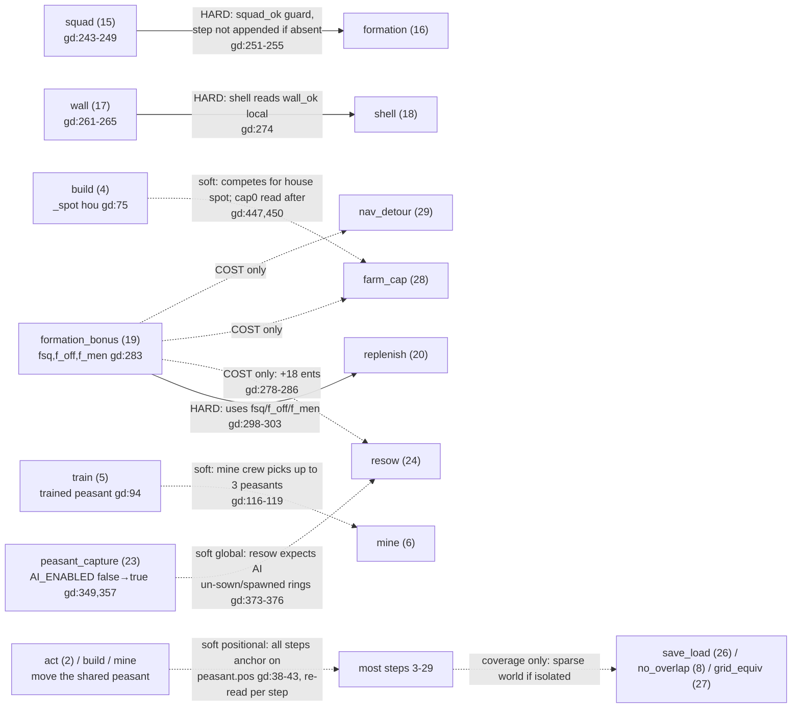

# T3 — Per-step cost, state deps, and split sizing for `app/selftest.json` (29 steps)

## Headline (2 lines)

The only MEASURED whole-suite wall time is **88.82 s** (queue job 1102, `--self-test`), of which **~43.6 s is fixed startup** (MEASURED proxy: default-seed 160² map dump, job 1192) — so **no subset can hit <30 s wall in today's one-process-per-job runner**; `<30 s` requires a shared-process baseline-snapshot restore or a pre-baked map. Per-step wall time is **UNKNOWN** (no per-step timing instrumentation exists in logs or code); all per-step costs below are **ESTIMATE** from code-derived sim-seconds plus MEASURED perf scaling.

Evidence labels used throughout: **MEASURED** = observed in a runner log/report; **CODE** = deterministic constant read from source; **ESTIMATE** = inferred; **UNKNOWN** = no data.

---

## 1. Measured anchors (whole-job only — no per-step timings exist)

| Signal | Value | Label | Source |
|---|---|---|---|
| Full `--self-test` wall | **88.82 s** (`run`), 7.16 s queue `wait`, timeout 120 s | MEASURED | `app/.godot_queue/results/00001102.json` (id `mm_smoke`, argv includes `--self-test app/selftest.json`) |
| Same job's report | `sim_seconds: 391.8125`, 29 steps | MEASURED | `app/selftest.json:10` |
| Second local run | `sim_seconds: 406.65625`, 29 steps | MEASURED | `app/report.json:11`; `selftest_run.log` |
| Fixed startup proxy (default seed 20261113, 160² map, `game.setup()`) | **43.60 s** | MEASURED | `00001192.json` (`recon_dump`, `--dump-map --seed 20261113`) + `main.gd:634-638` |
| Map-gen cost spread across configs | 10.97 s / 11.97 s / 92.08 s | MEASURED | jobs 1207 (`probe-forest-fast`), 1209 (`probe-forest-dense`), 1202 (`probe-forest-base`) |
| Full-tick scaling: 552 units / 10 sim-s | 16.60 s wall (`~415 ms/tick`) | MEASURED | `00001224` stdout: `mass sim wall time 16601.41 ms for 552 units / 10.0 sim-seconds` |
| Unit-move hot path, 5 ticks median | n=300: 334–513 ms; n=1000: 1887–3620 ms; n=3000: 7272–17043 ms | MEASURED | jobs 1225/1226/1219 (`t-perf-scale`) |
| Per-step wall time | none | UNKNOWN | grep of all `results/**/stdout.txt` found no `SELFTEST step … ms` lines; `selftest.gd` has no `Time.get_ticks_msec()` |
| Stale budgeting comment | "about 1 s wall time, ~230 sim seconds" | CODE (wrong) | `main.gd:1499` — contradicted by 88.82 s / 391.8 s above; do not budget from it |

**Implication:** `C3Game.new()` in the `save_load` step (`selftest.gd:420`) does **not** call `game.setup()` (`main.gd:676`), so it does not pay a second map-gen cost — startup is once per process. But each *split subset* is a new process ⇒ each pays startup again.

---

## 2. Cost ranking (all wall figures ESTIMATE; sim-seconds are CODE/cap-derived)

`_sim(s)` = `int(s/0.25)` calls to `game.tick(0.25)` (`selftest.gd:18-21`). "cap" = loop with early break, so actual sim-seconds are ≤ the cap. Cap total = **478.5 s**; MEASURED total 391.8–406.7 s ⇒ ~72–87 s of loop caps are not consumed (early breaks in `capture`, `farm_cap`, `nav_detour`, `volley`, `flee`).

Class rule: **SLOW** ≥25 sim-s cap, or tick-heavy after the 18-unit spawn at step 19; **MEDIUM** 5–16 sim-s; **FAST** ≤2 sim-s / no `game.tick`.

| # | step | sim-s (CODE/cap) | ticks | class | Cost driver in code | Wall ESTIMATE |
|---|---|---|---|---|---|---|
| 6 | `mine` | **90.0** | 360 | SLOW | `_sim(60)` build-site walk + `_sim(30)` income window (`gd:121,135`) | ~10–18 s |
| 2 | `act` | **80.0** | 320 | SLOW | single `_sim(80)` gather soak (`gd:56`) | ~9–16 s |
| 28 | `farm_cap` | **≤60.0** | ≤240 | SLOW | waits for house completion, hard cap 240 ticks (`gd:456-459`); runs with ~70 ents | ~6–14 s |
| 3 | `fight` | 30.0 | 120 | SLOW | `_sim(30)` melee duel (`gd:69`) | ~4–8 s |
| 14 | `capture` | ≤30.0 | ≤120 | SLOW | 120-tick capture loop, breaks on owner flip (`gd:235-238`) | ~3–8 s |
| 17 | `wall` | 30.0 | 120 | SLOW | `_sim(30)` after `place_building("wal")` (`gd:261-264`) | ~4–8 s |
| 24 | `resow` | 30.0 | 120 | SLOW | `_sim(30)` resow window (`gd:388`), **late-world ~70 ents**, currently FAILS | ~4–9 s |
| 29 | `nav_detour` | ≤30.0 + scan | ≤120 | SLOW | full 160² patch scan (`gd:470-484`, worst ~4M array reads) + 120-tick walk (`gd:493-498`) | ~4–10 s |
| 4 | `build` | 25.0 | 100 | SLOW | `_sim(25)` house build (`gd:79`) | ~3–6 s |
| 5 | `train` | 16.0 | 64 | MEDIUM | `_sim(16)` (`gd:96`); needs starting `cen` (`gd:86-89`) | ~2–4 s |
| 10 | `heal` | 10.0 | 40 | MEDIUM | 40 explicit ticks (`gd:195-196`) | ~1–3 s |
| 11 | `morale` | 10.0 | 40 | MEDIUM | 40 ticks (`gd:205-206`) | ~1–3 s |
| 12 | `upgrade` | 10.0 | 40 | MEDIUM | research + 40 ticks (`gd:216-218`) | ~1–3 s |
| 1 | `move` | 8.0 | 32 | MEDIUM | `_sim(8)` (`gd:45`) | ~1–2 s |
| 9 | `volley` | ≤6.0 | ≤24 | MEDIUM | 24-tick smoke watch, breaks on death (`gd:180-186`) | ~1–2 s |
| 25 | `attack_ground` | 5.0 | 20 | MEDIUM | `_sim(5)` cannon (`gd:413`) | ~1 s |
| 23 | `peasant_capture` | 5.0 | 20 | MEDIUM | 5×`_sim(1)` with TMCORE prints (`gd:352-356`); currently FAILS | ~1–2 s |
| 22 | `garrison` | 2.0 | 8 | FAST | `_sim(1)`×2 (`gd:328,331`) | <1 s |
| 21 | `flee` | ≤1.5 | ≤6 | FAST | 6 ticks (`gd:311-314`) | <1 s |
| 19 | `formation_bonus` | 0 | 0 | FAST* | no ticks, **but spawns ~18 units** (`gd:278-286`) → raises per-tick cost of steps 21,24,28,29 | <1 s direct; +multiplier |
| 26 | `save_load` | 0 | 0 | FAST | serialize/deserialize ~67–70 entities (`gd:417-422`) | <1 s |
| 27 | `grid_equiv` | 0 | 0 | FAST | 10 brute-force scans over entities (`gd:427-441`) | <1 s |
| 7 | `hud` | 0 | 0 | FAST | `hud.refresh_selection` + `hud_report` (`gd:147-149`) | <1 s |
| 8 | `no_overlap` | 0 | 0 | FAST | O(n²) pairwise distances on ~10 units (`gd:154-168`) | <1 s |
| 13 | `market` | 0 | 0 | FAST | `game.trade` (`gd:222`) | <1 s |
| 15 | `squad` | 0 | 0 | FAST | `squad_form` + `formation_targets` (`gd:243-249`) | <1 s |
| 16 | `formation` | 0 | 0 | FAST | set/disband (`gd:252-254`) | <1 s |
| 18 | `shell` | 0 | 0 | FAST | rally/objectives (`gd:268-274`) | <1 s |
| 20 | `replenish` | 0 | 0 | FAST | kill 2 / spawn 2 / `cmd_replenish` (`gd:299-303`) | <1 s |

**Cost-ordering insight:** sim-seconds ≠ wall. Steps 24/28/29 run after step 19's ~18-unit spawn, so each tick is materially more expensive (MEASURED scaling: 552 units ≈ 415 ms/tick vs n=300 unit-move ≈ 67–103 ms/tick). Moving `formation_bonus`+`replenish` to the *end* of a combined subset would speed the three slow tail steps — but see dep §3 (no correctness dep, only cost).

---

## 3. Dependency graph

Hard deps (a missing prerequisite = crash, silently-omitted step, or guaranteed fail) plus soft/cost couplings. Hard-dep findings agree with T1 §2; extra edges here are cost/global-state specific to T3.

Hard-dep citations:
- `formation` — `if squad_ok:` encloses `squad_set_formation`/`squad_disband` **and the `steps.append`** (`selftest.gd:251-255`). Skip/fail `squad` ⇒ step 16 vanishes from report (count changes).
- `shell` — `"passed": wall_ok and rally_ok and obj_ok` (`selftest.gd:274`); `wall_ok` computed only in the wall block (`:262-265`). Skipping `wall` leaves the local undefined.
- `replenish` — `fsq`, `f_off`, `f_men` created at `:283`,`:278`,`:281` and consumed at `:298-303`.

Soft/cost citations:
- `build`/`farm_cap` both call `_spot("hou", peasant.pos)` (`:75`, `:450`); `farm_cap` reads `cap0` at `:447` after `build` may already have raised it — still `cap0+25`, so correctness holds, but spot contention exists.
- `mine` crew = first 3 player-0 peasants (`:116-119`), one of whom may be the `train`ed peasant (`:94`).
- `Data.AI_ENABLED` is a static global flipped at `:349` and restored at `:357`; `resow`'s comment at `:373-376` explicitly accounts for AI-sown mill rings. If a split ever leaves it false (e.g. early exit between 349 and 357), `resow` semantics change.
- `formation_bonus` spawns officer + drummer + 15 pikemen + lone pikeman (`:278-286`); `resow` (`:388`), `farm_cap` (`:456-459`) and `nav_detour` (`:493-498`) all tick after it.
- `peasant` is captured once at `:38-43` and its `pos` is read at execution time by nearly every step — positional coupling only, not a numeric result dependency (agrees with T1 §2).

**No step consumes another step's numeric result except the three hard deps** — confirmed by reading all 29 `steps.append` blocks.

---

## 4. Subset sizing proposal

### Scenario A — current runner, one Godot process per subset (no redesign)

Wall per subset ≈ **fixed startup 30–45 s ESTIMATE** (MEASURED anchor 43.6 s; MEASURED spread 11–92 s) **+ its share of the ~45 s step work** (88.82 − 43.6).

- **<30 s per subset is infeasible here.** Even a zero-step job pays startup.
- 8 subsets (T1's partition) ⇒ **~285–405 s total** vs 88.82 s monolith (3–5× slower). Not "relatively fast".
- If subsets are still wanted: use **3 subsets × 9–10 steps**, **~58–75 s each ESTIMATE**, total ~175–225 s. Use only for targeted diagnosis; keep the 29/29 monolith as gate.

### Scenario B — one process, post-setup baseline snapshot restored before each subset (recommended if <30 s is required)

Take one `serialize()` snapshot immediately after `game.setup()`/`_setup_full_game()` (`main.gd:674-679`), restore before each `run_only` group, and rebind `peasant`/locals per group. Then startup is paid once (~43.6 s MEASURED) and subset wall = incremental only.

Target rule: **3–7 steps and ≤~90 sim-seconds per subset ⇒ ~1–18 s incremental ESTIMATE**, except the two long soaks.

| Subset | Steps (n) | sim-s total | Incremental wall ESTIMATE | Notes |
|---|---|---|---|---|
| `soak_act` | `act` (1) | 80 | ~9–16 s | dedicated slow lane; <30 s still OK |
| `soak_mine` | `mine` (1) | 90 | ~10–18 s | dedicated slow lane; slowest single step |
| `economy_fast` | `train`, `upgrade`, `market`, `resow`, `farm_cap` (5) | ~86 | ~7–16 s | resow/farm_cap currently red — do not hide |
| `buildings` | `build`, `wall`, `shell`, `garrison` (4) | 57 | ~5–12 s | preserves wall→shell |
| `combat` | `fight`, `volley`, `heal`, `morale`, `flee`, `attack_ground`, `peasant_capture` (7) | ~67.5 | ~7–16 s | keep AI-toggle cleanup in `peasant_capture` |
| `formations` | `squad`, `formation`, `formation_bonus`, `replenish` (4) | 0 | ~1–3 s | preserves both hard deps; cheap because no ticks |
| `movement_state_ui` | `move`, `no_overlap`, `nav_detour`, `capture`, `hud`, `save_load`, `grid_equiv` (7) | ~68 | ~6–15 s | nav_detour scan + capture sim |

Count `1+1+5+4+7+4+7 = 29` ✓. Estimated total incremental ~45–96 s + one startup ~44 s ≈ **~90–140 s** vs 88.82 s monolith — acceptable overhead for isolation, and every subset individually under ~30 s except the two explicitly-marked soak lanes (which are still ≤18 s ESTIMATE).

### Steps that cannot be made fast without redesign

- **`act` (80 s) and `mine` (90 s)** — irreducible sim soaks. Shortening the `_sim` windows changes what is asserted (T1 §5: no weakening). Redesign options: pre-seed node `hits`/mine `hits` via a fixture, or force-finished building state.
- **`farm_cap` (≤240 ticks)** — waits real build completion. Redesign: fixture with a pre-finished house, then assert cap delta only.
- **`nav_detour` (full-map scan + ≤120 ticks)** — redesign: pre-baked clear-patch fixture.
- **Startup (~44 s MEASURED proxy)** — irreducible per process. Redesign: pre-baked/deserialized map arrays, or the snapshot-restore approach above.

Recommendation: put the two soaks in a **dedicated slow lane**, never hide them by trimming assertions; keep the canonical 29/29 monolithic gate unchanged (T2 gate hazards §4).

---

## 5. Open questions

1. **Add per-step timing?** A `Time.get_ticks_msec()` bracket around each of the 29 blocks in `selftest.gd` (report field e.g. `wall_ms` per step) would convert every ESTIMATE here to MEASURED with a tiny diff — but changes report shape. Owner decision needed; until then per-step cost remains UNKNOWN.
2. **Settle the startup number.** MEASURED proxies disagree (11 s / 12 s / 43.6 s / 92 s). Is the canonical selftest config the 43.6 s default-seed 160² map (`data.gd:33-35`), or a lighter forest config? One instrumented selftest job would settle it.
3. **Baseline snapshot viability.** Does `deserialize()` (`selftest.gd:421`) restore `res_nodes` hits, `stats`, `blocked` tiles, `Data.AI_ENABLED`, squads, `objectives`? The step only checks entities + `time_s` (`:422`). If not, snapshot-restore needs extra state capture.
4. **Is `formation_bonus` before the slow tail required for anything besides cost?** I found no correctness dep; only the +18-entity tick multiplier. Confirm before reordering.
5. **Map size for subsets.** `main.gd:309-312` can override `Data.MAP_W/H` (default 160, menu default 320). Smaller subset maps would cut startup but change `resow`'s `wild_food == 0` invariant (`gd:404`) and `_spot`/nav geometry — likely unacceptable.
6. **Slow-lane budget:** should `capture` (≤30 sim-s) join `soak_*`, or stay in `movement_state_ui` as proposed?

---

## 6. Cross-references

- T1 (`T01_selftest_taxonomy.md`) — taxonomy, 8-subset partition, no-weakening rules; my §3 hard deps match its §2, §4 cost data is new.
- T2 (`T02_selftest_mechanism.md`) — `--self-test` is output-only; `--self-only`/`run_only` mechanism; gate hazards. My §4 Scenario B assumes that mechanism plus a baseline snapshot.
