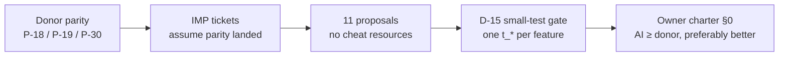
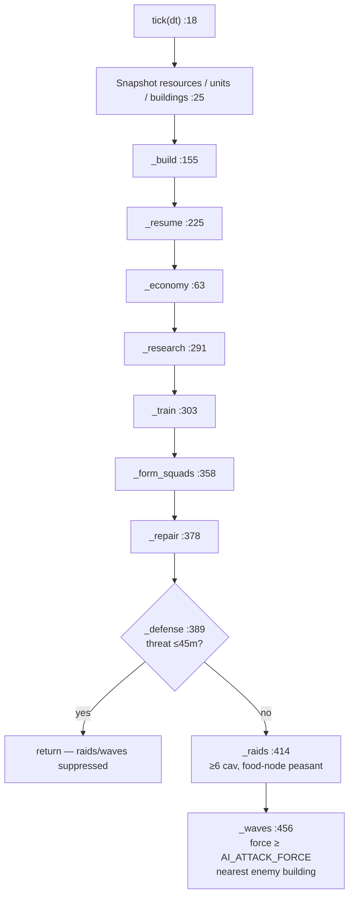
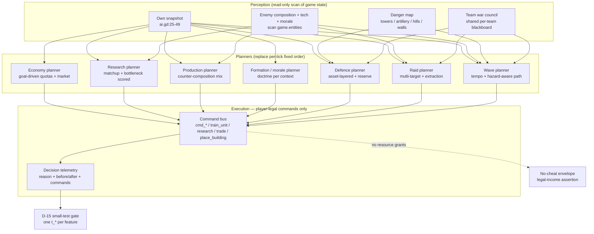

# 🧠 IMP-1 — Better-than-donor skirmish AI

> [!IMPORTANT]
> Proposal desk only. **No Godot runs, no code edits.** The sole artefact is this
> file. Source of truth for scope: `SWARM_OPS.md` §0 (owner wants AI at least
> donor-equivalent, preferably better) and decision **D-12**. Every claim below
> is cited to a file:line, board id or report §; uncited assertions are absent.

## 🧭 Decision trace

> [!NOTE]
> **D-12** (owner, 07:20) set the skirmish-only charter: random encounters,
> maximum fidelity, AI ≥ donor, multiple enemies, squads; missions/campaigns/
> network deferred (`docs/DECISION_LOG.md:43`; `SWARM_OPS.md` §0). This document
> therefore proposes **skirmish AI only**. **D-15** (coordinator, 07:35) requires
> one feature per small test file via `manifest.json` + `test_all.py`
> (`docs/DECISION_LOG.md:46`). Accordingly every ticket below names one `t_*`
> test id; new ids are **proposals** to be added by the test desk, not edits by
> IMP-1. **D-18/D-19** govern this file's markdown and D-xx citations.

## 🎯 TL;DR

`app/scripts/ai.gd` is a competent single-AI economy/production loop: quota-based
worker allocation, threshold build order, fixed research order, ratio-based
combined-arms production, squad formation, repair, home defence, cavalry raids
and force-threshold waves. It is **single-agent and reactive**: no shared state
between AIs, no enemy-composition telemetry, no hazard-aware pathing, static
difficulty knobs, and a global retreat timer. Eleven scoped tickets below close
those gaps **without resource or unit cheats** — difficulty is bought with better
decisions, not bonus income. Donor-parity work (P-18/P-19/P-30, RB G-11/G-13,
P-23) is *cross-referenced, not duplicated*.

## 🗺️ Current decision loop (read-only map of `app/scripts/ai.gd`)

1. **Gates** — `AI_ENABLED` and think-interval `think_t` (`ai.gd:18-24`).
2. **Snapshot** — 6 resources, peasants vs military split, finished/unfinished
   building counts, cached `home_id` with `blds[0]` fallback; hard bail if no
   finished building (`ai.gd:25-49`).
3. **Fixed order per tick**:
   `_build` (`:50`, impl `:155`) → `_resume` (`:51`, `:225`) → `_economy`
   (`:52`, `:63`) → `_research` (`:53`, `:291`) → `_train` (`:54`, `:303`) →
   `_form_squads` (`:55`, `:358`) → `_repair` (`:56`, `:378`) → `_defense`
   (`:57`, `:389`, **early return** on threat) → `_raids` (`:59`, `:414`) →
   `_waves` (`:60`, `:456`).
4. **Economy** — fixed quota food 35 % / wood 25 % / stone 15 % / mines 25 %
   (`:67-68`); only idle + surplus *without load* are reassigned (`:89-127`);
   depleted food nodes resown (`:78-82`); famine overrides all to food
   (`:129-134`).
5. **Build** — hard-coded resource thresholds for house/mines/barracks/store/
   blacksmith/market/academy/stable/18c barracks/diplomacy (`:167-190`);
   second town hall (`:192`), 6 wall segments (`:195`), 2 towers (`:197`);
   `_find_spot` = 24 random tries + `can_place()` + block-radius check
   (`:253-271`); naive "sell richest >1500, buy scarce <800" market (`:273-289`).
6. **Research** — fixed 12-entry upgrade order, one per tick (`:292-300`).
7. **Production** — peasants to `AI_MAX_PEASANTS` (`:304-308`); support first
   (drums/officers scaled by barracks count, **1 priest total**) (`:309-335`);
   force cap `AI_ATTACK_FORCE*2` (`:336`); class ratio heuristic
   ranged<melee, cavalry<melee/2, artillery<3 (`:338-356`).
8. **Squads / repair / defence** — officers form 36/72 squads from loose troops
   within 12 m, with an anti-chat-spam guard (`:358-376`); idle peasants repair
   own buildings <70 % HP, 2 each (`:378-387`); defence scans **45 m around
   home only**, ranged stand-ground ≤25 m, artillery attack-ground, others
   attack, then returns true and suppresses raids/waves (`:389-401`).
9. **Raid / wave** — team-aware `_is_enemy` (`:403-411`); raids require ≥6 idle
   cavalry and target the nearest enemy peasant standing on a food node, with
   stale `raid_ids` cleanup (`:414-453`); waves sum `aiforce`, trigger 20 s
   global retreat when routing > max(3, size/4), pick the **nearest enemy
   building across all enemies**, and stream squad officers / artillery /
   ranged (14 m back) / cavalry (10,−10 flank) at it (`:456-503`).

> [!WARNING]
> No cross-AI state, enemy-composition memory, danger map, adaptive difficulty
> or structured decision log exists in `ai.gd`. All observed actions go through
> the same player-legal command API (`train_unit`, `research`, `place_building`,
> `trade`, `cmd_*`) — **no cheat resource grant was found**, and none is proposed.

*Conceptual map of the read code, not a decompiled CFG; line numbers are from
the read of `app/scripts/ai.gd`.*

## 🚧 Donor parity — cross-reference only, do NOT duplicate

> [!CAUTION]
> These are **existing board/research tickets**. None is re-scoped here; the IMP
> tickets below *assume* they land and degrade gracefully if they do not.

| Item | Existing ticket | Why it is not in the IMP list |
|---|---|---|
| Multiple AI opponents / teams on one map, sim currently two-sided | **P-18** INTAKE (`SWARM_BOARD.md:46`; `STATUS_AI.md:108`) | Owner's top priority; owned by coordinator arbitration, not an improvement |
| Skirmish options parity (relief/richness/season/teams/map size) | **P-19** INTAKE (`SWARM_BOARD.md:47`) | Menu/sim feature parity, not AI decision quality |
| Donor formation bonuses from `formations.cfg` (43 entries, 2/2, hold 7/7) | **P-30** INTAKE, DB-01 (`SWARM_BOARD.md:54`; `DB_SCRIPTS.md:135,147`) | Correcting wrong numbers is parity; IMP-AI-06 only *uses* the corrected values |
| Squad XP / disband / mass-army scale | **P-22**, RB G-13 (`SWARM_BOARD.md:50`; `RB_MECHANICS.md:231-238`) | Missing donor mechanic; IMP-AI-06 adds doctrine on top |
| AI blows up mines before capture | RB G-11 (`RB_MECHANICS.md:216-222`) | Donor behaviour absent from `ai.gd`; parity, implemented by owner G |
| Upgrade-tree depth (firepower/bayonet/cavalry/drills) | **P-23**, RB G-02..G-05 (`SWARM_BOARD.md:51`) | Data/sim effect work; IMP-AI-09 only chooses *when* to research it |
| Hotkey patrol P vs Q; build-time units | RB G-12/G-14 | Not AI behaviour; out of scope |

## 🏆 Improvement portfolio — emoji priority index

Priority key: 🔴 P0 = first improvement to land **after** the parity tranche;
🟠 P1 = high skirmish value; 🟡 P2 = valuable polish; ⚪ P3 = nice-to-have.
**No IMP ticket outranks P-18/P-19/P-30.**

| ID | Ticket | Priority | Size | Test | Risk |
|---|---|:---:|:---:|---|:---:|
| IMP-AI-01 | Team war council / shared blackboard | 🔴 P0 | L | `t_ai_coordination` (new) + `t_teams` | Med-High |
| IMP-AI-02 | Enemy-aware combined-arms production | 🟠 P1 | M | `t_ai_counter_comp` (new) + `t_mass_army` | Med |
| IMP-AI-03 | Threat-aware wave pathing | 🟠 P1 | L | `t_ai_pathing` (new) | Med-High |
| IMP-AI-04 | Goal-driven economy allocation | 🟠 P1 | M | `t_ai_economy` (new) + `t_mine_unified` | Low-Med |
| IMP-AI-05 | Adaptive difficulty without cheats | 🟠 P1 | M | `t_ai_difficulty` (new) | Med |
| IMP-AI-06 | Formation doctrine + morale exploitation | 🟠 P1 | L | `t_squads` + `t_ai_doctrine` (new) | Med-High |
| IMP-AI-07 | Defence in depth / outpost garrison | 🟠 P1 | M | `t_ai_defense` (new) + `t_capture` | Med |
| IMP-AI-10 | Structured AI decision telemetry | 🟠 P1 | S–M | `t_ai_telemetry` (new) | Low |
| IMP-AI-08 | Economic raid planner | 🟡 P2 | M | `t_ai_raids` (new) + `t_multi_ai` | Low-Med |
| IMP-AI-09 | Reactive research planner | 🟡 P2 | M | `t_upgrades` + `t_ai_research` (new) | Med |
| IMP-AI-11 | Wave tempo / feint synchronization | 🟡 P2 | M | `t_ai_tempo` (new) + `t_multi_ai` | Med |

## 🧩 Proposed architecture

> [!TIP]
> The blackboard is **per team**, not global: an AI reads allies' intentions but
> never gains information about enemies it could not otherwise observe. This is
> what keeps coordination fair in a 2+ AI / team skirmish (P-18/P-19).

## 📋 Ticket cards

### IMP-AI-01 — Team war council / shared blackboard

- **Donor:** AIs act independently; team play in donor is documented as options,
  not coordinated AI strategy (`STATUS_AI.md:34-36`; P-18/P-19 parity).
- **Proposed better:** a per-team `war_council` dictionary owned by `game.gd`
  holding `focus_target`, `threat_map`, `role` (primary / feint / defender) and
  `attack_window`; same-team AIs pick complementary targets, stagger or
  synchronize waves, and avoid all stacking on one enemy.
- **Why:** turns "multiple AIs" into "a team" — the owner's explicit ask for
  multiple enemies gains strategic depth, not just more opponents.
- **Files:** `app/scripts/ai.gd` (G), `app/scripts/game.gd` (A) — needs P-18
  ownership arbitration first.
- **Size:** L · **Acceptance:** `t_ai_coordination` (new, test desk) + `t_teams`
  (T5); assert two allied AIs choose different primary targets and one feint.
- **Priority:** 🔴 P0 (after parity) · **Risk:** Med-High (cross-file; shared state).

### IMP-AI-02 — Enemy-aware combined-arms production

- **Donor:** `_train` uses fixed ratios — ranged<melee, cavalry<melee/2,
  artillery<3 — with no memory of the enemy army (`ai.gd:319-356`).
- **Proposed better:** rolling enemy class counts from read-only entity scans;
  bias production toward counters (pike/melee + grapeshot guns vs mass cavalry;
  fast cavalry vs exposed ranged; artillery/mortars vs fortifications); feed the
  chosen mix to the wave planner. Support cap scales to army size, not barracks
  count, and priest count scales beyond 1 for mass armies.
- **Why:** counters player one-trick tactics and makes the `aiforce` threshold
  meaningful instead of merely accumulating raw units.
- **Files:** `app/scripts/ai.gd` (G); `app/scripts/data.gd` read-only (A).
- **Size:** M · **Acceptance:** `t_ai_counter_comp` (new) + `t_mass_army` (T12);
  spawn a cavalry-heavy enemy and assert melee/artillery share rises.
- **Priority:** 🟠 P1 · **Risk:** Med (balance tuning).

### IMP-AI-03 — Threat-aware wave pathing around hazards

- **Donor:** `_waves` sends `cmd_attack_move` straight at the nearest enemy
  building; no tower/grapeshot/hill consideration (`ai.gd:473-503`). Donor wiki
  notes ranged high-ground bonus and hiding behind hills from cannon (S3/S14).
- **Proposed better:** build a coarse danger field (enemy towers/garrison,
  artillery reach, walls, hills/swamps) and route waves through waypoints via
  existing `nav.gd` A* (`J-01`); place ranged on high ground, artillery outside
  tower range, avoid grapeshot kill zones.
- **Why:** stops waves feeding piecemeal into fortifications; visibly smarter
  manoeuvre in skirmish.
- **Files:** `app/scripts/ai.gd` (G), `app/scripts/nav.gd` (J) — J-01 coordination.
- **Size:** L · **Acceptance:** `t_ai_pathing` (new); tower-guarded target forces
  a detour and artillery stops outside tower range.
- **Priority:** 🟠 P1 · **Risk:** Med-High (nav API, per-tick CPU).

### IMP-AI-04 — Goal-driven economy allocation

- **Donor:** static 35/25/15/25 worker quota and "sell richest >1500, buy
  scarce <800" market rule (`ai.gd:67-68,273-289`).
- **Proposed better:** derive resource targets from the next planned build,
  upgrade and train queue; allocate workers to close the actual deficit; trade
  only when marginal value is positive; relocate gatherers away from threatened
  nodes while preserving the no-interrupt-carriers rule.
- **Why:** removes dead-time where the AI hoards wood while unable to afford the
  tech/build it wants; compounds with P-23's deeper upgrade costs.
- **Files:** `app/scripts/ai.gd` (G); `app/scripts/data.gd` read-only (A).
- **Size:** M · **Acceptance:** `t_ai_economy` (new) + `t_mine_unified`; assert
  workers shift to iron when an artillery build is queued.
- **Priority:** 🟠 P1 · **Risk:** Low-Med.

### IMP-AI-05 — Adaptive difficulty without cheats

- **Donor:** fixed `AI_THINK_INTERVAL`, `AI_MAX_PEASANTS`, `AI_ATTACK_FORCE`
  (`ai.gd:24,304,471`) and no opponent adaptation.
- **Proposed better:** difficulty controls **decision quality** — think interval
  floor, number of simultaneous fronts, economy efficiency, aggression — tuned
  from player strength metrics with hysteresis. Hard invariant: AI may issue
  only player-legal commands; no resource/unit grants. Dev-build assertion
  checks AI resource deltas against legal income.
- **Why:** gives a meaningful difficulty setting that never feels like the AI is
  cheating — directly serves owner's "AI ≥ donor, preferably better" charter.
- **Files:** `app/scripts/ai.gd` (G), `app/scripts/data.gd` (A),
  `app/scripts/config.gd` (P/U), optional `menu.gd` (H/G).
- **Size:** M · **Acceptance:** `t_ai_difficulty` (new); both easy/hard AIs obey
  identical income law; hard wins more by decisions, not starting resources.
- **Priority:** 🟠 P1 · **Risk:** Med (balance/trust; multi-owner constants).

### IMP-AI-06 — Formation doctrine + morale exploitation

- **Donor:** officers form 36/72 squads generically and waves attack-move with
  them; hold bonuses and rout states are not deliberately used (`ai.gd:358-376,
  486-494`). Donor formations/morale: S2/S11/S13; P-30 fixes the numbers.
- **Proposed better:** choose formation per context (line/column for open-field
  fire, square vs cavalry, wedge for charge) from the corrected `formations.cfg`
  ids; use stand-ground/hold on defence to earn +7/+7; pursue routing enemies to
  snowball morale; replace the single 20 s global retreat with per-unit regroup;
  prioritise officer/drummer survival.
- **Why:** converts existing squad/formation code into tactical behaviour the
  player can see and counter.
- **Files:** `app/scripts/ai.gd` (G), `app/scripts/game.gd` (A),
  `app/scripts/data.gd` (A) — depends on P-30/P-22.
- **Size:** L · **Acceptance:** `t_squads` (T3) + `t_ai_doctrine` (new); assert
  hold bonus applied when defending and square chosen vs cavalry.
- **Priority:** 🟠 P1 · **Risk:** Med-High (depends parity tickets).

### IMP-AI-07 — Defence in depth / outpost garrisoning

- **Donor:** `_defense` checks only 45 m around home and, on any threat, returns
  true — freezing raids and waves (`ai.gd:389-401,57-58`). Remote mines/markets
  are undefended.
- **Proposed better:** layered defence over priority assets (home, mines,
  market, production); assign local defenders/garrisons, keep a mobile reserve;
  counter with the right class (ranged stand-ground, artillery attack-ground,
  cavalry intercept); suppress only the affected raid/wave, not the whole AI.
- **Why:** punishes player raids on economy instead of collapsing into a home
  ball; makes capture rules (RB G-01/G-09) matter in skirmish.
- **Files:** `app/scripts/ai.gd` (G); `app/scripts/game.gd` read-only for garrison
  API (A).
- **Size:** M · **Acceptance:** `t_ai_defense` (new) + `t_capture` (T14); raid a
  remote mine and assert local defence responds while the main wave continues.
- **Priority:** 🟠 P1 · **Risk:** Med.

### IMP-AI-10 — Structured AI decision telemetry

- **Donor:** no decision trace; the only AI chatter is the guarded
  `cmd_form_size` failure message (`ai.gd:363-375`).
- **Proposed better:** behind a debug/CLI flag, emit per-tick decision events
  (planner, target, reason, resources before/after, commands issued) and expose
  `ai.debug_snapshot()`. Enables regression tests for every other IMP ticket and
  is the evidence that no cheat path exists.
- **Why:** cheap force-multiplier for verification under D-15; shortens every
  review/QA cycle.
- **Files:** `app/scripts/ai.gd` (G); test scripts owned by F/R for CLI surfacing.
- **Size:** S–M · **Acceptance:** `t_ai_telemetry` (new); a 60 s CLI soak emits
  parseable events with zero illegal-command or resource-delta violations.
- **Priority:** 🟠 P1 (enabler) · **Risk:** Low.

### IMP-AI-08 — Economic raid planner

- **Donor:** raids require ≥6 idle cavalry and hit only the nearest enemy peasant
  on a food node, with no extraction or defender assessment (`ai.gd:414-453`).
- **Proposed better:** prioritised target list (enemy capturers at AI mines,
  miners, markets/mills/storehouses, undefended outskirts), class-appropriate
  raid groups, defender-strength check before committing, retreat on loss
  threshold, and feint coordination with the main wave (IMP-AI-01). Note: RB
  G-11 self-denial is parity and stays out of scope here.
- **Why:** sustained economic pressure gives the player something to defend
  against beyond one scripted cav probe.
- **Files:** `app/scripts/ai.gd` (G).
- **Size:** M · **Acceptance:** `t_ai_raids` (new) + `t_multi_ai` (T4); assert a
  market is raided when no food-node peasant is exposed and raiders withdraw at
  the loss threshold.
- **Priority:** 🟡 P2 · **Risk:** Low-Med.

### IMP-AI-09 — Reactive research planner

- **Donor:** fixed 12-upgrade order, one per tick, ignores enemy tech and the
  current bottleneck (`ai.gd:291-300`).
- **Proposed better:** score upgrades by prerequisites + value against the
  planned army mix (IMP-AI-02) and observed enemy composition; prioritise economy
  tech during expansion, mine tech when mine-heavy, bayonet/steel when facing 18c
  melee (RB G-02..G-05 / P-23); re-score when enemy tech is detected.
- **Why:** tech choices become part of strategy instead of a countdown; gracefully
  degrades until P-23 adds the missing upgrades.
- **Files:** `app/scripts/ai.gd` (G); `app/scripts/data.gd` read-only (A).
- **Size:** M · **Acceptance:** `t_upgrades` (T1) + `t_ai_research` (new); assert a
  cavalry-heavy enemy shifts the next research to an anti-cavalry upgrade.
- **Priority:** 🟡 P2 · **Risk:** Med (depends P-23 for full effect).

### IMP-AI-11 — Wave tempo / feint synchronization

- **Donor:** waves fire whenever `aiforce ≥ AI_ATTACK_FORCE` at the nearest
  enemy building; one global retreat timer; no timing or axis rotation
  (`ai.gd:456-503`).
- **Proposed better:** maintain a tempo model — attack on local force/tech/
  morale advantage, delay to let economy mature, synchronize with raid feints
  and team attack windows, rotate attack axes around fortified fronts, and press
  the advantage immediately after a won battle.
- **Why:** creates readable rhythm (boom → feint → strike) instead of constant
  equal-strength grinding; complements IMP-AI-01.
- **Files:** `app/scripts/ai.gd` (G).
- **Size:** M · **Acceptance:** `t_ai_tempo` (new) + `t_multi_ai` (T4); assert a
  wave waits for an agreed window and follows a raid feint.
- **Priority:** 🟡 P2 · **Risk:** Med.

## 🗑️ Rejected ideas (click to expand)

Why these were rejected

- **Cheat resources / free units / instant victory timers.** Violates the
  player-legal command invariant and the spirit of D-12 ("good port", AI ≥ donor
  by behaviour, not by cheating). Replaced by IMP-AI-05's decision-quality knobs.
- **Scripted hard-coded counter tables keyed to unit names.** Brittle against P-24
  roster additions and nation variants (RA 149 variants); IMP-AI-02 uses class
  telemetry and `aiforce` instead.
- **Full RTAI/flow-field pathfinding rewrite.** Too large and risks J-01's A*
  work; IMP-AI-03 layers a coarse danger field over existing `nav.gd`.
- **Mission/campaign AI scripts and `.aix` triggers.** Deferred by D-12
  (`SWARM_OPS.md` §0; P-16/P-17). Not skirmish scope.
- **Networked coordinated AIs across clients.** Network deferred by D-12; team
  council is in-process, per-team only.
- **Re-scoping P-18/P-19/P-30 as IMP tickets.** Would duplicate board work and
  break disjoint ownership (`SWARM_OPS.md` §3). Cross-referenced instead.

## ✅ How to land these

- [ ] Coordinator resolves G/A/H/J/F ownership and triages each IMP ticket via N
      (`SWARM_OPS.md` §2/§3; `STATUS_AI.md:173-176`).
- [ ] Land parity P-18 → P-19 → P-30 first; IMP-AI-01/06/09 depend on them.
- [ ] Test desk adds each proposed `t_ai_*` id to `app/tests/manifest.json`
      (D-15); status `pending` until the feature lands.
- [ ] Back up owned files before edit; all Godot via `app/tools/godot_runner.py`
      (D-03); green gates: selftest 29/29, uitest 17/17, clean gate, relevant
      `t_*` green (`STATUS_AI.md:178-201`).
- [ ] Review M verifies the no-cheat invariant for IMP-AI-05/10 before merge.
- [ ] IMP-1 updates this file only; coordinator edits `SWARM_BOARD.md` states.

## ❓ Open questions

- [ ] Does the owner want adaptive difficulty exposed as a skirmish-option
      (needs `menu.gd` + `config.gd` grants) or kept internal? — owner + G/P/U.
- [ ] Is `game.gd` the right home for a per-team war council, or should AI instances
      share a dedicated `C3AICouncil` object? — coordinator + A/G (P-18 arbitration).
- [ ] Can `nav.gd` A* accept a dynamic danger cost layer without a rewrite? — J
      (J-01) before IMP-AI-03 is estimated firmly.
- [ ] Which `t_ai_*` ids are approved and who authors them? — test desk (D-15).
- [ ] Do squad XP/disband (P-22) and donor formation values (P-30) land before or
      after IMP-AI-06? Affects its scope and estimate.

---

**Decision trace:** **D-12** skirmish charter (`docs/DECISION_LOG.md:43`,
`SWARM_OPS.md` §0) · **D-15** small tests (`docs/DECISION_LOG.md:46`) ·
D-18/D-19 markdown + citation rules.

**Related:** `SWARM_OPS.md` · `SWARM_BOARD.md` · `docs/DECISION_LOG.md` ·
`docs/STATUS_AI.md` · `docs/research/RB_MECHANICS.md` ·
`docs/decomp/DB_SCRIPTS.md` · `app/scripts/ai.gd` · `app/tests/manifest.json`
