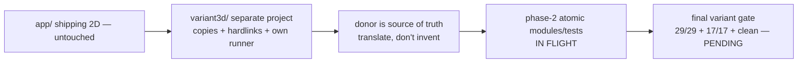

# ⚔️ CossacksGodot — 3D Skirmish Variant (`variant3d/`)

> [!IMPORTANT]
> Cold-readable entry point for the wave-7 3D variant. Read this file alone and
> you should know what `variant3d/` is, the rules it must obey, how to launch and
> test it, who owns which phase-2 file, and where every wave-7 report lives.
> Every factual claim below carries a report/job/line reference. Statuses are a
> **snapshot taken 2026-11-24 ~12:05** while phase-2 agents were still running;
> re-check disk and the linked reports before acting on them.


## 🎯 TL;DR

`variant3d/` is a **separate Godot 4.x project inside this repo** that duplicates
every 2D mechanic of the shipping `app/` port and hosts the 3D rendering branch.
It was scaffolded by V7-0 as real copies of scripts/tests/tools/configs/scenes/
shaders plus **hardlinked** assets (2.312 GiB saved, zero disk duplication), with
its **own `project.godot` and its own serialized runner queue**. It renders donor
**meshes directly — there is no 2D sprite-bake pipeline** in this project. All 3D
work must **translate donor code/data, never invent**, and scope is
**SINGLEPLAYER SKIRMISH ONLY (D-12)**. The scaffold gate is green: baseline
selftest **29/29 PASS** through the variant runner (job `v70-baseline-selftest-r3`,
ticket 5, exit 0, 82.13 s — `V70_scaffold.md` §3). Phase-2 atomic work is
**in flight**; the final variant gate (29/29 + 17/17 + clean) is **pending**
(`WAVE7_3D_VARIANT_CHARTER.md` "Gates"; `PROGRESS.md` §"Wave 7 phase 2").



## 🏗️ What this project is (architecture)

| Property | Reality | Evidence |
|---|---|---|
| Separate project | Full copy of `app/` scripts (41 files), tests (111), tools (230), scenes (2), shaders (2), root configs (17); own `project.godot`, `selftest.json`, `uitest.json`, `mechanics.json`, docs under `docs/variant3d/` | `WAVE7_3D_VARIANT_CHARTER.md` "Architecture decision"; `V70_scaffold.md` §1 |
| Assets hardlinked | 3,999 non-import asset files hardlinked (`os.link`) from `app/assets/**` = 2,482,248,044 B (2.312 GiB saved); 0 hardlink fallbacks. `.import` (3,383) + `.uid` (468) are **real** copies so Godot rewrites cannot touch 2D | `V70_scaffold.md` §1 (inode proof: `alg.ogg` `same_inode=True`, its `.import` `False`) |
| Independent runner | `variant3d/tools/godot_runner.py` differs from 2D in one line: `SPOOL = ROOT / "variant3d" / ".godot_queue"`. `status` prints the spool. 2D queue stayed at ticket ~1314 while variant started at 0 → zero contention | `V70_scaffold.md` §2; `V73_ATOMIC_CONTRACT.md` "Runner" |
| Own caches | `variant3d/.godot/` is generated (3,029 files / 1.19 GiB after `.gdignore`), not committed; `app/.godot/**` and `app/.godot_queue/**` were never copied | `V70_scaffold.md` §1, §6.2 |
| Renderer | `gl_compatibility` (Godot 4.4+ supports full 3D) kept byte-for-byte; only `config/name` → `"CossacksGodot - 3D Skirmish Variant"` and `config/description` changed | `V70_scaffold.md` §4 |
| 2D gates untouched | All final 2D gates stay in `app/`; last settled 29/29 job 1289, 17/17 job 1290 | `WAVE7_3D_VARIANT_CHARTER.md` "Gates"; `PROGRESS.md` "SESSION FINAL VERDICT" |

### No 2D bake pipeline (owner directive, 2026-11-24)

The 2D port bakes donor meshes into 8-azimuth sprite sheets + PNG atlases only
because it renders with `CanvasItem`. A real 3D variant renders **meshes**, so:

- **KEEP / NEED:** donor-derived geometry (`.obj` → `.glb`), DDS-derived albedo
  PNGs (`models/tex/**`, `terrain/blocks/**`), UV data, and **animation data**
  (`.oss` skin payload + `.aaf` action ranges → skeletal clips or sampled pose
  meshes).
- **DEAD WEIGHT — do not port/use:** baked sheets (`assets/models/anim/**` PNGs,
  `sprites/**`, `sprites_hi/**`), `anim/index.json` sprite metrics,
  `buildings.json` sprite keys, `bake_sprites.py` / `compute_ortho.py` outputs.
  V7-0 added real `.gdignore` markers in exactly those three sprite dirs (variant
  only) so Godot never imports them — `V70_scaffold.md` §5; charter §"NO 2D BAKE
  PIPELINE".
- **Kept and imported on purpose:** `assets/models/obj/**` (116 `.obj`), `tex/**`
  (233 files albedo), `terrain/blocks/**`, `terrain/heightmap/**`, sounds, UI —
  same citations.
- Geometry is resolution-free: "baked at 512 px" is N/A for meshes (`V72_mesh_conversion_feasibility.md` §2.3).
- Where rig semantics are unreadable, donor-faithful skinned conversion is
  **BLOCKED** and the sampled-pose fallback is labelled **PORT APPROXIMATION —
  NOT DONOR PARITY** (`V72_...md` §4.3, §5 Table B1/Table C). Never call it
  "ported donor animation".

> [!NOTE]
> The copied 2D scripts still read five sprite-metrics JSONs at runtime from
> inside the `.gdignore` trees. `.gdignore` only removes them from the import
> scan, not from disk, so the 29/29 baseline still resolves them. Exported 3D
> builds would need those JSONs included explicitly (`V70_scaffold.md` §5).

## 📜 Governing rule and scope

> **Leverage existing DONOR code — do not invent.** Donor `data\scripts`,
> `data\cameras`, `data\shaders`, `.osm` / `.oss` / `.aaf`, `light.cfg`,
> `env.cfg`, `terrainmesh*.osm` are the source of truth. Every 3D decision must
> cite **donor path:line or an evidence id**; translate donor algorithms and
> constants into Godot instead of designing new ones. Read donor **read-only**
> (Python `bytes` + latin-1); never run it or copy donor binaries.
> **UNVERIFIED where unreadable — no invented values.**
> (Charter §GOVERNING RULE, lines 29-38; restated in `V70_scaffold.md` §0,
> `V71_mechanics_inventory.md` §0/§2.4, `V72_mesh_conversion_feasibility.md` §1.1.)

**Scope: SINGLEPLAYER SKIRMISH ONLY (D-12).** In scope: menu shell, nation/map/
start options, all skirmish mechanics and their tests. **Deferred, not
implemented:** missions, campaigns, DLC mission maps, cutscenes, network
(charter line 37-38; `V71_...md` §0, §5.4; `V72_...md` §1 scope guard).

Two corrections carried forward from recon:
1. Donor main view is **perspective** (tilt −32°, focal 400, dolly 20–58), not
   orthographic — R-ARCH's ortho premise is superseded
   (`G31_donor_3d_truth.md` §2a, claim 1; `V71_...md` §0).
2. R-ARCH seam line numbers drifted; re-read before editing (`V71_...md` §0).

## 🚀 How to launch

From the repo root (`C:\Users\Maxym.Oboyshev\Documents\Craft Anything\cossacks-3-3`):

```bat
launch_variant3d.bat
```

- Preferred path = variant3d's **own serialized runner**
  (`python variant3d\tools\godot_runner.py run --id launch3d-manual --timeout 900 -- --path variant3d --stay %*`);
  the direct windowed Godot launch is a clearly labelled fallback only. Extra
  args are forwarded after Godot's `--`. Requires `python` and `godot` on PATH.
  (`launch_variant3d.bat:1-35,37-67`.)
- `launch_3d.bat` is a compatibility shim that delegates to
  `launch_variant3d.bat`; its old M0 `app/` terrain sandbox is documented as
  **VISUAL FAIL — do not use for acceptance** (`launch_3d.bat:1-26`).
- The launcher is **not** V7-0's file; it appeared during scaffolding and was
  left untouched (`V70_scaffold.md` §6.6).

## 🧪 Runner and tests (never call `godot` directly)

```bat
python variant3d\tools\godot_runner.py status
python variant3d\tools\godot_runner.py run --id <name> --timeout 300 -- ^
  --headless --path variant3d -- --self-test variant3d/selftest.json
python variant3d\tools\godot_runner.py run --id <name> --timeout 240 -- ^
  --headless --path variant3d -- --ui-test variant3d/uitest.json
```

First-time checkout bootstrap (generates `variant3d/.godot/`):

```bat
python variant3d\tools\godot_runner.py run --id import --timeout 900 -- ^
  --headless --path variant3d --import
```

Atomic test atoms use `--script` instead of a selftest flag:

```bat
python variant3d\tools\godot_runner.py run --id v<ID>-<name> --timeout 90 -- ^
  --headless --path variant3d --script res://tests/<module>.gd
```

(`V73_ATOMIC_CONTRACT.md` "Runner"; `V70_scaffold.md` §2-§3; `V732_test_camera3d.md` §4.)
All invocations stay **repo-root relative** because `ROOT` resolves to the repo
root in both runners (`V70_scaffold.md` §2). Do not run 2D `doctor` while a
variant import is active — it kills Godot by name regardless of spool
(`V70_scaffold.md` §6.1). Backups go to `inbox/backup/` with `-V7xx` suffix
(charter "PHASE-2 ORDER").

## 🗺️ Phase-2 atomic task map (statuses as of the 2026-11-24 ~12:05 read)

Two complementary maps are in force: the **charter's coarse V7-3…V7-9 owners**
(`WAVE7_3D_VARIANT_CHARTER.md` lines 66-79; refined by `V71_...md` §4) and the
**V7-3 atomic one-file-per-agent contract** actually launched as 18 agents in
4 batches (`V73_ATOMIC_CONTRACT.md`; `PROGRESS.md` §"Wave 7 phase 2 — ATOMIC
SPLIT LAUNCHED"). No two agents own the same file.

### Charter slots (integration seams deferred to a follow-up batch)

| Slot | Owned files (under `variant3d/`) | Status at read | Evidence |
|---|---|---|---|
| V7-3 | `project.godot`, `main.gd`, `config.gd`, `data.gd`, `menu.gd` — `render_mode` seam, relaxed typing, donor camera constants | **PENDING** (no phase-2 edit seen; `main.gd` mtime 11:32 before launch). Integration explicitly deferred | charter :67-73; `V71_...md` §4; `PROGRESS.md` phase-2 note |
| V7-4 | `world3d.gd`, `world3d_terrain.gd` — full world contract + heightfield | **PARTIAL / IN FLIGHT** — `world3d_terrain.gd` on disk (12:03:44); `world3d.gd` integration still 11/21 | `V71_...md` §4; `G32_heightmap_world.md` §8 (reuse `build_from_dump()` recipe); filesystem snapshot |
| V7-5 | `camera3d.gd`, `input_controller.gd` — perspective + picking | **PARTIAL / IN FLIGHT** — `camera3d.gd` on disk (12:04:49); `input_controller.gd` unchanged | `V71_...md` §4; `G31_...md` §2a; filesystem snapshot |
| V7-6 | `hud.gd` — camera-derived minimap box only | **PENDING** (`hud.gd` mtime 10:25 before launch); adapter module on disk | `V71_...md` §4, contract member `get_minimap_box` |
| V7-7 | `tests/**`, runner capture branch | **IN FLIGHT** — 6 of 7 atomic test files on disk; manifest not re-registered yet | `V73_ATOMIC_CONTRACT.md` "Test atoms"; `V738_manifest.md`; filesystem snapshot |
| V7-8 | `convert_models_3d.py`, `convert_terrain_3d.py`, `anim3d.gd`, `assets/models/glb/**` | **PARTIAL** — `anim3d.gd` on disk (12:04:31); conversion tools and `glb/**` absent at read | `V71_...md` §4; `V72_...md` §4/§5; filesystem snapshot |
| V7-9 | `scenes/*.tscn`, `shaders/*.gdshader`, environment | **PENDING / UNCERTAIN** — no phase-2 report seen; donor light/env sources documented | `V71_...md` §4, §2.4; charter :75 |

### V7-3 atomic contract modules (one file per agent)

| Module (all `variant3d/scripts/`) | Owner | Status at read | Evidence |
|---|---|---|---|
| `camera3d.gd` (perspective, clamp, viewport corners) | module agent (id UNCERTAIN) | **LANDED ON DISK** 12:04:49; no module report seen yet | `V73_ATOMIC_CONTRACT.md:10`; filesystem snapshot |
| `picking3d.gd` (pick / pick_res / ground_point) | module agent (id UNCERTAIN) | **PENDING / in flight** — absent at read | contract :11; snapshot |
| `world3d_terrain.gd` (full-grid ArrayMesh) | module agent (id UNCERTAIN) | **LANDED ON DISK** 12:03:44 | contract :12; `G32_...md` §2/§8 |
| `world3d_entities.gd` (no sprite sheets) | module agent (id UNCERTAIN) | **PENDING / in flight** — absent at read | contract :13; snapshot |
| `world3d_fx.gd` | module agent (id UNCERTAIN) | **LANDED ON DISK** (appeared during read) | contract :14; snapshot |
| `world3d_fog.gd` (expose fog arrays to HUD) | module agent (id UNCERTAIN) | **LANDED ON DISK** (appeared during read) | contract :15; snapshot |
| `hud3d_adapter.gd` (minimap box) | module agent (id UNCERTAIN) | **LANDED ON DISK** 12:04:52 | contract :16; snapshot |
| `anim3d.gd` (AAF ranges; label approximations) | module agent (id UNCERTAIN) | **LANDED ON DISK** 12:04:31 | contract :17; `V72_...md` §5 Table C |

### Test atoms and docs atoms

| Atom | Owner | Status at read | Evidence |
|---|---|---|---|
| `t_terrain3d.gd`, `t_camera3d.gd`, `t_pick3d.gd`, `t_entities3d.gd`, `t_fx3d.gd`, `t_fog3d.gd` | separate test agents | **LANDED ON DISK**; per-test reports mostly UNCERTAIN (only camera's seen) | contract :26-30; snapshot; `V732_test_camera3d.md` |
| `t_render_mode.gd` | test agent | **LANDED ON DISK** during read; report UNCERTAIN | contract :26-30; snapshot |
| `tests/manifest.json` registration | V7-38 | **LANDED** — report says 0 of 7 registered (files absent at *its* verification time); 24 2D entries intact, valid JSON. **Stale now** — re-register landed atoms | `V738_manifest.md` §"Registered vs pending", §"Manifest state" |
| Camera test verification | V7-32 | **LANDED (BLOCKED at run time)** — job `v732-camera3d` ticket 7 failed 0 checks `MODULE_MISSING`; module has since landed → re-run needed | `V732_test_camera3d.md` §4-§5; snapshot |
| Docs atoms | V7-39 (id UNCERTAIN), V7-40 (this doc set) | **V7-40 IN PROGRESS** | `V73_ATOMIC_CONTRACT.md` "Docs atoms"; this file |

> [!WARNING]
> "LANDED ON DISK" means the file existed at the snapshot time — **not** that a
> report landed, a gate passed, or the integration seams call it. Treat all
> phase-2 work as UNVERIFIED until its report and targeted runner job exist.
> The living per-atom status is `docs/variant3d/STATUS_WAVE7_PHASE2.md`.

## 📚 Wave-7 report index (all links)

**Phase 1 — landed:**

- [V7-0 scaffold + 29/29 baseline](../../coord_swarm_2026-11-24/reports/V70_scaffold.md)
- [V7-1 mechanics inventory (SHARE / ADAPT / NEW / BLOCKED)](../../coord_swarm_2026-11-24/reports/V71_mechanics_inventory.md)
- [V7-2 mesh conversion feasibility](../../coord_swarm_2026-11-24/reports/V72_mesh_conversion_feasibility.md)

**Phase 2 — landing while you read (check directory for new `V74*.md`):**

- [V7-32 camera3d test atom](../../coord_swarm_2026-11-24/reports/V732_test_camera3d.md) — BLOCKED-PENDING-MODULE at job `v732-camera3d`
- [V7-38 manifest registration](../../coord_swarm_2026-11-24/reports/V738_manifest.md) — 0 registered, 24 2D entries intact
- [V7-40 docs (my report)](../../coord_swarm_2026-11-24/reports/V740_docs.md) — this doc set
- All reports: `docs/coord_swarm_2026-11-24/reports/V7*.md`

**Charter / contracts / programme state:**

- [WAVE7_3D_VARIANT_CHARTER.md](../../coord_swarm_2026-11-24/WAVE7_3D_VARIANT_CHARTER.md)
- [V73_ATOMIC_CONTRACT.md](../../coord_swarm_2026-11-24/V73_ATOMIC_CONTRACT.md)
- [PROGRESS.md](../../coord_swarm_2026-11-24/PROGRESS.md) — phase-2 atomic split, wave-6/7 results
- [FINAL_GATE.md](../../coord_swarm_2026-11-24/FINAL_GATE.md) — 2D gate definition (29/29, 17/17, clean)

**Foundational donor/3D evidence feeding the variant:**

- [G31 donor 3D truth](../../coord_swarm_2026-11-24/reports/G31_donor_3d_truth.md)
- [G32 heightmap world](../../coord_swarm_2026-11-24/reports/G32_heightmap_world.md) — feeds `world3d_terrain.gd`
- `docs/audit/RENDER_ARCH_PORT_FEASIBILITY.md` (seams, SHARE/rewrite, M0–M4 gates)
- `docs/audit/RENDER_ARCH_{CAMERA,UNITS,SHADERS,SYNTHESIS}.md`, `WATER_REPORT.md`, `TERRAIN_DONOR_WATER.md`
- [living status](STATUS_WAVE7_PHASE2.md)

---

**Related:** [STATUS_WAVE7_PHASE2.md](STATUS_WAVE7_PHASE2.md) ·
`variant3d/README.md` (read-only scaffold README by V7-0) ·
`docs/STATUS_TEMPLATE.md` · `docs/coord_swarm_2026-11-24/`
