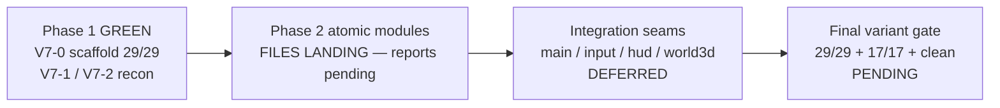
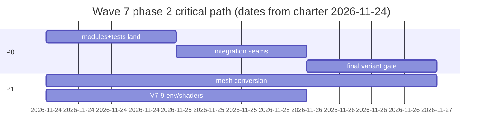

# ⚔️ STATUS — Wave 7 Phase 2 (`variant3d/`)

## 🟢 FINAL VERDICT — 2026-11-24 (authoritative; sections below are historical snapshots)

The 3D variant is **functional and its functional gates are green**. All 10 P0
gaps from the 9-agent parity audit are closed (`AUDIT3D_TRIAGE.md`):

| Gate / milestone | Result | Evidence |
|---|---|---|
| Variant selftest, `render_mode="3d"` | **29/29 PASS** | jobs 130, 157, 163, 186, 185; `variant3d/selftest.json` `passed:true` |
| Variant uitest | **17/17 PASS** | job `coord-variant-final-uitest` (191); `variant3d/uitest.json` `passed:true` |
| `t_render_mode` | **PASS 10/10**, `seam_missing=false` | job 193; `variant3d/tests/results/t_render_mode.json` |
| 2D shipping gate (`app/`) | selftest **29/29** (1342), uitest **17/17** (1341), clean **CLEAN** | job 1340 was a transient concurrent-Godot failure, rerun 1342 green |
| Launcher | `launch_variant3d.bat` works; `launch_3d.bat` shim delegates | direct launch, WinGet symlink resolution; `--dump-config` reports `"render_mode": "3d"` |
| Real 3D pixels | **YES** (windowed GPU capture) | V7-70 jobs 138/179; `Screenshot3DViewport`; CPU map remains headless/2D-only |
| Real entity meshes in play | **YES** — 0 → 5 in probe | V7-62 (job 130) |
| Donor models | 79/81 roster IDs, 172 OBJ importable | V7-63 + V7-72; bar18/dock absent in donor |
| Donor player colours | 13 slots, auto-loaded, tint by player batch | V7-61 + V7-65; probe 21/21 |
| Donor animation data | 55 shipped skins auto-register; 733/733 verts morph | V7-64/74/78; probe 24/24 |
| Runtime lighting | donor `WorldEnvironment` + `DonorSun` attached | V7-60, probe 19/19 |
| FX / ghost / rally | FX offset 452.548 m → 0.000 m; ghost/rally nodes appear | V7-73 + V7-76 |

**Qualifications that remain genuinely UNVERIFIED (do not silently drop):**
- Donor **visual parity** — real 3D pixels exist, but no A/B comparison against
  the donor was performed.
- Donor-sampled animation is **flat-root `PORT APPROXIMATION — NOT DONOR PARITY`**
  (`.oss` bone parents unreadable); ships static; N=6 frames/action, no interpolation.
- Alpha / >1.0 colour clamping / uniform-0 donor shading semantics.
- E6 flat-Y zoom anchor: measurement showed **no** real drift bug — open question.
- True positional audio (`AudioStreamPlayer3D`, donor emitter semantics) not built;
  only 3D-aware distance culling works.
- Variant queue has 60 historical, unacked **probe-iteration** failures, each
  superseded by a documented passing job; no variant `assert_clean.py` exists, so
  a formal variant `CLEAN` verdict is **not claimed**. App `CLEAN` is measured.

Remaining follow-up wave: PERF-3D (`sync_ms` 12–20 ms) and optional positional
audio / donor visual A/B. No git operations were performed by the assistant;
the user owns all commits.

---

> [!IMPORTANT]
> Cold-readable living status for the **wave-7 phase-2 3D variant work**. A human
> or fresh agent can read this file alone and know what is verified, what is in
> flight, who owns what, which gates are green/pending, and how to resume.
> **Every fact below carries evidence** (report path, runner job id, evidence
> id, or an explicit filesystem snapshot). Facts observed while agents were
> still writing are marked **UNCERTAIN** and must be re-verified before use.
> Snapshot time: **2026-11-24 ~12:05**. This doc follows
> `docs/STATUS_TEMPLATE.md` (D-18).


## 🎯 TL;DR

The separate `variant3d/` project exists and its **baseline is proven green**:
`v70-baseline-selftest-r3` (ticket 5, exit 0, 82.13 s) regenerated
`variant3d/selftest.json` at **29/29 PASS**, byte-comparable to 2D on all 29
step names/details (`V70_scaffold.md` §3). Phase 1 recon (V7-1 mechanics
inventory, V7-2 mesh feasibility) is landed; donor truth (G31) and the heightmap
mesh recipe (G32) are landed and feed the port. Phase 2 was split into **18
atomic agents** — 8 new 3D modules, 7 test atoms, manifest registration, 2 docs
atoms + supervision — with one file per agent (`V73_ATOMIC_CONTRACT.md`;
`PROGRESS.md` §"Wave 7 phase 2 — ATOMIC SPLIT LAUNCHED"). **Most module/test
files are appearing on disk but reports and gates have not landed**; integration
into `main.gd` / `input_controller.gd` / `hud.gd` / `world3d.gd` is deliberately
deferred to a follow-up batch (same PROGRESS entry). The **final variant gate
(29/29 + 17/17 + clean) has not been run**.



## 📊 At a glance

| Fact | Value | Evidence |
|---|---|---|
| Variant baseline selftest | **29/29 PASS**, `passed:true`, exit 0, 82.13 s | job `v70-baseline-selftest-r3`, ticket 5 (`V70_scaffold.md` §3) |
| Baseline equality to 2D | 29 step name+detail+passed strings identical; only `sim_seconds` jitter (366.875 vs 366.78125) | `V70_scaffold.md` §3 |
| 2D gates (unchanged) | selftest **29/29** job **1289**; uitest **17/17** job **1290**; clean CLEAN (198 jobs, 7 acked) | `PROGRESS.md` §"SESSION FINAL VERDICT"; charter "Gates" |
| Variant runner | Own FIFO `variant3d/.godot_queue`; 2D queue unaffected | `V70_scaffold.md` §2, `V73_ATOMIC_CONTRACT.md` "Runner" |
| Phase 1 reports | 3/3 landed (V7-0, V7-1, V7-2) | `reports/V70_scaffold.md`, `V71_mechanics_inventory.md`, `V72_mesh_conversion_feasibility.md` |
| Phase 2 report files seen at snapshot | 3 (+ this doc set compiling): V7-32, V7-38, V7-40 | `reports/V732_test_camera3d.md`, `V738_manifest.md`; filesystem read ~12:05 |
| 3D module files on disk | `camera3d.gd`, `hud3d_adapter.gd`, `anim3d.gd`, `world3d_terrain.gd`, `world3d_fx.gd`, `world3d_fog.gd`; **absent:** `picking3d.gd`, `world3d_entities.gd` | filesystem snapshot ~12:05; contract :10-17 (UNCERTAIN — agents still writing) |
| 3D test files on disk | 7 of 7 (`t_terrain3d`, `t_camera3d`, `t_pick3d`, `t_entities3d`, `t_fx3d`, `t_fog3d`, `t_render_mode`) | filesystem snapshot ~12:05; contract :26-30 (UNCERTAIN) |
| Manifest registration | 0 of 7 registered (files absent at V7-38's check); 24 2D entries intact; valid JSON | `V738_manifest.md` §"Registered vs pending", §"Manifest state", §"Verification" (STALE — re-register landed tests) |
| Final variant gate | **PENDING — not run** | charter "Gates"; `PROGRESS.md` phase-2 note |

Overall progress: `████░░░░░░ 40%` — measures phase-2 atoms with a **landed report
and/or a passing targeted job** over the 18-agent split; file-on-disk atoms are
counted as in-flight, not done.

## ✅ DONE — verified

- [x] `variant3d/` scaffold created: 8,253 files / 2,505,846,686 B; 3,999 assets
  hardlinked (2.312 GiB saved), 0 fallbacks — `V70_scaffold.md` §1.
- [x] Independent runner proven disjoint from 2D (`SPOOL = ROOT / "variant3d" /
  ".godot_queue"`) — `V70_scaffold.md` §2; `V73_ATOMIC_CONTRACT.md` "Runner".
- [x] Baseline selftest **29/29 PASS** through variant runner, equality to 2D —
  job `v70-baseline-selftest-r3` ticket 5 (`V70_scaffold.md` §3).
- [x] 2D bake dirs excluded via variant-only `.gdignore` (anim, sprites,
  sprites_hi); `obj/**`, `tex/**`, terrain, sounds, UI kept — `V70_scaffold.md` §5.
- [x] Mechanics inventory complete: 189 values (176 SHARE, 5 ADAPT, 8 modifiers),
  29 selftest + 17 uitest + 24 manifest tests dispositioned; donor source table
  for every ADAPT/NEW/BLOCKED item — `V71_mechanics_inventory.md` §1-§2.4.
- [x] Mesh conversion feasibility: 116 `.obj`, AAF `.oss` (peaukr 483 f/30 fps/20
  bones, exact size closure `ev_392885a6…`), donor-faithful skin **BLOCKED**,
  sampled-pose fallback = PORT APPROXIMATION — `V72_mesh_conversion_feasibility.md`
  §2-§5 Tables A/B1/B2/C (evidence ids `ev_0bbb20c1…`, `ev_6a6b0380…`,
  `ev_e5ad6408…`).
- [x] Donor 3D truth re-verified: main view perspective (tilt −32°, focal 400,
  dolly 20–58), not ortho — `G31_donor_3d_truth.md` §2a, claim 1
  (`ev_030dff8c…`, `ev_10f78080…`, `ev_cc0ee18b…`).
- [x] Heightmap recipe delivered: one 320² ArrayMesh, 102,400 verts / 203,522
  tris / 1 surface, 129.168 ms build, non-blank 1280×720 capture; verdict
  GEOMETRY_FIX_VERIFIED, **DONOR_FIDELITY_NOT_CLAIMED** —
  job `g32-shot` ticket 1334, shot sha `fc7b21e0…` (`G32_heightmap_world.md` §1, §6-§7).
- [x] Manifest atom report landed: no fake entries added, 24 2D entries intact,
  JSON valid — `V738_manifest.md`.
- [x] Camera test atom written with honest `MODULE_MISSING` guard (no weakened
  assertions) — job `v732-camera3d` ticket 7 (`V732_test_camera3d.md` §4-§5).

> [!NOTE]
> A passing selftest at scaffold time proves the **copied 2D mechanics** work in
> the variant project. It does **not** prove any 3D rendering: phase-2 modules
> had not landed then (`V71_...md` §5.1-§5.2).

## 🚧 LEFT — by criticality (per atomic task)

Statuses are from the ~12:05 snapshot; **UNCERTAIN** = agent still running, no
report/gate seen. `ON DISK` ≠ verified.

| Priority | Atomic task / file | Ticket / job | Owner | Status | Blocked by | Est. |
|---|---|---|---|---|---|---|
| 🔴 P0 | Integration seams: `main.gd` `render_mode` + relaxed typing; `input_controller.gd` → `picking3d`; `hud.gd` → `hud3d_adapter`; `world3d.gd` composes modules | follow-up batch (no id yet) | charter V7-3/5/6/4 | **PENDING** — no edits seen; deliberately deferred (`PROGRESS.md` phase-2 note) | module APIs must land + reports | 1 batch |
| 🔴 P0 | Final variant gate: selftest 29/29 + uitest 17/17 + clean, in `variant3d/` | not run | coordinator | **PENDING** (charter "Gates") | all atoms + integration | 1 gate run |
| 🔴 P0 | `camera3d.gd` verification: re-run test now that module exists | `v732-camera3d-r2` (proposed) | V7-32 / module owner | **UNCERTAIN** — module `ON DISK` 12:04:49; old job failed `MODULE_MISSING` | module report | 90 s |
| 🟠 P1 | `picking3d.gd` (pick / pick_res / ground_point) | — | module agent (id UNCERTAIN) | **PENDING / in flight** — absent at read | — | 1 d |
| 🟠 P1 | `world3d_entities.gd` (static/instanced meshes, no sprite sheets) | — | module agent (id UNCERTAIN) | **PENDING / in flight** — absent at read | V7-8 meshes | 1–2 d |
| 🟠 P1 | `world3d_terrain.gd` report + targeted `t_terrain3d` job | `t_terrain3d` | module + test agents (UNCERTAIN) | **ON DISK, report UNCERTAIN** | G32 recipe (`G32_...md` §8) | 1 d |
| 🟠 P1 | `world3d_fx.gd`, `world3d_fog.gd`, `hud3d_adapter.gd`, `anim3d.gd` reports + jobs | respective atoms | module agents (UNCERTAIN) | **ON DISK, reports UNCERTAIN** | — | 1 d |
| 🟠 P1 | Re-register landed 3D tests in `tests/manifest.json` (append LAST) | V7-38 re-run | V7-38 | **STALE** — 0 registered at its run; 7 files now on disk | test files landed (done) | 0.2 d |
| 🟠 P1 | V7-8 conversion tools `convert_models_3d.py`, `convert_terrain_3d.py`, `assets/models/glb/**` | — | V7-8 | **PENDING** — absent at read | V7-2 plan; donor rig BLOCKED for skinned parity | 2–4 d + test |
| 🟡 P2 | V7-9 scenes/shaders/env from donor `light.cfg` / `env.cfg` | — | V7-9 | **PENDING / UNCERTAIN** — no report seen | donor constants (available, `V71_...md` §2.4) | 2 d |
| 🟡 P2 | Per-atom reports for the remaining test files (`t_terrain3d`, `t_pick3d`, `t_entities3d`, `t_fx3d`, `t_fog3d`, `t_render_mode`) | — | test agents (UNCERTAIN) | **ON DISK, reports UNCERTAIN** | modules | 0.5 d |
| ⚪ P3 | Donor-faithful skinned GLB (bone hierarchy) | T-V72-2 | future | **BLOCKED / UNVERIFIED** — no donor-readable parent data (`V72_...md` §5 Table B1) | donor citation | 5–10 d after unblock |



## 🗃️ Deferred (D-12 / owner charter)

- Missions, campaigns, DLC mission maps, cutscenes, network — D-12, no 3D target
  (charter :37-38; `V71_...md` §0/§5.4).
- Donor skinned-rig parity, ACL playback semantics, FX behaviour from `.pfx`,
  full donor sid coverage (335 `.oss` / 3,897 `.osm`), naval hulls, construction
  stages — BLOCKED/UNVERIFIED or backlog, never invented
  (`V72_...md` §5 Tables B1/B2/C, §6).
- All UNVERIFIED donor values from `V71_...md` §2.4 summary (camera yaw/FOV,
  minimap rotation, FX constants, height→mesh LOD, fog↔explored binding, water
  `hmapTex`, second tree frame, per-frame bone mapping, 3D HUD layout, mass-army
  budget).
- Legacy M0 `app/` terrain sandbox — VISUAL FAIL, not an acceptance target
  (`launch_3d.bat:7-11`; `G31_...md` §3).

<details>
<summary>Full 2D-bake dead-weight list (do NOT port into 3D)</summary>

- `assets/models/anim/**` baked sprite sheets (1,849 PNGs), `anim/index.json`
  metrics, `buildings.json` sprite keys, `bake_sprites.py`/`compute_ortho.py`
  outputs (`charter` §"NO 2D BAKE PIPELINE"; `V70_scaffold.md` §5).
- `sprites/**` (358) and `sprites_hi/**` (180) — hidden by variant-only
  `.gdignore` markers.
- Sampled-pose / billboard approximations are allowed **only** labelled
  `PORT APPROXIMATION — NOT DONOR PARITY` (`V72_...md` §4.4, §5 Table C).

</details>

## 👥 Ownership map

| File / area | Owner | Notes / evidence |
|---|---|---|
| `variant3d/**` scaffold (V7-0) | V7-0 | landed; do not re-copy (`V70_scaffold.md` §7) |
| `project.godot`, `main.gd`, `config.gd`, `data.gd`, `menu.gd` | V7-3 (charter / `V71_...md` §4) | render_mode seam; integration deferred |
| `world3d.gd`, `world3d_terrain.gd` | V7-4 / terrain module agent | G32 recipe is REFERENCE only (`G32_...md` §8) |
| `camera3d.gd`, `input_controller.gd` | V7-5 / camera module agent | donor tilt −32°, dolly 20–58 (`G31_...md` §2a) |
| `hud.gd` + `hud3d_adapter.gd` | V7-6 / adapter module agent | minimap box only; data unchanged |
| `tests/**` (`t_*3d.gd`, `manifest.json`) | test agents + V7-38 | one file per agent; register LAST |
| `convert_models_3d.py`, `glb/**`, `anim3d.gd` | V7-8 | V7-2 verified plan; BLOCKED skinned parity |
| `scenes/*.tscn`, `shaders/*.gdshader`, env | V7-9 | donor `light.cfg` / `env.cfg` |
| `docs/coord_swarm_2026-11-24/reports/V74*.md` | each agent | one report per atom (`V73_ATOMIC_CONTRACT.md` "Docs atoms") |
| `docs/variant3d/README.md`, `STATUS_WAVE7_PHASE2.md`, `reports/V740_docs.md` | V7-40 | this doc set |

> [!WARNING]
> Only the listed owner may edit a file. Cross-file edits are a REVIEW BLOCK
> (`docs/SWARM_OPS.md` §3; `V73_ATOMIC_CONTRACT.md` "Module ownership").

## 🧪 Acceptance gates

```bat
python variant3d\tools\godot_runner.py status
python variant3d\tools\godot_runner.py run --id variant-final-selftest --timeout 300 -- --headless --path variant3d -- --self-test variant3d/selftest.json
python variant3d\tools\godot_runner.py run --id variant-final-uitest  --timeout 240 -- --headless --path variant3d -- --ui-test variant3d/uitest.json
```

Pass criteria (charter "Gates"; `V70_scaffold.md` §3 for the 29/29 baseline):

- `variant3d/selftest.json` `"passed": true`, **29/29**;
- `variant3d/uitest.json` `"passed": true`, **17/17**;
- variant queue clean (no unacked failed/timed-out jobs), 0 orphans;
- every atomic test re-run green after its module lands (`V732_test_camera3d.md` §5);
- 2D gates in `app/` still green (last 1289/1290 — `PROGRESS.md`). First-time
  checkout: bootstrap with `python variant3d\tools\godot_runner.py run --id import
  --timeout 900 -- --headless --path variant3d --import` (`V70_scaffold.md` §3).

## 🔗 Evidence index

- Reports: `docs/coord_swarm_2026-11-24/reports/V70_scaffold.md`,
  `V71_mechanics_inventory.md`, `V72_mesh_conversion_feasibility.md`,
  `V732_test_camera3d.md`, `V738_manifest.md`, `V740_docs.md`;
  foundational `G31_donor_3d_truth.md`, `G32_heightmap_world.md`.
- Runner jobs: `v70-baseline-selftest-r3` (ticket 5, 29/29),
  `v70-import-bootstrap-r3` (ticket 4, cache), `g32-shot` (ticket 1334, capture),
  `v732-camera3d` (ticket 7, intentional `MODULE_MISSING`); 2D `1289`/`1290`.
- Runner results: `variant3d/.godot_queue/results/00000007_v732-camera3d/`
  (`V732_test_camera3d.md` §4); `app/.godot_queue/results/` for 2D.
- Evidence ids: `ev_392885a6…` (`.oss` layout), `ev_0bbb20c1…` (`.osm` IDP2),
  `ev_6a6b0380…` (AAF), `ev_e5ad6408…` (ACL), `ev_030dff8c…`,
  `ev_10f78080…`, `ev_cc0ee18b…` (perspective projection) —
  `V72_...md` §1.1, `G31_...md` §1-§2a.
- Filesystem snapshot: V7-40 read of `variant3d/scripts/*.gd`,
  `variant3d/tests/t_*3d.gd`, `reports/V7*.md` at 2026-11-24 ~12:05
  (UNCERTAIN window — agents actively writing).

## 🔄 How to resume (cold start)

1. [ ] Read this file, `docs/variant3d/README.md`, the
       [charter](../../coord_swarm_2026-11-24/WAVE7_3D_VARIANT_CHARTER.md) and
       [atomic contract](../../coord_swarm_2026-11-24/V73_ATOMIC_CONTRACT.md).
2. [ ] Check `python variant3d\tools\godot_runner.py status` (spool must print
       `variant3d\.godot_queue`) and list `docs/coord_swarm_2026-11-24/reports/V7*.md`
       — phase-2 reports land continuously; earlier statuses go stale fast.
3. [ ] Re-verify module/test file existence and read **new reports** before
       believing any "ON DISK"/"UNCERTAIN" row in §4.
4. [ ] Pick the highest-priority unblocked atom (§4). Back up touched files to
       `inbox\backup\<name>.bak-V7xx` and edit **only your owned file**.
5. [ ] Cite a donor `path:line` or evidence id for every 3D constant; if no
       readable donor source exists, mark **UNVERIFIED** and add no invented
       value (charter §GOVERNING RULE; `V71_...md` §2.4).
6. [ ] Run the targeted atom through the variant runner (never `app/` runner,
       never direct `godot`), write one `V74*.md` report, then update §2/§4 here.
7. [ ] After integration, run the final gate in §7 and record job ids here.
       Do not touch `app/**` — 2D gates must stay green (jobs 1289/1290).

## ❓ Open questions

- [ ] Do the phase-2 module agents own ids V7-31…V7-37? Not stated in the
       contract or reports seen by V7-40 — **UNCERTAIN**; check new reports.
- [ ] Which per-atom reports and targeted jobs actually landed after ~12:05?
       **UNCERTAIN** — re-list the reports dir and queue results.
- [ ] Will integration seams be one follow-up batch or per-owner commits?
       `PROGRESS.md` says follow-up batch; no charter id yet.
- [ ] Does `world_to_px`/`view_rect` remain canvas px in 3D, or become viewport
       px? Owner V7-3 decision (`V71_...md` §6 Q2; black-map bug `MECHANICS.md:605`).
- [ ] Is the minimap box a projected ground quad or an axis-aligned
       approximation, and does the donor minimap rotate? UNVERIFIED
       (`V71_...md` §2.4, §6 Q5).
- [ ] Can donor skinned `.oss` frames be reconstructed, or is pose-sampling the
       only path? BLOCKED/UNVERIFIED (`V72_...md` §5 Table B1, §6 Q1).
- [ ] Should the final 3D status live here or at `docs/variant3d/STATUS.md` as
       the atomic contract says? V7-40 was tasked with this file; coordinator
       should reconcile (`V73_ATOMIC_CONTRACT.md` "Docs atoms").

---

**Related:** [variant3d README](README.md) ·
`variant3d/README.md` (V7-0 scaffold README, read-only) ·
`docs/STATUS_TEMPLATE.md` ·
`docs/coord_swarm_2026-11-24/PROGRESS.md` ·
`docs/coord_swarm_2026-11-24/FINAL_GATE.md`
